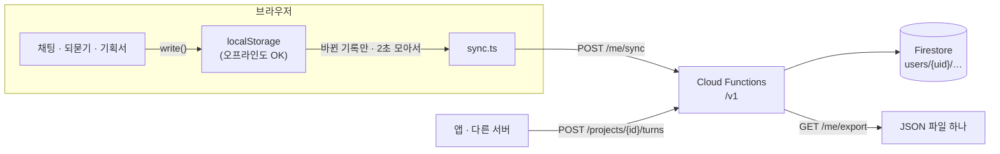
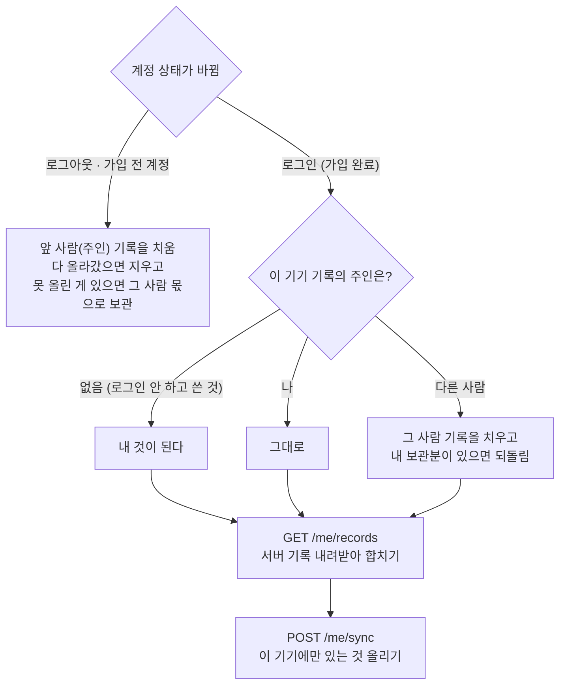
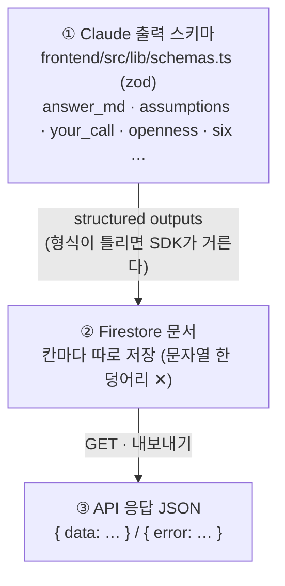
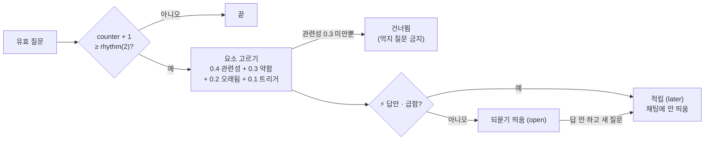
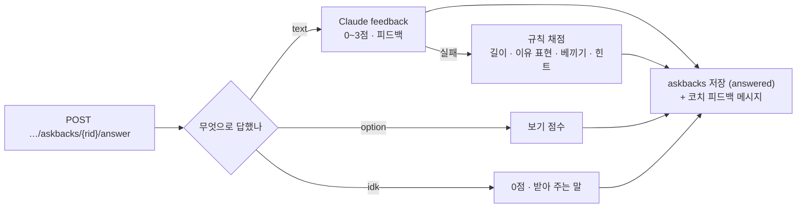
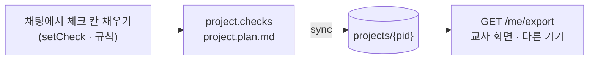
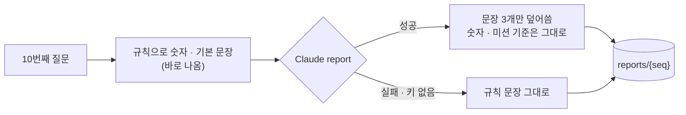
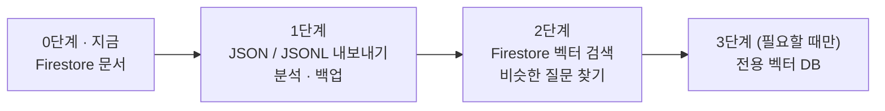

# AskBack DB 저장 검토서 v1 — 질문 · 답 · 되묻기를 회원별로 남긴다

> 2026-11-20 · 대상: `firebase/functions` (REST API) · `frontend/src/lib/sync.ts`
> 시험: `node firebase/scripts/records-smoke.mjs` 전부 통과 (되묻기 답하기 포함) · 기존 `npm run smoke` 41개 항목 통과 (에뮬레이터) · Claude 코치 호출은 가짜 Anthropic 서버로 요청 모양 · 응답 읽기 확인

---

## 0. 한눈에 — 질문에 대한 답

| 질문 | 답 | 이유 |
|---|---|---|
| 유저별 DB를 만들고 질문 · 답을 저장? | ✅ **만들었음.** `users/{uid}/projects/{pid}/turns · messages · askbacks` | 문서 경로에 uid가 들어가 있어 남의 기록은 경로부터 다르다 |
| JSON 파일로 구조화해서 보낼까? | **파일이 아니라 문서(document)로 저장**하고, 필요할 때 `GET /me/export`가 JSON 파일 하나로 묶어 준다 | 파일 통째로 저장하면 한 줄 고칠 때마다 전체를 다시 써야 하고, 검색 · 통계가 안 된다 |
| Firebase에서 답을 JSON으로 구조화하는 법? | 3층: **Claude 출력 스키마 → Firestore 필드 → API JSON** (§2) | 답을 문자열 하나로 넣지 않고 `md · assumptions · yourCall · role`처럼 칸을 나눠야 리포트 · 통계가 바로 읽는다 |
| Python으로 할까? | **API는 지금처럼 TypeScript**, Python은 **분석 · 배치용**으로만 (§7) | 분석기 · 되묻기 규칙 · 출력 스키마를 프런트와 **같은 파일**로 쓰고 있다. Python으로 옮기면 규칙이 두 벌이 된다 |
| 2문 1역 되묻기도 잘 되나? | 브라우저: ✅ 원래 됨 · 서버 API: ❌ 없었음 → ✅ **이번에 넣음** — 생성 · Claude 다듬기 · Claude 채점까지 (§3) | 서버 `POST …/turns`가 카운터만 올리고 되묻기를 만들지 않았다 |
| 기획서.md에서 백엔드 역할? | **만들기는 브라우저(규칙), 보관 · 내보내기는 서버** (§4) | 체크 칸을 채우는 건 규칙이라 즉시 · 무료여야 한다 |
| 10문 리포트도 Claude? | **숫자는 규칙, 문장 3개만 Claude** — ✅ 만들었음 (§5) | 점수가 Claude 기분에 따라 바뀌면 리포트끼리 비교가 안 된다 |
| Claude가 만든 질문 · 답도 DB에? | ✅ 답 · 되묻기 · 채점 · 심화 질문 모두 `source: "claude"`로 저장 (§6) | |
| JSON · 벡터 DB 운영 가이드? | **지금은 Firestore 하나로 충분.** 비슷한 질문 찾기가 필요해지면 Firestore 벡터 검색 (§8) | 따로 벡터 DB를 두면 지울 곳이 두 군데가 된다 (탈퇴 · 만 14세 미만) |
| REST 규약에 맞나? | **대체로 맞다** (리소스 경로 · 메서드 · 상태 코드 · 멱등 PUT). 예외는 §9 | |

---

## 1. 저장 흐름



**두 길이 있는 이유**

| 길 | 누가 쓰나 | 답을 만드는 곳 | 저장 |
|---|---|---|---|
| ① 브라우저 먼저 → `POST /me/sync` | 지금 웹 앱 | Next `/api/turn` (Claude) · 로컬 답 카드 | 로그인했으면 바뀐 기록만 올림 |
| ② 서버에서 묻기 `POST /projects/{id}/turns` | 모바일 앱 · 외부 연동 · curl | Cloud Functions (Claude) | 서버가 바로 저장 |

같은 Firestore에 같은 모양으로 쌓이므로, 내보내기 · 리포트 · 관리자 화면은 길을 구분하지 않는다.

**동기화 규칙** (`frontend/src/lib/sync.ts`)

| 규칙 | 예 |
|---|---|
| 기록마다 지문(JSON 해시)을 기억해 두고, **바뀐 것만** 보낸다 | 질문 1개 → 프로젝트 1 + 질문 1 + 메시지 2 = 4건 |
| 한 번에 300건씩 (서버 한도 400) | 처음 로그인한 날 예전 기록 900건 → 3번에 나눠 |
| **같은 id는 덮어쓰기** (멱등) | 네트워크가 끊겨 두 번 보내도 질문 수는 그대로 |
| 프로젝트가 먼저, 기록이 뒤 | 프로젝트 없이 기록만 오면 `422 unknown_project` |
| 사진 원본은 올리지 않고 장 수만 | `images: [3장]` → `imageCount: 3` (문서 한도 1MB 보호) |
| 가입 전 · 로그아웃 · 정지(401 · 403) → 조용히 쉰다 | 다시 로그인하면 이어서 |
| 예시 프로젝트(`prj_example_…`)는 올리지 않는다 | 예시를 불러와도 내 계정 기록이 되지 않는다 |

### 1-1. 기록 주인 — 이 기기의 기록은 누구 것인가

화면은 언제나 localStorage를 읽는다(빠르고 오프라인에서도 동작). 대신 **그 기록이 누구 것인지** `askback:owner`에 적어 두고, 계정이 바뀔 때마다 맞춘다. 주인은 Firebase 로그인이 아니라 **가입까지 마친 계정**이다 — 가입 중인 계정으로는 기록이 새지 않는다.



**합치는 규칙**

| 경우 | 남는 것 |
|---|---|
| 이 기기에서 바꾸고 아직 못 올린 기록 | 이 기기 것 |
| 양쪽에 다 있는 기록 | 서버 것 (다른 기기에서 고쳤을 수 있다) — 사진은 이 기기 것을 살린다 |
| 서버에만 있는 기록 | 내려받는다 |
| 이 기기에만 있는 기록 | 남기고 다음 올리기 때 올린다 |
| 리포트 번호(index)가 겹침 | 뒤의 것에 새 번호 |

**브라우저 시험 (에뮬레이터, 2026-11-20)**

| 시나리오 | 결과 |
|---|---|
| ① 로그인 전에 질문 → A 가입 | ✅ A 계정에 올라감 · 예시 프로젝트는 안 올라감 |
| ② 같은 기기에서 B로 로그인 | ✅ A 기록이 화면에서 사라짐 · B가 화면에서 한 질문은 B 계정에만 |
| ③ A가 새 기기에서 로그인 | ✅ A의 질문 Q1과 그 답이 대화에 이어서 보임 · B 것은 없음 |
| ④ 로그아웃 | ✅ 화면이 빈 시작 화면으로 · 이름표 "친구"로 |

설정의 "🗑 전부 지우기"는 로그인 중이면 **이 기기에서 지우고 로그아웃**한다 (계정 기록은 서버에 남아 다시 로그인하면 돌아온다). 서버 기록까지 지우는 길은 탈퇴(`DELETE /me`)다.

---

## 2. JSON 구조화 — 3층



| 층 | 어디 | 핵심 |
|---|---|---|
| ① 출력 스키마 | `schemas.ts` · `prompts.json` | Claude에게 **칸이 정해진 JSON**으로만 답하게 한다. 이미 쓰고 있음 (`messages.parse` + `zodOutputFormat`) |
| ② 문서 | Firestore | Firestore 문서가 곧 JSON이다. `JSON.stringify` 해서 넣지 않는다 — 그러면 `where("role", "==", …)` 같은 검색이 안 된다 |
| ③ 응답 | REST | 성공 `{ "data": … }`, 실패 `{ "error": { code, message, details } }` |

### 2-1. Firestore 구조

```
users/{uid}                          회원 · 통계(stats.projects · turns · askbacks)
 ├─ usage/{2026-11-20}               하루 질문 수 · 토큰
 └─ projects/{pid}                   프로젝트 · 기획서 체크 칸 · 리듬(counter · barIndex)
     ├─ turns/{tid}                  질문 하나 + 분석
     ├─ messages/{mid}               대화 한 줄 (user · answer · coach · rq · deepQ)
     ├─ askbacks/{rid}   ← 새로 생김   되묻기 + 학생 답 + 점수
     └─ reports/{seq}    ← 새로 생김   10문 리포트 (숫자 + 문장 3개 + writtenBy)
llmCalls/{id}                         Claude 호출 기록 (모델 · 토큰 · 걸린 시간 · 실패 이유)
config/llm                            모델 설정
```

### 2-2. 문서 예시

`turns/{tid}` — 질문 하나

```json
{
  "n": 2, "windowIndex": 1, "barIndex": 0,
  "question": "펌프를 몇 초 켰다가 끄는 게 좋을까? 화분은 지름 15cm 정도야.",
  "analysis": { "openness": "O3", "six": { "why": 0, "context": 1, "constraint": 1, "criteria": 0, "verify": 0, "discard": 0 }, "stage": "구현", "concepts": ["펌프 제어"] },
  "role": "engineer", "source": "claude", "model": "claude-sonnet-5", "createdAt": 1795161600000
}
```

`messages/{mid}` (kind: answer) — 그 질문의 답

```json
{
  "kind": "answer", "turnId": "JZ4t…", "source": "claude",
  "md": "짧게 켜고 기다렸다가 다시 재는 방식이 안전해. …",
  "role": "engineer", "roleReason": "조건과 제약을 같이 줬으니 구현 방법을 같이 짜 봤어",
  "assumptions": ["펌프 유량은 1분에 1L 정도라고 가정"],
  "yourCall": ["몇 초 켤지 — 화분 크기로 직접 재 봐"],
  "createdAt": 1795161600001
}
```

`askbacks/{rid}` — 되묻기

```json
{
  "turnId": "JZ4t…", "windowIndex": 1, "barIndex": 0,
  "element": "rule", "axis": "algo", "form": "F3",
  "question": "네 제품이 '지금 움직여야 한다'고 판단하는 규칙을 한 문장으로 말하면?",
  "status": "answered", "answer": "흙이 다 마르기 전에 무게로 먼저 알 수 있어서",
  "score": 2, "feedback": "좋아, 이유까지 말했어.", "source": "local",
  "createdAt": 1795161600002, "answeredAt": 1795161700000
}
```

### 2-3. 내보내기 JSON (`GET /me/export`)

질문을 **질문 · 답 · 되묻기 한 묶음(qa)**으로 엮어서 돌려준다. `?projectId=`로 하나만, `?download=1`이면 파일로 받는다.

```json
{
  "schema": "teenspark.export/v1",
  "exportedAt": "2026-11-20T11:00:00.000Z",
  "user": { "uid": "…", "nickname": "서연", "grade": "중2" },
  "projects": [{
    "id": "3Rzg…", "name": "스마트 화분", "format": "product",
    "counts": { "questions": 3, "askbacks": 1, "answeredAskbacks": 1 },
    "qa": [{
      "n": 2, "question": "펌프를 몇 초 켰다가 끄는 게 좋을까?",
      "analysis": { "openness": "O3" },
      "answer": { "md": "…", "role": "engineer", "assumptions": ["…"], "yourCall": ["…"] },
      "askbacks": [{ "question": "…규칙을 한 문장으로 말하면?", "status": "answered", "answer": "…", "score": 2 }]
    }]
  }]
}
```

`schema` 값은 모양이 바뀔 때 `v2`로 올린다. 받는 쪽(Python 분석 · 교사용 화면)이 버전을 보고 읽는다.

---

## 3. 2문 1역 — 되묻기 검토



| 항목 | 브라우저 (웹 앱) | 서버 API — 전 | 서버 API — 지금 |
|---|---|---|---|
| 2문마다 되묻기 생성 | ✅ | ❌ 카운터만 올라감 | ✅ 같은 `rq.ts` 규칙 |
| 카운터 리셋 · 마디 +1 | ✅ | ❌ | ✅ |
| 새 질문이 오면 열린 되묻기 → 나중에 | ✅ | ❌ | ✅ |
| ⚡ 답만 · 급함 → 적립 | ✅ | ❌ | ✅ |
| 되묻기 문장 Claude로 다듬기 (`rq` 태스크) | ✅ | ❌ | ✅ 띄울 것만 다듬음 (적립은 템플릿). 실패하면 템플릿 · `source` 로 구분 |
| 학생 답 채점 (`feedback` 태스크) | ✅ Claude → 실패 시 규칙 | ❌ | ✅ `POST …/askbacks/{rid}/answer` — 글: Claude → 실패 시 규칙 · 보기: 보기 점수 · 모름: 0점 · `gradedBy` 로 구분 |
| DB 저장 | ❌ (localStorage만) | ❌ | ✅ `askbacks` |

시험 결과 (에뮬레이터):

| 순서 | 결과 |
|---|---|
| 질문 1 | 되묻기 없음 · counter 1 |
| 질문 2 | 되묻기 "네 제품이 '지금 움직여야 한다'고 판단하는 규칙을 한 문장으로 말하면?" · counter 0 · barIndex 1 |
| 질문 3 (되묻기에 답 안 함) | 앞 되묻기 → `later` · 새 되묻기 없음 |

**규칙은 한 곳:** 채점 규칙과 Claude 입력 만들기는 `frontend/src/lib/grade.ts` 하나에 있고, 브라우저(`engine.ts`)와 서버가 같이 쓴다.

**모델:** 되묻기 · 채점은 짧은 JSON 하나라서 답하는 모델과 따로 `tasks.coach`(기본 `claude-sonnet-5-5` · effort `low` · 30초)를 쓴다. 관리자가 `PATCH /admin/settings/llm`에 `{"tasks":{"coach":{"model":"claude-haiku-5-5"}}}`처럼 바꿀 수 있다. 호출은 `llmCalls`에 `task: "rq" | "feedback"`으로 남고 토큰은 그날 사용량에 더해진다.

**되묻기 답하기 흐름**



| 경우 | 응답 |
|---|---|
| 정상 | `200 { askback, coachMessage }` |
| text · option · idk 중 하나가 아님 | `400 invalid_input` |
| 없는 보기 번호 | `400 invalid_input` |
| 없는 되묻기 | `404 not_found` |
| 이미 답함 | `409 already_answered` (고치려면 `PUT`) |

---

## 4. 기획서.md — 백엔드 역할



| 일 | 맡는 곳 | 이유 |
|---|---|---|
| 체크 칸 채우기 · md 조립 | **브라우저 (규칙)** | 학생이 누르는 즉시 보여야 한다. Claude를 부르면 느리고 돈이 든다 |
| 답 속 "기획서에 남길 한 줄" 고르기 | 지금은 예시 시나리오 JSON만 (`planNote`) → 다음 단계에서 Claude `answer` 출력에 칸 추가 | 문장 요약은 AI가 잘한다 |
| 저장 · 다른 기기에서 열기 | **서버** (`projects/{pid}.checks · plan`) | 기기를 바꿔도 이어서 |
| 내보내기 · 교사 확인 | **서버** (`/me/export`) | |
| 버전 기록 (어제 기획서 vs 오늘) | 서버 (다음 단계: `projects/{pid}/planVersions/{n}`) | 리포트에서 "이번 10문 동안 기획서가 이렇게 자랐어"를 보여 줄 수 있다 |

---

## 5. 10문 리포트 — Claude를 쓸까?

**추천: 숫자는 규칙, 문장만 Claude.**

| 리포트 칸 | 지금 | 추천 | 이유 |
|---|---|---|---|
| 열림 O1~O5 분포 · 6요소 · 국면 · 역할 | 규칙 | **규칙 유지** | 같은 기록이면 같은 숫자가 나와야 리포트끼리 비교된다 |
| 되묻기 점수 · 막힌 개념 | 규칙 | **규칙 유지** | |
| 한 줄 요약 (headline) | 템플릿 | **Claude** | "이번엔 무게 센서로 방향을 바꾼 게 컸어"처럼 그 학생 말로 |
| 다음 미션 문장 | 템플릿 | **Claude가 다듬기** (미션 고르기는 규칙) | 무엇을 할지는 규칙, 어떻게 말할지는 AI |
| 기획서 변화 한 줄 | 없음 | **Claude** | §4 버전 기록이 생기면 |

| 비교 | 전부 규칙 | 전부 Claude | **숫자 규칙 + 문장 Claude** |
|---|---|---|---|
| 같은 기록 → 같은 점수 | ✅ | ❌ | ✅ |
| 학생 맞춤 문장 | ❌ | ✅ | ✅ |
| 비용 | 0 | 10문마다 큰 호출 1번 | 10문마다 **작은 호출 1번** (입력: 숫자표 + 질문 10줄) |
| Claude 실패 시 | — | 리포트 없음 | 템플릿 문장으로 그대로 나옴 |

**만든 것 (브라우저 · 서버 같은 규칙)**

| 칸 | 누가 | 파일 |
|---|---|---|
| 숫자 (열림 · 6요소 · 역할 · 되묻기 · 걸린 개념 · 미션 기준) | 규칙 `buildWindowReport` | `frontend/src/lib/report.ts` |
| 제목 `headline` · 베스트 이유 `best.reason` · 미션 문장 `nextMission.text` | Claude `report` 태스크 → 실패하면 규칙 문장 | `reportAi.ts` · `prompts.json` `report` · `schemas.ts` `ReportSchema` |
| 누가 썼나 | `writtenBy: "claude" \| "local"` | |



- 브라우저: 리포트는 규칙으로 **바로** 뜨고, Claude 문장이 오면 학생이 아직 열지 않았을 때만 바꿔 끼운다 (읽는 중에 글이 바뀌지 않게).
- 서버: `POST …/turns`의 10번째 응답에 `report`가 담겨 오고, 대화에 "📄 1번째 리포트가 나왔어" 알림이 남는다.
- 학생이 미션을 자기 말로 고치면(`editedByStudent`) Claude가 다시 덮지 않는다.

비용 감: 10문에 1번이고, 입력이 질문 10줄 + 숫자표라 **질문 1개에 답하는 호출보다 작다**. 빠른 모델(`claude-haiku-5-5`)로도 충분하다. 저장은 `users/{uid}/projects/{pid}/reports/{seq}`(문서 id = 몇 번째 리포트)에 하고, 호출은 `llmCalls`에 `task: "report"`로 남는다. 모델은 되묻기 · 채점과 같은 `tasks.coach`.

---

## 6. Claude가 만든 것 — 어디에 저장되나

| Claude 태스크 | 만드는 것 | 저장 위치 | 표시 |
|---|---|---|---|
| `answer` | 답 · 가정 · 학생이 정할 것 · 역할 | `messages` (kind: answer) + `turns.analysis` | `source: "claude"` · `model` |
| `rq` | 되묻기 문장 다듬기 · 보기 | `askbacks` | `source` |
| `feedback` | 학생 답 점수 · 피드백 | `askbacks.score · feedback` | |
| `deep` | 심화 질문 · 답 | `messages` (kind: deepQ) | |
| (모두) | 모델 · 토큰 · 걸린 시간 · 실패 이유 | `llmCalls` | 서버 길만 (§10) |

**원문 프롬프트 전체는 저장하지 않는다.** 시스템 프롬프트는 `prompts.json`에 버전으로 있고, 학생 입력과 Claude 출력은 위 칸에 이미 있다. 같은 것을 두 번 저장하면 탈퇴할 때 지울 곳만 늘어난다 (만 14세 미만 학생 데이터).

---

## 7. Python을 쓸까?

| 일 | 언어 | 이유 |
|---|---|---|
| REST API · Claude 호출 · 저장 | **TypeScript (지금 그대로)** | 분석기 · 되묻기 규칙 · 출력 스키마 · 답 카드를 프런트와 **같은 파일**로 번들한다. 고칠 곳이 한 곳 |
| 통계 · 연구 · 교사용 엑셀 | **Python** | pandas · 그래프가 편하다 |
| 프롬프트 품질 시험 (같은 질문 100개 돌려 보기) | Python 또는 Node | `scripts/validate_scenario.py`가 이미 Python |

Python은 **내보내기 JSON을 읽기만** 하면 된다:

```python
import json, pandas as pd

data = json.load(open("teenspark-2026-11-20.json"))
rows = [
    {"project": p["name"], "n": q["n"], "openness": (q["analysis"] or {}).get("openness"),
     "role": q["role"], "askbacks": len(q["askbacks"]),
     "score": next((a["score"] for a in q["askbacks"] if a["score"] is not None), None)}
    for p in data["projects"] for q in p["qa"]
]
df = pd.DataFrame(rows)
print(df.groupby("openness").size())          # 열림 분포
print(df["score"].mean())                     # 되묻기 평균 점수
```

여러 학생을 한꺼번에 볼 때는 `firebase-admin` (Python)으로 `collection_group("turns")`를 읽거나, 아래 §8의 BigQuery 내보내기를 쓴다.

---

## 8. JSON · 벡터 DB 운영 가이드



| 단계 | 언제 | 무엇 | 예 |
|---|---|---|---|
| **0 · 지금** | 바로 | Firestore가 원본. 질문 · 답 · 되묻기가 칸별로 | 학생 한 명의 기록 열기 · 리포트 |
| **1 · JSON** | 학생 수백 명 | `/me/export` (학생 한 명) · 관리자용 JSONL 일괄 내보내기 · Firebase **BigQuery Export 확장** | "중2가 O1 질문을 가장 많이 하는 단계는?" |
| **2 · 벡터 검색** | 질문이 수천 개 넘고 "비슷한 질문"이 필요할 때 | `turns`에 `embedding` 칸을 더하고 **Firestore 벡터 검색(`findNearest`)** | 답 카드 고르기 · "다른 친구들은 여기서 이렇게 물었어" · 같은 질문 반복 감지 |
| **3 · 전용 벡터 DB** | 벡터 수백만 개 · 키워드+의미 섞은 검색이 필요할 때 | pgvector · Pinecone 등 | 지금은 필요 없음 |

**왜 Firestore 벡터 검색부터인가**

| | Firestore 벡터 검색 | 전용 벡터 DB 따로 |
|---|---|---|
| 탈퇴 · 프로젝트 삭제 | `recursiveDelete` 한 번에 같이 지워짐 | 두 곳에서 지워야 함 (놓치면 개인정보 사고) |
| 권한 | 경로에 uid — 그대로 | 따로 맞춰야 함 |
| 운영 | 추가 서버 없음 | 서버 · 요금 · 동기화 하나 더 |

**임베딩 만드는 곳:** Claude API는 임베딩을 만들지 않는다. Anthropic이 권하는 Voyage AI 같은 임베딩 API를 쓴다. 질문을 저장할 때(서버 `runTurn` · `/me/sync`) 함께 만들어 `embedding` 칸에 넣는다.

**벡터에 넣을 것 · 넣지 않을 것**

| 넣는다 | 넣지 않는다 |
|---|---|
| 학생 질문 · 답 카드 · 되묻기 템플릿 | 이름 · 학년 · 이메일 |
| | 마음이 힘든 신호(emotional)로 걸린 대화 |
| | 만 14세 미만 학생의 글 (보호자 동의 범위 확인 전까지) |

---

## 9. REST 규약 점검

| 규칙 | 상태 | 예 |
|---|---|---|
| 자원은 명사 경로, 계층은 경로로 | ✅ | `/projects/{id}/turns/{tid}` · `/projects/{id}/askbacks/{rid}` |
| GET은 읽기만 (부작용 없음) | ✅ | |
| POST = 새로 만들기 → `201` | ✅ | `POST /projects` → 201 · `POST …/turns` 답했으면 201, 잡담이면 200 (새 자원 없음) |
| PUT = 이 id로 통째로 저장, 멱등 → 새로 `201` / 덮어쓰기 `200` + `Location` | ✅ 새로 | `PUT …/turns/t_put1` 처음 201, 다시 200 |
| PATCH = 보낸 칸만 | ✅ | `PATCH /projects/{id}` · `PATCH /me` |
| DELETE | ✅ (200 + `{deleted:true}`; 204도 규약상 OK) | |
| 상태 코드 | ✅ | 400 입력 · 401 토큰 없음 · 403 권한 · 404 없음 · 409 중복 · 422 부모 없음 · 429 하루 한도 · 503 Claude 불가 |
| 남의 자원 | ✅ 404 (있다는 것도 알려 주지 않음) | 다른 학생 토큰으로 `GET …/askbacks` → 404 |
| 버전 | ✅ `/v1` | |
| 오류 모양 통일 | ✅ `{ error: { code, message, details } }` | |
| 목록 페이지 나누기 | 🟡 `messages`만 `?before=` 커서. `turns`는 `limit`만 | 질문이 200개 넘으면 커서 필요 |

**규약에서 벗어난 곳 (일부러)**

| 경로 | 왜 동사인가 | 판단 |
|---|---|---|
| `POST /auth/login · logout · refresh` | 자원이 아니라 행동 | 업계 관례. 유지 |
| `POST /ask` · `POST …/turns/stream` | "묻기" 행동 · SSE 스트림 | 유지 |
| `POST …/askbacks/{rid}/answer` | 답하기 + 채점(Claude) — 같은 답도 채점이 매번 같지 않아 PUT(멱등)이 아니다 | 유지. 결과를 그대로 다시 쓰고 싶으면 `PUT …/askbacks/{rid}` |
| `POST /me/sync` | 여러 종류 자원을 한 번에 (배치) | 요청 수를 300분의 1로 줄인다. 같은 일을 `PUT …/{kind}/{id}`로 하나씩도 할 수 있다 |

결론: **Richardson 성숙도 2단계**(자원 + HTTP 메서드 + 상태 코드). 응답에 다음 링크를 싣는 3단계(HATEOAS)는 앱 하나가 쓰는 API라 필요 없다.

---

## 10. 새로 생긴 API

| 메서드 | 경로 | 하는 일 |
|---|---|---|
| POST | `/me/sync` | 브라우저 기록 묶음 올리기 `{ projects[], turns[], messages[], askbacks[], reports[] }` (합쳐서 400개까지) → `{ saved, created }` |
| GET | `/me/records` | 내 기록 전부를 **브라우저 저장 모양 그대로** — 로그인한 기기가 내려받아 합친다 (§1-1) |
| GET | `/me/export?projectId=&download=1` | 내 기록 전부를 JSON 하나로 (§2-3) |
| GET | `/projects/{id}/turns/{tid}` | 질문 하나 = 질문 + 답 + 되묻기 |
| GET | `/projects/{id}/askbacks?status=open` | 되묻기 목록 (`open` · `answered` · `later`) |
| GET | `/projects/{id}/askbacks/{rid}` | 되묻기 하나 |
| GET | `/projects/{id}/reports` | 리포트 목록 (제목 · 범위 · 누가 썼나) |
| GET | `/projects/{id}/reports/{seq}` | 리포트 한 장 JSON · `Accept: text/markdown` 또는 `?format=md`면 **.md (화면과 같은 8칸)** |
| PATCH | `/projects/{id}/reports/{seq}` | `{ opened }` · `{ missionText }` — 열었음 · 미션을 내 말로 |
| POST | `/projects/{id}/askbacks/{rid}/answer` | 되묻기에 답하기 `{ text }` · `{ option }` · `{ idk: true }` → 채점 · 피드백 (§3) |
| PUT | `/projects/{id}/{turns · messages · askbacks}/{rid}` | 하나씩 저장 (새로 201 · 덮어쓰기 200) |
| (바뀜) POST | `/projects/{id}/turns` | 응답에 `askback` 칸 추가 — 2문째에 되묻기가 생기면 담겨 온다 (Claude로 다듬은 것) |
| (바뀜) POST | `/projects/{id}/turns` | 10번째 질문이면 응답에 `report` 칸 |
| (바뀜) PATCH | `/admin/settings/llm` | `tasks.coach` (되묻기 · 채점 · 리포트 문장 모델) 추가 |

---

## 11. 남은 일

~~서버에 `rq` · `feedback` Claude 태스크 옮기기~~ ✅ 완료
~~10문 리포트 서버 저장 + 문장만 Claude~~ ✅ 완료
~~기록 주인 · 다른 기기에서 내려받아 합치기 · 로그아웃하면 치우기~~ ✅ 완료

| 순서 | 할 일 | 크기 |
|---|---|---|
| 1 | 브라우저 길의 Claude 호출도 `llmCalls`에 남기기 (지금은 Next `/api/turn`이 직접 불러 기록이 없음) | 소 |
| 2 | 생각 노트(`notes`) · 다음 달 목표(`goals`)도 동기화 | 소 |
| 3 | `turns` 목록 커서 페이지 · `/me/records` 나눠 받기 (기록이 수천 개가 되면) | 소 |
| 4 | 못 올린 기록을 보관한 채 다른 사람이 로그인하는 경우 브라우저 시험 (규칙은 넣었고 화면 시험은 아직) | 소 |
