# AskBack 서버 설계서 v1 — REST API · DB · 알고리즘 · Claude 프롬프트/JSON 가이드

> **한 줄 요약** — 지금은 브라우저(localStorage)가 DB 역할을 하고, 판정·코칭 로직도 전부 브라우저에서 돈다. 서버는 Claude를 그대로 불러 주는 `/api/turn` 하나뿐이다.
> 이 문서는 **"Claude API를 안전하게 붙이고, 기록을 서버 DB에 남기는 서버"** 를 만들기 전에 그 설계를 확정한다.
>
> - 대상 코드: `frontend/src/lib/*` (types · db · engine · analyzer · rq · report · actions), `frontend/src/data/prompts.json`, `frontend/src/app/api/turn/route.ts`
> - 표기: *(현재)* = 지금 코드에 있는 것 · *(신규)* = 이 문서에서 새로 정하는 것 · *(앱 예시)* = 시나리오 JSON의 실제 문장 · *(가상)* = 설명용 예

---

## 목차

| # | 장 | 담는 것 |
|---|---|---|
| 0 | [왜 서버가 필요한가](#0-왜-서버가-필요한가) | 지금 구조의 한계 · 서버가 가져갈 일 |
| 1 | [전체 구조](#1-전체-구조) | 구성도 · 책임 나누기 · 기술 선택 |
| 2 | [DB 설계](#2-db-설계) | ERD · 테이블 정의 · 인덱스 · localStorage 대응표 |
| 3 | [REST API 설계](#3-rest-api-설계) | 공통 규칙 · CRUD 지도 · 엔드포인트별 JSON |
| 4 | [알고리즘](#4-알고리즘) | 한 턴 파이프라인 · 관문 · 분석 · 리듬 · 역질문 선택 · 채점 · 리포트 |
| 5 | [Claude 연결 · 프롬프트 · JSON 가이드](#5-claude-연결--프롬프트--json-가이드) | 프롬프트 층 · 역할별 스키마 · 검증/복구 · 폴백 |
| 6 | [오류 코드](#6-오류-코드) | HTTP · 업무 오류 |
| 7 | [보안 · 개인정보](#7-보안--개인정보) | 미성년자 데이터 · 키 관리 · 남용 방지 |
| 8 | [옮기는 순서](#8-옮기는-순서) | 단계도 · 완료 기준 |

---

## 0. 왜 서버가 필요한가

### 0-1. 지금 구조 *(현재)*

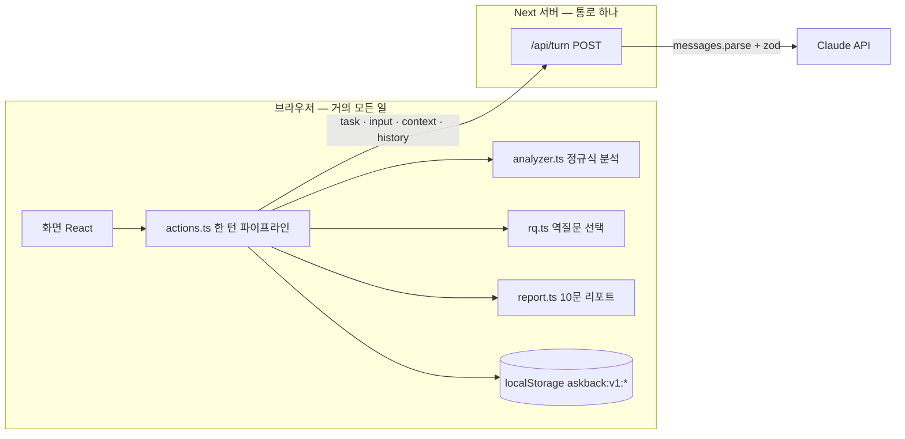

### 0-2. 그래서 생기는 문제

| 문제 | 지금 모습 | 왜 곤란한가 | 서버가 생기면 |
|---|---|---|---|
| 기록이 기기에 갇힘 | localStorage 키 11개 | 폰↔PC 이어 쓰기 불가, 캐시 지우면 전부 사라짐 | DB에 남고 어느 기기에서나 이어 씀 |
| 판정이 조작 가능 | 점수·리포트를 브라우저가 계산 | 리포트·월간 성장 기록을 학교·대회에 쓰기 어려움 | 점수·리포트는 **서버가 계산한 것만** 인정 |
| `/api/turn`이 열린 통로 | 아무 `task`·`input`이나 받음 | 누구나 우리 키로 Claude를 마음대로 호출 | 인증 + 사용량 한도 + 입력 검증 |
| 비용을 모름 | `usage`를 응답에만 실음 | 학생당·작업당 비용을 모르니 가격을 못 정함 | `llm_calls` 테이블에 토큰·지연·캐시 적중 기록 |
| 프롬프트 바꾸면 추적 불가 | `prompts.json` 하나 | 어느 답이 어느 프롬프트로 나왔는지 모름 | 호출마다 `prompt_version` 저장 |
| 교사·보호자 화면 불가 | 데이터가 학생 기기에만 | 반 단위 리포트 같은 확장 막힘 | 같은 DB 위에 나중에 붙임 |

### 0-3. 서버가 가져갈 일 · 브라우저에 남길 일

| 일 | 서버 | 브라우저 | 이유 |
|---|:-:|:-:|---|
| Claude 호출 (답·역질문·채점·심화) | ✅ | | 키 보호 · 비용 기록 |
| 관문 판정(잡담·중복·정서) | ✅ | ✅(미리보기) | 서버가 최종. 브라우저는 즉시 반응용 |
| 개방도·6요소 분석 | ✅ | | 리포트 근거가 되는 값 |
| 2문 1역 리듬 · 역질문 선택 | ✅ | | 카운터 조작 방지 |
| 역질문 채점 | ✅ | | 점수는 서버만 |
| 10문 리포트 · 월간 리포트 | ✅ | | 같은 8칸 형식을 한 곳에서 계산 |
| 기획서.md 조립 · .md 내보내기 | ✅(저장) | ✅(렌더) | 원본은 DB, 보기는 화면 |
| 우주 배경 꾸미기(`space`) | | ✅ | 기기 취향 — 서버에 올리지 않는다 |
| 서버 없을 때 로컬 답 카드 | | ✅ | 오프라인 폴백은 그대로 유지 |

---

## 1. 전체 구조

### 1-1. 구성도 *(신규)*

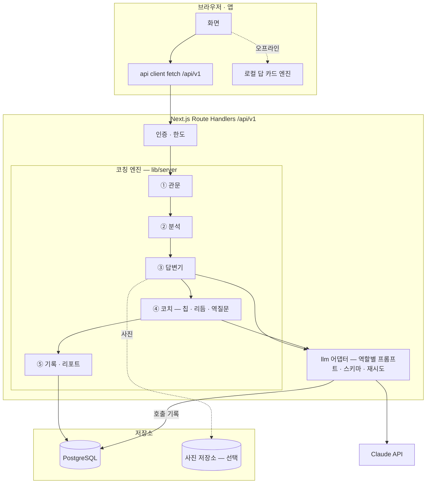

### 1-2. 기술 선택

| 칸 | 추천 | 다른 길 | 추천 이유 | 이 추천이 틀리는 조건 |
|---|---|---|---|---|
| 서버 | **Next.js Route Handlers** (같은 저장소 `frontend/src/app/api/v1`) | 별도 FastAPI · NestJS | 이미 `/api/turn`이 Next에 있고, `lib/*` 로직(TypeScript)을 그대로 서버로 옮길 수 있다 | 동시 접속이 매우 많거나 긴 작업 큐가 필요해지면 별도 서버로 뺀다 |
| DB | **PostgreSQL** (Neon · Supabase 등 관리형) | SQLite · MongoDB | 리포트 집계(그룹·합계)가 많고, `analysis` 같은 반쯤 정해진 값은 JSONB로 담을 수 있다 | 1인 로컬 데모만 할 거라면 SQLite로 충분 |
| ORM | **Drizzle** | Prisma | 타입이 `types.ts`와 가깝고 SQL이 그대로 보인다 | 팀이 Prisma에 익숙하면 Prisma |
| 검증 | **zod** (이미 사용 중) | | `schemas.ts`를 요청·응답·Claude 출력 검증에 같이 쓴다 | — |
| 인증 | **익명 기기 토큰 → 나중에 계정 연결** | 처음부터 소셜 로그인 | 중학생은 가입 단계에서 이탈. 먼저 쓰고, 기록을 지키고 싶을 때 연결 | 학교 단위 도입이면 처음부터 학교 계정 |
| Claude SDK | `@anthropic-ai/sdk` `messages.parse` + `zodOutputFormat` (이미 사용 중) | | 구조화 출력이 스키마를 보장 | — |

### 1-3. 폴더 구조 *(신규)*

```
frontend/src/
├─ app/api/v1/
│  ├─ auth/            device · link
│  ├─ me/              프로필 · 상태 · 목표
│  ├─ projects/[id]/   CRUD + turns · messages · rqs · reports · notes · plan · deep
│  ├─ rqs/[id]/        답하기 · 힌트 · 나중에 · 모르겠어
│  ├─ reports/[id]/    조회 · 열람 표시 · .md
│  ├─ monthly/[ym]/    월간 리포트
│  └─ import/          localStorage → 서버 옮기기
├─ lib/server/         ← lib/* 중 판정 로직을 옮겨 온 곳 (브라우저에서 import 금지)
│  ├─ gate.ts  analyze.ts  coach.ts  rq.ts  report.ts  mission.ts
│  ├─ llm/     client.ts  tasks.ts  prompts/  validate.ts
│  └─ db/      schema.ts  repo/*.ts
└─ lib/api.ts          ← 브라우저용 fetch 래퍼 (db.ts의 read/write 자리를 대신한다)
```

> `db.ts` 주석에 이미 *"나중에 서버 DB로 옮길 때는 이 파일의 read/write만 바꾸면 된다"* 고 되어 있다. 1단계에서는 그 약속대로 `read/write`를 `lib/api.ts` 호출로 바꾸는 데서 시작한다.

---

## 2. DB 설계

### 2-1. ERD

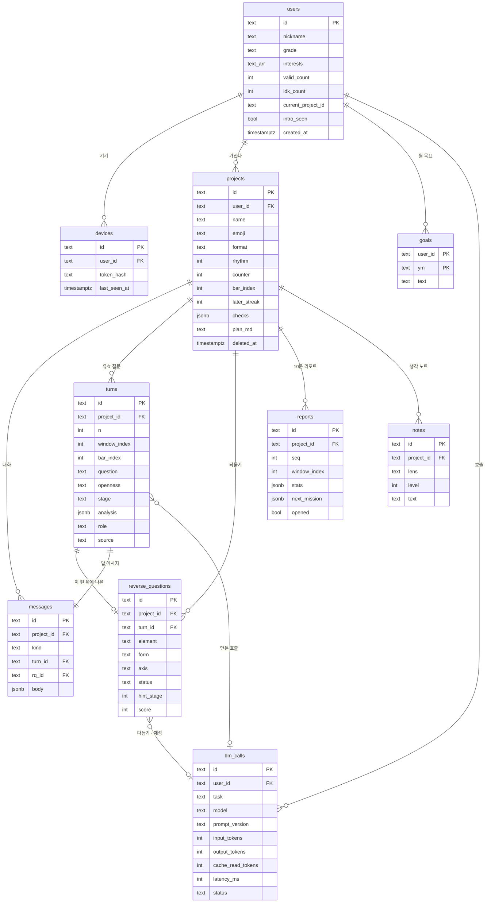

### 2-2. 설계 원칙

| 원칙 | 내용 | 예 |
|---|---|---|
| **ID는 지금 모양 그대로** | 접두사 + 랜덤 문자열 (`prj_…`, `t_…`, `rq_…`, `m_…`) | 브라우저에서 옮겨 온 데이터의 ID가 안 바뀐다 → 링크·참조 유지 |
| **집계할 값은 컬럼, 나머지는 JSONB** | 리포트에서 세는 값(`openness`, `stage`, `six_*`)은 컬럼으로 꺼내고, 전체 `analysis`는 JSONB로 원본 보관 | "이번 달 O3 몇 번" → 컬럼 `GROUP BY` |
| **시간은 `timestamptz`, API는 ISO 8601** | 브라우저의 `Date.now()` 숫자는 옮길 때 변환 | `1758430920000` → `2025-09-21T05:02:00Z` |
| **지우기는 부드럽게** | `projects.deleted_at` 으로 숨김. 30일 뒤 실제 삭제 작업 | 실수로 지운 프로젝트 복구 |
| **서버가 계산한 값만 진짜** | `score`, `reports.stats`, `users.valid_count` 는 API로 직접 못 바꾼다 | PATCH 요청에 `score`가 있으면 무시 |
| **기기 취향은 안 올린다** | `space`(우주 배경)는 DB에 없다 | — |

### 2-3. 테이블 정의

#### `users` — 학생 *(localStorage `profile` + `state` + `introSeen`)*

| 컬럼 | 타입 | 제약 | 설명 | 예 |
|---|---|---|---|---|
| `id` | text | PK | `usr_…` | `usr_mf3k2a9x` |
| `nickname` | text | not null, ≤ 20자 | 화면 이름 (실명 받지 않음) | `민준` |
| `grade` | text | null | 학년 | `중2` |
| `interests` | text[] | default `{}` | 관심사 | `{메이커,식물}` |
| `valid_count` | int | default 0 | 전체 유효 질문 수 | `61` |
| `idk_count` | int | default 0 | "잘 모르겠어" 누른 수 | `3` |
| `current_project_id` | text | FK null | 마지막으로 연 프로젝트 | `prj_…` |
| `intro_seen` | bool | default false | 온보딩 소개 봤는가 | `true` |
| `linked_account` | text | null, unique | 계정 연결 시 (이메일 해시 등) | — |
| `created_at` / `updated_at` | timestamptz | | | |

#### `devices` — 익명 기기 토큰

| 컬럼 | 타입 | 설명 |
|---|---|---|
| `id` | text PK | `dev_…` |
| `user_id` | text FK → users | |
| `token_hash` | text unique | 토큰 원문은 저장하지 않고 SHA-256만 |
| `user_agent` | text | 기기 구분용 |
| `last_seen_at` | timestamptz | 90일 안 쓰면 만료 |

#### `projects` — 프로젝트 *(localStorage `projects`)*

| 컬럼 | 타입 | 제약 | 설명 | 예 *(앱 예시)* |
|---|---|---|---|---|
| `id` | text | PK | | `prj_smartpot` |
| `user_id` | text | FK, index | | |
| `name` | text | not null, ≤ 40 | | `스마트 화분` |
| `description` | text | ≤ 200 | `desc` | `상추 화분 — 센서에서 시작해 서버 · AI · 공유로` |
| `emoji` | text | | | `🌱` |
| `packs` | text[] | ⊂ {maker,share,collab,ai} | 켜 둔 팩 | `{maker,ai}` |
| `format` | text | null, ∈ {paper,research,campaign,service,product} | 초안 형식 | `product` |
| `rhythm` | smallint | ∈ {2,3,4}, default 2 | N문 1역 | `2` |
| `answer_only` | bool | default false | [⚡ 답만] | `false` |
| `counter` | smallint | 0 ≤ x < rhythm | 이번 마디에 쌓인 질문 | `1` |
| `bar_index` | int | default 0 | 마디 번호 | `5` |
| `later_streak` | smallint | default 0 | [나중에] 연속 횟수 | `0` |
| `checks` | jsonb | default `{}` | 체크 칸 key → 한 줄 | `{"scenario":"흙이 320 밑이면 3초 급수"}` |
| `plan_filename` | text | null | 기획서 파일 이름 | `스마트화분_기획서.md` |
| `plan_md` | text | null | 기획서.md 본문 | |
| `is_example` | bool | default false | 예시로 불러온 프로젝트 | `true` |
| `created_at` / `updated_at` / `deleted_at` | timestamptz | | | |

#### `turns` — 유효 질문 한 번 *(localStorage `turns`)*

| 컬럼 | 타입 | 설명 | 예 *(앱 예시 q61)* |
|---|---|---|---|
| `id` | text PK | | `t_…` |
| `project_id` | text FK, index | | |
| `user_id` | text FK | 집계용 중복 저장 | |
| `n` | int | 학생 전체 기준 번호 | `61` |
| `window_index` | int | 이 프로젝트의 몇 번째 리포트 구간 | `1` |
| `bar_index` | int | 마디 번호 | `0` |
| `question` | text | ≤ 4000자 | `흙 센서값이 400 밑이면 펌프 3초 켜는 코드 짜줘` |
| `openness` | text | O1~O5 · NA | `O2` |
| `stage` | text | 탐색 · 설계 · 구현 · 검증 | `구현` |
| `six_why` … `six_discard` | numeric(2,1) ×6 | 0 · 0.5 · 1 | `0, 1, 0, 0, 0, 0` |
| `analysis` | jsonb | `Analysis` 전체 원본 | `{signals:["spec"], concepts:["임계값"], …}` |
| `role` | text null | typist · coder · engineer · architect · encyclopedia | `coder` |
| `chip_used` | text null | widen · narrow · alt | `null` |
| `source` | text | claude · local | `claude` |
| `llm_call_id` | text FK null | 이 답을 만든 호출 | |
| `created_at` | timestamptz | | |

> **유일 조건**: `(project_id, window_index, n)`. 리포트는 `window_index`로 10개씩 묶는다.

#### `messages` — 대화 한 줄 *(localStorage `messages`)*

`Message`는 종류(`kind`)마다 모양이 다르다. 공통 칸은 컬럼, 종류별 칸은 `body` JSONB.

| 컬럼 | 타입 | 설명 |
|---|---|---|
| `id` | text PK | `m_…` |
| `project_id` | text FK, index `(project_id, created_at)` | |
| `kind` | text | user · answer · coach · rq · deepPick · deepQ |
| `turn_id` | text FK null | kind=answer 일 때 |
| `rq_id` | text FK null | kind=rq 일 때 |
| `body` | jsonb | 아래 표 |
| `created_at` | timestamptz | |

| kind | body 모양 | 예 |
|---|---|---|
| `user` | `{text, chip?, deep?, imageIds?}` | `{"text":"재봤어 — 마른 흙은 320쯤…"}` |
| `answer` | `{md, role, roleReason, riskNote?, assumptions[], yourCall[], chips[], planNote?, source}` | 규칙 카드 + 🙋 되묻기 |
| `coach` | `{md, actions?[]}` | `{"md":"요즘 바쁜 것 같아…","actions":[{"label":"3문 1역","action":"rhythm:3"}]}` |
| `rq` | `{}` (내용은 `reverse_questions`) | |
| `deepPick` | `{}` | |
| `deepQ` | `{lens, level, md}` | `{"lens":"philosophy","level":0,"md":"**🦉 철학 · L1** …"}` |

> 사진은 `body`에 data URL로 넣지 않는다. 저장소에 올리고 `imageIds`만 남긴다 (DB 크기 · 개인정보).

#### `reverse_questions` — 역질문 *(localStorage `rqs`)*

| 컬럼 | 타입 | 설명 | 예 |
|---|---|---|---|
| `id` | text PK | | `rq_…` |
| `project_id` · `turn_id` | text FK | 어느 턴 뒤에 나왔나 | |
| `window_index` · `bar_index` | int | | `1` · `0` |
| `element` | text | 평가 요소 ID (E1~E12, M*, S*, C*, A*, F*) | `E6` |
| `pack` | text null | | `null` |
| `form` | text | F1 고르기 · F2 빈칸 · F3 한두 문장 | `F1` |
| `axis` | text null | plan · algo · arch | `algo` |
| `question` | text | | `400이라는 숫자가 바뀌면 어디가 같이 바뀌어야 해?` *(가상)* |
| `benefit` | text null | 답하면 무엇이 세지나 | `기획서의 '판정 기준' 칸이 채워져` |
| `options` | jsonb null | F1 보기 `[{label,score}]` | |
| `hint` · `example` · `coach_view` | text | 힌트 3단 | |
| `expected_points` | text[] | | `{직접 잰 값,마른/젖은 사이}` |
| `selection_scores` | jsonb | 뽑힐 때 상위 3개 점수 (설명용) | `{"E6":0.71,"F2":0.64,"E3":0.52}` |
| `status` | text | open · answered · later | `answered` |
| `hint_stage` | smallint | 0~3 | `0` |
| `answer` · `score` · `reason` · `feedback` | text · smallint(0~3) · text · text | 채점 결과 (서버만 씀) | |
| `refine_call_id` · `grade_call_id` | text FK null | 다듬기 · 채점 호출 | |
| `created_at` · `answered_at` | timestamptz | | |

> **부분 유일 인덱스**: `UNIQUE (project_id) WHERE status = 'open'` — 열린 역질문은 프로젝트마다 하나뿐.

#### `reports` — 10문 리포트 *(localStorage `reports`)*

| 컬럼 | 타입 | 설명 |
|---|---|---|
| `id` | text PK | `rpt_…` (지금의 `index` 숫자는 `legacy_index`로 보관) |
| `project_id` | text FK | |
| `seq` | int | 그 프로젝트의 몇 번째 리포트 — 화면 제목 `"스마트 화분 · 1번째 리포트"` |
| `window_index` | int | 묶은 턴의 window |
| `headline` | text | `센서에서 공유까지 — 화분이 네 단을 올랐다` *(앱 예시)* |
| `turn_from` · `turn_to` | int | `1` · `10` |
| `stage` | text | 가장 많았던 단계 |
| `stats` | jsonb | 8칸 재료: `mix` · `roles` · `six` · `text` · `elements` · `stuck` · `best` · `mixComment` |
| `last_mission` | jsonb null | `{text, result, detail}` |
| `next_mission` | jsonb | `Mission` |
| `opened` | bool | 처음 열람했는가 |
| `period_from` · `period_to` · `created_at` | timestamptz | |

> **유일 조건**: `(project_id, seq)`. 같은 구간에 리포트가 두 장 생기지 않게 한다 (동시 요청 대비).

#### `notes` · `goals` · `llm_calls` · `idempotency_keys`

| 테이블 | 핵심 컬럼 | 설명 |
|---|---|---|
| `notes` | `id, project_id, lens, level(0~3), question, text, created_at` | 심화 대화의 생각 노트 |
| `goals` | `PK(user_id, ym), text` | `"2026-10"` → 다음 달 목표 |
| `llm_calls` | `id, user_id, project_id, task, model, effort, prompt_version, input_tokens, output_tokens, cache_read_tokens, cache_write_tokens, latency_ms, stop_reason, status(ok·invalid·refusal·error·timeout), error_code, created_at` | 호출 한 번 = 한 줄. **학생 원문은 넣지 않는다** (본문은 turns·messages에 이미 있음) |
| `idempotency_keys` | `PK(user_id, key), request_hash, response jsonb, created_at` | 같은 질문을 두 번 보내도 Claude는 한 번만 부른다. 24시간 보관 |

### 2-4. 인덱스

| 테이블 | 인덱스 | 쓰는 곳 |
|---|---|---|
| projects | `(user_id, updated_at DESC) WHERE deleted_at IS NULL` | 프로젝트 목록 |
| messages | `(project_id, created_at)` | 대화 불러오기 · 커서 페이지 |
| turns | `(project_id, window_index)` | 10문 묶기 |
| turns | `(user_id, created_at)` | 월간 리포트 |
| reverse_questions | `(project_id, element, status)` | 역질문 선택의 "약함 · 오래됨" 계산 |
| reverse_questions | `UNIQUE (project_id) WHERE status='open'` | 열린 역질문 하나 |
| reports | `UNIQUE (project_id, seq)` | |
| llm_calls | `(user_id, created_at)` · `(task, created_at)` | 하루 한도 · 비용 대시보드 |

### 2-5. localStorage → DB 대응표

| localStorage 키 *(현재)* | 테이블 *(신규)* | 옮길 때 바뀌는 점 |
|---|---|---|
| `askback:v1:profile` | `users` | `name` → `nickname` |
| `askback:v1:state` | `users` (`valid_count`, `idk_count`, `current_project_id`) | `windowCount`는 저장하지 않고 계산 · `demoStep`은 버림 |
| `askback:v1:projects` | `projects` | `desc` → `description`, `plan{}` → `plan_filename`·`plan_md` |
| `askback:v1:messages` | `messages` | 종류별 칸 → `body`, `images` → 저장소 + `imageIds` |
| `askback:v1:turns` | `turns` | `analysis.six` → `six_*` 컬럼으로도 복사 |
| `askback:v1:rqs` | `reverse_questions` | 그대로 |
| `askback:v1:notes` | `notes` | 그대로 |
| `askback:v1:reports` | `reports` | `index` → `legacy_index`, 통계 칸 → `stats` |
| `askback:v1:goals` | `goals` | 객체 → 행 |
| `askback:v1:introSeen` | `users.intro_seen` | |
| `askback:v1:space` | **(옮기지 않음)** | 기기 취향 |

---

## 3. REST API 설계

### 3-1. 공통 규칙

| 항목 | 규칙 | 예 |
|---|---|---|
| 기본 주소 | `/api/v1` | `POST /api/v1/projects` |
| 인증 | `Authorization: Bearer <device_token>` | 모든 요청 (토큰 발급 제외) |
| 형식 | `Content-Type: application/json; charset=utf-8` · 필드는 **camelCase** | `answerOnly`, `windowIndex` |
| 시간 | ISO 8601 UTC 문자열 | `"2026-10-22T05:02:00Z"` |
| 성공 봉투 | `{ "data": … , "meta"?: … }` | |
| 실패 봉투 | `{ "error": { "code", "message", "details"? } }` | §6 |
| 목록 | 커서 페이지 `?limit=50&cursor=…` → `meta.nextCursor` | 대화가 길어도 일정한 속도 |
| 부분 수정 | `PATCH` = 보낸 칸만 바꿈 | `{ "rhythm": 3 }` |
| 같은 요청 두 번 | `POST` 중 비용이 드는 것은 `Idempotency-Key` 헤더 필수 | 네트워크 재시도에도 Claude 1번 |
| 동시 수정 | 응답에 `ETag`, 수정 시 `If-Match` | 두 기기에서 같은 프로젝트를 고칠 때 |
| 서버만 쓰는 칸 | 요청에 있어도 무시 | `score`, `counter`, `stats` |

### 3-2. 자원 지도 (CRUD)

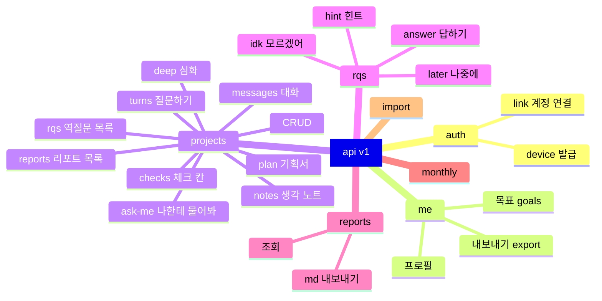

| 자원 | Create | Read | Update | Delete |
|---|---|---|---|---|
| 기기 토큰 | `POST /auth/device` | — | — | `DELETE /auth/device` (로그아웃) |
| 내 정보 | (토큰 발급 때 생성) | `GET /me` | `PATCH /me` | `DELETE /me` (전부 지우기) |
| 목표 | `PUT /me/goals/{ym}` | `GET /me/goals` | `PUT /me/goals/{ym}` | `DELETE /me/goals/{ym}` |
| 프로젝트 | `POST /projects` | `GET /projects` · `GET /projects/{id}` | `PATCH /projects/{id}` | `DELETE /projects/{id}` |
| 체크 칸 | — | (프로젝트에 포함) | `PUT /projects/{id}/checks/{key}` | `DELETE /projects/{id}/checks/{key}` |
| 기획서 | — | `GET /projects/{id}/plan` | `PUT /projects/{id}/plan` | — |
| **턴(질문)** | **`POST /projects/{id}/turns`** ⭐ | `GET /projects/{id}/turns` · `GET /turns/{id}` | ✖ (기록은 고치지 않음) | ✖ |
| 메시지 | (턴·코치가 만듦) | `GET /projects/{id}/messages` | ✖ | ✖ |
| 역질문 | `POST /projects/{id}/ask-me` | `GET /projects/{id}/rqs` · `GET /rqs/{id}` | `POST /rqs/{id}/answer` · `/hint` · `/later` · `/idk` | ✖ |
| 리포트 | (10번째 턴이 만듦) | `GET /projects/{id}/reports` · `GET /reports/{id}` · `GET /reports/{id}.md` | `PATCH /reports/{id}` (`opened`, 미션 문구 고치기만) | ✖ |
| 월간 리포트 | — | `GET /monthly/{ym}` · `GET /monthly/{ym}.md` | — | — |
| 생각 노트 | `POST /projects/{id}/deep/answer` | `GET /projects/{id}/notes` | `PATCH /notes/{id}` | `DELETE /notes/{id}` |
| 옮기기 | `POST /import/local` | — | — | — |

> **왜 턴·메시지는 고치거나 지울 수 없나** — 리포트의 근거이기 때문. 지우고 싶으면 프로젝트 단위로 지운다(`DELETE /projects/{id}`) — 그러면 리포트도 같이 사라진다.

### 3-3. 인증

#### `POST /api/v1/auth/device` — 익명 기기 토큰 발급

```json
// 요청
{ "nickname": "민준", "grade": "중2", "interests": ["메이커", "식물"] }
```

```json
// 201 Created
{
  "data": {
    "token": "abk_dev_7f3c…(한 번만 보여줌)",
    "user": { "id": "usr_mf3k2a9x", "nickname": "민준", "grade": "중2", "interests": ["메이커", "식물"], "validCount": 0, "introSeen": false }
  }
}
```

### 3-4. 내 정보

#### `GET /api/v1/me`

```json
{
  "data": {
    "id": "usr_mf3k2a9x",
    "nickname": "민준",
    "grade": "중2",
    "interests": ["메이커", "식물"],
    "validCount": 61,
    "idkCount": 3,
    "currentProjectId": "prj_smartpot",
    "introSeen": true,
    "usage": { "today": { "turns": 14, "limit": 60 } }
  }
}
```

#### `PATCH /api/v1/me` — `{ "nickname"?, "grade"?, "interests"?, "introSeen"?, "currentProjectId"? }`

#### `GET /api/v1/me/export` — 내 데이터 전부 (지금 `exportAll()`과 같은 모양의 JSON)

### 3-5. 프로젝트

#### `POST /api/v1/projects`

```json
// 요청
{
  "name": "스마트 화분",
  "description": "상추 화분 — 센서에서 시작해 서버 · AI · 공유로",
  "emoji": "🌱",
  "packs": ["maker", "ai"],
  "format": "product"
}
```

```json
// 201 Created — 첫 코치 인사 메시지도 같이 만든다 (createProject 와 같음)
{
  "data": {
    "project": {
      "id": "prj_mf3k8b1q",
      "name": "스마트 화분",
      "description": "상추 화분 — 센서에서 시작해 서버 · AI · 공유로",
      "emoji": "🌱",
      "packs": ["maker", "ai"],
      "format": "product",
      "rhythm": 2,
      "answerOnly": false,
      "counter": 0,
      "barIndex": 0,
      "checks": {},
      "plan": null,
      "progress": { "turnsInWindow": 0, "reportsCount": 0, "draft": { "done": 0, "total": 4, "next": "scenario" } },
      "createdAt": "2026-10-22T05:00:00Z",
      "updatedAt": "2026-10-22T05:00:00Z"
    },
    "messages": [
      { "id": "m_…", "kind": "coach", "md": "안녕, 민준! **스마트 화분** 얘기를 같이 해보자. …", "createdAt": "2026-10-22T05:00:00Z" }
    ]
  }
}
```

| 필드 | 필수 | 검증 |
|---|:-:|---|
| `name` | ✅ | 1~40자 |
| `description` | | ≤ 200자 |
| `emoji` | | 이모지 1개 |
| `packs` | | ⊂ {maker, share, collab, ai} |
| `format` | | ∈ {paper, research, campaign, service, product} |

#### `GET /api/v1/projects?limit=20&cursor=…`

```json
{
  "data": [
    { "id": "prj_smartpot", "name": "스마트 화분", "emoji": "🌱", "format": "product", "updatedAt": "…", "progress": { "turnsInWindow": 6, "reportsCount": 1 } }
  ],
  "meta": { "nextCursor": null }
}
```

#### `PATCH /api/v1/projects/{id}` — 바꿀 수 있는 칸

| 칸 | 예 | 부수 효과 |
|---|---|---|
| `name` · `description` · `emoji` | | |
| `packs` | `["maker","share"]` | 다음 역질문 후보가 바뀜 |
| `format` | `"service"` | 형식이 바뀌면 `checks` 비움 (`setFormat`과 같음) |
| `rhythm` | `3` | `counter`가 새 rhythm 이상이면 0으로 |
| `answerOnly` | `true` | 역질문을 띄우지 않고 [나중에]로 적립 |

#### `DELETE /api/v1/projects/{id}` → `204` (30일 동안 `POST /projects/{id}/restore` 로 복구 가능)

#### `PUT /api/v1/projects/{id}/checks/{key}` — 체크 칸 한 줄

```json
{ "text": "흙이 320 밑이면 3초 급수, 30초 동안 다시 안 봄" }
```

#### `GET · PUT /api/v1/projects/{id}/plan` — 기획서.md

```json
{ "filename": "스마트화분_기획서.md", "md": "# 🌱 스마트 화분 기획서\n\n## 알고리즘 — 급수 규칙\n| 칸 | 내용 | …" }
```

### 3-6. ⭐ 턴 — 질문 하나 보내기

이 서버의 심장. 한 요청 안에서 **관문 → 분석 → 답 → 칩 → (리듬이 차면) 역질문 → (10문이 차면) 리포트** 가 모두 일어난다.

#### `POST /api/v1/projects/{id}/turns`

```http
POST /api/v1/projects/prj_smartpot/turns
Authorization: Bearer abk_dev_…
Idempotency-Key: 5b2d7a3e-…            ← 같은 키로 다시 오면 저장된 응답을 그대로 돌려줌
Accept: application/json                ← text/event-stream 이면 단계별 스트림(아래)
```

```json
// 요청
{
  "text": "재봤어 — 마른 흙은 320쯤, 물 준 직후는 610쯤 나와. 400은 예제에서 베낀 숫자였어. 그럼 지금 규칙(읽고 → 비교 → 3초 켜기)이 맞는 방향일까? 목표는 상추가 안 마르는 것, 제약은 5V 펌프에 다음 주 시연이야.",
  "chip": "widen",
  "imageIds": [],
  "clientMessageId": "cm_01"
}
```

| 필드 | 필수 | 검증 |
|---|:-:|---|
| `text` | ✅ | 1~4000자 (코드 붙여넣기 포함) |
| `chip` | | widen · narrow · alt · null — 칩을 눌러 만든 질문인가 |
| `imageIds` | | 최대 3개, 먼저 `POST /uploads` 로 올린 것 |
| `clientMessageId` | | 화면이 낙관적으로 그린 말풍선과 짝 맞추기 |

**응답은 세 가지 모양 중 하나** — `outcome`으로 구분한다.

| outcome | 언제 | HTTP | 카운터 |
|---|---|---|---|
| `answered` | 유효 질문 → 답했다 | 201 | +1 |
| `gated` | 잡담 · 중복 · 사용법 · 정서 신호 | 200 | 그대로 |
| `emotional` | Claude가 정서 신호를 잡음 (`emotional: true`) | 200 | 그대로 |

```json
// 201 Created — outcome: answered (리듬이 차서 역질문까지 나온 경우)
{
  "data": {
    "outcome": "answered",
    "userMessage": { "id": "m_u62", "kind": "user", "text": "재봤어 — 마른 흙은 320쯤 …", "chip": "widen", "createdAt": "…" },
    "turn": {
      "id": "t_62",
      "n": 62,
      "windowIndex": 1,
      "barIndex": 0,
      "analysis": {
        "openness": "O3",
        "stage": "설계",
        "six": { "why": 1, "context": 1, "constraint": 1, "criteria": 0.5, "verify": 1, "discard": 0 },
        "concepts": ["임계값"],
        "urgent": false,
        "contextLoad": 3
      },
      "role": "engineer",
      "source": "claude"
    },
    "answer": {
      "id": "m_a62",
      "kind": "answer",
      "md": "**결론 먼저** — 방향은 맞아. 다만 '3초 켜기'를 '켜고 30초 기다렸다 다시 보기'로 바꾸자. …\n\n---\n\n🙋 **하나만 되물을게** — 상추가 '안 마른다'는 건 네 눈엔 어떤 모습이야?",
      "role": "engineer",
      "roleReason": "목표 · 제약 · 직접 잰 값을 줬으니, 나는 방법과 대안을 펼쳤어",
      "riskNote": null,
      "assumptions": ["센서값이 작을수록 마른 흙이라고 봤어"],
      "yourCall": ["문턱을 320과 610 사이 어디에 둘지"],
      "chips": [{ "kind": "alt", "draft": "이 방식 말고 다른 방식 2개와, 각각 잃는 걸 알려줘. 내 제약은 ___야." }],
      "planNote": "알고리즘 — 급수 규칙 v2 (켜고 기다렸다 다시 보기)"
    },
    "rq": {
      "id": "rq_31",
      "element": "E6",
      "axis": "algo",
      "form": "F1",
      "question": "펌프를 켠 뒤 30초 기다리는 동안 흙이 계속 320 밑이면, 다음엔 어디로 가?",
      "benefit": "기획서의 '판정 기준' 칸에 '몇 번 연속이면 멈춘다'가 생겨",
      "options": [
        { "label": "다시 3초 켠다 — 끝없이", "score": 1 },
        { "label": "다시 켜되, 3번 넘으면 멈추고 알린다", "score": 3 },
        { "label": "기다리지 않고 바로 다시 켠다", "score": 0 }
      ],
      "status": "open",
      "hintStage": 0
    },
    "report": null,
    "coachMessages": [],
    "project": { "counter": 0, "barIndex": 1, "laterStreak": 0, "turnsInWindow": 2 },
    "me": { "validCount": 62 }
  }
}
```

```json
// 200 OK — outcome: gated
{
  "data": {
    "outcome": "gated",
    "reason": "duplicate",
    "userMessage": { "id": "m_…", "kind": "user", "text": "…" },
    "coachMessages": [{ "id": "m_…", "kind": "coach", "md": "방금이랑 같은 질문이네. 답이 아쉬웠다면 **어디가** 아쉬웠는지 한 줄만 보태 줄래? …" }]
  }
}
```

#### 스트림 모드 (`Accept: text/event-stream`) *(선택)*

Claude 답이 10~40초 걸릴 수 있어서, 화면이 단계별로 채워지게 한다. 이벤트 순서는 늘 같다.

| 순서 | event | data | 화면 |
|---|---|---|---|
| 1 | `accepted` | `{ userMessage }` | 내 말풍선 확정 |
| 2 | `gate` | `{ valid, reason? }` | 무효면 여기서 `done` |
| 3 | `analysis` | `{ openness, stage, six }` *(로컬 분석 1차값)* | 개방도 배지 미리 |
| 4 | `answer` | `{ turn, answer }` | 답 카드 |
| 5 | `rq` | `{ rq }` 또는 생략 | 되묻기 카드 |
| 6 | `report` | `{ report }` 또는 생략 | "리포트 도착" 알림 |
| 7 | `done` | `{ project, me }` | 입력창 점 ●○ 갱신 |
| — | `error` | `{ code, message, fallback: "local" }` | 로컬 답 카드로 대체 |

### 3-7. 메시지 · 턴 조회

#### `GET /api/v1/projects/{id}/messages?limit=50&before=m_…`

```json
{
  "data": [
    { "id": "m_u61", "kind": "user", "text": "흙 센서값이 400 밑이면 펌프 3초 켜는 코드 짜줘", "createdAt": "…" },
    { "id": "m_a61", "kind": "answer", "turnId": "t_61", "md": "코드 대신 **규칙 카드**로 적어줄게. …", "role": "coder", "chips": [{ "kind": "widen", "draft": "…" }], "createdAt": "…" },
    { "id": "m_r31", "kind": "rq", "rqId": "rq_31", "rq": { "question": "…", "status": "answered", "score": 3 }, "createdAt": "…" }
  ],
  "meta": { "nextCursor": "m_u59" }
}
```

> `kind: "rq"` 메시지에는 역질문 내용을 펼쳐서 넣어 준다 → 화면이 따로 요청할 필요 없음.

#### `GET /api/v1/projects/{id}/turns?window=1` — 리포트 구간의 질문 10개 (질문 문서 내보내기용)

### 3-8. 역질문

#### `POST /api/v1/rqs/{id}/answer`

```json
// F1 고르기
{ "optionIndex": 1 }
// F2 · F3 직접 쓰기
{ "text": "3번 넘게 계속 마르면 펌프를 멈추고 알림 — 센서가 빠졌을 수도 있으니까" }
```

```json
// 200 OK
{
  "data": {
    "rq": { "id": "rq_31", "status": "answered", "score": 3, "answer": "3번 넘게 계속 마르면 …" },
    "coachMessage": {
      "id": "m_…",
      "kind": "coach",
      "md": "\"센서가 빠졌을 수도 있으니까\" — 그거 진짜 중요한 경우야. 하나만 보태면, 멈췄을 때 누가 알아채는지도 정해 두면 좋아. 계속 갈래, 이걸 먼저 볼래?"
    },
    "planNote": "판정 기준 — 3번 연속 마르면 멈추고 알림"
  }
}
```

> **점수(`score`)는 응답에 실리지만 화면에 숫자로 보여주지 않는다** — 리포트의 🟢🟡⚪ 색으로만 쓴다 (프롬프트의 "점수·등급을 말하지 않는다"와 같은 원칙).

| 엔드포인트 | 본문 | 하는 일 |
|---|---|---|
| `POST /rqs/{id}/hint` | — | `hintStage` +1 (최대 3). 응답에 이번 단계 힌트 텍스트 |
| `POST /rqs/{id}/later` | — | `status=later`, 프로젝트 `laterStreak` +1. 3이 되면 "간격 늦출까?" 코치 메시지 |
| `POST /rqs/{id}/idk` | — | `score=0`, `idkCount` +1, 코치 관점(`coachView`)으로 받아 주는 메시지 |
| `POST /projects/{id}/ask-me` | — | 리듬과 무관하게 역질문 1개. 물을 게 없으면 `200 { rq: null, coachMessage }` |

| 상황 | 응답 |
|---|---|
| 이미 답한 역질문에 다시 답함 | `409 RQ_ALREADY_ANSWERED` |
| `options`가 없는데 `optionIndex`를 보냄 | `422 VALIDATION_FAILED` |

### 3-9. 리포트

#### `GET /api/v1/projects/{id}/reports` — 목록 (제목 · 한 줄 · 범위)

```json
{
  "data": [
    { "id": "rpt_…", "seq": 1, "title": "스마트 화분 · 1번째 리포트", "headline": "센서에서 공유까지 — 화분이 네 단을 올랐다", "range": "질문 Q1~Q10 · 9월 19~21일", "opened": true }
  ]
}
```

#### `GET /api/v1/reports/{id}` — 8칸 전부

```json
{
  "data": {
    "id": "rpt_…",
    "seq": 1,
    "title": "스마트 화분 · 1번째 리포트",
    "headline": "센서에서 공유까지 — 화분이 네 단을 올랐다",
    "turnRange": [1, 10],
    "sections": {
      "glance":   { "stage": "설계", "roles": { "coder": 1, "engineer": 4, "architect": 4, "encyclopedia": 1 } },
      "mix":      { "O1": 0, "O2": 1, "O3": 4, "O4": 4, "O5": 1, "NA": 0, "comment": "열린 질문이 지난 리포트 1번 → 이번 8번. …" },
      "length":   { "count": 10, "avg": 96, "buckets": { "short": { "count": 2, "avgSix": 0.5 }, "mid": { "count": 5, "avgSix": 2.4 }, "long": { "count": 3, "avgSix": 4.0 } } },
      "six":      { "why": 6, "context": 9, "constraint": 5, "criteria": 4, "verify": 5, "discard": 2 },
      "rqs":      [{ "element": "E6", "form": "F1", "score": 3, "color": "🟢" }],
      "stuck":    [{ "concept": "임계값", "countInWindow": 3, "countTotal": 4 }],
      "best":     { "turnN": 2, "text": "재봤어 — 마른 흙은 320쯤 …", "reason": "목표와 조건을 주고 방법을 물었어. 질문에 왜·맥락·제약·확인을 실었어." },
      "mission":  { "last": { "text": "…", "result": "done", "detail": "3번 해냈어 — …" }, "next": { "key": "criteria", "text": "새 기능을 만들기 전에 \"잘 됐다는 건 ___로 알 수 있다\" 한 줄을 질문에 넣어보기", "basis": "기준을 실은 질문이 10개 중 4개", "editedByStudent": false } }
    },
    "opened": false,
    "createdAt": "…"
  }
}
```

> `sections`의 키 순서 = `REPORT_SECTIONS` 여덟 칸 순서. 데이터가 없어도 키는 빠지지 않는다 (빈 배열 · null).

| 엔드포인트 | 설명 |
|---|---|
| `PATCH /reports/{id}` | `{ "opened": true }` 또는 `{ "nextMission": { "text": "…" } }` (학생이 미션 문구를 고침 → `editedByStudent: true`) |
| `GET /reports/{id}.md` | `text/markdown` — `reportToMd()`와 같은 결과 |
| `GET /monthly/{ym}` | 그 달의 리포트 · 요소별 추이 · 처방 · 목표 |

### 3-10. 심화 대화 (2문 1역 카운터에 들어가지 않음)

| 엔드포인트 | 요청 | 응답 |
|---|---|---|
| `POST /projects/{id}/deep/open` | — | `{ message: { kind: "deepPick" } }` |
| `POST /projects/{id}/deep/ask` | `{ "lens": "philosophy", "level": 0 }` | `{ message: { kind: "deepQ", md } }` |
| `POST /projects/{id}/deep/answer` | `{ "lens": "philosophy", "level": 0, "text": "편하게 해 주는 게 꼭 좋은 건지 모르겠어" }` | `{ note, coachMessage, nextQuestion }` |

### 3-11. 옮기기 — `POST /api/v1/import/local`

처음 서버에 붙는 날, 브라우저에 쌓인 기록을 한 번에 올린다.

```json
// 요청 — exportAll() 결과 그대로
{
  "version": "askback:v1",
  "profile": { "name": "민준", "grade": "중2", "interests": ["메이커"], "createdAt": 1758430000000 },
  "state": { "validCount": 61, "idkCount": 3, "currentProjectId": "prj_…" },
  "projects": [ … ], "messages": [ … ], "turns": [ … ], "rqs": [ … ], "notes": [ … ], "reports": [ … ], "goals": { "2026-09": "…" }
}
```

```json
// 200 OK
{ "data": { "imported": { "projects": 3, "messages": 214, "turns": 61, "rqs": 27, "reports": 6, "notes": 4 }, "skipped": { "examples": 1, "duplicates": 0 }, "warnings": ["사진 12장은 용량 때문에 옮기지 않았어"] } }
```

| 규칙 | 이유 |
|---|---|
| 같은 ID가 이미 있으면 건너뜀 | 두 번 눌러도 안전 |
| `example: true` 리포트 · 불러온 예시 프로젝트는 건너뜀 | 내 기록이 아님 |
| 점수 · 리포트는 **받되 `imported: true` 표시** | 서버가 계산한 것과 구분 |
| 최대 5MB | 남용 방지 |

---

## 4. 알고리즘

### 4-1. 한 턴 파이프라인 (`POST /turns`)

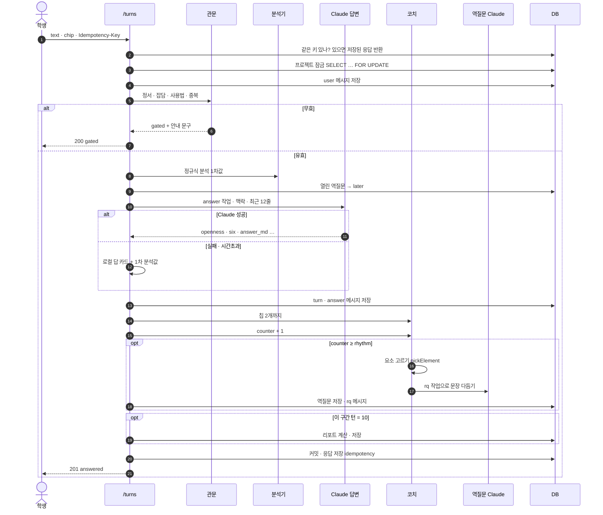

> **잠금 범위** — Claude 호출(수십 초)을 잠금 안에서 기다리면 안 된다. 실제 구현은 ① 잠금 → 사용자 메시지 · 열린 역질문 정리 → 잠금 해제 ② Claude 호출 ③ 다시 잠금 → `counter`를 **다시 읽고** 턴 · 역질문 · 리포트 저장 → 해제. 같은 프로젝트에 두 질문이 거의 동시에 와도 카운터가 꼬이지 않는다.

### 4-2. ① 관문 — 무엇을 질문으로 세나

| 순서 | 판정 | 규칙 *(현재 `analyzer.ts`)* | 결과 | 예 |
|---|---|---|---|---|
| 1 | 정서 | `우울 · 죽고 싶 · 자해 · 왕따 · 괴롭힘 …` | 평가·질문 내려놓고 1388 안내 | "요즘 너무 힘들어" |
| 2 | 잡담 | 12자 이하 + `ㅇㅇ · 고마워 · ㅋㅋ …` | 짧게 받고 끝 | "ㅇㅋ 고마워" |
| 3 | 사용법 | `리포트 · 설정 … 어디` | 메뉴 위치 안내 | "리포트 어디서 봐?" |
| 4 | 중복 | 직전 질문과 글자쌍 유사도 ≥ 0.9 | "어디가 아쉬웠는지 한 줄" | 같은 질문 재전송 |
| — | 그 밖 | | **유효** → 카운터 +1 | |

> 서버에서 추가: Claude 답에 `emotional: true`가 오면 **그 턴은 저장하지 않고** 정서 응답만 남긴다 (정규식이 놓친 경우의 두 번째 그물).

### 4-3. ② 분석 — 개방도와 6요소

**두 단계로 정한다**: 로컬 정규식 1차값 → Claude가 답하면서 낸 값으로 덮어쓴다.

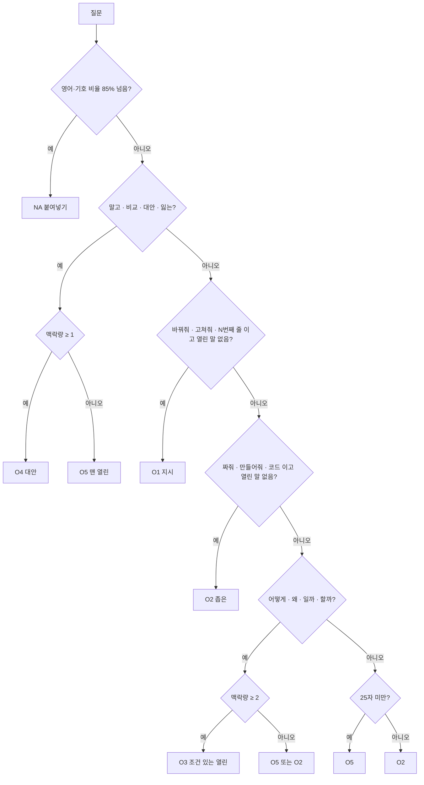

| 개념 | 정의 | 계산 |
|---|---|---|
| **맥락량** (0~3) | 지금까지 준 맥락 | 이번 질문 + 최근 3턴에서 `context`·`constraint`·`criteria`가 0.5 이상이면 각 +1 (프로젝트 설명이 있으면 context로 침) |
| **6요소** | 질문 문장에 실린 것 | why · context · constraint · criteria · verify · discard 각 0 / 0.5 / 1 |
| **역할** | 개방도 → AI를 무엇으로 썼나 | O1 타자수 · O2 코더 · O3 엔지니어 · O4 아키텍트 · O5 백과사전 · NA 없음 |

| 덮어쓰기 규칙 | |
|---|---|
| Claude 응답이 스키마를 통과했다 | `openness` · `six` · `stage` · `concepts(최대 3)` 를 Claude 값으로 |
| Claude가 `concepts`를 빈 배열로 줬다 | 로컬 값 유지 |
| 폴백(로컬 답 카드) | 로컬 1차값 그대로, `source: "local"` |
| `urgent` · `signals` · `contextLoad` | 항상 로컬 값 (Claude에게 묻지 않음) |

### 4-4. ③ 답변기 — 개방도에 맞는 답의 모양

| 개방도 | 답의 뼈대 | 끝 |
|---|---|---|
| O1 · O2 | 요청한 결과물 그대로 + 맨 위 "이 결과물이 따르는 순서" 2~4줄. 위험하면 `risk_note` | 🙋 되묻기 |
| O3 | 결론 → 이유 → 결과물(규칙 카드 · 순서도) → 확인하는 법 → 버린 대안 1개 | 🙋 되묻기 |
| O4 | 비교표(방식·얻는 것·잃는 것·맞는 상황) → 추천과 이유 → 추천이 틀리는 조건 | 🙋 되묻기 |
| O5 | 짧은 개요 → "누구에게 물어도 같은 답" → 좁히는 질문 3개 | 🙋 되묻기 |
| NA | 원인과 고치는 법 | 🙋 되묻기 |

### 4-5. ④ 코치 — 칩 · 리듬 · 역질문

#### 칩 (최대 2개)

| 조건 | 칩 | 예 |
|---|---|---|
| 형식이 있고 (구현 단계 또는 O1·O2) | widen — 설계로 돌아가기 | "이 코드가 따르는 순서부터 같이 정하자 …" |
| 최근 3턴(구현 단계면 5턴)이 전부 O1·O2 | widen | "지금 내가 짜고 있는 이 구조 자체가 맞는 방향일까? …" |
| O5 · O3 | narrow | "그중에서 ___ 부분을 내 상황에 맞게 …" |
| O3 | alt | "이 방식 말고 다른 방식 2개와, 각각 잃는 걸 …" |

#### 리듬 — 2문 1역 상태도

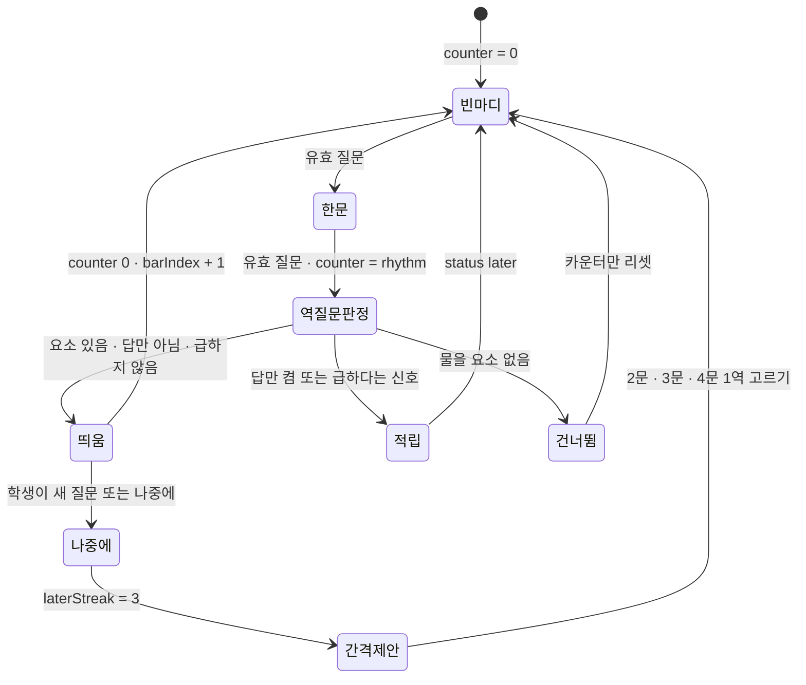

| 값 | 규칙 |
|---|---|
| `rhythm` | 2 (기본) · 3 · 4 |
| `counter` | 유효 질문마다 +1, rhythm에 닿으면 0 |
| `barIndex` | 마디가 끝날 때마다 +1 (역질문 "오래됨" 계산의 시계) |
| `laterStreak` | 열린 역질문을 두고 새 질문 · [나중에] → +1, 답하면 0, 3이면 간격 제안 후 0 |

#### 역질문 고르기 — 점수식 *(현재 `rq.ts`)*

$$\text{점수} = 0.4 \times \text{관련성} + 0.3 \times \text{약함} + 0.2 \times \text{오래됨} + 0.1 \times \text{트리거}$$

| 항 | 뜻 | 계산 |
|---|---|---|
| 관련성 (0~1) | 이 마디의 질문과 맞는가 | 요소별 규칙 (예: E9 기획 — 첫 2턴이거나 "누구 · 사용자"가 나오면 0.9). **0.3 미만이면 후보에서 뺀다** (억지 질문 금지) |
| 약함 (0~1) | 이 요소를 아직 못하나 | 최근 3번 점수 평균 `s` → `(3 − s) / 3`. 물어본 적 없으면 0.5 |
| 오래됨 (0~1) | 오래 안 물었나 | `(지금 barIndex − 마지막 barIndex) / 5`, 최대 1. 처음이면 1 |
| 트리거 (0/0.6/1) | 바로 물어야 할 신호 | "골라줘" → E6 · 같은 개념 3번 → E1 · 에러 붙여넣기 → E7 … |

| 보정 (곱하기) | 값 | 이유 |
|---|---|---|
| 이번 리포트 구간에서 이미 물은 요소 | × 0.3 | 같은 걸 또 묻지 않게 |
| 팩 요소, 구간당 2개 미만 | × 1.25 (넘으면 × 0.3) | 팩은 10문당 2개 |
| 형식 요소, 구간당 3개 미만 | × 1.3 (넘으면 × 0.6) | 설계 질문을 앞세움 |
| 아직 안 물은 축 (기획 · 알고리즘 · 구조) | × 1.35 | 10문 안에 세 축이 다 한 번 |
| 이미 물은 축 (세 축이 다 안 찼을 때) | × 0.75 | 한 축만 파지 않게 |

**계산 예** *(가상 — 스마트 화분 2번째 질문 뒤)*

| 요소 | 관련성 | 약함 | 오래됨 | 트리거 | 기본 점수 | 보정 | 최종 |
|---|---|---|---|---|---|---|---|
| E6 기준 (알고리즘 축) | 0.8 | 0.5 | 1 | 0 | 0.32+0.15+0.2+0 = **0.67** | 안 물은 축 × 1.35 | **0.90** ✅ |
| F2 판단 규칙 (형식) | 0.8 | 0.5 | 1 | 0 | 0.67 | 형식 × 1.3, 축 × 1.35 → 단, 같은 축 | 0.88 |
| E9 누구의 문제 (기획 축) | 0.55 | 0.5 | 1 | 0 | 0.57 | 안 물은 축 × 1.35 | 0.77 |
| E12 멈추면 어디까지 | 0 | — | — | — | — | 관련성 0.3 미만 → 제외 | — |

#### 형태 올리기 — 고르기 → 빈칸 → 한두 문장

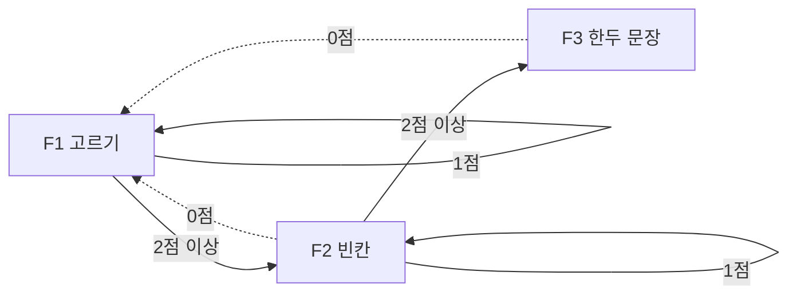

| 규칙 | |
|---|---|
| 그 요소를 처음 묻거나 지난번 0점 | F1 |
| 지난번 2점 이상 | 한 단 올림 |
| 지난번 1점 | 같은 형태 |
| F1 템플릿이 없는 요소 | 늘 F3 |

### 4-6. 채점 — 역질문 답 *(서버만)*

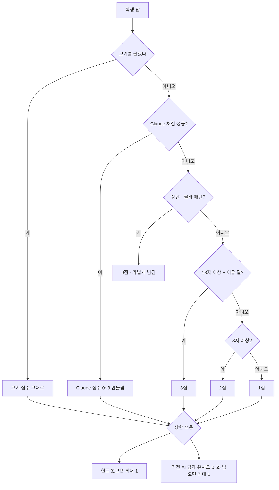

| 점수 | 뜻 | 예 *(질문: "30초 기다리는 동안 계속 320 밑이면?")* |
|---|---|---|
| 3 | 자기 말로 정확 + 이유·조건 | "3번 넘게 계속 마르면 멈추고 알림 — 센서가 빠졌을 수도 있으니까" |
| 2 | 대체로 맞음, 일부 빠짐 | "멈춰야 할 것 같아" |
| 1 | 방향만 · AI 문장 반복 · 힌트 후 | "다시 켠다" |
| 0 | 모르겠어 · 무관 · 장난 | "ㅋㅋ 몰라" |

> **Claude 점수도 서버가 다시 상한을 건다** — 프롬프트에 "힌트 쓰면 최대 1점"이 있어도, 서버가 `hint_stage ≥ 1 → min(score, 1)` 을 한 번 더 적용한다. 모델 판단에 규칙을 맡기지 않는다.

### 4-7. 리포트 — 10문마다 한 장

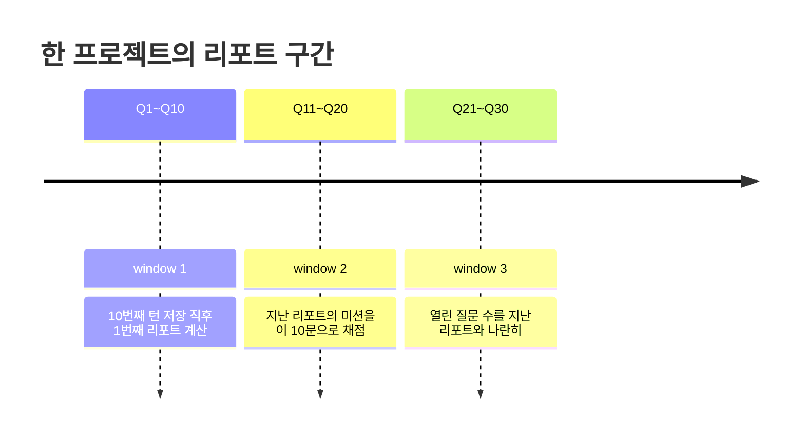

| 칸 | 계산 | 예 |
|---|---|---|
| ① 한눈에 | 가장 많은 단계 · 역할 분포 | 설계 · 🔧4 🏛4 |
| ② 질문 유형 | O1~O5·NA 개수, 지난 리포트와 O3+O4 비교 문장 | "열린 질문이 1번 → 8번" |
| ③ 질문 길이 | 짧은(≤40) · 보통 · 긴(>120) 개수와 각 평균 6요소 | 긴 질문 3개, 평균 6요소 4.0 |
| ④ 실은 것 | 6요소별로 0.5 이상인 질문 수 | 기준 4 / 10 |
| ⑤ 되묻기 | 구간 역질문의 요소 · 형태 · 점수 색 | 🟢🟢🟡⚪ |
| ⑥ 걸린 곳 | 구간에서 2번 이상 나온 개념 상위 2 | 임계값 3번 |
| ⑦ 베스트 질문 | 개방도 가중치(O3·O4=3, O2=1, O5=0.5) + 6요소 합 + 칩 0.5 가 가장 큰 질문 | Q2 |
| ⑧ 미션 | 지난 미션 채점(done · partial · missed) → 가장 약한 칸으로 다음 미션 | "잘 됐다는 건 ___로 알 수 있다" |

> **동시성** — 10번째 턴 두 개가 동시에 저장되면 리포트가 두 장 생길 수 있다. `UNIQUE (project_id, seq)` 로 막고, 충돌하면 이미 생긴 리포트를 돌려준다.

### 4-8. 폴백 — Claude가 없어도 대화는 이어진다

| 상황 | 서버 동작 | 학생이 보는 것 |
|---|---|---|
| 키 없음 · 503 | 로컬 답 카드(`answers.json` + `/answers/*.md`) | 같은 모양의 답, 끝에 🙋 되묻기 |
| 시간 초과 (답 45초 · 나머지 15초) | 1번 재시도 → 폴백 | 같음 |
| 스키마 불일치 | 1번 "고쳐서 다시" 요청 → 폴백 (§5-6) | 같음 |
| `stop_reason: refusal` | 폴백 + `llm_calls.status=refusal` | 같음 |
| 429 한도 | `retry-after` 존중, 폴백 | 같음 |
| 역질문 다듬기 실패 | 요소 템플릿 문장 그대로 | 조금 덜 구체적인 되묻기 |
| 채점 실패 | 길이·이유 규칙 채점 | 같은 3단 피드백 |
| 사진이 있는데 폴백 | "사진 속은 못 읽었어"를 솔직히 | 안내 + 글로 한 줄 요청 |

---

## 5. Claude 연결 · 프롬프트 · JSON 가이드

### 5-1. 작업(task) 네 가지

| task | 언제 부르나 | 입력 | 출력 스키마 | 모델 | effort | max_tokens | 시간 제한 |
|---|---|---|---|---|---|---|---|
| `answer` | 유효 질문마다 | 학생 질문 + 맥락 + 최근 12줄 + 사진(≤3) | `AnswerSchema` | `claude-opus-5-5` | `medium` | 16000 | 45초 |
| `rq` | 마디가 찰 때 | 마디(직전 2문답) · 평가요소 · 형태 · 확인할 축 | `RQSchema` | `claude-opus-5-5` | `low` | 4000 | 15초 |
| `feedback` | 역질문에 직접 쓴 답 | 역질문 · 기대 요소 · 학생 답 · 힌트 단계 · 직전 답 | `FeedbackSchema` | `claude-opus-5-5` | `low` | 4000 | 15초 |
| `deep` | 심화 대화 답 | 렌즈 · 깊이 · 학생의 말 | `DeepSchema` | `claude-opus-5-5` | `low` | 4000 | 15초 |

> - 지금 코드의 기본 모델은 `claude-opus-5`(`ASKBACK_MODEL`)이다. 서버를 만들 때 **`claude-opus-5-5`** 로 올린다 (같은 기능, 더 낮은 단가). Opus 5.5는 effort 기본값이 `medium`이므로 **작업마다 명시**한다.
> - 모델 · effort는 환경 변수(`ASKBACK_MODEL_ANSWER`, `ASKBACK_EFFORT_RQ` …)로 작업별로 바꿀 수 있게 하고, `rq`·`feedback`을 더 싼 모델(예: `claude-sonnet-5-5`)로 내릴지는 **실제 답 30~50개로 품질을 비교한 뒤** 정한다.
> - 안전 분류기가 거절(`refusal`)하면 서버 측 폴백 기능(`fallbacks: "default"`)을 켜 두고, 그래도 거절이면 §4-8 로컬 폴백.

### 5-2. 프롬프트 층 — 캐시가 깨지지 않는 순서

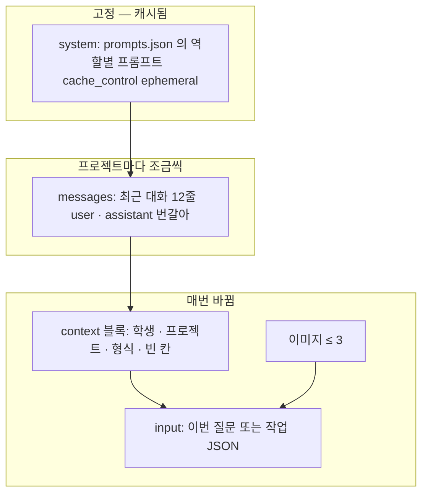

| 규칙 | 이유 | 하지 말 것 |
|---|---|---|
| system에는 **바뀌지 않는 것만** | 접두가 1바이트만 달라도 캐시가 깨짐 | system에 학생 이름 · 날짜 · 프로젝트 넣기 |
| 학생·프로젝트 맥락은 **마지막 user 메시지 안 `<context>`** | 매번 바뀌는 값은 캐시 뒤쪽에 | |
| `prompt_version` = system 문자열의 해시 앞 8자 | 어느 프롬프트로 만든 답인지 추적 | 버전 없이 prompts.json 수정 |
| 캐시 적중 확인 | `usage.cache_read_input_tokens` 를 `llm_calls`에 저장 | 0이 계속되면 무엇이 바뀌는지 점검 |

#### 실제로 보내는 요청 모양 *(answer)*

```json
{
  "model": "claude-opus-5-5",
  "max_tokens": 16000,
  "thinking": { "type": "adaptive" },
  "output_config": { "effort": "medium", "format": "<AnswerSchema 의 JSON Schema>" },
  "system": [
    { "type": "text", "text": "너는 청소년과 함께 프로젝트를 만드는 동료이자 코치다. …(prompts.json answer.system)", "cache_control": { "type": "ephemeral" } }
  ],
  "messages": [
    { "role": "user", "content": "흙 센서값이 400 밑이면 펌프 3초 켜는 코드 짜줘" },
    { "role": "assistant", "content": "코드 대신 **규칙 카드**로 적어줄게. …" },
    {
      "role": "user",
      "content": "<context>\n학생: 민준 (중2) · 관심: 메이커, 식물\n프로젝트: 스마트 화분 — 상추 화분 — 센서에서 시작해 서버 · AI · 공유로\n초안 형식: 🔧 제품 · 채운 칸: 동작 시나리오 / 빈 칸: 부품 목록, 구조 스케치, 만드는 순서\n형식별 코칭 지침: 제품의 알고리즘 = 입력→판단→출력 규칙 …\n</context>\n\n재봤어 — 마른 흙은 320쯤, 물 준 직후는 610쯤 나와. …"
    }
  ]
}
```

### 5-3. `<context>` 블록 형식 *(서버가 조립)*

| 줄 | 출처 | 예 | 없을 때 |
|---|---|---|---|
| `학생:` | users | `민준 (중2) · 관심: 메이커, 식물` | `학생 (학년 모름) · 관심: 없음` |
| `프로젝트:` | projects | `스마트 화분 — 상추 화분 — …` | 이름만 |
| `초안 형식:` | `format` + `checks` | `🔧 제품 · 채운 칸: … / 빈 칸: …` | 줄 생략 |
| `형식별 코칭 지침:` | `formats.json` `coach` | | 줄 생략 |
| `기획서 요약:` *(신규)* | `plan_md` 의 제목줄만 최대 10개 | `알고리즘 — 급수 규칙 v2 · 판정 기준 — 3번 연속` | 줄 생략 |

> **context에 넣지 않는 것** — 실명 · 학교 · 연락처 · 기기 정보. 모델이 몰라도 되는 것은 보내지 않는다.

### 5-4. 역할별 입력 JSON (`input`)

`answer`는 학생 질문 원문을 그대로 보낸다. 나머지 셋은 **JSON 문자열**을 보낸다. 키 이름은 지금 프롬프트가 읽는 한국어 키를 그대로 쓴다 (프롬프트를 바꾸지 않기 위해).

```json
// rq — 역질문 다듬기
{
  "마디": [
    { "q": "흙 센서값이 400 밑이면 펌프 3초 켜는 코드 짜줘", "a": "코드 대신 **규칙 카드**로 …(최대 1200자)" },
    { "q": "재봤어 — 마른 흙은 320쯤 …", "a": "**결론 먼저** — 방향은 맞아 …" }
  ],
  "평가요소": "E6 잘 됐다는 기준",
  "형태": "F1",
  "확인할_축": "🔀 알고리즘 — 어떤 순서와 규칙으로 돌아가는지"
}
```

```json
// feedback — 직접 쓴 답 채점
{
  "역질문": "펌프를 켠 뒤 30초 기다리는 동안 흙이 계속 320 밑이면, 다음엔 어디로 가?",
  "expected_points": ["반복 횟수 상한", "멈춘 뒤 알림", "센서 고장 가능성"],
  "학생의_답": "3번 넘게 계속 마르면 멈추고 알림 — 센서가 빠졌을 수도 있으니까",
  "hint_stage": 0,
  "직전_AI_답": "**결론 먼저** — …(최대 1500자)"
}
```

```json
// deep — 심화
{ "렌즈": "철학", "지금_깊이": "L1", "다음_깊이": "L2", "학생의_말": "편하게 해 주는 게 꼭 좋은 건지 모르겠어" }
```

### 5-5. 역할별 출력 JSON — 스키마와 예

모든 출력은 `messages.parse` + `zodOutputFormat(스키마)` 로 받는다 → **스키마에 맞지 않는 JSON은 애초에 나오지 않는 것이 원칙**, 그래도 서버가 한 번 더 검증한다.

#### `answer` 출력

| 필드 | 타입 | 규칙 |
|---|---|---|
| `openness` | enum `O1 O2 O3 O4 O5 NA` | 확신 낮으면 `NA` |
| `six` | object, 6키 각 `0 \| 0.5 \| 1` | 키를 빼지 않는다 |
| `stage` | enum `탐색 설계 구현 검증` | |
| `concepts` | string[] | 0~3개, 한 단어씩 |
| `emotional` | boolean | 정서 신호가 있으면 true — 서버가 턴을 저장하지 않음 |
| `answer_md` | string (마크다운) | **반드시 `---` 다음 `🙋 **하나만 되물을게** — …` 한 줄로 끝남** |
| `assumptions` | string[] | 답이 깔고 있는 가정 0~4개 |
| `your_call` | string[] | 학생 몫으로 남긴 판단 0~3개 |
| `risk_note` | string \| null | 없으면 `null` (빈 문자열 금지) |
| `role_reason` | string | 이 역할로 답한 이유 한 줄 |

```json
{
  "openness": "O2",
  "six": { "why": 0, "context": 1, "constraint": 0, "criteria": 0, "verify": 0, "discard": 0 },
  "stage": "구현",
  "concepts": ["임계값"],
  "emotional": false,
  "answer_md": "코드 대신 **규칙 카드**로 적어줄게. 이 카드를 코딩 도구에 붙여넣으면 코드는 바로 나와.\n\n**급수 규칙 v1**\n\n| 칸 | 내용 |\n|---|---|\n| 입력 | 흙 센서값 (1초마다 읽기) |\n| 판단 | 값이 **400보다 작으면** '말랐다' |\n| 출력 | 펌프를 **3초** 켜고 끈다 |\n\n**확인하는 법** — 센서를 마른 흙 / 젖은 흙 / 물컵에 차례로 꽂고 값을 적어봐.\n\n---\n\n🙋 **하나만 되물을게** — 400이라는 숫자는 어디서 왔어?",
  "assumptions": ["센서값이 작을수록 마른 흙이라고 봤어", "400과 3초는 네가 정한 숫자 그대로 뒀어"],
  "your_call": ["마른 흙과 젖은 흙을 직접 재면, 400은 얼마로 바뀔까?"],
  "risk_note": "시킨 대로 적었어. 다만 한 가지 — 펌프가 도는 3초 동안은 흙을 안 봐.",
  "role_reason": "설계(400 · 3초)는 네가 다 정했고, 나는 그걸 규칙 카드로 옮겼어"
}
```
*(앱 예시 q61을 스키마 모양으로 옮김)*

#### `rq` 출력

| 필드 | 타입 | 규칙 |
|---|---|---|
| `question` | string | 2문장 이내 · 마디의 구체적 단어·숫자 포함 · F2면 `___` 포함 |
| `benefit` | string | "기획서의 ___ 칸이 채워져"처럼 결과물로 |
| `options` | `{label, score}[]` | F1이면 정확히 3개(점수 0~3), F2·F3이면 **빈 배열** |
| `hint` · `example` · `coach_view` | string | 힌트 3단 |
| `expected_points` | string[] | 2~3개 |

```json
{
  "question": "펌프를 켠 뒤 30초 기다리는 동안 흙이 계속 320 밑이면, 다음엔 어디로 가?",
  "benefit": "기획서의 '판정 기준' 칸에 '몇 번 연속이면 멈춘다'가 생겨",
  "options": [
    { "label": "다시 3초 켠다 — 끝없이", "score": 1 },
    { "label": "다시 켜되, 3번 넘으면 멈추고 알린다", "score": 3 },
    { "label": "기다리지 않고 바로 다시 켠다", "score": 0 }
  ],
  "hint": "순서도에서 '다시 읽기' 화살표가 몇 번이나 돌 수 있는지 봐",
  "example": "전자레인지도 문이 안 닫히면 몇 번 시도하다 멈추고 알려 주지",
  "coach_view": "끝없이 도는 고리에는 늘 '몇 번까지'와 '그다음 누가 아나'가 필요해",
  "expected_points": ["반복 횟수 상한", "멈춘 뒤 알림", "센서 고장 가능성"]
}
```
*(가상)*

#### `feedback` 출력

| 필드 | 타입 | 규칙 |
|---|---|---|
| `score` | number | 0~3 (서버가 반올림 · 상한 적용) |
| `reason_one_line` | string | 로그용 |
| `feedback_md` | string | 3문장 이내 · ① 인용해 받기 ② 하나만 보태기 ③ "계속 갈래, 이걸 먼저 볼래?" · **점수 언급 금지** |

```json
{
  "score": 3,
  "reason_one_line": "상한과 이유(센서 빠짐)까지 자기 말로",
  "feedback_md": "\"센서가 빠졌을 수도 있으니까\" — 그거 진짜 중요한 경우야. 하나만 보태면, 멈췄을 때 누가 알아채는지도 정해 두면 좋아. 계속 갈래, 이걸 먼저 볼래?"
}
```

#### `deep` 출력

```json
{
  "reply_md": "\"편하게 해 주는 게 꼭 좋은 건지\" — 좋은 의심이야. 나는 화분이 다 알아서 하면 상추를 들여다볼 일이 줄어들 것 같기도 해.",
  "next_question": "네 화분이 물을 다 알아서 준다면, 너는 상추에 대해 뭘 덜 알게 될까? 나는 '잎 색깔 변화'를 놓칠 것 같은데, 너는?"
}
```

### 5-6. 구조화 JSON 가이드 — 프롬프트에 넣는 규칙과 서버 검증

#### 프롬프트에 넣는 출력 규칙 (모든 역할 공통 꼬리말)

```text
## 출력 형식
- 정해진 JSON 스키마의 모든 키를 빠짐없이 채운다. 값이 없으면 문자열은 null(허용된 칸만), 배열은 []로 둔다. 빈 문자열 ""은 쓰지 않는다.
- enum 값은 표기 그대로 쓴다 (O3, 설계, F1). 번역하거나 설명을 붙이지 않는다.
- 숫자 칸에는 숫자만 넣는다 (six는 0, 0.5, 1 중 하나).
- 마크다운은 *_md 로 끝나는 칸에만 쓴다. 다른 칸은 한 줄 평문이다.
- JSON 밖에 다른 말을 쓰지 않는다.
```

#### 서버 검증 3단

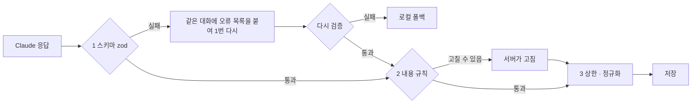

| 단계 | 검사 | 어기면 |
|---|---|---|
| 1 스키마 | zod `safeParse` (타입 · enum · 필수 키) | 오류 경로를 붙여 1회 재요청 → 실패 시 폴백 |
| 2 내용 규칙 | `answer_md`가 🙋 되묻기 줄로 끝나는가 | 서버가 `answers.json asks[openness]`에서 한 줄 붙임 |
| | `concepts` > 3 · `your_call` > 3 | 앞에서 자름 |
| | `rq.options`: F1인데 3개가 아님 / F2·F3인데 있음 | F1: 템플릿 보기 사용 · F2·F3: 비움 |
| | F2인데 `question`에 `___` 없음 | 템플릿 문장 사용 |
| | `feedback_md`에 "점", "/3", "등급" | 해당 문장 제거 후 저장 |
| | `risk_note === ""` | `null` |
| 3 상한 · 정규화 | `score` 반올림 → 0~3 자르기 → 힌트·복사 상한 | — |
| | 문자열 길이: `answer_md` ≤ 12000자, 나머지 한 줄 칸 ≤ 300자 | 자르고 `…` |

#### 응답 처리 순서 (의사코드)

```text
call(task, input):
  res = claude.messages.parse(요청)                       # zodOutputFormat
  기록 llm_calls(usage, stop_reason, latency)
  if res.stop_reason == "refusal"      → return 폴백
  if res.stop_reason == "max_tokens"   → return 폴백        # 잘린 JSON은 쓰지 않는다
  if res.parsed_output 없음            → 1회 재요청(오류 목록 첨부) → 그래도 없으면 폴백
  out = 내용규칙(res.parsed_output)
  out = 상한(out)
  return out
```

### 5-7. 프롬프트 관리

| 항목 | 규칙 |
|---|---|
| 원본 | `frontend/src/data/prompts.json` (지금 그대로) — 서버가 읽는다 |
| 버전 | 서버 시작 시 역할별 system 해시 → `prompt_version` |
| 바꿀 때 | 시나리오 JSON의 질문 15개 이상을 새 프롬프트로 돌려 **스키마 통과율 · 🙋 끝맺음 비율 · 코드 비율**을 이전과 비교 |
| 금지 | system에 날짜 · 학생 정보 · 무작위 값 (캐시 깨짐) |
| 스키마 | `lib/schemas.ts` 하나 — Claude 출력 · API 응답 검증 · 화면 타입이 모두 여기서 나온다 |

### 5-8. 비용 · 한도

| 한도 | 기본값 | 넘으면 |
|---|---|---|
| 학생당 하루 유효 질문 | 60 | `429 DAILY_LIMIT` + 로컬 답 카드로는 계속 대화 가능 |
| 학생당 분당 요청 | 10 | `429 RATE_LIMITED` |
| 한 질문 사진 | 3장 · 장당 1.5MB (긴 변 1568px로 줄임) | `413` |
| 한 질문 글자 | 4000자 | `422` |
| 대화 기록 전달 | 최근 12줄 · 줄당 1200자 | 앞을 잘라 보냄 |

| 비용 추정 *(가상, 질문 1개 · 리듬 2 기준)* | 호출 수 |
|---|---|
| answer | 1 |
| rq (2턴에 1번) | 0.5 |
| feedback (직접 쓴 답일 때만, 약 절반) | 0.25 |
| **질문 1개당 평균** | **약 1.75회** — 실제 토큰은 `llm_calls`로 측정해서 정한다 |

---

## 6. 오류 코드

| HTTP | code | 언제 | 화면 |
|---|---|---|---|
| 400 | `BAD_REQUEST` | JSON이 아님 | "다시 보내 줄래?" |
| 401 | `UNAUTHORIZED` | 토큰 없음 · 만료 | 기기 토큰 재발급 |
| 403 | `FORBIDDEN` | 남의 프로젝트 | — |
| 404 | `NOT_FOUND` | 없는 ID · 지운 프로젝트 | 목록으로 |
| 409 | `RQ_ALREADY_ANSWERED` | 이미 답한 역질문 | 카드 닫기 |
| 409 | `IDEMPOTENCY_MISMATCH` | 같은 키 · 다른 본문 | 새 키로 재전송 |
| 412 | `PRECONDITION_FAILED` | `If-Match` 불일치 (다른 기기에서 먼저 고침) | 새로고침 |
| 413 | `PAYLOAD_TOO_LARGE` | 사진 · 옮기기 파일 초과 | 줄여서 다시 |
| 422 | `VALIDATION_FAILED` | 필드 규칙 위반 (`details`에 필드별) | 칸 옆에 표시 |
| 429 | `RATE_LIMITED` · `DAILY_LIMIT` | 한도 | "잠깐 쉬었다 가자" · 로컬 답 |
| 502 | `LLM_FAILED` | Claude 실패 + 폴백도 실패 (드묾) | 다시 시도 버튼 |
| 503 | `LLM_UNAVAILABLE` | 키 없음 — **`/turns`는 이 경우에도 폴백 답으로 201** | — |

```json
{ "error": { "code": "VALIDATION_FAILED", "message": "질문은 4000자까지 보낼 수 있어.", "details": [{ "field": "text", "rule": "max", "limit": 4000 }] } }
```

---

## 7. 보안 · 개인정보

중학생이 쓰는 서비스다. **덜 모으고, 덜 보내고, 쉽게 지울 수 있게** 가 원칙.

| 항목 | 규칙 |
|---|---|
| 모으는 것 | 닉네임 · 학년 · 관심사 · 대화. **실명 · 학교 · 전화 · 생일은 받지 않는다** |
| Claude로 보내는 것 | 질문 · 최근 대화 · `<context>`(닉네임 · 학년 · 프로젝트). 기기 정보 · 토큰 · ID는 보내지 않음 |
| 키 | `ANTHROPIC_API_KEY`는 서버 환경 변수에만. 브라우저 번들에 `NEXT_PUBLIC_`으로 절대 노출 금지 |
| 토큰 | 기기 토큰 원문은 발급 응답에서 한 번만, DB에는 해시 |
| 정서 신호 | 정서 판정된 대화는 리포트 · 통계에 넣지 않는다. 1388 안내는 고정 문구 |
| 지우기 | `DELETE /me` → 모든 행 즉시 삭제 (`llm_calls`는 user_id를 지우고 익명 통계로만 남김) |
| 내보내기 | `GET /me/export` 로 언제든 전부 받기 |
| 로그 | 서버 로그에 질문 원문을 남기지 않는다 (ID와 길이만) |
| 남용 | 기기당 · IP당 한도, 옮기기 5MB, `task` 값은 서버가 정함 (지금처럼 클라이언트가 `task`를 고르지 못하게) |
| 보호자 동의 | 만 14세 미만 · 계정 연결 시 보호자 동의 흐름 — **계정 연결 단계(8장 4단계)에서 법무 확인 후 확정** |

---

## 8. 옮기는 순서

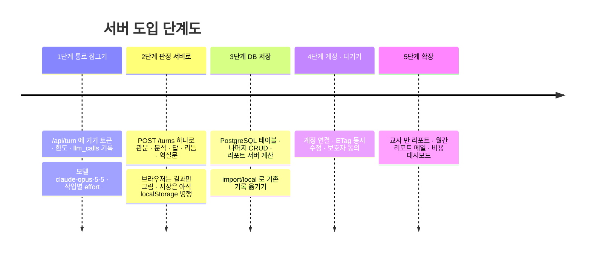

| 단계 | 바꾸는 파일 *(예정)* | 완료 기준 |
|---|---|---|
| 1 | `app/api/turn/route.ts`, `lib/server/llm/*` | 토큰 없는 요청 401 · 하루 한도 동작 · 호출마다 `llm_calls` 한 줄 · 캐시 적중 0 아님 |
| 2 | `lib/actions.ts` → `lib/server/coach.ts`, `app/api/v1/projects/[id]/turns` | 시나리오 JSON 16문을 서버로 돌렸을 때 개방도 · 역질문 요소가 지금 브라우저 결과와 같음 |
| 3 | `lib/db.ts` read/write → `lib/api.ts`, `lib/server/db/*` | 다른 브라우저에서 같은 토큰으로 같은 대화 · 리포트가 보임 |
| 4 | `app/api/v1/auth/link` | 폰과 PC가 같은 계정으로 이어짐, 동시 수정 시 412 |
| 5 | 교사용 화면 | — |

> **언제든 폴백** — 어느 단계에서든 서버가 죽으면 지금처럼 로컬 JSON · MD 엔진으로 대화가 이어져야 한다 (`checkLive()` 흐름 유지). 그것이 "서버 없이도 돈다"는 지금 앱의 장점이기 때문이다.

---

### 부록 A. 용어

| 말 | 뜻 |
|---|---|
| 턴 | 유효 질문 하나와 그 답 |
| 마디 | rhythm개의 턴 — 끝나면 역질문 1개 |
| 리포트 구간(window) | 한 프로젝트의 턴 10개 |
| 개방도 | O1 지시 ~ O5 맨 열린, NA 판별 불가 |
| 6요소 | 왜 · 맥락 · 제약 · 기준 · 확인 · 버릴 것 |
| 세 축 | 🧭 기획 · 🔀 알고리즘 · 🏗 전체 구조 |
| 요소 | 역질문이 확인하는 능력 (E1~E12 기본, M·S·C·A 팩, F 형식) |
| 형태 | F1 고르기 · F2 빈칸 · F3 한두 문장 |
| 폴백 | Claude 없이 로컬 답 카드로 답하기 |

### 부록 B. 지금 코드와의 연결

| 이 문서 | 지금 코드 |
|---|---|
| §2 테이블 | `lib/types.ts` 의 `Profile · Project · Turn · Message · ReverseQuestion · WindowReport · Note` |
| §4-2 · 4-3 | `lib/analyzer.ts` `analyze()` |
| §4-5 칩 · 역질문 | `lib/engine.ts` `chipsFor()` · `lib/rq.ts` `pickElement() · nextForm() · buildRQ()` |
| §4-5 리듬 | `lib/actions.ts` `runTurn()` |
| §4-6 채점 | `lib/engine.ts` `gradeAnswer()` |
| §4-7 리포트 | `lib/report.ts` `buildWindowReport() · REPORT_SECTIONS` |
| §5 프롬프트 · 스키마 | `data/prompts.json` · `lib/schemas.ts` · `app/api/turn/route.ts` |
