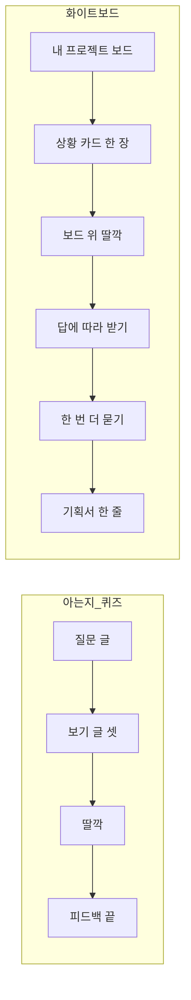
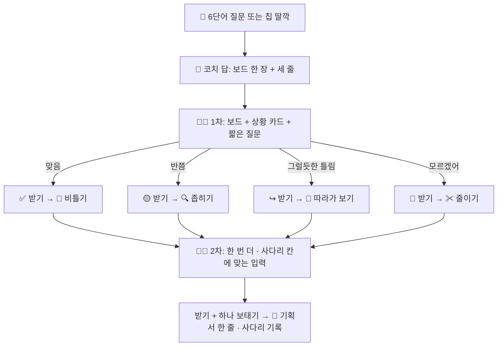
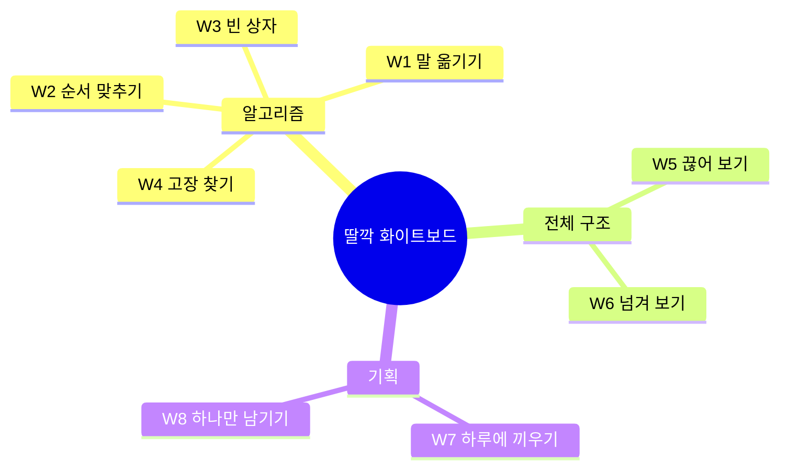
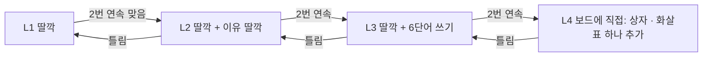
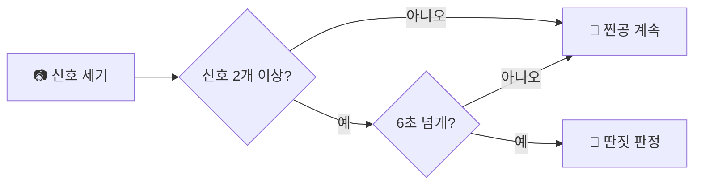
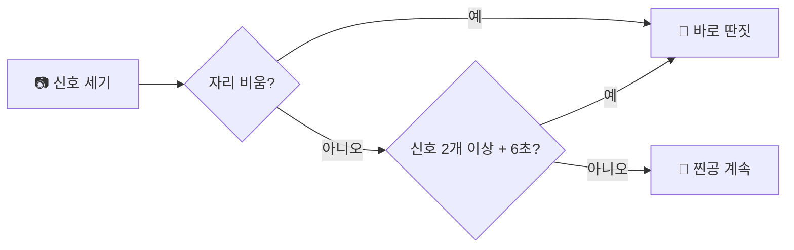
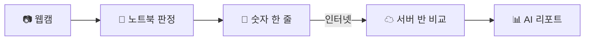
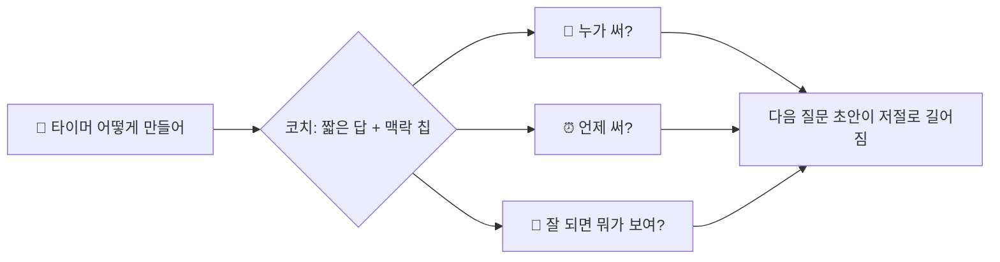
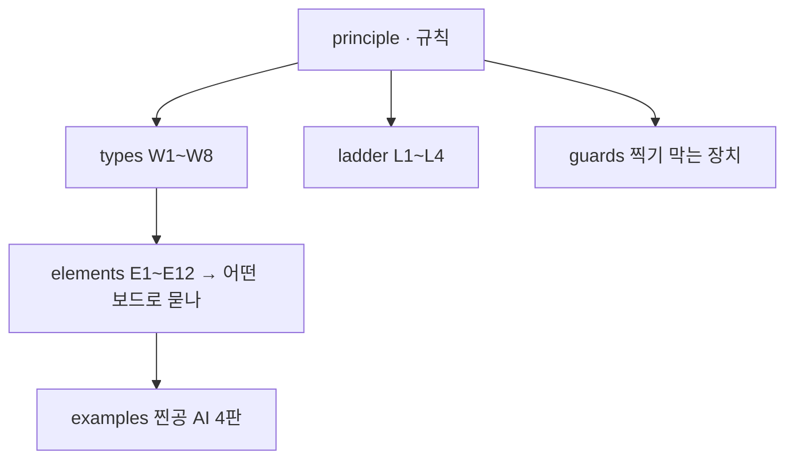

# 🖱 딸깍 화이트보드 역질문 템플릿 v1 — 보드 위에서 묻고, 답에 따라 한 번 더 묻는다

> 데이터: `frontend/src/data/whiteboard.json` · 기존 역질문: `frontend/src/data/elements.json` · `src/lib/rq.ts`
> 상태: **템플릿(기획) 단계** — 앱 화면 · 엔진에는 붙이지 않는다. 보여 주는 역할은 **소개 페이지(/about#whiteboard)** 가 맡는다 — §5의 네 판을 직접 눌러 보는 판(`components/about/WhiteboardTry.tsx`, 문구는 `about.json` `askback.whiteboard`).

---

## 0. 한 장 요약

| | 지금 (elements.json · 찐공 AI 예시) | 바꾼 뒤 (딸깍 화이트보드) |
|---|---|---|
| 묻는 것 | "흐름을 말할 수 있어?" — **아는지** | "이 카드면 말은 어디로 가?" — **돌려 보게** |
| 학생이 하는 일 | 보기 글 읽고 고르기, 또는 두세 문장 쓰기 | 보드 위 상자 · 화살표 · 칩을 **딸깍** |
| 질문 길이 | 40~120자 | **20자 안팎** — 보드가 말한다 |
| 답한 뒤 | 피드백 한 번으로 끝 | 답에 따라 **4갈래로 받고, 한 번 더 묻는다** |
| 운으로 맞히면 | 그대로 🟢 | 두 번째 질문(비틀기)에서 드러난다 |
| 딸깍만 하는 버릇 | 그대로 둔다 | **사다리**로 딸깍 → 이유 딸깍 → 6단어 → 보드에 직접 |

> **말 정리** — **딸깍**은 *나쁜 쪽*을 부르는 이름이다: 몇 단어 질문 → AI가 한 번에 완성품 → 다음 질문은 더 짧아진다. 우리 쪽은 **화이트보드 역질문**이라 부른다 (누르는 손은 같아도, 묻는 건 설계다). 나쁜 예시 템플릿은 `whiteboard.json` 의 `badExample` — 질문 5개(평균 2단어) · AI가 몰래 정한 것 8개 · 발표 날 화이트보드 검문 4문 모두 🤷. 소개 페이지에서 질문을 딸깍하면 스켈레톤 · "만드는 중"이 1.4초 뜨고, 한 번 만든 칸은 브라우저에 저장돼 다시 오면 바로 보인다 (`components/about/BadClick.tsx`).

---

## 1. 왜 필요한가

### 1-1. 아이들의 실제 모습

| 본 것 | 그래서 생기는 일 | 템플릿이 하는 일 |
|---|---|---|
| 앱 · 게임 · 쇼츠로 **딸깍에 익숙** | 긴 글 질문은 안 읽고 넘긴다 | 첫 입력은 언제나 딸깍 하나 |
| 질문이 **6단어를 거의 안 넘는다** ("타이머 어떻게 만들어?") | 코치가 맥락 없이 긴 답을 쏟는다 | 질문도 칩 딸깍으로 맥락을 붙인다 (§6) |
| 딸깍으로 **찍는 데 익숙** | 보기 셋이면 셋 중 하나를 찍는다 | 맞혀도 한 번 더 (비틀기), 빠른 딸깍엔 "왜?" |
| "알아?"라고 물으면 **"응"** | 자기 평가 보기("말할 수 있어")를 고른다 | 자기 평가 보기를 **없앤다** — 상황을 주고 돌려 보게 |

### 1-2. 지금 역질문이 약한 곳 *(앱 예시 그대로)*

| 출처 | 지금 질문 | 왜 약한가 |
|---|---|---|
| `elements.json` E11 F1 | "이걸 덩어리로 나누면, 값은 어디서 어디로 흘러?" 보기: *칸을 나눌 수 있고 … 말할 수 있어 / 칸은 나누겠는데 … 잘 모르겠어 / 통째로 하나라서 …* | 보기가 **자기 평가**다. 아는 척하면 🟢 |
| `elements.json` E1 F1 | "어떤 순서로 돌아가는 것에 가까워?" 보기: *재고 → 판단 → 움직인다* … | 내 프로젝트가 아닌 **일반 지식 퀴즈**. 외워서 맞힌다 |
| `elements.json` E10 F1 | "일부러 안 하기로 한 게 있어?" 보기: *정해뒀고 왜인지도 말할 수 있어* … | 정답이 보기에 쓰여 있다 |
| 찐공 AI Q6 (E12 F3) | "딴짓 사진 12장은 어디서 생겨서, 어디까지 가고, 어디서 사라져? 그리고 …" | 질문 둘이 한 문장에, 54자 넘는 글쓰기. 중학생은 여기서 멈춘다 |
| 찐공 AI Q2 (E1 F1) | 화장실 10분은 순도에 어떻게? (보기 셋 + 피드백) | 상황은 좋다. 그런데 **피드백 한 번으로 끝** — 맞힌 게 실력인지 운인지 모른다 |

### 1-3. 화이트보드 테스트란

면접관이 화이트보드에 순서도를 그려 두고 **"이 값이 들어오면 어디로 가요?"** 하고 묻는 것. 외운 걸 말하게 하지 않고, **설계 위에서 손으로 돌려 보게** 한다. 우리는 이걸 딸깍으로 한다.



---

## 2. 한 판의 흐름 — 묻고, 받고, 한 번 더



### 2-1. 네 갈래 받기 → 두 번째 질문

| 1차 결과 | 받는 말 (1문장) | 2차 수 | 2차가 하는 일 | 예 *(찐공 AI 보드)* |
|---|---|---|---|---|
| ✅ 맞음 | 학생이 딸깍한 상자 이름을 그대로 되받는다 | 🔀 **비틀기** | 조건 **하나만** 바꿔 다시 — 운인지 실력인지 가른다 | "3초 → 이번엔 7초면?" |
| 🟡 반쯤 | 맞은 절반을 먼저 짚는다 | 🔍 **좁히기** | 놓친 상자 하나만 보드에서 빛나게 하고 다시 | "6초 상자 전에 지나는 상자, 신호 몇 개?" |
| ↪ 그럴듯한 틀림 | "좋아, 그 길대로 해 볼게" — 틀렸다고 말하지 않는다 | 🚶 **따라가 보기** | 학생 규칙대로 돌리면 생기는 결과를 보여 주고, **스스로** 이상한 곳을 찾게 | "하품마다 📵 — 하루 30번. 괜찮아?" |
| 🤝 모르겠어 | "괜찮아, 한 칸만 보자" | ✂ **줄이기** | 보드를 상자 하나로 줄인 같은 질문 | "신호 1개. 2개 이상? [예] [아니오]" |

> **규칙 하나** — 두 번째 질문은 **같은 보드 위에서** 묻는다. 새 그림을 꺼내지 않는다. 학생이 방금 딸깍한 자리에서 이어진다.

### 2-2. 끝내는 말 (2차 뒤)

| 2차 결과 | 코치가 하는 말 | 남는 것 |
|---|---|---|
| 맞음 | 받기 + **하나 보태기**(빠진 경우 · 순서 · 연결 중 하나) | 기획서 한 줄 *(지호가 보드에서 정함)* |
| 틀림 | 맞는 길을 보드에 한 번 그어 보여 주고 끝 — 세 번째 질문 없음 | 복기함 + 다음 판 같은 요소 다시 |
| 모르겠어 | 코치의 생각 한 줄 + "너는?" | 복기함 |

**세 번째는 없다.** 두 번 묻고 돌려보낸다. 프로젝트로 돌아가는 게 먼저다.

---

## 3. 화이트보드 8가지 — 무엇을 딸깍하나

| 유형 | 이름 | 보드 | 딸깍 | 축 | 기존 요소 |
|---|---|---|---|---|---|
| W1 | 🚶 말 옮기기 | 순서도 + 상황 카드 | **말이 멈출 상자** 하나 | 🔀 알고리즘 | E1 흐름 |
| W2 | 🔢 순서 맞추기 | 흩어진 상자 3~4개 | **차례대로** 딸깍 | 🔀 알고리즘 | E1 · E8 |
| W3 | ⬜ 빈 상자 | 상자 하나가 비어 있는 순서도 | 들어갈 **카드** | 🔀 / 🧭 | E6 기준 · E7 검증 |
| W4 | 🐞 고장 찾기 | 한 곳이 일부러 틀린 보드 | **이상한 화살표 · 숫자** | 🔀 알고리즘 | E5 실패 · E7 |
| W5 | ✂ 끊어 보기 | 구조도 + 가위 카드 | **멈추는 칸 전부** (여러 개) | 🏗 전체 구조 | E12 경계 |
| W6 | 📦 넘겨 보기 | 칸과 칸 사이 선 | 선 위로 **지나가는 것 / 못 지나가는 것** | 🏗 전체 구조 | E11 연결 |
| W7 | 🕐 하루에 끼우기 | 쓸 사람의 하루 시간줄 | 내 것이 **끼어드는 순간** | 🧭 기획 | E9 대상 |
| W8 | ❌ 하나만 남기기 | 기능 카드 4~5장 | **남길 카드** 하나 (나머지 X) | 🧭 기획 | E2 핵심 · E10 범위 |



### 3-1. 좋은 화이트보드 질문의 조건

| 조건 | 나쁜 예 | 좋은 예 |
|---|---|---|
| **내 프로젝트 보드** 위에서 | "보통 순서도는 어떤 순서야?" | 지호의 AI 눈 순서도 그대로 |
| **상황 카드 한 장** | "딴짓은 어떻게 판정돼?" | 🃏 "하품하며 3초 눈 감음" |
| 질문은 **20자 안팎** | "이 상황에서 순서도는 어떻게 판정하고 어디가 틀릴 수 있어?" | "말은 어디서 멈춰?" |
| **자기 평가 보기 금지** | "말할 수 있어 / 잘 모르겠어" | 보드의 상자 이름이 곧 보기 |
| 오답은 **그럴듯하게** | 말도 안 되는 상자 | 상자 하나를 건너뛴 길 · 경계값 반대쪽 |
| **모르겠어**는 같은 크기 | 작은 회색 글씨 | 다른 보기와 같은 크기 칩 |

---

## 4. 딸깍에 길들지 않게 — 사다리와 장치

딸깍은 **입구**지 끝이 아니다. 같은 요소를 맞힐수록 2차의 입력이 한 칸씩 무거워진다.



| 사다리 | 1차 | 2차 | 보기 | 최고점 |
|---|---|---|---|---|
| L1 🖱 딸깍 | 딸깍 | 딸깍 | 보인다 | 2 |
| L2 🖱🖱 이유 딸깍 | 딸깍 | 딸깍 + **이유 칩** 딸깍 | 보인다 | 3 |
| L3 ✏ 6단어 | 딸깍 | **6단어 이내로 쓰기** | [보기 열기] — 열면 최고 1점 | 3 |
| L4 🖊 보드에 직접 | 딸깍 | 보드에 **상자나 화살표 하나 추가** | 없음 | 3 |

> 사다리는 **요소(E1 · E5 …)마다 따로** 오른다. 흐름은 L3인데 경계는 L1일 수 있다.

### 4-1. 찍기 막는 장치

| 장치 | 무엇을 막나 | 규칙 |
|---|---|---|
| 🔀 보기 섞기 | 자리 외우기 | 상자 보기는 보드 위치, 칩 보기는 매번 순서를 섞는다 |
| ⏱ 2초 딸깍 | 읽지 않고 찍기 | 1차를 2초 안에 누르면 2차에 **이유 칩**이 붙는다 (사다리 한 칸 위로 임시) |
| 🔁 비틀기 | 운 | 맞혀도 조건을 바꿔 한 번 더 — **점수는 2차에서 확정** |
| 🧩 이유 칩 | 결과만 외우기 | "왜?" 칩 3개 중 하나 — 결과는 맞고 이유가 틀리면 🟡 |
| 🚫 자기 평가 보기 | 아는 척 | 템플릿에 "할 수 있어 / 말할 수 있어"가 들어가면 검사기가 막는다 |
| ✏ 내 말 한 줄 | 딸깍 의존 | L3부터 2차는 쓰기. 6단어면 충분하다고 **먼저 말해 준다** |

### 4-2. 점수 (기존 0~3과 같은 칸)

| 칸 | 1점 조건 |
|---|---|
| 1차 | 맞음 (반쯤은 0.5 → 내림) |
| 2차 | 비틀기 · 좁히기 · 따라가 보기에서 맞음 |
| 이유 · 내 말 | L2 이유 칩 맞음 / L3 6단어에 핵심 단어 / L4 상자가 규칙에 맞음 |

- 힌트를 봤으면 최고 1점, L3에서 [보기 열기]를 눌렀으면 최고 1점 — 기존 `feedback` 규칙과 같다.
- 🟢 2점 이상 · 🟡 1점 · ⚪ 0점 — `scoreDot` 그대로 쓴다.
- 점수는 학생에게 말하지 않는다. 사다리 칸(🖱 → ✏)만 보여 준다.

---

## 5. 예시 — 찐공 AI 보드로 *(가상 · 찐공 AI 2~4단의 규칙을 그대로 씀)*

### 예시 A · W1 말 옮기기 · 🔀 E1 흐름 · L1

**학생 질문 (6단어)** — "AI 눈 어떻게 판정해?"

**보드**



**🃏 상황 카드** — 지호가 하품하며 눈을 3초 감았다 *(신호: 눈 감음 1개)*
**🧑‍🏫 1차** — "말은 어디서 멈춰?"
**딸깍 보기** — [📗 찐공 계속] [📵 딴짓 판정] [⏳ 6초 넘게?] [🤷 모르겠어]

| 딸깍 | 갈래 | 받는 말 | 🧑‍🏫 2차 (같은 보드) | 2차 보기 |
|---|---|---|---|---|
| 📗 찐공 계속 | ✅ 맞음 | "찐공 계속 — 맞아. 신호가 하나라 첫 상자에서 바로 돌아가." | 🔀 비틀기 — 🃏 *고개 숙임 + 눈 감음, 7초* "이번엔?" | [📗 찐공] [📵 딴짓] [⏳ 6초 상자] |
| ⏳ 6초 넘게? | 🟡 반쯤 | "6초 상자까지 갔네. 그 앞 상자를 지나왔는지 보자." | 🔍 좁히기 — 첫 상자만 빛남 "신호 몇 개였지?" | [1개] [2개] |
| 📵 딴짓 판정 | ↪ 틀림 | "좋아, 그 길대로 해 볼게. 그럼 하품할 때마다 📵가 떠." | 🚶 따라가 보기 — "하품 하루 30번. 📵 30번, 괜찮아?" → "괜찮지 않아"면 "어느 상자가 막아 줘?" | [괜찮아] [너무 많아] → 보드 상자 딸깍 |
| 🤷 모르겠어 | 🤝 줄이기 | "괜찮아, 상자 하나만 보자." | ✂ 줄이기 — 보드에 ◇ 하나 "신호 1개. 2개 이상이야?" | [예] [아니오] |

**끝내는 말 (✅ → 비틀기도 맞음)** — "📵 딴짓 — 맞아, 이번엔 두 상자를 다 넘었어. **하나 보태면**, 7초 중 6초가 넘는 순간 판정되니까 📵는 6초 지점부터 세는 게 맞을지 0초부터 세는 게 맞을지 정해야 해."
**📝 기획서 한 줄** — `신호 1개는 몇 초든 찐공 · 신호 2개 + 6초부터 딴짓 (지호가 보드에서 따라감)`

---

### 예시 B · W4 고장 찾기 · 🔀 E5 실패 조건 · L2

**학생 질문** — "이거 틀릴 때 있어?"

**보드 (한 곳이 일부러 틀림)**



**🧑‍🏫 1차** — "이상한 화살표, 딸깍!"
**딸깍 보기** — 보드의 화살표 넷 + [🤷 모르겠어]

| 딸깍 | 갈래 | 받는 말 | 🧑‍🏫 2차 | 2차 보기 (L2: + 이유 칩) |
|---|---|---|---|---|
| 자리 비움 → 바로 딴짓 | ✅ | "거기야. 자리 비움만 6초 규칙을 건너뛰고 있어." | 🔀 비틀기 — 🃏 *지우개 주우러 2초 숙임* "이 보드면 뭐가 떠?" | [📵 딴짓] [📗 찐공] + 왜? [6초 안 지켜서] [신호가 1개라서] [화면 밖이라서] |
| 2개 이상 + 6초 → 딴짓 | ↪ | "좋아, 그 화살표를 지워 볼게. 그럼 폰 들고 1분 있어도…" | 🚶 따라가 보기 — "폰 1분, 이제 뭐가 떠?" | [📗 찐공] [📵 딴짓] |
| 🤷 | 🤝 | "괜찮아. 화살표 둘만 비교하자." | ✂ 줄이기 — 두 화살표만 남김 "6초를 기다리는 건 어느 쪽?" | [위] [아래] |

**📝 기획서 한 줄** — `자리 비움도 6초를 지킨다 — 지우개 줍기는 딴짓이 아니다 (지호가 고장 찾기에서 정함)`

---

### 예시 C · W5 끊어 보기 · 🏗 E12 경계 · L1

**학생 질문** — "와이파이 끊기면?"

**보드**



**🃏 가위 카드** — ✂ 노트북 ↔ 서버 사이 인터넷 끊김
**🧑‍🏫 1차** — "멈추는 칸, 다 딸깍" *(여러 개 고르기)*

| 딸깍 | 갈래 | 받는 말 | 🧑‍🏫 2차 | 2차 보기 |
|---|---|---|---|---|
| ☁ + 📊 | ✅ | "서버랑 리포트만 — 맞아. 판정은 노트북에서 하니까 타이머는 계속 돌아." | 🔀 비틀기 — "1시간 뒤 다시 연결. 그사이 숫자 한 줄은?" | [사라져] [모아 뒀다 보내] [처음부터 다시 재] |
| 전부 다 | ↪ | "좋아, 다 멈춘다고 해 볼게. 그럼 시험 전날 와이파이가 끊기면…" | 🚶 따라가 보기 — "지호의 순공, 그날은 몇 분으로 남아?" | [0분] [잰 만큼] |
| 🧠 + ☁ + 📊 | 🟡 | "서버 쪽은 맞아. 노트북 판정은 인터넷이 필요할까?" | 🔍 좁히기 — 🧠 칸만 빛남 "이 칸은 무엇만 있으면 돌아?" | [웹캠] [인터넷] |
| 🤷 | 🤝 | "괜찮아. 가위 바로 오른쪽 칸만 보자." | ✂ 줄이기 — "☁ 서버는 숫자를 받을 수 있어?" | [응] [아니] |

**📝 기획서 한 줄** — `인터넷이 끊겨도 판정 · 타이머는 돈다. 숫자 한 줄은 모아 뒀다가 다시 연결되면 보낸다 (지호가 끊어 보기에서 정함)`

---

### 예시 D · W8 하나만 남기기 · 🧭 E2 핵심 · L3

**학생 질문** — "발표 3일 남았어"

**보드** — 기능 카드 다섯 장: [⏱ 버튼 타이머] [👁 AI 눈] [🏁 레이스] [🏫 반 비교] [📊 AI 리포트]
**🧑‍🏫 1차** — "하나만 남겨. 딸깍!"

기획 질문에는 정답 상자가 없다. 그래서 갈래는 **맞음/틀림이 아니라 '그 카드가 혼자 설 수 있나'** 로 가른다.

| 딸깍 | 갈래 | 받는 말 | 🧑‍🏫 2차 (L3: 6단어 쓰기) |
|---|---|---|---|
| 👁 AI 눈 | ✅ 혼자 섬 | "AI 눈 — 앉아 있던 시간과 공부한 시간을 가르는 칸이지." | 🔀 비틀기 — 친구가 "그냥 스톱워치랑 뭐가 달라?" ✏ "6단어로 답해 봐" *(예: 딴짓은 빼고 진짜만 잰다)* |
| ⏱ 버튼 타이머 | 🟡 혼자 서지만 약함 | "타이머 — 이것만 있어도 돌아가긴 해." | 🔍 좁히기 — "폰 집을 때 버튼 누를까?" ✏ "6단어로" *(찐공 AI Q3에서 지호가 직접 겪은 것)* |
| 🏫 반 비교 / 📊 리포트 | ↪ 혼자 못 섬 | "좋아, 반 비교만 남겨 볼게." | 🚶 따라가 보기 — 나머지 카드를 지운 보드 "비교할 숫자는 어디서 와?" → [보기 열기] 시 [타이머] [AI 눈] [몰라] |
| 🤷 | 🤝 | "괜찮아, 둘만 남겨 보자." | ✂ 줄이기 — [⏱] [👁] 두 장만 "친구 폰 보는 걸 잡는 건?" 딸깍 |

**📝 기획서 한 줄** — `하나만 남긴다면 AI 눈 — 앉은 시간이 아니라 공부한 시간을 잰다 (지호가 6단어로 씀)`

---

## 6. 질문 쪽도 딸깍에서 시작 — 6단어 질문 키우기

학생 질문이 6단어라도 **막지 않는다.** 답은 짧게 주고, 맥락을 칩 딸깍으로 붙이게 한다.



| 학생이 친 것 | 칩 딸깍 뒤 입력창 초안 |
|---|---|
| "타이머 어떻게 만들어?" (3단어) | "**나**가 **저녁 공부 때** 쓰는 타이머 어떻게 만들어? **잘 되면 진짜 공부 시간이 보여.**" |
| "AI 눈 어떻게 판정해?" (4단어) | "노트북 웹캠으로 **멍때림이랑 자리 비움**을 판정하려면? **6초 넘을 때만** 잡고 싶어." |

- 칩 안의 값도 딸깍 (예: 👤 [나] [친구] [가족] [반 전체] + ✏ 직접).
- 이건 기존 `fromChip` 초안과 같은 길이다. 새로 만드는 건 **값 칩**뿐.

---

## 7. 템플릿 데이터 모양 (`whiteboard.json`)



| 키 | 뜻 |
|---|---|
| `principle` | 질문 20자 · 자기 평가 금지 · 두 번까지 · 같은 보드 |
| `branches` | 네 갈래(맞음 · 반쯤 · 틀림 · 모르겠어)와 2차 수(비틀기 · 좁히기 · 따라가 보기 · 줄이기) |
| `ladder` | L1~L4 — 2차 입력 방식과 최고점 |
| `guards` | 찍기 막는 장치 (2초 · 섞기 · 이유 칩 · 금지어) |
| `types` | W1~W8 — 보드 · 딸깍 대상 · 축 |
| `elements` | 기존 E1~E12를 어떤 W로, 어떤 상황 카드로 묻는지 + 빈칸 틀(`{{ }}`) |
| `examples` | 위 §5의 찐공 AI 4판을 데이터로 |
| `prompt` | 라이브 코치(LLM)가 이 틀로 1차 · 2차를 만들 때의 규칙 |

### 7-1. 판 하나의 모양

```text
board      : 보드 (mermaid 또는 카드 목록)
card       : 상황 카드 한 장
ask        : 1차 질문 (20자 안팎)
pick       : one | many | order | board   ← 무엇을 딸깍하나
choices[]  : label · branch(right|half|wrong|dontKnow) · reply · next
next       : move(twist|narrow|walk|shrink) · card? · ask · choices[] · reasons[]? · write?
close      : right / wrong / dontKnow 끝내는 말
planLine   : 기획서에 남길 한 줄
```

---

## 8. 기존 것과 이어 붙이는 곳 (다음 단계)

| 붙일 곳 | 바꿀 것 | 크기 |
|---|---|---|
| `elements.json` F1 | 자기 평가 보기 → `whiteboard.json`의 W 판으로 교체 (F2 · F3은 사다리 L3 · L4로) | 데이터 |
| `prompts.json` `rq` · `feedback` | `whiteboard.json` `prompt`를 붙여 1차 + 4갈래 2차를 한 번에 생성 | 데이터 |
| `lib/rq.ts` `nextForm` | F1→F2→F3 대신 요소별 사다리 L1~L4 | 작은 코드 |
| `RQCard.tsx` · `ReverseQuestionBubble.tsx` | 보드 + 상황 카드 + 2차 한 번 더 | 화면 |
| `scenarios/zzingong.json` | 역질문 10개를 화이트보드 2단으로 바꾸고, 학생 질문을 6단어 + 칩으로 | 데이터 |
| `scripts/validate_scenario.py` | 자기 평가 금지어 · ask 길이 · 네 갈래 모두 `next` 있는지 검사 | 작은 코드 |
