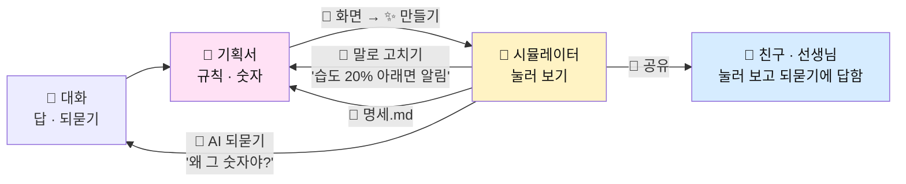
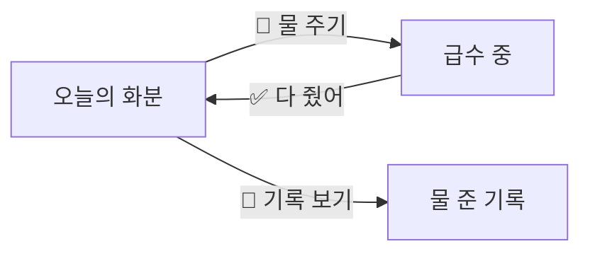
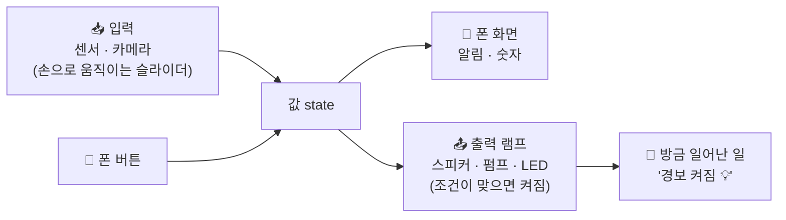
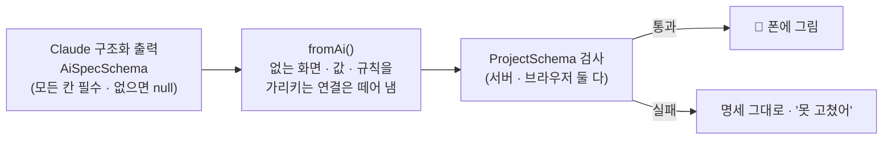

# 📱 화면 시뮬레이터 설계서 v1 — 기획과 화면을 한 대화에서 같이 그린다

> **한 문장**: 코드는 만들지 않는다. 학생이 정한 기획서(규칙 · 숫자)를 **화면 명세 JSON**으로 바꿔 정해진 부품 6종으로만 그리고, 눌러 보고, 대화로 고치고, 링크로 나눈다.
>
> **위치**: [바이브코딩 수업 운영 기획서 v1](바이브코딩_수업_운영_기획서_v1_기획에서_미리보기까지.md)의 §4 제작 · §5 미리보기와 소스 · §6.2 생성 출력 형식을 **대신한다**. 그 문서의 "Next.js 코드 생성 · .zip"은 이 문서의 "화면 명세 · 공유 링크"로 바뀐다.
> **짝 문서**: [화면설계서 v3 (앱)](AI_역질문_화면설계서_v3_앱.md) — 대화 화면(S3) 원본 · [설계서 v4](AI_역질문_설계서_v4_설계를_묻고_기획서를_남긴다.md) — "답의 기본 결과물은 명세"
> **기준일**: 2026-11-15. **MVP가 동작한다** (§10에서 이미 있는 것 / 만들 것을 나눈다).
> **움직이는 시연**: `frontend`에서 `npm run dev`를 켜고 다음 두 곳을 연다.
> - `/sim` — 더미 예시 🌱 스마트 화분 · 🍱 급식 투표, **모두 예시**
> - 대화창 헤더의 **📱 화면** 버튼
>
> **다섯 기둥**
> - ① **코드 0줄** — 결과물은 화면 명세(화면 · 칸 · 값 · 규칙)뿐이다. 부품은 6종으로 닫혀 있다
> - ② **기획과 화면은 같이 간다** — 기획 모드와 시뮬레이터 모드를 나누지 않는다. 대화로 정한 규칙이 곧 버튼의 규칙이다
> - ③ **AI는 지어내지 않고 되묻는다** — 학생이 정하지 않은 규칙 · 숫자 · 기준은 화면에 넣지 않고 질문으로 돌려준다
> - ④ **누르면 되묻는다** — 규칙이 붙은 버튼은 처음 누를 때 "이 버튼은 어느 규칙이야?"를 묻는다
> - ⑤ **링크 하나로 나눈다** — 서버 저장 · 로그인 없이 명세를 링크에 담아 친구 · 선생님에게 보낸다

---

## 1. 왜 필요한가

### 1.1 수업에서 막히는 곳

| 막히는 곳 | 실제로 생기는 일 | 시뮬레이터로 풀면 |
|---|---|---|
| 🧾 **기획서가 글뿐** | "물 주기 버튼이 있다"까지 쓰고 멈춘다. 언제 막히는지, 누르면 뭐가 바뀌는지가 빈다 | 버튼을 눌러 보면 빈 곳이 바로 드러난다 ("눌렀는데 아무 일도 안 일어남 🤔") |
| 🤖 **코드 생성은 AI가 다 함** | "앱 만들어 줘" 한 줄이면 끝. 학생은 왜 그렇게 도는지 모른다 | 코드는 없다. 학생이 정한 규칙만 화면에 들어간다 |
| 😴 **참여가 없음** | 기획서 쓰기는 혼자 하는 숙제가 된다 | 폰 화면을 딸깍하고, 친구 화면을 받아서 눌러 보고, 되묻기에 답한다 |
| 🔀 **기획과 화면이 따로 놂** | 화면을 바꾸면 기획서가 낡고, 기획서를 바꾸면 화면이 낡는다 | 한 대화에서 같이 바뀌고, 📄 명세.md로 기획서에 다시 붙는다 |
| 💳 **AI 키가 없을 때** | 수업이 멈춘다 | 빈 예시 틀 + ✏️ 손으로 고치기로 그대로 진행된다 |

### 1.2 "코드보다 설계"와 부딪치지 않나?

부딪치지 않는다. 시뮬레이터가 내놓는 것은 **명세**다. 설계서 v4가 정한 결과물(규칙 카드 · 상태표 · 순서도 · 화면 칸)을 *눌러 볼 수 있게* 만든 것일 뿐이다.

| | 코드 생성 (예전 계획) | 화면 시뮬레이터 (이 문서) |
|---|---|---|
| AI가 내놓는 것 | `page.tsx` | 화면 명세 JSON |
| 그리는 쪽 | 생성된 코드 그대로 실행 | **앱의 고정된 렌더러**가 부품 6종으로만 그림 |
| AI가 틀리면 | 이상한 코드가 돈다 | 스키마 밖 값은 떨어져 나간다 (§6.3) |
| 학생이 고칠 때 | 코드를 읽어야 한다 | 칸을 딸깍하거나 말로 한다 |
| 기획서로 돌아가기 | 끊긴다 | 📄 명세.md가 기획서 형식 그대로 나온다 |

---

## 2. 전체 지도

### 2.1 한 바퀴



### 2.2 화면 목록

| ID | 화면 | 들어오는 길 | 하는 일 | 상태 |
|---|---|---|---|---|
| **SIM-0** | 시뮬레이터 페이지 | 주소 `/sim` | 예시 프로젝트를 고르고 돌려 보기 · 고치기 | ✅ |
| **SIM-0s** | 공유받은 화면 | 주소 `/sim#s=…` | 남이 보낸 화면을 열어 본다 | ✅ |
| **SIM-1** | 화면 만들기 (빈 상태) | 대화창 📱 화면 → 처음 | ✨ 기획서로 만들기 / 🧩 빈 예시 틀 | ✅ (AI 실호출 미확인) |
| **SIM-2** | 시뮬레이터 다이얼로그 | SIM-1 다음, 또는 저장된 명세가 있을 때 | 돌려 보기 · 고치기 · 말로 고치기 | ✅ |
| **SIM-q** | 되묻기 시트 | 규칙 붙은 버튼을 처음 누름 | 어느 규칙인지 고른다 | ✅ |
| **SIM-md** | 📄 명세.md 창 | 상단 📄 명세.md | 기획서에 붙일 .md를 복사 | ✅ |
| **SIM-sh** | 🔗 공유 창 | 상단 🔗 공유 | 링크를 복사 | ✅ |

SIM-0과 SIM-2는 **같은 본체**(`SimStage`)를 쓴다. 다른 것은 머리글과 왼쪽 맨 위 카드뿐이다.

---

## 3. 공통 화면 구조 (SIM-0 · SIM-2)

### 3.1 배치 — PC는 세 칸, 모바일은 폰이 맨 위

```
┌───────────────────────────────────────────────────────────────────────────┐
│ 📱 화면 시뮬레이터  MVP         [▶️ 돌려 보기][✏️ 고치기][📄 명세.md][🔗 공유] 앱으로 │
│ 코드는 없어. 화면 · 칸 · 규칙만 정하면 바로 눌러 볼 수 있어.                        │
├────────────────────┬───────────────────────┬──────────────────────────────┤
│ 🗂 예시 프로젝트     │   ┌─────────────────┐  │ 🗺 화면 흐름 — 눌러서 이동      │
│ [🌱 스마트 화분]     │   │   오늘의 화분     │  │ 🏁 오늘의 화분                │
│ [🍱 급식 투표]       │   ├─────────────────┤  │  └ 🚿 물 주기 → 급수 중        │
│ 흙이 마르면 알려 주고…│   │ ▨ 🪴 화분 사진    │  │  └ 📒 기록 보기 → 물 준 기록   │
│                    │   │ 흙 습도      45%  │  │ 급수 중                      │
│ 📜 기획서의 규칙     │   │ [🚿 물 주기 ❓R3] │  │ 물 준 기록                   │
│ R1 습도 30% 아래면…  │   │ [📒 기록 보기]    │  ├──────────────────────────────┤
│ R2 물 한 번에 +30…   │   │                 │  │ 🙋 내가 설명한 버튼  1 / 3개    │
│ R3 80% 이상이면 막기 │   └─────────────────┘  │ ▓▓▓░░░░░                      │
│ R4 횟수를 기록…      │                       │ ☑ 버튼을 처음 누를 때 되묻기    │
│                    │ 💬 말로 기획·화면 같이 고치기│ ├──────────────────────────────┤
│ 🎛 상황 바꾸기       │ [예: 습도 20% 아래면…][보내기]│ 🧾 방금 일어난 일             │
│ 💧 흙 습도 ━━●── 45% │                       │ ✅ 다 줬어 딸깍 — 습도 45→75 … │
│ 🚿 물 준 횟수 ●─── 0 │                       │                              │
│ ↺ 처음 상태로        │                       │                              │
└────────────────────┴───────────────────────┴──────────────────────────────┘
```

| 영역 | 무엇 | 왜 |
|---|---|---|
| **가운데 폰** | 360px 폭 · 높이 640px. 안쪽만 밝은 종이색 와이어프레임 | 밤하늘 앱 안에서 "이건 내가 만든 앱 화면"이라고 한눈에 구분된다 |
| **왼쪽** | 프로젝트 고르기 · 📜 기획서의 규칙 · 🎛 상황 바꾸기 | 규칙이 화면 옆에 붙어 있어야 "이 버튼은 어느 규칙?"에 답할 수 있다 |
| **오른쪽** | 🗺 화면 흐름 · 🙋 설명한 버튼 · 🧾 방금 일어난 일 | 누를 때마다 무엇이 바뀌었는지 글로 남는다. 버튼을 눌렀는데 아무 일도 안 일어나면 "🤔"로 빈 곳이 드러난다 |
| **폰 아래** | 💬 말로 기획 · 화면 같이 고치기 | 대화가 화면 바로 아래에 있어야 기획과 화면이 따로 놀지 않는다 |

**모바일(1024px 미만)**: 한 줄로 쌓는다. 순서는 폰 + 말로 고치기 → 왼쪽 카드 → 오른쪽 카드. 폰이 언제나 맨 위에 온다.

### 3.2 두 모드

| 모드 | 폰 안에서 보이는 것 | 오른쪽 | 바뀌는 것 |
|---|---|---|---|
| ▶️ **돌려 보기** (기본) | 실제 앱처럼 그린 칸. 조건이 안 맞는 알림은 숨는다 | 화면 흐름 | 값(state)만. 명세는 그대로 |
| ✏️ **고치기** | 칸마다 점선 편집 상자 + 맨 아래 ➕ 칸 더하기 | 화면 흐름 + ➕ 화면 더하기 + 🧹 처음으로 | 명세 자체. 바꾸는 즉시 저장된다 |

✏️ 고치기에서 칸 하나가 하는 일:

| 칸 | 고칠 수 있는 것 |
|---|---|
| 모든 칸 | 글 · ↑ 위로 · 🗑 지우기 |
| 🔢 숫자 | 보여 줄 값 (state 중 하나) |
| 🔘 버튼 | 누르면 갈 화면 · 따르는 규칙 |
| 📋 목록 | 쉼표로 나눈 줄 |
| 화면 이름 | 폰 맨 위 제목 칸 |

> **MVP에서 손으로 못 고치는 것**: 버튼이 바꾸는 값(do) · 보이는 조건(showIf) · 막히는 조건(disabledIf). 이 셋은 **💬 말로 고치기**나 JSON으로만 바뀐다. 조건은 규칙과 같이 정해야 하기 때문이다 (§10.2에서 열 것인지 정한다).

### 3.3 되묻기 시트 (SIM-q)

규칙(rule)이 붙은 버튼을 **처음** 누르면 폰 아래에서 시트가 올라온다.

```
┌─────────────────────────────┐
│ 🙋 잠깐, 되물을게              │
│ 「🚿 물 주기」 — 어느 규칙을 따라? │
│ ┌─────────────────────────┐ │
│ │ R1 습도 30% 아래면 알림…    │ │
│ │ R2 물 한 번에 +30 …        │ │
│ │ R3 80% 이상이면 막기  ✅    │ │ ← 고른 뒤 초록
│ │ R4 횟수를 기록에 남긴다      │ │
│ │ 🤷 모르겠어                 │ │ ← 언제나 같은 크기
│ └─────────────────────────┘ │
│ ✅ 맞아! 이 버튼은 네가 설명할 수 있어. │
│ [ 계속하기 → ]                │
└─────────────────────────────┘
```

| 규칙 | 내용 |
|---|---|
| 언제 뜨나 | 규칙 붙은 버튼을 **처음** 누를 때만. 같은 버튼은 두 번 묻지 않는다 |
| 안 뜨는 경우 | ☐ 되묻기를 끔 · 규칙이 1개 이하 (고를 게 없다) |
| 답한 뒤 | [계속하기 →]를 누르면 원래 버튼 동작(값 바꾸기 · 화면 이동)이 그대로 일어난다. 틀려도 막지 않는다 |
| 열려 있는 동안 | 뒤의 다른 버튼은 눌리지 않는다 |
| 점수 | 버튼 꼬리표가 ❓ → ✅(맞음) / 🔁(틀림 · 모르겠어)로 바뀐다. 오른쪽 **🙋 내가 설명한 버튼 N / 전체**만 오른다. 다른 학생과 비교하지 않는다 |
| 다시 | ↺ 다시 풀기로 꼬리표를 모두 ❓로 되돌린다 |

### 3.4 🎛 상황 바꾸기

값마다 슬라이더가 하나씩 있다. 버튼을 여러 번 누르지 않고 **경계값을 바로 시험**하기 위한 것이다.

> 예: 💧 흙 습도를 20%로 내리면 → "😵 목말라요!" 알림이 뜬다 (R1). 85%로 올리면 → 🚿 물 주기가 🔒 막힌다 (R3).

이 경계값 시험이 바로 수업 활동이 된다. "몇 %에서 막혀야 해? 왜 그 숫자야?"를 학생이 직접 돌려 보며 답한다.

---

## 4. 화면별 설계

### SIM-0 시뮬레이터 페이지 (`/sim`)

| 항목 | 내용 |
|---|---|
| 데이터 | `frontend/src/data/sim.json` — 🌱 스마트 화분(화면 3 · 규칙 4 · 값 2), 🍱 급식 투표(화면 2 · 규칙 4 · 값 3). **모두 예시** |
| 저장 | 고친 명세는 이 브라우저에만 저장된다 (`askback:sim:v1`). 저장이 막혀 있어도 더미 데이터로 그대로 돈다 |
| 처음으로 | ✏️ 고치기 → 🧹 고친 것 모두 지우고 처음으로 |
| 머리글 오른쪽 | [앱으로] 링크 |

### SIM-0s 공유받은 화면 (`/sim#s=…`)

| 항목 | 내용 |
|---|---|
| 보이는 것 | 왼쪽 카드 제목이 **🗂 공유받은 화면 · 예시**로 바뀌고, 맨 앞에 **🔗 (이름)** 탭이 생겨 바로 열린다 |
| 받은 쪽에서 고치면 | 받은 사람 브라우저에만 저장된다. **보낸 사람 것은 바뀌지 않는다** |
| 잘못된 링크 | 길이 · 형식 검사(§7.3)를 통과하지 못하면 조용히 무시하고 예시만 보여 준다 |

### SIM-1 화면 만들기 (대화창 📱 화면 → 처음)

대화창 헤더 📝 기획서 옆의 **📱 화면** 버튼(별빛 노랑 테두리)을 누르면 화면 전체를 덮는 다이얼로그가 뜬다. 이 프로젝트에 저장된 명세가 없으면 이 화면부터 보인다.

```
            📱
   🌱 스마트 화분 — 화면으로 보기
 지금까지 대화로 정한 기획서를 화면으로 그려 볼게.
 코드는 만들지 않아 — 화면 · 칸 · 규칙만 나와.
 기획서에 없는 건 그리지 않고 되물을 거야.

 [✨ 기획서로 화면 만들기] [🧩 빈 예시 틀로 시작] [✕ 닫기]
```

| 버튼 | 하는 일 | AI 꺼짐 |
|---|---|---|
| ✨ 기획서로 화면 만들기 | 기획서를 `/api/sim`으로 보내 화면 명세를 받는다. 받는 동안 "화면을 그리는 중…" | 회색으로 꺼지고 "지금은 AI 연결이 꺼져 있어 (서버에 API 키가 없음)" 안내 |
| 🧩 빈 예시 틀로 시작 | 정해진 틀(화면 3개: 처음 → 하는 화면 → 결과, 값 1개, **규칙 0개**)로 시작 | 그대로 된다. "예시 틀은 AI가 만든 게 아니라 정해진 빈 틀이야" |
| ✕ 닫기 / Esc | 대화로 돌아간다 | |

**기획서로 무엇을 보내나**: 프로젝트에 📝 기획서가 있으면 그 .md를, 없으면 지금까지 채운 초안(`projectMd(project, false)`)을 보낸다.

**빈 틀에 규칙이 0개인 이유**: 규칙은 학생이 정한다. 왼쪽 📜 카드는 "아직 정한 규칙이 없어. 대화에서 '언제 · 얼마나 · 무엇을 막을지'를 정하면 여기에 생겨."라고 안내한다.

### SIM-2 시뮬레이터 다이얼로그

§3의 공통 구조에 두 가지가 더해진다.

| 더해지는 것 | 내용 |
|---|---|
| ✨ 알림 띠 (맨 위) | AI가 막 만들었을 때 note(무엇을 만들었는지) + 🙋 ask(되묻는 질문 하나) |
| 머리글 | `📱 🌱 스마트 화분 [화면 시뮬레이터]` · "기획서에서 나온 화면이야. 눌러 보고, 이상한 곳은 대화로 돌아가서 물어봐." · 오른쪽 끝 [✕ 닫기] |
| 저장 | 프로젝트마다 따로 저장된다 (`askback:sim:p:<프로젝트 id>`). 닫았다 열면 그대로 이어진다 |
| 처음으로 | 🧹를 누르면 이 프로젝트의 명세를 지우고 SIM-1로 돌아간다 |

### 💬 말로 기획 · 화면 같이 고치기 (SIM-0 · SIM-2 공통)

```
💬 말로 기획 · 화면 같이 고치기  ● Claude
┌──────────────────────────────────┐
│          습도 20% 아래면 빨간 알림 띄워 줘 │ ← 나
│ R5를 더하고, 첫 화면에 빨간 알림을 붙였어.    │ ← 코치 (note)
│ ───────────────────────────────  │
│ 🙋 20%로 정한 이유가 뭐야? 화분마다 같을까? │ ← 누르면 입력창에 "…→ " 로 들어온다
└──────────────────────────────────┘
[ 예: 습도 20% 아래면 빨간 알림을 띄워 줘 ][보내기]
```

| 규칙 | 내용 |
|---|---|
| 보내는 것 | 기획서 + **지금 명세** + 요청 한 줄 |
| 받는 것 | 고친 명세 전체 + note + ask. 받자마자 폰 화면이 바뀐다 |
| 규칙이 생기는 길 | 학생이 요청에서 **직접 말한** 규칙 · 숫자만 rules에 더한다. 그 규칙을 따르는 버튼 · 알림 · 조건도 같이 바꾼다 |
| 🙋 되묻기 | 코치 말풍선 아래에 붙는다. 누르면 입력창에 `질문 → `이 채워진다 — **보내지는 않는다** (화면설계서 v3 P5) |
| 실패 | "이번엔 화면을 못 고쳤어. 조금 다르게 말해 줄래?" — 명세는 그대로 |
| AI 꺼짐 | 입력창 대신 "지금은 AI 연결이 꺼져 있어. ✏️ 고치기에서 손으로 바꿀 수 있어." |

### SIM-md 📄 명세.md 창

기획서에 그대로 붙일 수 있는 .md를 보여 주고 [📋 복사]한다. 구성은 언제나 같은 네 칸이다.

| 칸 | 내용 |
|---|---|
| 1. 화면 흐름 | mermaid `flowchart LR` — 화면이 상자, 버튼이 화살표 |
| 2. 규칙 | `R1 …` 목록 (없으면 "아직 정한 규칙이 없다") |
| 3. 기억하는 값 | 값 · 처음 · 범위 표 |
| 4. 화면 칸 | 화면마다 `칸 \| 내용 \| 누르면 · 조건 \| 규칙` 표 |

예시 (🌱 스마트 화분, 앞부분):

````markdown
## 1. 화면 흐름



### 오늘의 화분 (첫 화면)

| 칸 | 내용 | 누르면 · 조건 | 규칙 |
|---|---|---|---|
| 🔢 숫자 | 흙 습도 ({moisture}) | — | — |
| 🔔 알림 | 😵 목말라요! 물을 주세요 | 보이는 조건: 💧 흙 습도 < 30 | — |
| 🔘 버튼 | 🚿 물 주기 | → 급수 중 · 막히는 조건: 💧 흙 습도 >= 80 | R3 |
````

### SIM-sh 🔗 공유 창

| 항목 | 내용 |
|---|---|
| 보이는 것 | 링크 한 줄(누르면 전체 선택) + [📋 복사] |
| 안내 문구 | "화면 명세가 링크 안에 통째로 들어 있어 — 서버에 저장되지 않고, 로그인도 필요 없어. 링크를 여는 사람은 자기 브라우저에서 눌러 보고 고칠 수 있지만, 내 것은 바뀌지 않아. 내가 다시 고치면 새 링크를 만들어 줘." |
| 길이 | 스마트 화분 예시 기준 약 **1,250자** (압축 후) |

---

## 5. 부품 6종

폰 안에 그려지는 것은 이 여섯 가지뿐이다. 새 부품을 더하는 것은 **기획 결정**이다 (§10.2).

| 부품 | 모양 | 필드 | 예시 |
|---|---|---|---|
| 📝 **text** 글 | 본문 글 | `text` | "물을 주고 있어요… 지금 습도 {moisture}%" |
| 🔢 **stat** 숫자 | 이름 왼쪽, 큰 숫자 + 단위 오른쪽 | `text` 이름, `bind` 값 | 흙 습도 **45**% |
| 🔔 **notice** 알림 | 조건이 맞을 때만 보이는 색 띠 | `text`, `tone` warn(빨강)·good(초록), `showIf` | 😵 목말라요! (습도 < 30) |
| 🔘 **button** 버튼 | 검은 테두리 · 눌리는 그림자 · 규칙 꼬리표 | `text`, `go` 갈 화면, `do` 값 바꾸기, `rule`, `disabledIf` | 🚿 물 주기 ❓R3 — 80% 이상이면 🔒 |
| 📋 **list** 목록 | 줄 나눔 목록 | `items` | 월 — 아침 8시 / 수 — 저녁 6시 |
| 🖼 **image** 그림 자리 | 빗금 상자 + 설명 | `text` | 🪴 화분 사진 |

**글 안의 `{키}`** 는 그 값의 지금 숫자로 바뀐다. ("오늘 — {watered}번" → "오늘 — 2번")

**조건(showIf · disabledIf)** 은 `{ key, op, value }` 한 개다. op는 `<` `<=` `>` `>=` `==` `!=`.
**값 바꾸기(do)** 는 `{ key, op: set | add, value }` 여러 개다. 값은 언제나 min~max 안에 머문다.

### 5.1 🔌 하드웨어 패널 — 기기는 돌리지 않고, 기기가 주고받는 값만 흉내 낸다

**왜 필요한가** — 바이브코딩(앱 화면)만이 아니라 센서 · 카메라 · 펌프가 붙은 메이커 프로젝트도 수업에서 같이 다룬다. 진짜 기기를 꽂지 않아도 "이 값이 들어오면 무엇이 켜지지? 몇 번 규칙이야?"를 돌려 볼 수 있어야 한다.



| 칸 | 모양 | 하는 일 | 예 *(⏱ 찐공 AI 예시 템플릿)* |
|---|---|---|---|
| 📥 **입력** `hardware.inputs` | 기기 이름표 + 슬라이더 | 값(state) 하나를 센서 · 카메라 대신 손으로 넣는다. 🎛 상황 바꾸기와 따로 보인다 | 📷 웹캠 → AI 눈: 신호 0~3개 · 📷 웹캠 → 초 세기: 0~20초 |
| 📤 **출력** `hardware.outputs` | 램프 ● + 켜지는 조건 + 규칙 꼬리표 | 조건(`onIf`)이 맞으면 켜진다. 값을 슬라이더로 움직여도, 버튼으로 바꿔도 바로 반응한다 | 🔊 딴짓 경보 (노트북 스피커): 이어진 시간 ≥ 6초 · R3 |
| 🔌 **책상 위 기기** 띠 | 폰 바로 아래 램프 칩 | 모바일에서도 폰과 출력이 한눈에 | 🔊 딴짓 경보 ● · 📸 딴짓 사진 ○ |
| 🧾 기록 | 한 줄 | 램프가 켜지거나 꺼질 때만 남긴다 (슬라이더를 움직일 때마다 쌓이지 않게) | "🎛 이어진 시간 7초 — 🔊 딴짓 경보 켜짐 💡" |
| 📄 명세.md | §5 하드웨어 표 | 방향 · 기기 · 값/켜지는 조건 · 규칙 | |

다른 예시라면 이렇게 쓴다 *(가상)*:

| 프로젝트 | 📥 입력 | 📤 출력 |
|---|---|---|
| 🌱 스마트 화분 | 흙 센서 0~1023 · 물통 수위 | 💧 펌프: 흙 값 < 400 · 🚱 물통 빔 LED |
| 🐢 거북목 감시 | 웹캠 → 거북목 확신 % · 이어진 초 | 🐢 조용한 경고: 10초 연속 |

| 규칙 | 내용 |
|---|---|
| 기기는 돌리지 않는다 | 카메라 · 마이크 · 시리얼 연결 없음. 코드 0줄 원칙(기둥 ①) 그대로 |
| 출력은 계산하지 않는다 | 조건 하나(`onIf`)로 켜짐 · 꺼짐만. "펌프 3초" 같은 시간 동작은 글로 적고, 숫자는 학생이 정한 규칙에 맡긴다 |
| 말로 고쳐도 남는다 | AI가 고친 명세에 hardware가 빠지면 지금 것을 붙이고, 없어진 값을 가리키는 입력 · 출력은 떼어 낸다 |
| 손으로 못 고치는 것 | 입력 · 출력 더하기와 켜지는 조건 — 조건은 규칙과 같이 정해야 해서 💬 말로 · JSON으로만 (N2와 같다) |

---

## 6. 화면 명세 (데이터)

### 6.1 모양

```json
{
  "id": "plant", "emoji": "🌱", "name": "스마트 화분",
  "oneLine": "흙이 마르면 알려 주고, 너무 많이 주는 것도 막아 주는 화분 앱",
  "rules": [{ "id": "R3", "text": "습도가 80% 이상이면 물 주기를 막는다 (과습 방지)" }],
  "state": { "moisture": { "label": "💧 흙 습도", "value": 45, "min": 0, "max": 100, "unit": "%" } },
  "start": "home",
  "screens": [
    { "id": "home", "title": "오늘의 화분", "blocks": [
      { "id": "p5", "type": "button", "text": "🚿 물 주기", "go": "watering", "rule": "R3",
        "disabledIf": { "key": "moisture", "op": ">=", "value": 80 } }
    ]}
  ]
}
```

| 칸 | 뜻 | 기획서에서 온 곳 |
|---|---|---|
| `rules` | 규칙 카드 | 🔀 알고리즘 — 처리 규칙 |
| `state` | 기억하는 값 (숫자만, 켜짐/꺼짐은 0/1) | 상태표 · 데이터 한 줄 |
| `screens` · `start` | 화면 흐름 | 🏗 전체 구조 — 화면 흐름 |
| `blocks[].rule` | 이 버튼이 따르는 규칙 | 규칙 ↔ 화면 연결 (되묻기의 정답) |

### 6.2 한도 (스키마가 막는 것)

| 항목 | 한도 |
|---|---|
| 화면 | 1~12개 |
| 화면마다 칸 | 20개 |
| 규칙 | 12개 |
| 버튼 하나의 값 바꾸기 | 6개 |
| 목록 줄 | 12줄 |
| 글 | 칸 200자, 이름 60자, 화면 제목 40자 |

AI에게는 더 좁게 시킨다 — 화면 2~5개, 화면마다 칸 7개 이하, 값 2~4개, 버튼 글자 12자 이내.

### 6.3 AI 출력이 명세가 되기까지



| 떼어 내는 것 | 예 |
|---|---|
| 없는 화면으로 가는 `go` | `go: "settings"`인데 settings 화면이 없음 → 이동 없음 |
| 없는 값의 `bind` · `do` · 조건 | `bind: "temp"`인데 state에 temp 없음 → 숫자 칸이 "?" |
| 없는 규칙의 `rule` | `rule: "R9"` → 꼬리표 없음 (되묻지 않음) |
| 틀린 `start` | 첫 화면으로 바꿈 |

---

## 7. AI 규칙 (`/api/sim`)

### 7.1 시스템 프롬프트가 지키게 하는 것

| # | 규칙 | 왜 |
|---|---|---|
| A1 | 코드 · HTML · CSS 금지, 부품 6종만 | 기둥 ① |
| A2 | 규칙은 **학생이 정한 것만** — 기획서에 있거나 요청에서 학생이 직접 말한 것 | 기둥 ③. 코치는 대신 정하지 않는다 (설계서 v4 your_call) |
| A3 | 동작이 있는 버튼인데 맞는 규칙이 없으면 `rule: null`, 그 규칙을 ask로 되묻는다 | 빈 곳을 숨기지 않고 드러낸다 |
| A4 | 기획서가 얇으면 화면도 얇게 | 화려한 화면이 빈 기획을 가리지 않게 |
| A5 | 고치기 요청이면 요청한 곳만, 나머지 id · 글 · 순서는 그대로 | 학생이 손으로 고친 것을 지우지 않는다 |
| A6 | "멋있게" 같은 꾸미기는 글 · 순서 · 그림 자리만 | 꾸미기가 동작을 바꾸지 않는다 |
| A7 | ask는 학생만 정할 수 있는 것 하나, 열린 질문으로 | "물 주기 버튼은 습도가 몇 %일 때 막을 거야? 왜 그 숫자야?" |
| A8 | 말투는 중학생에게 하는 반말 | 앱 전체와 같다 |

### 7.2 주고받는 것

| | 내용 |
|---|---|
| `GET /api/sim` | `{ live, model }` — 키가 있는지만 알려 준다 |
| `POST` 처음 만들기 | `{ id, name, plan }` |
| `POST` 말로 고치기 | `{ id, name, plan, current, request }` |
| 응답 | `{ project, note, ask, model }` |
| 오류 | 503 키 없음 · 401 인증 · 429 한도 · 502 출력 없음 / 거절 |
| 모델 · 노력 | `/api/turn`과 같은 `ASKBACK_MODEL` · `ASKBACK_EFFORT` 환경 변수 |

### 7.3 공유 링크

| 항목 | 내용 |
|---|---|
| 모양 | `/sim#s=z.<압축된 명세>` (압축을 못 하는 브라우저는 `j.<명세>`) |
| 왜 `#` 뒤인가 | `#` 뒤는 서버로 가지 않는다. 링크를 열어도 서버에 남지 않는다 |
| 여는 쪽 검사 | 남이 만든 것이므로 ① 링크 40,000자 이하 ② 풀었을 때 300KB 이하 ③ ProjectSchema 통과 — 셋 다 맞을 때만 연다 |
| 한계 | 고칠 때마다 새 링크다. 선생님이 반 전체를 한 화면에서 모아 보기는 안 된다 (§10.2 서버 저장) |

---

## 8. 수업 흐름 — 바이브코딩 2차시 예시

| 차시 | 시간 | 학생 | 화면 | 선생님 |
|---|---|---|---|---|
| 1 | 10분 | `/sim`에서 🌱 스마트 화분을 눌러 본다. 🎛 습도를 내리고 올려 본다 | SIM-0 | "왜 80%에서 막혀? R 몇 번이야?" |
| 1 | 25분 | 내 프로젝트를 대화로 기획한다 | S3 대화 | 되묻기 칩 돌기 |
| 1 | 10분 | 📱 화면 → ✨ 만들기. 🙋 되묻기에 답하며 💬로 고친다 | SIM-1 → SIM-2 | 규칙 0개인 학생 먼저 보기 |
| 2 | 15분 | 🔗 공유 링크를 짝에게 보낸다. 짝 화면을 눌러 보고 **되묻기에 답한다** | SIM-0s | 🙋 설명한 버튼 N/전체를 같이 보기 |
| 2 | 15분 | 짝이 막힌 버튼 = 내 기획의 빈 곳. 대화로 돌아가 규칙을 고친다 | S3 ↔ SIM-2 | |
| 2 | 15분 | 📄 명세.md를 기획서에 붙인다 | SIM-md | 기획서 제출 |

> **짝 활동이 핵심이다**. 내가 만든 버튼을 짝이 "🤷 모르겠어"로 답하면, 그 버튼은 화면에서도 기획서에서도 설명이 안 된 것이다. 점수는 비교하지 않는다. 막힌 버튼만 같이 본다.

---

## 9. 예외 · 빈 상태

| 상황 | 보이는 것 |
|---|---|
| AI 키 없음 | ✨ 만들기 회색 + 안내, 💬 입력창 대신 안내. 🧩 빈 틀과 ✏️ 고치기는 그대로 |
| AI가 못 그림 · 거절 | "이번엔 화면을 못 그렸어. 한 번 더 눌러 봐." — 명세는 그대로 |
| 연결 끊김 | "연결이 끊겼어. 잠깐 뒤에 다시 해 봐." |
| 빈 화면 | 폰 안에 "빈 화면이야. ✏️ 고치기에서 칸을 더해 봐." |
| 규칙 0개 | 📜 카드 안내 + 되묻기 시트 안 뜸 + 🙋 0 / 0개 |
| 값이 없는 숫자 칸 | 숫자 자리에 "?" |
| 동작 없는 버튼 | 🧾 "(버튼) 딸깍 — 아무 일도 안 일어남 🤔" |
| 막힌 버튼 | 회색 + "🔒 지금은 막혀 있어" |
| 저장소 막힘 (사생활 모드 등) | 저장 없이 그대로 돈다. 새로 열면 처음부터 |
| 잘못된 공유 링크 | 무시하고 예시만 |

---

## 10. 이미 있는 것 / 만들 것

### 10.1 이미 있는 것 (2026-11-15)

| 무엇 | 파일 | 확인 |
|---|---|---|
| 더미 예시 2개 | `frontend/src/data/sim.json` | ✅ |
| 명세 타입 · 검사 · AI 변환 · 공유 · 빈 틀 | `frontend/src/lib/sim.ts` | ✅ |
| AI 생성 · 말로 고치기 | `frontend/src/app/api/sim/route.ts` | ⚠️ 키 없음 503만 확인. **실제 생성은 아직 못 돌려 봄** |
| 시뮬레이터 본체 | `frontend/src/components/sim/SimStage.tsx` | ✅ 돌려 보기 · 되묻기 · 고치기 · .md · 공유 |
| `/sim` 페이지 | `frontend/src/components/sim/Simulator.tsx` · `src/app/sim/page.tsx` | ✅ 공유 링크 열기 포함 |
| 대화창 다이얼로그 | `frontend/src/components/sim/SimDialog.tsx` · `Chat.tsx`의 📱 버튼 | ✅ 열기 · 빈 틀 · 저장 · Esc |
| 스타일 | `frontend/src/components/sim/sim.css` | ✅ |
| ⏱ 찐공 AI 예시 템플릿 · 대화 ↔ 화면 Q 번호 잇기 | `frontend/src/data/sim-templates.json` · `Chat.tsx` 답 카드 📱 · 규칙 💬 Q | ✅ |
| 🔌 하드웨어 패널 (§5.1) | `lib/sim.ts` `hardware` · `SimStage.tsx` | ✅ |

### 10.2 정해야 할 것 · 만들 것

| # | 무엇 | 정할 것 | 기본 제안 |
|---|---|---|---|
| N1 | **AI 실제 생성 확인** | `.env.local`에 키를 넣고 예시 3개(화분 · 급식 · 등굣길)로 A1~A8이 지켜지는지 본다 | 가장 먼저 |
| N2 | 조건 · 값 바꾸기를 손으로 고치기 | 손으로 열지, 말로만 둘지 | 말로만 — 조건은 규칙과 같이 정해야 해서 |
| N3 | 명세 → 기획서 자동 반영 | 📄 복사 대신 기획서 체크 칸에 바로 넣을지 | 학생이 [넣기]를 누를 때만 (P5) |
| N4 | 서버 저장 공유 (`/sim/ab12`) | 짧은 주소 · 선생님 화면에서 반 전체 보기 | 파일럿 뒤. 지금은 링크로 충분 |
| N5 | 부품 더하기 (입력칸 · 체크 · 탭) | 무엇을 더할지 | 입력칸 하나만 먼저 — 숫자를 학생이 넣어 보는 용도 |
| N6 | 화면 이미지 내보내기 | 발표 자료용 PNG | 필요할 때 |
| N7 | 사용량 한도 | 반 하루 예산 · 학생당 횟수 | 바이브코딩 기획서 §7과 같은 틀 |
