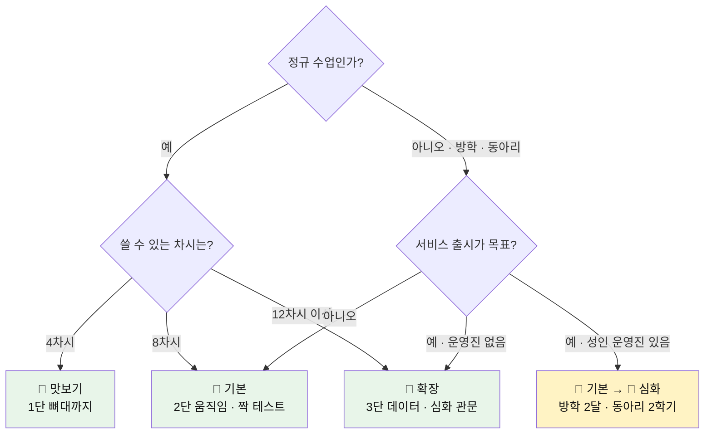

# 📄 AskBack 교사용 한 장 요약

> 과정 고르기 · 준비물 · 🌿 기본 8차시에 교사가 할 일 · 꼭 지킬 것. 수업 전에 한 장으로 뽑아 둔다. 낯선 말은 [용어집](../AskBack_교육과정_기본용_심화용_v1.md) §12, 비용은 §11.
> **원본**: [AskBack 교육과정 v1](../AskBack_교육과정_기본용_심화용_v1.md) · 인쇄물 묶음: [한 장 요약](AskBack_교사용_한장요약.md) · [학생 활동지](AskBack_학생활동지_기본8차시.md) · [안내문](AskBack_학부모_학교_안내문.md)

---

## 어떤 과정을 고를까

## 준비물

| 언제 | 준비할 것 | 누가 | 체크 |
|---|---|---|---|
| 2주 전 | AskBack 서버 · API 키 · 월 지출 한도 | 교사 · 운영자 | ☐ |
| 2주 전 | [학부모 · 학교 안내문](AskBack_학부모_학교_안내문.md) 발송 | 교사 | ☐ |
| 1주 전 | 반 코드 · 토큰 QR 카드 인쇄 | 교사 | ☐ |
| 1주 전 | 키를 비운 0원 모드로 리허설 1회 | 교사 | ☐ |
| 1주 전 | [학생 활동지](AskBack_학생활동지_기본8차시.md) 인쇄 | 교사 | ☐ |
| 당일 | 교실 Wi-Fi에서 접속 확인 · 예시 빌드 띄우기 | 교사 | ☐ |

## 🌿 기본 8차시 — 교사가 할 일

| 차시 | 학생 활동 | 교사가 볼 곳 | 교사가 던질 질문 | 활동지 |
|---|---|---|---|---|
| 1 | QR 접속 · 아이디어 · 형식 고르기 | 형식 분포 | "그걸 불편해하는 사람 한 명의 이름을 댈 수 있어?" | ① |
| 2 | 대화 10문 · 1번째 리포트 | 리포트 「걸린 곳」 | "AskBack이 되물은 숫자, 직접 재 올 수 있어?" | ① |
| 3 | 체크 칸 4개 · 🔓 제작 관문 | 관문에 걸린 학생 목록 | "이 칸에 AI 문장이 아니라 네 말이 들어갔어?" | ② |
| 4 | 1단 🦴 뼈대 | 미리보기 | "화면 칸 수가 기획서와 같아?" | ③ |
| 5 | 2단 ⚙️ 움직임 | 미리보기 · 빌드 버전 | "이 버튼은 상태표의 몇 번째 줄이야?" | ③ |
| 6 | 짝과 바꿔 쓰기 | 짝 메모 | "짝의 질문 때문에 바뀐 칸이 있어?" | ④ |
| 7 | 2단 다시 만들기 · 2번째 리포트 | 기획서 변경 · 리포트 | "처음 규칙과 지금 규칙이 왜 달라?" | ⑤ |
| 8 | 3분 발표 | 평가표 ([교육과정 §4.6](../AskBack_교육과정_기본용_심화용_v1.md)) | — | ⑤ |

## 꼭 지킬 것 · 하지 말 것

| ✅ 꼭 | ❌ 하지 말 것 |
|---|---|
| 학생은 닉네임만 쓴다 | 실명 · 연락처 · 사진 속 얼굴을 입력하게 하기 |
| 완성도보다 **고친 횟수와 이유**를 칭찬한다 | 미리보기가 예쁜 순서로 평가하기 |
| 관문에 걸린 학생에게 질문 1개만 던진다 | 교사가 기획서 칸을 대신 채워 주기 |
| 미리보기는 2단에서 멈춘다 (🌿 기본) | 4단 꾸미기에 차시를 쓰기 |
