# 🧭 AskBack 교육과정 v1 — 기본용으로 같이 생각하고, 심화용으로 출시한다

> **한 문장**: **기본용**(학교)은 AskBack 하나로 **MVP를 만들며 같이 생각하는 과정**이고, **심화용**(방학 · 동아리 · 성인반)은 기본용의 결과물을 들고 **유료 도구로 서비스까지 내는 과정**이다.
>
> **세부 문서**: 기본용 운영 → [바이브 코딩 수업 운영 기획서 v1](바이브코딩_수업_운영_기획서_v1_기획에서_미리보기까지.md) · 화면 → [📱 화면 시뮬레이터 설계서 v1](AI_역질문_화면_시뮬레이터_설계서_v1.md) · 기본+심화 집중형 사례 → [방학 2달 서비스 완성 과정 기획서 v1](방학_2달_서비스_완성과정_기획서_v1.md)
> **기준일**: 2026-11-15 (처음 2026-10-29). 🏫 기본용은 코드를 만들지 않는다 — AskBack이 기획서를 **📱 화면 시뮬레이터**(눌러 보는 화면 명세)로 그리고, 기획과 화면을 한 대화에서 같이 고친다. 시뮬레이터 MVP는 있고, 관문 · 단 나누기 · 반 운영 기능은 **아직 구현 전**이다 (§7). 예시는 *(앱 예시)* = 저장소 시나리오 JSON, *(가상)* = 설명용으로 구분한다.
> **먼저 볼 곳**: 교사는 📄 인쇄물 3종(한 장 요약 · 학생 활동지 · 안내문) → 형식별 예시 §4.7 → 과정별 흐름 §4.4 · §6 → 비용 §11 · 용어집 §12


## 목차

| # | 장 | 누가 먼저 읽나 |
|---|---|---|
| 📄 | [교사용 한 장 요약 → 인쇄물](#-교사용-한-장-요약--인쇄물) | 교사 |
| 0 | [결론](#0-결론) | 모두 |
| 1 | [왜 두 단계인가](#1-왜-두-단계인가) | 학교 관리자 · 교사 |
| 2 | [기본용과 심화용 한눈에](#2-기본용과-심화용-한눈에) | 모두 |
| 3 | [과정 전체 흐름](#3-과정-전체-흐름) | 모두 |
| 4 | [🏫 기본용 — MVP를 만들며 같이 생각하기](#4--기본용--mvp를-만들며-같이-생각하기) | 교사 |
| 5 | [🌉 다리 — 기본용에서 심화용으로](#5--다리--기본용에서-심화용으로) | 교사 |
| 6 | [🚀 심화용 — 유료 도구로 서비스까지](#6--심화용--유료-도구로-서비스까지) | 운영진 |
| 7 | [AskBack 기능 로드맵](#7-askback-기능-로드맵--과정별로) | 개발 |
| 8 | [문서들의 관계](#8-문서들의-관계) | 개발 · 운영진 |
| 9 | [🧑‍🎓 학생 활동지](#9--학생-활동지) | 교사 |
| 10 | [📨 학부모 · 학교 안내문](#10--학부모--학교-안내문) | 교사 · 학교 |
| 11 | [💰 비용 계산](#11--비용-계산--반-25명-기준) | 학교 관리자 · 운영진 |
| 12 | [📖 용어집](#12--용어집) | 모두 |
| 13 | [정할 것](#13-정할-것) | 운영진 · 개발 |

---

## 📄 교사용 한 장 요약 → 인쇄물

| 인쇄물 | 담긴 것 | 언제 쓰나 |
|---|---|---|
| [📄 교사용 한 장 요약](교육과정_인쇄물/AskBack_교사용_한장요약.md) | 과정 고르기 흐름도 · 준비물 체크표 · 8차시별 교사 질문 · 꼭 지킬 것 | 수업 2주 전부터 |
| [🧑‍🎓 학생 활동지](교육과정_인쇄물/AskBack_학생활동지_기본8차시.md) | 활동지 ①~⑤ · 자기 점검표 | 차시마다 |
| [📨 학부모 · 학교 안내문](교육과정_인쇄물/AskBack_학부모_학교_안내문.md) | 가정통신문 · 심화용 신청서 · 학교 관리자용 한 장 | 수업 2주 전 발송 |

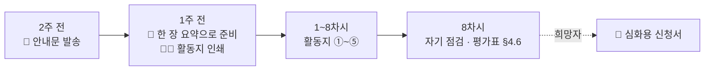

---

## 0. 결론

| 질문 | 답 |
|---|---|
| 기본용 → 심화용으로 나누는 게 좋은가? | **좋다.** 학교의 제약(예산 · 나이 · 차시)과 서비스 출시의 요구(서버 · 배포 · 사용자)는 한 과정에 담기 어렵다 |
| 기본용은 AskBack만으로 충분한가? | **충분하다.** 목표를 *완성도*가 아니라 *MVP + 생각의 과정*으로 두면, 📱 화면 1~2단과 기획서로 끝까지 간다. 코드 없이 눌러 보는 화면이 MVP다 |
| 심화용에서 바로 유료 도구를 써도 되나? | **된다.** 기본용에서 기획서 · 데이터 모양 · 화면 명세가 이미 정해져 있어서 유료 시간을 *만드는 일*에만 쓴다. 단, 미성년자는 **성인(교사 · 조교) 명의 계정**으로 운영한다 |
| 무엇이 두 과정을 잇나? | **다리 꾸러미**: 기획서.md · 화면 명세.md · 리포트 · 데이터 한 줄 (§5) |

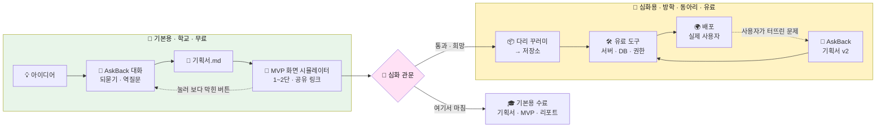

---

## 1. 왜 두 단계인가

### 1.1 학교의 제약과 기본용의 답

| 학교의 제약 | 한 과정에 다 담으면 | 기본용의 답 |
|---|---|---|
| 💳 학생별 유료 결제 불가 | 결제할 수 있는 학생만 참여한다 | 교사 API 키 하나 · 학생은 토큰만 |
| 🔞 미성년자 계정 제한 | 가입 단계에서 수업이 멈춘다 | 학생 계정 0개 |
| ⏱ 주 1~2차시 · 학기 단위 | 서버 · 배포까지 가다가 시간이 끝난다 | 목표를 **MVP + 생각 과정**으로 줄인다 |
| 📋 수행평가 | 결과물의 완성도로만 평가하게 된다 | **생각의 흔적**(기획서 변경 · 역질문 · 리포트)을 평가한다 |
| 👥 30명 동시 운영 | 학생마다 다른 도구에서 다른 문제가 터진다 | 같은 도구 · 같은 단계 · 교사가 한 화면에서 본다 |

### 1.2 서비스 출시의 요구와 심화용의 답

| 서비스에 필요한 것 | AskBack만으로는 | 심화용의 답 |
|---|---|---|
| 🗄 여러 사람이 같은 데이터를 본다 | 화면 시뮬레이터는 가짜 값으로 각자의 브라우저에서만 돈다 | 유료 도구로 서버 · DB를 붙인다 |
| 🌍 공개 주소 · 실제 사용자 | 공유 링크는 화면 명세일 뿐, 실제 앱이 아니다 | 배포 · 사용자 5명 · 1주 운영 |
| 💻 실제 코드 | AskBack은 코드를 만들지 않는다 (부품 6종 · 화면 12개 상한) | Claude Code 같은 코딩 에이전트 |
| 👤 운영 책임 | 학교 수업의 범위를 넘는다 | 희망자 · 성인 운영진 · 별도 과정 |

---

## 2. 기본용과 심화용 한눈에

| 구분 | 🏫 기본용 | 🚀 심화용 |
|---|---|---|
| **목표** | MVP를 만들며 **같이 생각하기** | 실제 사용자가 쓰는 **서비스 출시** |
| **대상** | 반 전체 (중1~고2) | 기본용 수료 + 관문 통과 + 희망자 |
| **장소 · 형태** | 정규 수업 · 자유학기 · 창체 | 방학 집중 · 동아리 · 메이커스페이스 · 성인반 |
| **기간** | 4 · 8 · 12차시 중 선택 | 4주 집중 또는 한 학기 동아리 |
| **도구** | **AskBack만** | AskBack(코치) + **유료 코딩 도구**(Claude Code 등) + 호스팅 |
| **비용** | 교사 API 키 · 반 예산 | + 유료 좌석 · 호스팅 · 서비스 안 AI 기능 API |
| **학생 계정** | 0개 | 0개 (미성년). 성인반은 개인 계정 가능 |
| **혼자 / 팀** | 개인 + 짝 | 3명 1팀 |
| **만드는 범위** | 📱 화면 1~2단 필수 · 3단 선택 (코드 없음) | 서버 · DB · 권한 · 배포 · 운영 |
| **데이터** | 가짜 값 · 🎛 슬라이더 (브라우저에 저장) | 실제 DB · 여러 사용자 |
| **결과물** | 기획서.md · 화면 명세.md · 공유 링크 · 리포트 | 공개 주소 · 저장소 · 기획서 v2 · 운영 기록 |
| **평가** | 생각의 과정 (§4.6) | 완성 기준 7가지 ([2달 과정 §6](방학_2달_서비스_완성과정_기획서_v1.md)) |
| **AskBack의 역할** | 코치 + **화면 설계 도구**(시뮬레이터) | 코치 + **작업 문서 생성기**(CLAUDE.md · 작업 카드) |

### 2.1 사용 공간 지도

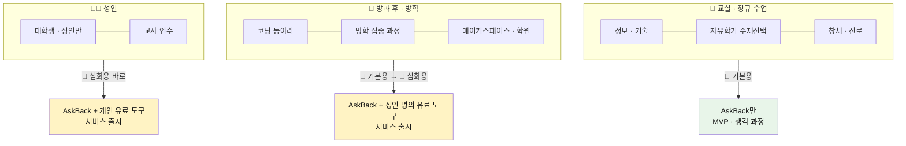

| 공간 | 과정 | 기간 | 끝에 남는 것 |
|---|---|---|---|
| 정보 · 기술 수업 | 🏫 기본용 4~8차시 | 한 학기 일부 | 기획서 · 화면 공유 링크 |
| 자유학기 주제선택 | 🏫 기본용 12차시 | 한 학기 | 기획서 · MVP · 발표 |
| 코딩 동아리 | 🏫 → 🚀 | 1학기 기본 · 2학기 심화 | 서비스 |
| 방학 집중 과정 | 🏫 1달 → 🚀 1달 | 8주 | 서비스 ([2달 과정](방학_2달_서비스_완성과정_기획서_v1.md)) |
| 성인반 · 교사 연수 | 🚀 바로 (기본용 2일 압축) | 2~4주 | 서비스 · 수업 설계 |

---

## 3. 과정 전체 흐름

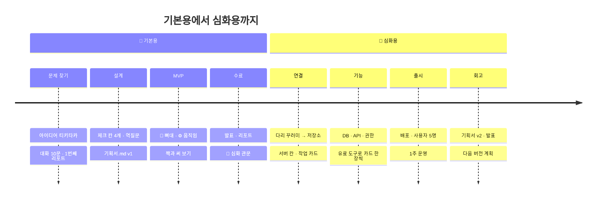

---

## 4. 🏫 기본용 — MVP를 만들며 같이 생각하기

### 4.1 기본용에서 MVP의 뜻

> **MVP = 한 사람이 한 가지 일을 끝까지 해 볼 수 있는 화면.** 가짜 값이면 충분하고, 코드가 아니라 📱 화면 시뮬레이터에서 눌러 볼 수 있으면 된다.

| MVP인 것 ✅ | MVP가 아닌 것 ❌ |
|---|---|
| 핵심 기능 **1개**가 버튼으로 끝까지 돈다 | 기능 5개가 반쯤씩 돈다 |
| 기획서의 상태표 · 규칙이 화면에서 재현된다 (버튼마다 R 꼬리표) | 화면은 예쁜데 버튼에 규칙이 없다 |
| 가짜 값 · 🎛 슬라이더로 경계값 시험 | 로그인 · 서버 · 실제 DB |
| 친구가 공유 링크로 1분 안에 눌러 볼 수 있다 | 설명을 5분 들어야 쓸 수 있다 |
| "다음에 무엇을 붙일지"가 기획서에 적혀 있다 | 끝났다고 생각한다 |

### 4.2 화면 범위 (기본용)

| 단 | 기본용 | 이유 |
|---|---|---|
| 1 🦴 뼈대 | **필수** | 화면 흐름이 기획서와 같은지 확인 |
| 2 ⚙️ 움직임 | **필수** | 규칙이 버튼 · 조건이 되는 순간. 기본용의 핵심 |
| 3 🔌 값 | 선택 (12차시 과정 · 빠른 학생) | 값의 범위 · 기록 목록. 심화용 DB 준비 |
| 4 🎨 다듬기 | 하지 않음 (발표 전 1회만 허용) | 완성도보다 생각에 시간을 쓴다 |

> **예외** — 🌱 맛보기 4차시는 차시가 모자라 **1단까지만** 간다. **형식** — 다섯 형식 모두 1~2단을 쓴다. 캠페인 · 논문 · 리서치에서 "2단 움직임"이 무엇인지는 [수업 운영 기획서 §4.1 형식별 표](바이브코딩_수업_운영_기획서_v1_기획에서_미리보기까지.md)를 따른다 (예: 캠페인 = 콘티 넘기기 + 행동 약속 버튼).

### 4.3 "같이 생각하는 도구"의 구조

기본용에서 AskBack은 답을 주는 기계가 아니라 **생각을 같이 하는 상대**다. 생각의 상대는 셋이다.

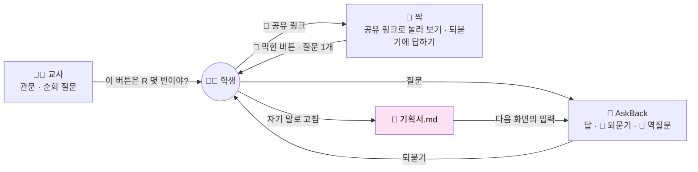

| 상대 | 언제 | 무엇을 묻나 | 예시 *(앱 예시 · 스마트 화분)* |
|---|---|---|---|
| 🤖 AskBack · 🙋 되묻기 | 매 답 끝 | 다음 단계로 가는 숫자 · 선택 | "400이라는 숫자는 어디서 왔어? 네 흙에서 '마른 값'과 '젖은 값'을 직접 본 적 있어?" |
| 🤖 AskBack · 🧭 역질문 | 두 답마다 | 진짜 이해했는지 | "센서 선이 빠져 값이 0이 되면 이 규칙은 어떻게 돼?" |
| 🤖 AskBack · 📱 화면 되묻기 | 버튼을 처음 누를 때 · 화면을 고칠 때마다 | 버튼과 기획서 규칙의 연결 | "「🚿 물 주기」 — 어느 규칙을 따라?" · "80%로 정한 이유가 뭐야?" |
| 👫 짝 | 공유 링크를 받은 뒤 | 처음 쓰는 사람의 눈 · 버튼 되묻기 | "물 준 기록은 어디서 봐?" |
| 🧑‍🏫 교사 | 순회 · 관문 | 근거와 출처 | "이 버튼은 상태표의 몇 번째 줄이야?" |

### 4.4 차시 선택지

| 과정 | 차시 | 다루는 것 | 끝에 남는 것 | 맞는 곳 |
|---|---|---|---|---|
| 🌱 **맛보기** | 4차시 | 아이디어 → 대화 10문 → 체크 칸 → 1단 뼈대 | 기획서 초안 · 뼈대 화면 링크 | 정보 수업 한 단원 · 진로 체험 |
| 🌿 **기본** | 8차시 | + 역질문 · 2단 움직임 · 짝 테스트 · 발표 | 기획서 v1 · MVP · 리포트 2장 | 정보 · 기술 · 자유학기 |
| 🌳 **확장** | 12차시 | + 사용자 인터뷰 · 3단 값 · 심화 관문 | 기획서 v1 · MVP(3단) · 리포트 3장 · 관문 결과 | 자유학기 · 동아리 1학기 |

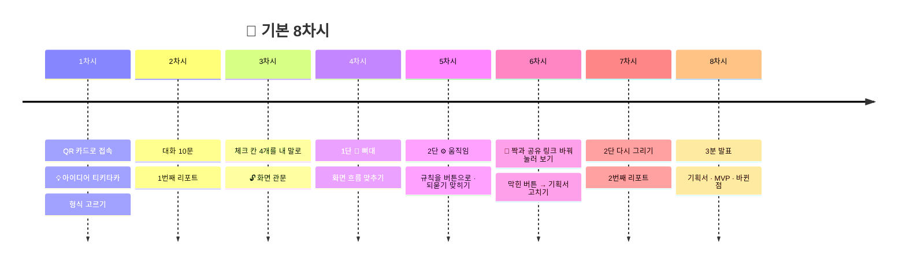

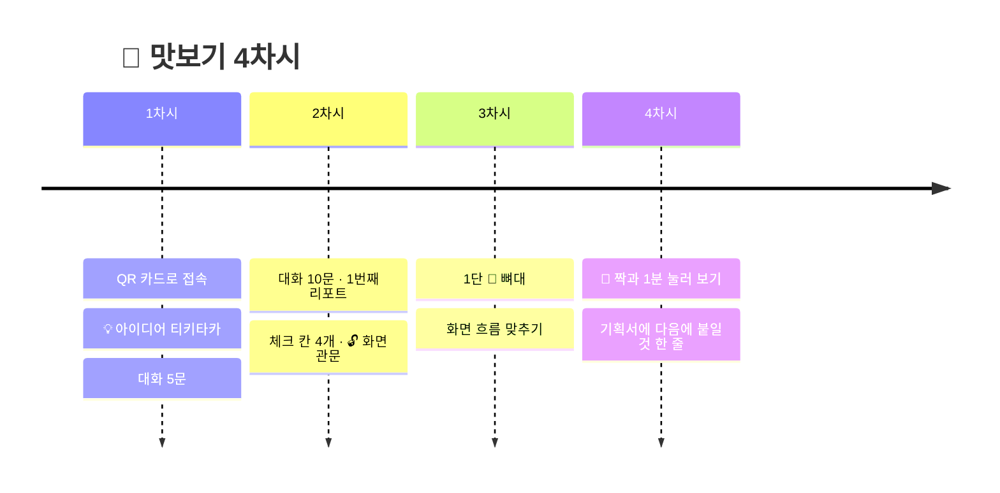

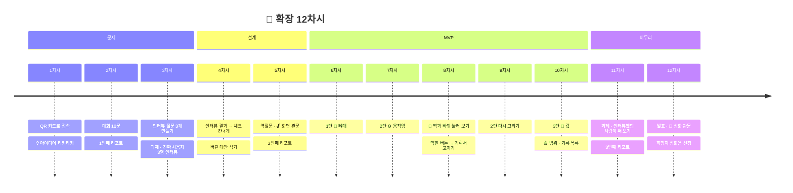

**활동 × 과정 — 몇 차시에 하나**

| 활동 | 🌱 4차시 | 🌿 8차시 | 🌳 12차시 |
|---|---|---|---|
| 💡 아이디어 · 형식 고르기 | 1 | 1 | 1 |
| 💬 대화 10문 · 리포트 | 1~2 (1장) | 2 · 7 (2장) | 2 · 5 · 11 (3장) |
| 🎤 사용자 인터뷰 | — | — | 3 (과제) · 11 (과제) |
| 📝 체크 칸 · 🔓 관문 | 2 | 3 | 4~5 |
| 🦴 1단 뼈대 | 3 | 4 | 6 |
| ⚙️ 2단 움직임 | — | 5 · 7 | 7 · 9 |
| 👫 짝 테스트 | 4 (1분) | 6 | 8 |
| 🔌 3단 데이터 | — | — | 10 |
| 🎤 발표 | — (한 줄 소감) | 8 | 12 |
| 🚦 심화 관문 | — | 희망자만 | 12 |

### 4.5 한 학생의 기본용 여정 *(앱 예시 · 🌱 스마트 화분, 민준 중3)*

| 차시 | 민준이 한 것 | AskBack이 한 것 | 기획서에 남은 것 |
|---|---|---|---|
| 1 | "상추 화분에 물 자동으로 주고 싶어" | 형식 🤖 제품 제안 · 🙋 "언제 '말랐다'고 볼 거야?" | 형식 · 한 줄 아이디어 |
| 2 | 흙 값을 직접 재 옴 (마른 흙 320 · 젖은 흙 610) | 규칙 카드 제안 · 🧭 "센서 선이 빠지면?" | 알고리즘 — 급수 규칙 |
| 3 | 상태표 3줄 · 실패 조건을 자기 말로 | 🔓 화면 열림 | 상태표 · 실패 조건 *(민준이 역질문에서 찾음)* |
| 4 | 📱 1단 그리기 → 화면 흐름 3개 확인 | 뼈대 · 🙋 "제일 먼저 볼 숫자는?" | 구조 — 화면 3개 |
| 5 | 2단 그리기 → 🎛 슬라이더로 0 · 85% 재현 · 버튼 되묻기 3개 맞힘 | 규칙 R1~R3을 버튼 조건으로 · 🙋 "이게 원한 안전망이야?" | — |
| 6 | 🔗 공유 링크를 받은 짝이 "물 준 기록은 어디서 봐?" | — | 알림 규칙 📵 줄 추가 |
| 7 | 💬 "물 준 기록 화면 넣어 줘"로 규칙 · 화면 같이 고침 | 📄 명세.md · 2번째 리포트 | 알림 규칙 · 화면 명세 |
| 8 | 발표: "처음 규칙과 지금 규칙이 다른 이유" | — | 버린 대안 · 다음에 붙일 것 |

### 4.6 평가 — 완성도가 아니라 생각의 흔적

| 항목 | 비중 | 근거 (AskBack에 자동으로 남음) | 🟢 잘함 | 🟡 보통 | ⚪ 아직 |
|---|---|---|---|---|---|
| 🎯 문제 정의 | 15% | 체크 칸 · 대화 기록 | 누가 · 언제 · 왜 불편한지 한 줄 | 대상이 넓다 | 기능부터 말한다 |
| 🧭 역질문 대응 | 20% | 역질문 판정 🟢🟡⚪ | 🟢 3개 이상 · 자기 숫자로 답함 | 🟢 1~2개 | 대부분 "모르겠어" |
| 📝 기획서의 자기 말 | 20% | 체크 칸 · 🫵 내가 정한 것 | 숫자 · 기준을 직접 정함 | AI 문장을 고쳐 씀 | AI 문장을 그대로 |
| 🔁 고친 횟수와 이유 | 20% | 기획서 변경 · 화면 명세 | 막힌 버튼 → 규칙 · 화면 같이 고치기 2회 이상 | 1회 | 0회 |
| 📱 MVP 동작 | 15% | 화면 시뮬레이터 · 🙋 내가 설명한 버튼 | 규칙이 버튼에서 재현되고 되묻기를 모두 맞힘 | 뼈대만 | 화면 없음 |
| 👫 짝에게 준 질문 | 10% | 짝 테스트 메모 | 기획서를 바꾸게 한 질문 | 감상 | 없음 |

> 같은 MVP여도 **기획서를 두 번 고친 학생**이 한 번에 끝낸 학생보다 높게 평가된다. 기본용이 키우려는 것은 고치는 힘이다.

### 4.7 형식별 예시 — 네 프로젝트의 기본용 · 심화용 *(앱 예시)*

저장소의 예시 시나리오 4개(`frontend/src/data/scenarios/*.json`)에서 실제 첫 질문과 되묻기를 가져왔다.

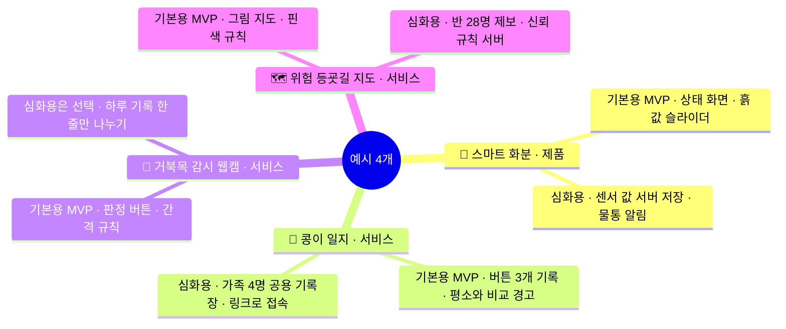

#### 첫 질문 → 되묻기 → 학생이 재 온 값

| 프로젝트 | 학생 | 첫 질문 (좁은 질문) | 🙋 AskBack의 첫 되묻기 | 학생이 재 온 값 |
|---|---|---|---|---|
| 🌱 스마트 화분 | 민준 중3 | "흙 센서값이 400 밑이면 펌프 3초 켜는 코드 짜줘" | "400이라는 숫자는 어디서 왔어? '마른 값'과 '젖은 값'을 직접 본 적 있어?" | 마른 흙 320 · 물 준 직후 610. "400은 예제에서 베낀 숫자였어" |
| 🐶 콩이 일지 | 다온 중2 | "밥 · 산책 · 배변을 버튼 3개로 기록하는 앱 만들어줘" | "'2끼 연속'이라는 숫자는 어디서 왔어?" | 1주 공책 기록: 아침엔 늘 반쯤 남기고 저녁엔 다 먹는다 |
| 🐢 거북목 감시 웹캠 | 서연 중2 | "30분마다 '자세 확인!' 알림 뜨는 웹페이지 코드 짜줘" | "30분이라는 숫자는 어디서 왔어?" | 5분마다 사진 12장: 20분째부터 고개가 나간다 |
| 🗺 위험 등굣길 지도 | 서윤 중1 | "구글 폼으로 위험한 곳 제보받는 거 만들어줘" | "오늘 당장 부탁할 수 있는 사람은 몇 명이야?" | 반 28명 · 후문에서 큰길까지 300m · 종이 지도 스티커 31개 |

#### 기본용 MVP 범위

| 프로젝트 | 1단 🦴 뼈대 | 2단 ⚙️ 움직임 | 가짜로 두는 것 | MVP 끝에 던질 🧭 역질문 |
|---|---|---|---|---|
| 🌱 스마트 화분 | 지금 · 오늘 그래프 · 마지막 급수 3칸 | 대기 → 급수 → 휴식 상태표 · 흙 값 슬라이더 | 센서 · 펌프 → 슬라이더 | "센서 선이 빠져 값이 0이 되면 이 규칙은 어떻게 돼?" |
| 🐶 콩이 일지 | 밥 · 산책 · 배변 버튼 3개 · 오늘 기록 | 다 / 반 / 조금 입력 · 평소보다 덜 먹으면 빨간 표시 | 가족 4명 → 이름 버튼 4개 | "네가 본 '반'과 엄마가 본 '반'이 같을까?" |
| 🐢 거북목 감시 웹캠 | 타이머 · [바르게] [거북목] 버튼 · 오늘 횟수 | 답에 따라 다음 알림 간격이 바뀌는 규칙 · 하루 5번 상한 | 웹캠 AI 판정 → 버튼 | "[바르게]를 눌렀을 때 그게 진짜였는지 어떻게 알 수 있을까?" |
| 🗺 위험 등굣길 지도 | 그림 지도 (SVG) · 제보 목록 · 제보 버튼 | 서로 다른 3명이 같은 곳을 찍으면 핀 색이 바뀜 | 실제 지도 API · 반 친구들 → 가짜 제보 10개 | "'같은 곳'은 몇 m 안까지야? 걸어서 세어 볼래?" |

> 화면 시뮬레이터는 정해진 부품 6종만 그리고 실행되는 코드가 없어서 ([수업 운영 기획서 §5](바이브코딩_수업_운영_기획서_v1_기획에서_미리보기까지.md)) 실제 지도 API나 웹캠 AI를 쓸 수 없다. 오히려 기본용에서는 장점이다. **규칙을 가짜 입력(슬라이더 · 버튼)으로 먼저 시험하는 습관**이 생긴다.

#### 🚦 심화 관문 3번 질문 — "다른 사람과 데이터를 나눠야 하나?"

| 프로젝트 | 학생의 답 | 관문 결과 | 심화용에서 붙일 것 |
|---|---|---|---|
| 🌱 스마트 화분 | 학교에서도 화분 상태를 보고 싶다 → *나와 화분* 사이의 서버가 필요하다 | 🚀 (제품 · 하드웨어 운영진 필요) | 센서 값 서버 저장 · 물통 빔 알림 |
| 🐶 콩이 일지 | 가족 4명이 각자 밥을 준다. 아빠는 앱을 깔지 않고 카톡 링크만 누른다 | 🚀 | 공용 기록장 · 로그인 없는 링크 접속 |
| 🐢 거북목 감시 웹캠 | 처음엔 혼자 쓴다. 영상은 절대 남기지 않는다 | 🎓 기본용 수료가 자연스럽다. 친구와 나누기는 다음 학기 | (선택) 하루 한 줄 기록만 나누기 |
| 🗺 위험 등굣길 지도 | 반 28명의 제보가 한곳에 모여야 핀 색이 바뀐다 | 🚀 | 제보 서버 · 신뢰 규칙(서로 다른 3명) · 구청 전달 |

---

## 5. 🌉 다리 — 기본용에서 심화용으로

### 5.1 다리 꾸러미

| 꾸러미 | 기본용에서 | 심화용에서 쓰이는 곳 |
|---|---|---|
| 📝 기획서.md v1 | 체크 칸 · 상태표 · 버린 대안 | 기획서 v2(서버 칸)의 출발점 · `CLAUDE.md`의 원본 |
| 📱 화면 명세.md · 공유 링크 | 1~2단(또는 3단) — 화면 흐름 · 규칙 · 화면 칸 표 | 유료 도구에 주는 첫 작업 카드 · 화면 설계 원본 |
| 🔌 데이터 한 줄 | 3단에서 정한 값 · 기록 목록 (없으면 심화 1일차에 정함) | DB 표 |
| 📊 리포트 | 걸린 곳 · 미션 | 심화용 팀 구성 · 역할 나누기 |
| 💬 짝 · 사용자 메모 | 막힌 버튼 · 터진 문제 | 첫 사용자 후보 · 작업 카드 우선순위 |

### 5.2 🚦 심화 관문

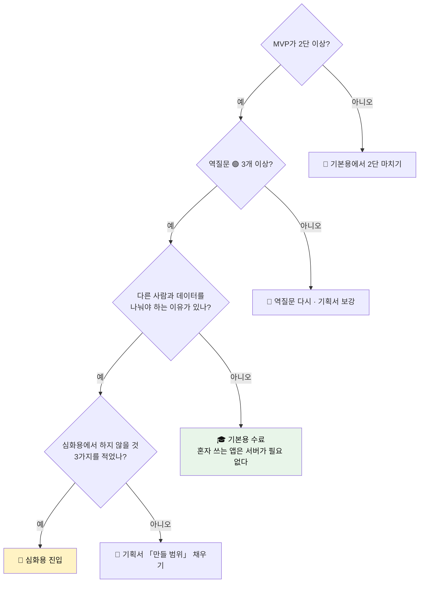

> 관문을 못 넘는 것은 실패가 아니다. 혼자 쓰는 앱이라면 기본용 MVP가 이미 완성형이다.

---

## 6. 🚀 심화용 — 유료 도구로 서비스까지

### 6.1 세 가지 형태

| 형태 | 기간 · 리듬 | 유료 도구 명의 | 팀 | 맞는 곳 |
|---|---|---|---|---|
| ⚡ **방학 집중** | 4주 · 주 4일 × 3시간 | 조교 · 교사 (성인) | 3명 1팀 · 조교 1명당 2~3팀 | 학교 방학 캠프 · 학원 |
| 🐢 **동아리 한 학기** | 15주 · 주 1회 2시간 | 지도 교사 | 3명 1팀 · 최대 4팀 | 코딩 동아리 · 2학기 |
| 🧑‍💼 **성인반** | 2~4주 | 학습자 개인 | 개인 또는 2명 | 대학생 · 교사 연수 · 일반인 |

### 6.2 미성년자 반의 운영 원칙

| 원칙 | 내용 |
|---|---|
| 계정 · 결제 | 유료 도구 · 호스팅 · 도메인은 모두 **성인(교사 · 조교 · 기관) 명의** |
| 키보드 | 학생이 앉아서 **작업 카드로 지시**한다. 성인이 옆에서 승인한다 |
| 승인이 필요한 일 | 배포 · 비밀 키 입력 · 삭제 · 외부 서비스 연결은 성인만 |
| 개인정보 | 서비스에서 실명 · 연락처 · 주소를 받지 않는다 |
| 확인할 것 | 그 시점의 요금 · 사용량 한도 · 약관을 구매 전에 확인한다 ([2달 과정 §5.2](방학_2달_서비스_완성과정_기획서_v1.md)) |

### 6.3 하루의 흐름 — 카드 한 장

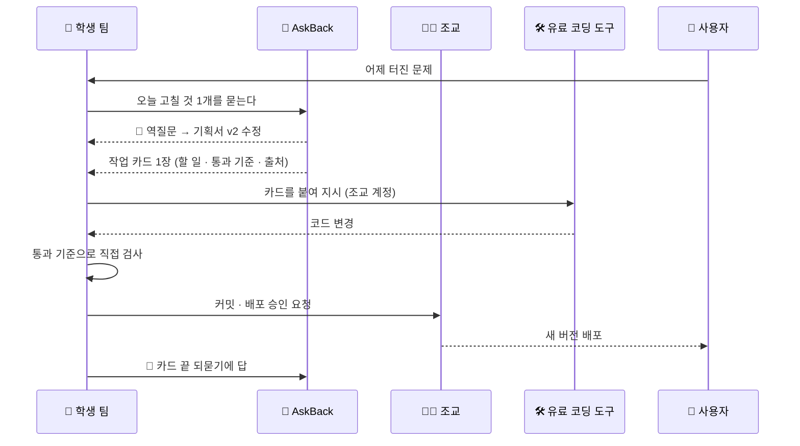

### 6.4 ⚡ 방학 집중 4주

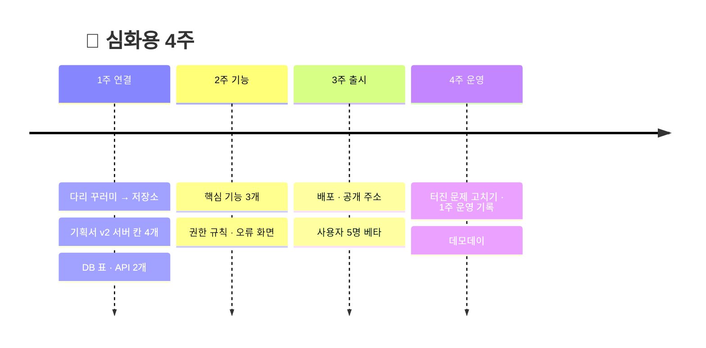

| 주 | AskBack (코치) | 유료 도구 (제작) | 완성 기준 체크 |
|---|---|---|---|
| 1 | 서버 칸 역질문 · `CLAUDE.md` · 작업 카드 | 저장소 · DB 표 · API · 가짜 데이터를 API로 | ③ 저장 |
| 2 | "누가 무엇을 지울 수 있어?" | 권한 · 오류 화면 · 기능 3개 | ④ 오류 화면 · ⑤ 개인정보 |
| 3 | "첫 사용자가 10분 안에 막힐 곳은?" | 배포 · 환경 변수 · 사용 기록 | ① 공개 주소 · ② 사용자 5명 |
| 4 | 터진 문제 → 기획서 고치기 · 마지막 리포트 | 버그 수정 · README | ⑥ 운영 기록 · ⑦ README · 기획서 v2 |

> 완성 기준 7가지의 자세한 내용은 [방학 2달 과정 §6](방학_2달_서비스_완성과정_기획서_v1.md)을 따른다.

### 6.5 🐢 동아리 한 학기 15주

1학기에 🌳 확장 12차시(기본용)를 마친 동아리가 2학기에 심화용으로 간다. 방학 집중보다 **시간은 짧지만 운영 기간이 길다**.

#### 방학 집중과 무엇이 다른가

| 구분 | ⚡ 방학 집중 4주 | 🐢 동아리 15주 |
|---|---|---|
| 총 시간 | 4주 × 4일 × 3시간 ≈ 48시간 | 15주 × 2시간 = 30시간 |
| 운영진 | 조교 1명당 2~3팀 | **지도 교사 1명** · 유료 좌석 1~2개 (교사 명의) |
| 팀 | 최대 6팀 | 최대 4팀 |
| 장점 | 몰입 · 빠른 출시 | **사용자 운영 기간이 길다** (5~6주). 실제로 쓰이는 서비스가 된다 |
| 위험 | 출시 후 운영이 1주뿐 | 주 간격이 길어 맥락을 잊는다 · 좌석 한 개에 4팀이 몰린다 |
| 위험 대응 | — | 매주 **지난주 작업 카드 + AskBack 기록**으로 시작 · 좌석 순번표 (아래) |

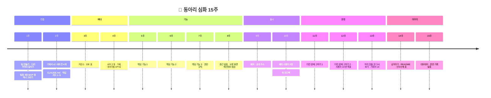

| 주 | AskBack (코치) | 유료 도구 (제작) | 집에서 · 주 사이 (도구 없이) | 완성 기준 |
|---|---|---|---|---|
| 1~2 | 팀 기획서 합치기 · 서버 칸 역질문 · 작업 카드 | — | 팀원끼리 서버 칸 초안 나눠 쓰기 | — |
| 3~4 | "이 표의 한 줄은 누가 만들어?" | 저장소 · DB · API | 베타 사용자 5명 미리 약속 받기 | ③ 저장 |
| 5~7 | 기능마다 카드 1장 · 끝 되묻기 | 기능 3개 · 권한 | 친구에게 화면 캡처 보여 주고 질문 받기 | — |
| 8 | "누가 무엇을 지울 수 있어?" | 오류 화면 · 개인정보 점검 | 중간 발표 피드백 정리 | ④ ⑤ |
| 9~10 | "첫 사용자가 10분 안에 막힐 곳은?" | 배포 · 사용 기록 | **사용자 피드백 모으기** (휴대폰으로 서비스 접속은 가능) | ① ② |
| 11~13 | 터진 문제 → 기획서 v3 | 버그 수정 · 작은 개선 | 사용자 수 · 터진 문제 기록 | ⑥ |
| 14~15 | 넘겨주는 한 장 · 마지막 리포트 | README | 발표 준비 | ⑦ |

> 유료 도구는 교사 명의라 **집에서는 쓰지 않는다**. 주 사이에는 AskBack(학생 토큰)으로 다음 작업 카드를 쓰고, 공개된 서비스로 사용자 피드백을 모은다. 그래서 동아리 시간 2시간은 *만드는 일*에만 쓴다.

#### 2시간 안의 좌석 순번 — 좌석 1개 · 4팀

```mermaid
gantt
    title 동아리 2시간 · 유료 좌석 1개
    dateFormat HH:mm
    axisFormat %H:%M
    section 공통
    지난주 피드백 · 오늘 카드 확인 :c0, 15:00, 15m
    마무리 · 커밋 · 다음 카드 초안 :c9, 16:45, 15m
    section 🛠 좌석
    A팀 운전 :s1, 15:15, 22m
    B팀 운전 :s2, after s1, 22m
    C팀 운전 :s3, after s2, 22m
    D팀 운전 :s4, after s3, 22m
    section 좌석 밖
    대기 팀 · 통과 기준 검사 · AskBack 되묻기 · 사용자 응대 :w1, 15:15, 90m
```

| 시간 | 운전 중인 팀 | 나머지 세 팀이 하는 일 |
|---|---|---|
| 0:00~0:15 | — | 다 같이: 지난주 사용자 피드백 · 오늘 카드 1장 확인 |
| 0:15~1:45 | A → B → C → D 순서로 **22분씩** | 직전 운전 팀: 통과 기준으로 검사 · 커밋 메시지 / 다음 팀: 카드 다듬기 / 그 밖: AskBack 되묻기 · 사용자 응대 |
| 1:45~2:00 | — | 커밋 · 교사 배포 승인 · 다음 주 카드 초안 |

> 좌석이 2개면 팀당 45분이 된다. 22분 안에 끝나지 않는 카드는 **카드가 너무 큰 것**이다. AskBack에서 둘로 나눈다. 순번은 매주 한 칸씩 돌려 같은 팀이 늘 첫 번째가 되지 않게 한다.

### 6.6 🧑‍💼 성인반 · 교사 연수

성인은 개인 유료 계정을 쓸 수 있다. 그래서 **기본용을 2일로 압축**하고 바로 심화용으로 간다. 교사 연수는 여기에 **"학생 자리 → 교사 자리" 돌아보기**를 더한다.

#### 두 갈래

| 구분 | 🎓 교사 연수 | 💼 대학생 · 일반 성인반 |
|---|---|---|
| 목표 | 내 수업에서 기본용을 운영할 수 있다 + 심화용을 직접 겪어 본다 | 내 서비스를 출시한다 |
| 기간 | 기본 2일 + 심화 2주 (주 2회 × 3시간) | 기본 2일 + 심화 4주 (주 2회 × 3시간) |
| 유료 도구 | 연수생 개인 또는 연수 기관 명의 | 학습자 개인 |
| 팀 | 개인 (같은 학교 교사끼리 2명 가능) | 개인 또는 2명 |
| 결과물 | 내 서비스 + **내 학교용 수업 계획 한 장** | 공개 주소 서비스 · 운영 기록 |
| 완성 기준 | [2달 과정 §6](방학_2달_서비스_완성과정_기획서_v1.md) 완성 기준 중 ① ③ ④ ⑤ ⑦ (② 사용자 5명 · ⑥ 운영 1주는 선택) | 완성 기준 7가지 전부 |

#### 기본용 2일 압축

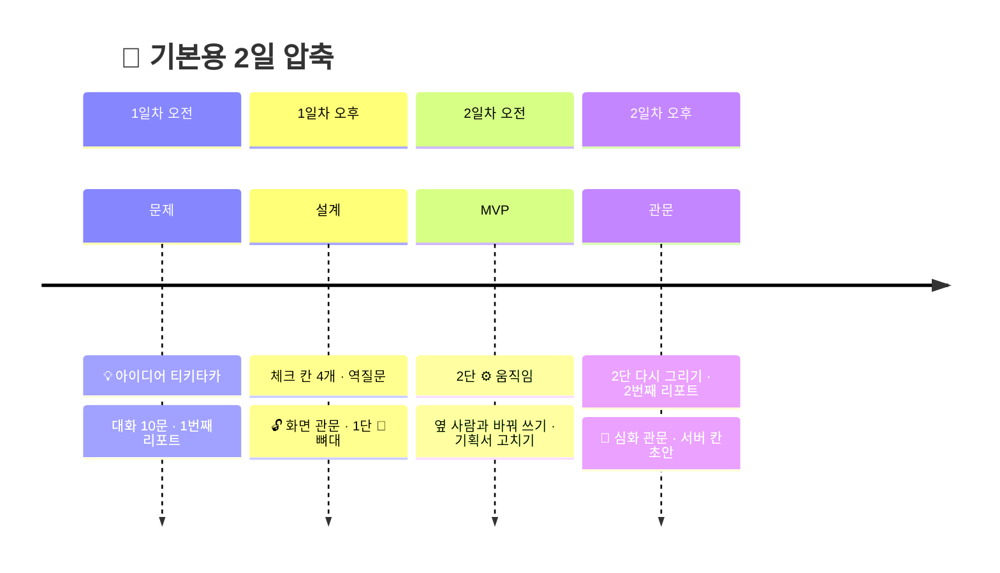

| 8차시 과정의 | 2일 압축에서 | 줄인 이유 |
|---|---|---|
| 1~2차시 아이디어 · 대화 10문 | 1일차 오전 (3시간) | 성인은 문제 정의가 빠르다. 대신 **되묻기에 직접 재 온 값**을 꼭 요구한다 |
| 3차시 체크 칸 · 관문 | 1일차 오후 앞 1시간 | — |
| 4~5차시 📱 1~2단 | 1일차 오후 ~ 2일차 오전 | — |
| 6차시 짝 테스트 | 2일차 오전 | 옆 사람이 학생 역할을 한다 |
| 7~8차시 다시 그리기 · 발표 | 2일차 오후 | 발표 대신 🚦 심화 관문 셀프 점검 |

#### 🎓 교사 연수에만 있는 것 — 자리 바꿔 돌아보기

각 단계가 끝날 때마다 10분씩, 학생으로 겪은 것을 교사의 눈으로 다시 본다.

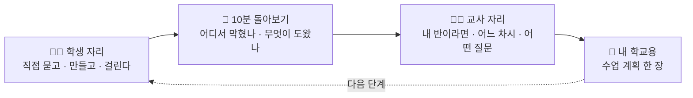

| 단계 | 학생 자리에서 겪은 것 (적기) | 교사 자리 질문 |
|---|---|---|
| 대화 10문 | | 내 반 학생이 첫 질문에서 가장 많이 할 실수는? |
| 역질문 | | 🟢를 못 받는 학생에게 던질 질문 하나는? |
| 📱 1~2단 화면 | | 관문에 걸린 학생에게 교사는 무엇을 *하지 않아야* 하나? |
| 짝 테스트 | | 짝 질문이 감상으로 끝나지 않게 하려면? |
| 심화 2주 | | 우리 학교에서 심화용을 연다면 누가 좌석 명의를 맡나? |

#### 심화 2주 · 4주

| 주 | 🎓 교사 연수 (2주) | 💼 성인반 (4주) |
|---|---|---|
| 1 | 서버 칸 · `CLAUDE.md` · DB · API · 기능 1개 | 서버 칸 · DB · API |
| 2 | 배포 · 공개 주소 · **내 학교용 수업 계획 발표** | 기능 3개 · 권한 · 오류 화면 |
| 3 | — | 배포 · 사용자 5명 |
| 4 | — | 운영 · 고치기 · 데모데이 |

---

## 7. AskBack 기능 로드맵 — 과정별로

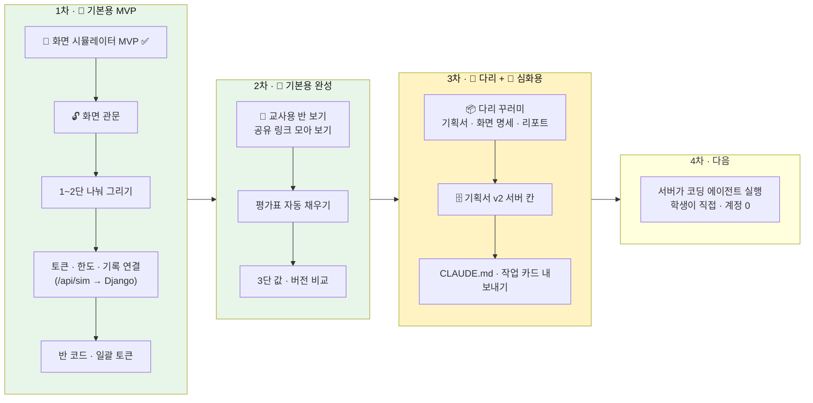

| 차수 | 기능 | 과정 | 지금 상태 | 바탕이 되는 기존 기능 |
|---|---|---|---|---|
| 1차 | 📱 화면 시뮬레이터 (눌러 보기 · 되묻기 · 손 / 말로 고치기 · 명세.md · 공유 링크) | 🏫 | ✅ MVP (AI 생성은 키를 넣고 확인 전) | [화면 시뮬레이터 설계서 §10](AI_역질문_화면_시뮬레이터_설계서_v1.md) |
| 1차 | 🔓 화면 관문 | 🏫 | ⬜ | 형식별 체크 칸 `/checks/{key}` ✅ |
| 1차 | 1~2단 나눠 그리기 · `/api/sim`을 Django로 옮겨 토큰 · 한도 · 기록 연결 | 🏫 | ⬜ | 작업별 모델 설정 ✅ · 한도 ✅ |
| 1차 | 반 코드 · 일괄 토큰 · 반 예산 | 🏫 | ⬜ | `issue_token` ✅ (한 명씩) |
| 2차 | 🔗 교사용 반 보기 · 짧은 공유 주소 | 🏫 | ⬜ | 공유 링크 ✅ |
| 2차 | 평가표(§4.6) 자동 채우기 | 🏫 | ⬜ | 역질문 판정 ✅ · 리포트 ✅ |
| 2차 | 3단 값 · 버전 비교 | 🏫 | ⬜ | — |
| 3차 | 📦 다리 꾸러미 (기획서 · 화면 명세 · 리포트 묶음) | 🌉 | ⬜ | 기획서 `/plan` ✅ · 리포트 .md ✅ · 명세.md ✅ |
| 3차 | 기획서 v2 서버 칸 · 역질문 | 🚀 | ⬜ | 체크 칸 구조 ✅ |
| 3차 | `CLAUDE.md` · 작업 카드 내보내기 | 🚀 | ⬜ | — |
| 4차 | 서버가 코딩 에이전트 실행 | 🚀 | ⬜ | 별도 보안 설계 문서 필요 |

---

## 8. 문서들의 관계

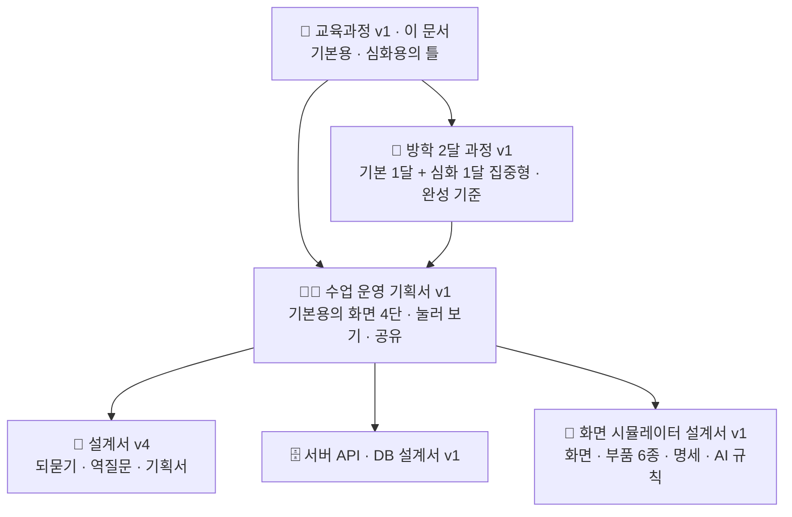

| 문서 | 이 교육과정에서의 자리 | 고칠 점 |
|---|---|---|
| [수업 운영 기획서 v1](바이브코딩_수업_운영_기획서_v1_기획에서_미리보기까지.md) | 🏫 기본용의 화면 단계 · 수업 운영 상세 | 기본용 범위는 1~2단 필수 · 3단 선택 · 4단 제외 (이 문서 §4.2가 우선) |
| [방학 2달 과정 v1](방학_2달_서비스_완성과정_기획서_v1.md) | ⚡ 방학 집중형 (🏫 1달 + 🚀 1달) | 출시 관문을 이 문서의 🚦 심화 관문(§5.2)과 맞춘다 |

---

## 9. 🧑‍🎓 학생 활동지

인쇄용 파일: [AskBack_학생활동지_기본8차시.md](교육과정_인쇄물/AskBack_학생활동지_기본8차시.md)

| 활동지 | 차시 | 학생이 채우는 것 | 이어지는 곳 |
|---|---|---|---|
| ① 문제 한 줄 | 1~2 | 불편한 사람 한 명 · 언제 · 되물은 숫자 · 직접 재 올 것 | 체크 칸 「핵심 사용자」 |
| ② 체크 칸 — 내 말로 | 3 | 형식별 표 ②-A~E 중 하나 · 생각해 볼 질문 → AI 문장 → 내 문장 → 내가 정한 숫자 | 🔓 화면 관문 |
| ③ 화면 기록 | 4~5 | 버튼마다 따르는 규칙 · 막힌 버튼 · 이상한 것 · 되묻기 | 📄 화면 명세.md |
| ④ 짝 테스트 | 6 | 공유 링크로 1분 눌러 보기 · 🤷 한 버튼 · 질문 하나 | 고칠 기획서 칸 |
| ⑤ 고친 이유 · 발표 카드 | 7~8 | 처음 규칙 · 지금 규칙 · 바뀐 이유 · 하지 않을 것 | 발표 · 🚦 심화 관문 |
| 자기 점검 | 8 | §4.6 평가표와 같은 눈금 | 교사 평가 |

---

## 10. 📨 학부모 · 학교 안내문

인쇄용 파일: [AskBack_학부모_학교_안내문.md](교육과정_인쇄물/AskBack_학부모_학교_안내문.md) (초안 · `[ ]` 칸은 학교가 채움)

| 안내문 | 받는 사람 | 핵심 내용 |
|---|---|---|
| 가정통신문 · 🏫 기본용 | 전체 학부모 | 가정 비용 없음 · 회원 가입 없음 · 저장되는 정보 · AI 회사 API로 전송 · 보관 기간 |
| 신청서 · 🚀 심화용 | 희망자 학부모 | 성인 명의 유료 도구 · 공개 범위 · 보호자 동의 칸 |
| 학교 관리자용 한 장 | 교장 · 행정실 · 개인정보 담당 | 예산 항목 · 저장 위치 · 외부 전송 · 보관 · 비용 통제 |

---

## 11. 💰 비용 계산 — 반 25명 기준

> **단가는 비워 둔다.** 모델과 요금은 바뀌므로, 아래 계산식에 **파일럿에서 잰 값**을 넣는다. 횟수(몇 번 부르나)는 과정 설계에서 나오므로 여기서 정한다.

### 11.1 비용이 생기는 곳

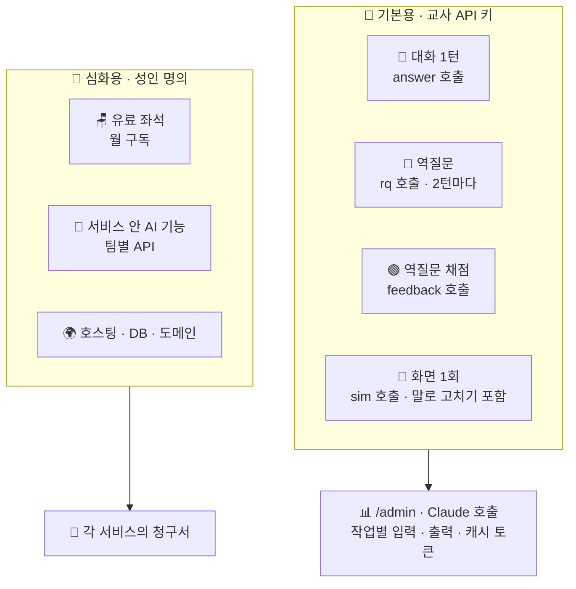

| 호출 | 언제 | 지금 서버 | 메모 |
|---|---|---|---|
| `answer` | 학생 질문마다 | ✅ `ASKBACK_MODEL_ANSWER` | 가장 많이 불린다 |
| `rq` | 질문 2개마다 역질문 | ✅ `ASKBACK_MODEL_RQ` | 출력이 짧다 |
| `feedback` | 역질문 답 채점 | ✅ `ASKBACK_MODEL_FEEDBACK` | 출력이 짧다 |
| `deep` | 한 답을 더 깊이 파고드는 **깊이 묻기**를 열 때만 (과정 이름 '심화용'과 다른 것) | ✅ `ASKBACK_MODEL_DEEP` | 기본용 계산에서는 0회로 둔다 |
| `sim` | 화면 그리기 · 💬 말로 고치기 1회마다 | 🟡 Next.js `/api/sim` (`ASKBACK_MODEL`) — Django로 옮길 때 `ASKBACK_MODEL_SIM` | 출력은 명세 JSON 하나. ✏️ 손으로 고치기 · 공유 링크는 0원 |

### 11.2 계산식

```
기본용 반 비용 = 25명 × ( 질문 수 × c_answer
                        + 역질문 수 × (c_rq + c_feedback)
                        + 화면 횟수 × c_sim )

c_작업 = 평균 입력 토큰 × 입력 단가
       + 평균 출력 토큰 × 출력 단가
       + 평균 캐시 읽기 토큰 × 캐시 읽기 단가 (+ 캐시 쓰기)
```

### 11.3 횟수 — 과정 설계에서 나오는 값 (학생 1명)

| 과정 | 질문 수 | 역질문 수 (질문 ÷ 2) | 화면 횟수 | 근거 |
|---|---|---|---|---|
| 🌱 맛보기 4차시 | 15 | 7 | 3 | 리포트 1장(10문) + 5문 · 1단 그리기 1 + 말로 고치기 2 |
| 🌿 기본 8차시 | 25 | 12 | 12 | 리포트 2장(20문) + 5문 · 1단 3 · 2단 8 · 4단 1 |
| 🌳 확장 12차시 | 35 | 17 | 15 | 리포트 3장(30문) + 5문 · 1단 3 · 2단 8 · 3단 3 · 4단 1 |
| 🏫 기본용 2일 (성인) | 25 | 12 | 12 | 8차시와 같다 |

> 리포트는 질문 10개마다 나오므로 질문 수는 "리포트 장수 × 10 + 5"로 잡는다. 화면은 단마다 그리기 1회 + 💬 말로 고치기 1~2회가 기준이다 ([수업 운영 기획서 §8](바이브코딩_수업_운영_기획서_v1_기획에서_미리보기까지.md) 한 차시 리듬). ✏️ 손으로 고치기는 세지 않는다. `deep`(깊이 묻기)은 0회로 둔다.

**반 25명 × 🌿 기본 8차시**

| 작업 | 1명 횟수 | 반 전체 횟수 | 1회 비용 `c` | 소계 |
|---|---|---|---|---|
| `answer` | 25 | 625 | ( ) | ( ) |
| `rq` | 12 | 300 | ( ) | ( ) |
| `feedback` | 12 | 300 | ( ) | ( ) |
| `deep` | 0 | 0 | ( ) | 0 |
| `sim` | 12 | 300 | ( ) | ( ) |
| **합계** | | | | **( )** |
| **학생 1인당** | | | | **( ) ÷ 25** |

> 반 하루 예산은 이 합계를 차시 수로 나눈 값에 **여유 30%** 를 더해 잡는다. 바닥나면 ✨ 화면 만들기 · 💬 말로 고치기만 잠기고, 🧩 빈 예시 틀 · ✏️ 손으로 고치기 · 대화 0원 모드(로컬 답 카드)는 계속된다.

### 11.4 `c` 재는 법 — 파일럿 1차시

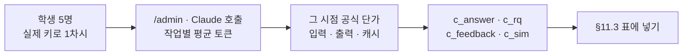

| 칸 | 어디서 | 값 |
|---|---|---|
| 작업별 평균 입력 · 출력 · 캐시 토큰 | `/admin` → Claude 호출 (작업별 합계 ÷ 호출 수) | |
| 캐시 적중률 | 같은 화면의 캐시 읽기 토큰 ÷ 입력 토큰 | |
| 단가 | 사용할 모델의 공식 가격표 (확인한 날짜 적기) | |
| `sim` 평균 출력 | 처음 그리기와 💬 말로 고치기를 따로 잰다 | |

### 11.5 🚀 심화용 비용 칸

| 항목 | ⚡ 방학 4주 (6팀) | 🐢 동아리 15주 (4팀) | 🎓 교사 연수 (개인) | 단가 |
|---|---|---|---|---|
| 기본용 부분 (§11.3) | 1달차 · 24명 | 1학기 · 12명 | 2일 · 연수생 수 | 위 계산 |
| 유료 좌석 × 개월 | 2~3석 × 1개월 | 1~2석 × 4개월 | 연수생 수 × 1개월 | ( ) |
| 서비스 안 AI 기능 API | 쓰는 팀만 · 팀별 월 상한 | 같음 | 선택 | ( ) |
| 호스팅 · DB · 도메인 | 무료 한도로 시작 · 6팀 | 4팀 | 개인 | ( ) |
| **학생(연수생) 1인당** | ( ) | ( ) | ( ) | |

---

## 12. 📖 용어집

> 교사 · 학부모 · 학생이 처음 읽을 때 필요한 말만 모았다. 예시는 *(앱 예시)* 시나리오에서 가져왔다.

```mermaid
mindmap
  root((AskBack 용어))
    대화
      되묻기
      역질문
      2문 1역
      리포트
      0원 모드
    기획
      형식
      체크 칸
      기획서 md
      내가 정할 것
      가정 공개
    화면
      화면 관문
      1단에서 4단
      화면 시뮬레이터
      버튼 되묻기
      공유 링크
      MVP
    심화
      심화 관문
      다리 꾸러미
      서버 칸
      작업 카드
      CLAUDE md
      좌석
      완성 기준
    운영
      반 코드와 토큰
      반 예산
      성인 명의
```

### 12.1 대화

| 용어 | 한 줄 뜻 | 예시 | 처음 나오는 곳 |
|---|---|---|---|
| 🙋 **되묻기** | 모든 답 끝에 붙는 열린 질문. 학생이 직접 재 오거나 정해 올 것을 묻는다 | "400이라는 숫자는 어디서 왔어?" *(스마트 화분)* | 🏫 1차시 |
| 🧭 **역질문** | 질문 두 개마다 AskBack이 학생에게 내는 확인 질문. 설계를 *진짜 아는지* 본다 | "센서 선이 빠져 값이 0이 되면 이 규칙은 어떻게 돼?" | 🏫 2차시 |
| **2문 1역** | 질문 2개마다 역질문 1개가 나오는 리듬 | 입력창 옆 점 ○○ | 🏫 2차시 |
| 🟢🟡⚪ **판정** | 역질문 답의 색. 점수 대신 색만 보여 준다 | 🟢 자기 숫자로 답함 | 🏫 2차시 |
| 📊 **리포트** | 질문 10개마다 나오는 8칸 분석. "프로젝트 · N번째 리포트" | "스마트 화분 · 1번째 리포트" | 🏫 2차시 |
| **0원 모드** | API 키를 비워 두면 미리 만든 답 카드로 답한다 | 리허설 · 예산이 바닥난 날 | 교사 준비 |

### 12.2 기획

| 용어 | 한 줄 뜻 | 예시 | 처음 나오는 곳 |
|---|---|---|---|
| **형식** | 📄 논문 · 🔬 리서치 · 🎬 캠페인 · 💻 서비스 · 🤖 제품. 형식이 체크 칸과 질문을 바꾼다 | 콩이 일지 = 💻 서비스 | 🏫 1차시 |
| **체크 칸** | 형식마다 4개씩 있는, 학생이 *자기 말로* 채우는 칸 | 💻 서비스: 핵심 사용자 · 핵심 기능 3개 · 화면 흐름 · 만들 범위 | 🏫 3차시 |
| 📝 **기획서.md** | 체크 칸 · 규칙 · 버린 대안이 모인 한 장짜리 문서 | `스마트화분_기획서.md` | 🏫 3차시 |
| 🫵 **내가 정할 것** | AI가 대신 정하지 않는 목표 · 기준 · 숫자 | 마른 흙 기준값 | 🏫 2차시 |
| **가정 공개** | AI가 어림한 숫자를 "가정"이라고 밝히는 것 | "휴식 10분은 내가 어림한 숫자야" | 🏫 2차시 |

### 12.3 화면

| 용어 | 한 줄 뜻 | 예시 | 처음 나오는 곳 |
|---|---|---|---|
| 🔓 **화면 관문** | 필수 체크 칸을 다 채워야 ✨ 기획서로 화면 만들기가 열린다 | 💻 서비스: 핵심 기능 · 화면 흐름 · 만들 범위 | 🏫 3차시 |
| **1~4단** | 🦴 뼈대 → ⚙️ 움직임 → 🔌 값 → 🎨 다듬기. 한 번에 한 단만 그린다 | 2단 = 규칙 R3이 🚿 물 주기 버튼의 막히는 조건이 됨 | 🏫 4차시 |
| 📱 **화면 시뮬레이터** | 기획서를 코드 없이 화면 명세로 그려 폰 모양으로 눌러 보는 곳. 부품은 글 · 숫자 · 알림 · 버튼 · 목록 · 그림 자리 6종 | 🎛 흙 습도를 85%로 올리면 물 주기가 🔒 | 🏫 4차시 |
| 🙋 **버튼 되묻기** | 규칙이 붙은 버튼을 처음 누르면 "어느 규칙을 따라?"를 묻는다. 맞힌 수만 보여 준다 | 내가 설명한 버튼 3 / 3개 | 🏫 5차시 |
| 🔗 **공유 링크** | 화면 명세를 통째로 담은 링크. 서버 저장 · 로그인 없음. 받은 쪽에서 고쳐도 원본은 그대로 | 짝에게 보내 눌러 보게 하기 | 🏫 6차시 |
| **MVP** | 한 사람이 한 가지 일을 끝까지 해 볼 수 있는 화면. 가짜 값 · 시뮬레이터로 충분하다 | 버튼 3개로 기록하는 콩이 일지 | 🏫 전체 |

### 12.4 심화

| 용어 | 한 줄 뜻 | 예시 | 처음 나오는 곳 |
|---|---|---|---|
| 🚦 **심화 관문** | 기본용에서 심화용으로 가는 4가지 질문. 방학 과정에서는 **출시 관문**이라 부르고 2가지를 더 본다 | "다른 사람과 데이터를 나눠야 하나?" | 🏫 마지막 차시 |
| 📦 **다리 꾸러미** | 기획서 · 화면 명세.md · 데이터 한 줄 · 리포트 · 메모 묶음 | 심화용 저장소의 첫 작업 카드 | 🌉 |
| 🗄 **서버 칸** | 기획서 v2에 더하는 데이터 표 · API 목록 · 권한 규칙 · 운영 규칙 | "반납 버튼은 빌린 사람만?" | 🚀 1주 |
| 🃏 **작업 카드** | 할 일 1개 · 통과 기준 · 기획서 출처를 적은 카드. 유료 도구에 한 장씩 준다 | `05-2 목록 API` | 🚀 1주 |
| `CLAUDE.md` | 유료 코딩 도구가 먼저 읽는 프로젝트 규칙 파일. AskBack이 기획서에서 만든다 | 목적 · 하지 않을 것 · 데이터 표 | 🚀 1주 |
| 🪑 **좌석** | 유료 도구 계정 하나. 미성년자 반은 성인 명의 | 좌석 1개 · 4팀 · 22분씩 | 🚀 |
| ✅ **완성 기준 7가지** | 공개 주소 · 사용자 5명 · 서버 저장 · 오류 화면 · 개인정보 최소 · 1주 운영 · README · 기획서 v2 | | 🚀 |

### 12.5 운영

| 용어 | 한 줄 뜻 | 예시 | 처음 나오는 곳 |
|---|---|---|---|
| **반 코드 · 토큰** | 학생 계정 대신 쓰는 접속 열쇠. QR 카드로 나눠 준다 | `2-3반` · 닉네임 민준 | 교사 준비 |
| **반 예산** | 반 전체가 하루에 쓸 수 있는 호출 상한 | 바닥나면 AI 화면 만들기만 잠김 | 교사 준비 |
| **성인 명의** | 유료 도구 · 호스팅 · 결제를 교사 · 조교 · 기관 이름으로 하는 원칙 | 조교 계정으로 학생이 지시 | 🚀 |

---

## 13. 정할 것

| # | 결정 | 선택지 | 권장 | 정하는 때 |
|---|---|---|---|---|
| 1 | 첫 파일럿 과정 | 🌱 4차시 · 🌿 8차시 · 🌳 12차시 | 🌿 8차시 · 한 반 | 1차 기능 구현 전 |
| 2 | 기본용 형식 범위 | 다섯 형식 전부 · 💻 서비스만 | 💻 서비스 + 🤖 제품 | 파일럿 전 |
| 3 | 심화용 첫 형태 | ⚡ 방학 · 🐢 동아리 · 🧑‍💼 성인반 | 🧑‍💼 성인반(교사 연수)으로 먼저 검증 → ⚡ 방학 | 기본용 파일럿 뒤 |
| 4 | 유료 도구 | 그 시점 요금 · 한도 비교 | 구매 전 1주 사용량 측정 | 심화용 4주 전 |
| 5 | 평가표 비중 | §4.6 기본값 · 학교별 조정 | 학교 수행평가 기준에 맞춰 조정 | 학기 시작 전 |
| 6 | 안내문 개인정보 칸 | 대화 기록 보관 기간 · 삭제 방법 | 학기 종료 후 [ ]개월 · 학생이 직접 내보내기 후 삭제 | 안내문 발송 전 |
