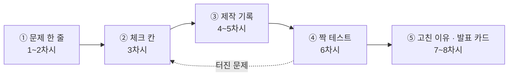

# 🧑‍🎓 AskBack 학생 활동지 — 🌿 기본 8차시

> 차시마다 한 장씩 인쇄한다.
> **원본**: [AskBack 교육과정 v1](../AskBack_교육과정_기본용_심화용_v1.md) · 인쇄물 묶음: [한 장 요약](AskBack_교사용_한장요약.md) · [학생 활동지](AskBack_학생활동지_기본8차시.md) · [안내문](AskBack_학부모_학교_안내문.md)

---

> 인쇄해서 쓴다. AskBack 안에 같은 내용이 쌓이지만, **종이에 손으로 한 번 더 쓰는 것**이 기본용의 생각 도구다. 칸 안의 *기울임 글씨*는 예시 *(앱 예시 · 🐶 콩이 일지)* 다. 학생에게 줄 때는 지운다.

## 활동지 ① 문제 한 줄 (1~2차시)

| 칸 | 내 답 |
|---|---|
| 불편한 사람 **한 명** (이름이나 관계) | *우리 집 가족 4명, 특히 강아지 밥을 따로 주는 엄마 · 아빠* |
| 그 사람이 **언제** 불편한가 | *누가 저녁을 줬는지, 콩이가 다 먹었는지 모를 때* |
| 지금은 어떻게 해결하고 있나 | *카톡으로 "밥 줬어?" 물어본다. 답이 늦다* |
| 내 아이디어 한 줄 | *버튼 3개로 기록하는 가족 공용 콩이 일지* |
| 고른 형식 | ☐ 📄 논문 ☐ 🔬 리서치 ☐ 🎬 캠페인 ☑ 💻 서비스 ☐ 🤖 제품 |
| AskBack이 되물은 숫자 · 사실 | *"'2끼 연속'이라는 숫자는 어디서 왔어?"* |
| 내가 **직접 재 오거나 물어 올 것** | *1주일 동안 끼니마다 남긴 양을 공책에 적기* |

## 활동지 ② 체크 칸 — 내 말로 (3차시)

> **내 형식의 표 한 장만** 인쇄해서 준다. 🔓 표시 칸을 다 채워야 AskBack의 제작이 열린다. 칸 이름 옆의 `key`는 AskBack 화면의 체크 칸과 같다.

| 형식 | 표 | 만드는 MVP 페이지 | 열리는 제작 단 |
|---|---|---|---|
| 💻 서비스 (웹·앱) | ②-A | 서비스 첫 화면 | 1~2단 (확장 과정은 3단까지) |
| 🤖 제품 (하드웨어) | ②-B | 상태를 보여 주는 모니터링 화면 · 센서는 가짜 값 | 1~2단 (확장 과정은 3단까지) |
| 🎬 캠페인 (AI 영상) | ②-C | 콘티 4컷을 넘겨 보는 캠페인 페이지 · 행동 약속 버튼 | 1~2단 |
| 📄 논문 | ②-D | 서론–방법–결과–결론 4칸 연구 소개 페이지 · 자료를 넣으면 결과 표가 바뀜 | 1~2단 |
| 🔬 리서치 | ②-E | 조사 결과 페이지 · 표 ↔ 그림 전환 | 1~2단 |

> 🌱 맛보기 4차시는 어느 형식이든 1단까지만 간다.

### ②-A 💻 서비스 *(예: 🐶 콩이 일지 · 앱 예시)*

| 체크 칸 | 🔓 | 생각해 볼 질문 | AI가 제안한 문장 | 내 말로 고친 문장 | 내가 정한 숫자 · 기준 |
|---|---|---|---|---|---|
| 핵심 사용자 `user` | | 이름을 댈 수 있는 한 사람은? 그 사람이 앱을 *싫어할* 이유는? | | *카톡 링크만 누르는 아빠도 5초 안에 기록* | *5초* |
| 핵심 기능 3개 `features` | ✅ | 하나만 남긴다면 무엇? | | | |
| 화면 흐름 `flow` | ✅ | 첫 화면에서 버튼을 누르면 어디로 가? | | | |
| 만들 범위 `scope` | ✅ | 이번에 **하지 않을** 것 3가지는? | | | |

### ②-B 🤖 제품 *(예: 🌱 스마트 화분 · 앱 예시)*

| 체크 칸 | 🔓 | 생각해 볼 질문 | AI가 제안한 문장 | 내 말로 고친 문장 | 내가 정한 숫자 · 기준 |
|---|---|---|---|---|---|
| 동작 시나리오 `scenario` | ✅ | 언제 → 무엇을 재고 → 어떻게 판단해 → 무엇을 하나? 실패하면? | | *흙 값이 마른 값보다 낮으면 급수, 5초 넘으면 멈춤* | *마른 320 · 젖은 610* |
| 부품 목록 `parts` | ✅ | 판단에 쓰는 부품과 기록만 하는 부품은? 판단에 쓰는 값이 웹 화면의 칸이 된다 | | | |
| 구조 스케치 `sketch` | | 부품이 어디에 어떻게 붙나? 선이 빠지면 어떤 값이 읽히나? | | | |
| 만드는 순서 `order` | | 가장 먼저 시험할 한 가지는? | | | |

### ②-C 🎬 캠페인 (AI 영상) *(가상 예: 급식 잔반 줄이기)*

| 체크 칸 | 🔓 | 생각해 볼 질문 | AI가 제안한 문장 | 내 말로 고친 문장 | 내가 정한 숫자 · 기준 |
|---|---|---|---|---|---|
| 바꿀 행동 `behavior` | ✅ | 누가 · 언제 · 무엇을 *하나만* 바꾸나? | | *점심 배식 때 '조금만' 말하기* | *1주에 3번* |
| 메시지 `message` | ✅ | 10초 안에 읽히는 한 문장은? | | | |
| 콘티 4컷 `storyboard` | ✅ | 30초를 4컷으로. 행동이 나오는 컷은 몇 번째? | | | |
| 배포 채널 `channel` | | 그 사람이 *그 순간* 보는 곳은? | | | |

### ②-D 📄 논문 *(가상 예: 쉬는 시간 길이와 집중도)*

| 체크 칸 | 🔓 | 생각해 볼 질문 | AI가 제안한 문장 | 내 말로 고친 문장 | 내가 정한 숫자 · 기준 |
|---|---|---|---|---|---|
| 연구 질문 `question` | ✅ | 답이 '예 · 아니오'나 숫자로 나오는 질문인가? | | | |
| 확인 방법 `method` | | 무엇을 몇 번 재면 답이 나오나? | | | |
| 자료 수집 계획 `data` | | 언제 · 누구에게서 · 몇 개? | | | |
| 목차 `toc` | ✅ | 서론 · 방법 · 결과 · 결론에 한 줄씩 쓰면? | | | |

### ②-E 🔬 리서치 *(가상 예: 우리 학교 등교 수단 조사)*

| 체크 칸 | 🔓 | 생각해 볼 질문 | AI가 제안한 문장 | 내 말로 고친 문장 | 내가 정한 숫자 · 기준 |
|---|---|---|---|---|---|
| 조사 대상 `target` | ✅ | 누구까지 포함하고 누구는 빼나? | | | |
| 방법 2가지 `methods` | | 설문 말고 직접 *보는* 방법은? | | | |
| 표본 `sample` | | 몇 명이면 결론을 말할 수 있나? | | | |
| 표와 그림 `charts` | ✅ | 결론을 보여 주는 표 **하나**는? | | | |

> ✍️ **스스로 점검**: '내 말로' 칸이 'AI가 제안한 문장' 칸과 똑같다면, 아직 내 말이 아니다. '내가 정한 숫자 · 기준' 칸이 비어 있으면 AskBack에 *"이 칸의 기준을 내가 정하려면 무엇을 재 와야 해?"* 라고 물어본다.

## 활동지 ③ 제작 기록 (4~5차시)

| 버전 | 단 | 기획서의 어느 칸에서 왔나 | 써 보니 된 것 | 써 보니 이상한 것 | 🙋 AskBack의 되묻기 · 내 답 |
|---|---|---|---|---|---|
| v1 | 1단 🦴 | *화면 흐름* | *버튼 3개가 보인다* | *오늘 누가 줬는지 칸이 없다* | |
| v2 | 2단 ⚙️ | *핵심 기능 2번 · 경고 규칙* | | | |
| v3 | 2단 ⚙️ | | | | |

## 활동지 ④ 짝 테스트 (6차시)

| 순서 | 짝이 할 일 | 짝이 적는 칸 |
|---|---|---|
| 1 | 설명을 듣지 않고 **1분** 동안 써 본다 | 처음 누른 버튼: |
| 2 | 막힌 곳 하나를 적는다 | 막힌 곳: |
| 3 | 만든 사람에게 **질문 하나**를 남긴다 | 질문: |
| 4 | 만든 사람이 답한다 | 이 질문 때문에 고칠 기획서 칸: |

## 활동지 ⑤ 고친 이유 · 발표 카드 (7~8차시)

| 칸 | 내 답 |
|---|---|
| 처음 규칙 | *2끼 연속 남기면 빨간 표시* |
| 지금 규칙 | *콩이의 평소 양보다 덜 먹으면 빨간 표시* |
| 바뀐 이유 (**누가 · 무엇 때문에**) | *1주 공책을 보니 아침엔 늘 반쯤 남겨서, 2끼 연속 규칙이면 매일 빨간 표시가 떴다* |
| 역질문 중 가장 어려웠던 것 | |
| 하지 않기로 한 것 3가지와 이유 (🚦 심화 관문 4번) | |
| 🚀 심화용에 가면 붙이고 싶은 것 | |

## 자기 점검 — 평가표([교육과정 §4.6](../AskBack_교육과정_기본용_심화용_v1.md))와 같은 항목 · 같은 기준

| 항목 | 🟢 | 🟡 | ⚪ | 내 표시 |
|---|---|---|---|---|
| 🎯 문제를 한 사람 · 한 순간으로 말했다 | 누가 · 언제 · 왜 불편한지 한 줄 | 대상이 넓다 | 기능부터 말한다 | |
| 🧭 역질문에 내 숫자로 답했다 | 🟢 3개 이상 · 내 숫자로 | 🟢 1~2개 | 대부분 "모르겠어" | |
| 📝 체크 칸이 내 말이다 | 숫자 · 기준을 직접 정함 | AI 문장을 고쳐 씀 | AI 문장 그대로 | |
| 🔁 터진 문제로 기획서를 고치고 다시 만들었다 | 2번 이상 | 1번 | 0번 | |
| 🖥 규칙이 화면에서 돈다 | 2단에서 규칙 재현 | 1단 뼈대만 | 미리보기 없음 | |
| 👫 짝에게 쓸모 있는 질문을 남겼다 | 짝이 기획서를 고침 | 감상 | 없음 | |
