# 🔥 Firebase로 백엔드 서버 만들기 — 2시간 수업자료 v1

> **한 문장**: 회원이 질문하면 **Claude가 답하고**, 그 질문과 답이 **내 질문함에만** 저장되는 백엔드 서버를 Firebase로 다섯 단계에 나눠 만든다.
>
> **대상**: 중학생 (코드를 처음 만져 보는 학생도 따라올 수 있게) · **시간**: 120분 (쉬는 시간 5분 포함)
> **주된 목표**: ① 개발 과정을 한 바퀴 경험하기 ② Firebase 백엔드(회원 · DB · 서버 함수)를 직접 세우고 이해하기
> **기준일**: 2026-11-20 · 본문의 코드는 Firebase 에뮬레이터에서 처음부터 끝까지 돌려 확인했다 (Claude 호출은 키 대신 모의 서버로 요청 모양까지 확인).

---

## 목차

| # | 장 | 시간 | 누가 먼저 보나 |
|---|---|---|---|
| 0 | [한눈에 보기](#0-한눈에-보기) | — | 모두 |
| 1 | [수업 전 준비 (교사)](#1-수업-전-준비-교사) | 수업 전날 | 교사 |
| 2 | [도입 — 백엔드는 식당의 주방](#2-도입--백엔드는-식당의-주방-10분) | 10분 | 모두 |
| 3 | [개발 과정과 설계 — 만들기 전에 그린다](#3-개발-과정과-설계--만들기-전에-그린다-15분) | 15분 | 모두 |
| 4 | [1단계 — 서버 켜기](#4-1단계--서버-켜기-15분) | 15분 | 학생 |
| 5 | [2단계 — DB에 저장하기](#5-2단계--db에-저장하기-15분) | 15분 | 학생 |
| 6 | [3단계 — 회원 확인하기](#6-3단계--회원-확인하기-20분) | 20분 | 학생 |
| — | ☕ 쉬는 시간 | 5분 | — |
| 7 | [4단계 — Claude에게 답 받기](#7-4단계--claude에게-답-받기-20분) | 20분 | 학생 |
| 8 | [5단계 — 내 질문함과 보안 시험](#8-5단계--내-질문함과-보안-시험-10분) | 10분 | 학생 |
| 9 | [정리 — 오늘 만든 것](#9-정리--오늘-만든-것-10분) | 10분 | 모두 |
| 부록 | [A 완성 코드](#부록-a--완성-코드) · [B 명령 카드](#부록-b--명령-카드) · [C 막혔을 때](#부록-c--막혔을-때) · [D 용어집](#부록-d--용어집) · [E 평가](#부록-e--평가-기준-교사용) · [F 실제 서비스와 비교](#부록-f--실제-서비스틴스파크와-비교) · [G 더 해 보기](#부록-g--더-해-보기-심화) | — | 교사 · 빠른 학생 |

---

## 0. 한눈에 보기

### 0.1 오늘 만드는 것 — 「질문함 서버」

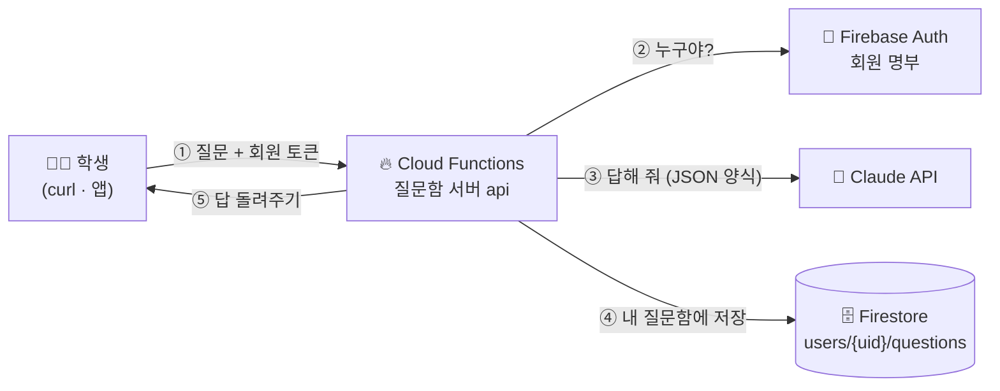

| 부품 | Firebase에서 무엇 | 오늘 하는 일 |
|---|---|---|
| 🔥 서버 | **Cloud Functions** (함수 하나 `api`) | 주소(경로)마다 할 일을 정한다 |
| 🔐 회원 | **Firebase Authentication** | 가입 · 로그인은 Auth가 하고, 서버는 **토큰만 검사**한다 |
| 🗄 DB | **Cloud Firestore** | 질문과 답을 **회원별 폴더**에 저장한다 |
| 🤖 AI | **Claude API** (Anthropic) | 정해 준 **JSON 양식**으로 답과 되묻기를 받는다 |
| 🧪 연습장 | **Firebase 에뮬레이터** | 위 셋을 **내 컴퓨터 안에서** 똑같이 띄운다 (돈 · 계정 · 개인정보 없음) |

### 0.2 학습 목표

| 축 | 목표 (수업이 끝나면 학생이 말할 수 있는 것) | 확인 방법 |
|---|---|---|
| 🧭 개발 과정 | "만들기 전에 **API 표와 DB 구조**를 먼저 그린다" | 설계 활동지의 표가 채워져 있다 |
| 🔥 백엔드 구축 | "서버는 **주소 · 메서드 · JSON**으로 대화한다" | `curl`로 다섯 가지 요청을 보내고 결과를 읽는다 |
| 🔐 회원 · 보안 | "서버는 **토큰**으로 누구인지 알고, **내 것만** 보여 준다" | 친구 토큰으로 내 질문을 열면 404가 나오는 걸 설명한다 |
| 🤖 AI 연결 | "AI 답은 **양식(스키마)**을 정해야 DB에 넣기 좋다" | 답 JSON의 칸 3개를 말한다 |
| 🗝 비밀 지키기 | "API 키는 **서버에만** 둔다" | 키를 어디에 두는지 말한다 |

### 0.3 120분 시간표

```mermaid
gantt
  title 2시간 수업 흐름 (분)
  dateFormat  m
  axisFormat  %M분
  section 이해
  도입 · 식당 비유          :a1, 0, 10m
  개발 과정 · 설계          :a2, after a1, 15m
  section 만들기
  1단계 서버 켜기           :b1, after a2, 15m
  2단계 DB 저장             :b2, after b1, 15m
  3단계 회원 확인           :b3, after b2, 20m
  쉬는 시간                 :crit, br, after b3, 5m
  4단계 Claude 답           :b4, after br, 20m
  5단계 내 질문함 · 보안    :b5, after b4, 10m
  section 정리
  정리 · 회고               :c1, after b5, 10m
```

| 시간 | 활동 | 학생이 손에 쥐는 것 | 핵심 낱말 |
|---|---|---|---|
| 0:00~0:10 | 도입 — 식당 비유 | "프런트 · 백엔드 · DB"를 내 말로 | 클라이언트 · 서버 |
| 0:10~0:25 | 개발 과정 · 설계 | **API 표 · DB 구조 그림** (활동지) | 요구사항 · 설계 · REST |
| 0:25~0:40 | 1단계 서버 켜기 | `GET /health` 응답 | 에뮬레이터 · 함수 · 경로 |
| 0:40~0:55 | 2단계 DB 저장 | 방명록 글이 에뮬레이터 화면에 보임 | 컬렉션 · 문서 · JSON |
| 0:55~1:15 | 3단계 회원 확인 | 토큰 · 401 · 내 닉네임 | 인증 · 토큰 · 미들웨어 |
| 1:15~1:20 | ☕ 쉬는 시간 | | |
| 1:20~1:40 | 4단계 Claude 답 | 답 · 되묻기 · 키워드가 담긴 JSON | API 키 · 구조화된 출력 |
| 1:40~1:50 | 5단계 내 질문함 · 보안 시험 | 친구 토큰 → 404 | 권한 · 경로 설계 |
| 1:50~2:00 | 정리 · 회고 | 오늘 지도 · 다음에 할 것 1개 | 배포 · 운영 |

### 0.4 단계가 쌓이는 모양

> 한 번에 다 만들지 않는다. **한 단계 = 기능 하나 + 시험 하나**. 앞 단계가 돌아가야 다음 단계로 간다.

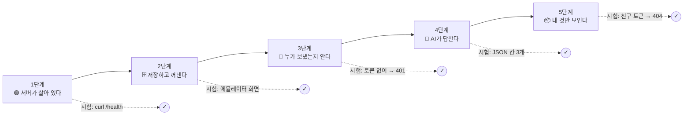

---

## 1. 수업 전 준비 (교사)

### 1.1 컴퓨터마다 설치 (수업 전날까지)

| 프로그램 | 버전 | 확인 명령 | 왜 필요한가 |
|---|---|---|---|
| Node.js | 22 | `node -v` → `v22.x` | 서버 코드를 돌린다 |
| Java | 21 이상 | `java -version` | Firebase 에뮬레이터(Firestore)가 Java로 돈다 |
| Firebase CLI | 최신 | `npx firebase --version` | 에뮬레이터를 켠다 |
| VS Code | 최신 | — | 코드 편집 |
| 터미널 | macOS: 터미널 · Windows: **Git Bash** | `curl --version` | 서버에 요청을 보낸다 (명령은 bash 문법) |

> 💡 학교 컴퓨터에 설치가 어렵다면, 교사가 미리 만든 **시작 꾸러미 폴더**(§1.3)를 USB나 공유 폴더로 나눠 주고 `npm install`까지 해 둔다. 인터넷이 막혀 있으면 `node_modules`까지 통째로 복사한다.

### 1.2 계정 · 비용 · 개인정보 원칙

| 항목 | 이 수업의 원칙 | 이유 |
|---|---|---|
| Firebase 계정 | **필요 없음** — 에뮬레이터 프로젝트 이름이 `demo-`로 시작하면 진짜 Firebase에 연결하지 않는다 | 학생 계정 0개 · 결제 0원 |
| 회원 이메일 | `minji@test.com`처럼 **가짜 이메일**만 | 만 14세 미만 개인정보를 받지 않는다 |
| 저장 데이터 | 에뮬레이터를 끄면 **사라진다** | 연습 데이터가 남지 않는다 |
| Claude API 키 | **교사 명의**. 반 전용 키를 만들고 **월 사용 한도**를 걸어 둔다. 수업이 끝나면 키를 지운다 | 키가 새도 피해가 한도 안에서 멈춘다 |
| 키가 없을 때 | 서버가 **연습 답**을 돌려준다 → 수업은 그대로 진행 | 키 문제로 수업이 멈추지 않게 |

키를 나누는 방법 셋 — 반 상황에 맞게 고른다.

| 방법 | 학생 컴퓨터 | 장점 | 주의 |
|---|---|---|---|
| ① 키 없이 (연습 답) | 키 없음 | 가장 안전 · 비용 0 | 진짜 답은 교사 화면 시연으로 보여 준다 |
| ② 교사 컴퓨터만 진짜 키 | 키 없음 | 안전 · 진짜 답을 함께 본다 | 4단계를 교사 화면 중심으로 진행 |
| ③ 반 전용 키를 `.secret.local`에 | 반 키 (한도 걸린 것) | 학생마다 진짜 답 | 수업 직후 키 삭제 · 키를 화면에 띄우지 않기 |

> **비용 감 (추정)**: 이 수업 코드(`claude-opus-5-5`, effort `low`, 짧은 답)는 질문 1개에 **대략 1센트 안팎**이다. 25명 × 10질문 = 250번이면 **몇 달러 수준**. 정확한 값은 Claude Console의 사용량 화면으로 확인한다. 더 아끼려면 모델을 `claude-haiku-5-5`로 바꿀 수 있다 (선택은 교사가).

### 1.3 시작 꾸러미 폴더

> 이 문서 옆 **[askbox_실습꾸러미/](askbox_실습꾸러미/)** 폴더가 그대로 시작 꾸러미다. 통째로 복사해 나눠 주면 된다.

```
askbox/                      ← 오늘의 프로젝트 폴더
├─ firebase.json             에뮬레이터 설정 (포트)
├─ .firebaserc               프로젝트 이름: demo-askbox
├─ firestore.rules           DB 문을 전부 잠그는 규칙
└─ functions/                서버 코드가 사는 곳
   ├─ package.json           쓰는 도구 목록
   ├─ index.js               ★ 오늘 학생이 채우는 파일 (처음엔 비어 있음)
   └─ .secret.local          (선택) Claude 키 — 교사만
```

`firebase.json`

```json
{
  "functions": [{ "source": "functions", "runtime": "nodejs22" }],
  "firestore": { "rules": "firestore.rules" },
  "emulators": {
    "auth": { "port": 9099 },
    "functions": { "port": 5001 },
    "firestore": { "port": 8080 },
    "ui": { "enabled": true, "port": 4000 },
    "singleProjectMode": true
  }
}
```

`.firebaserc`

```json
{ "projects": { "default": "demo-askbox" } }
```

`functions/package.json`

```json
{
  "name": "askbox-functions",
  "private": true,
  "main": "index.js",
  "engines": { "node": "22" },
  "dependencies": {
    "@anthropic-ai/sdk": "^0.127.0",
    "express": "^5.3.0",
    "firebase-admin": "^13.10.0",
    "firebase-functions": "^7.4.0"
  }
}
```

`firestore.rules` — 5단계에서 다시 본다

```
rules_version = '2';
service cloud.firestore {
  match /databases/{database}/documents {
    match /{document=**} {
      allow read, write: if false;
    }
  }
}
```

`functions/.secret.local` — 방법 ③일 때만, 교사가 넣는다

```
ANTHROPIC_API_KEY=여기에-반-전용-키
```

### 1.4 수업 전날 리허설 체크

| ✓ | 확인 | 명령 / 방법 | 기대 결과 |
|---|---|---|---|
| ☐ | 설치 | `cd askbox/functions && npm install` | 오류 없이 끝남 |
| ☐ | 에뮬레이터 | `cd askbox && npx firebase emulators:start` | `All emulators ready!` |
| ☐ | 화면 | 브라우저 `http://127.0.0.1:4000` | Auth · Firestore · Functions 칸이 보임 |
| ☐ | 완성 코드 | `완성본/index.js`를 `functions/index.js`에 복사하고 부록 B 명령 차례로 | 부록 B의 기대 결과와 같음 |
| ☐ | 포트 | 다른 프로그램이 5001 · 8080 · 9099 · 4000을 쓰지 않는지 | 겹치면 `firebase.json` 포트를 바꾼다 |
| ☐ | 키 | (방법 ②③) 교사 컴퓨터에서 4단계 질문 | `"source":"claude"` |

---

## 2. 도입 — 백엔드는 식당의 주방 (10분)

### 2.1 질문 던지기 (2분)

> "우리가 앱에 질문을 쓰고 **보내기**를 누르면, 그 글은 어디로 갈까? 내일 다른 폰으로 로그인해도 내 질문이 보이는 건 왜일까?"

학생 답을 칠판에 모은다 → "어딘가에 **저장하는 곳**이 있다" · "**나인지 확인**한다" · "**답을 만드는 곳**이 있다"로 묶는다.

### 2.2 식당 비유 (5분)

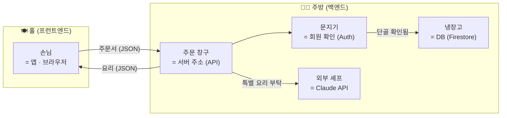

| 식당 | 서버 세계 | 오늘 쓰는 것 | 한 줄 설명 |
|---|---|---|---|
| 손님 | 클라이언트 (앱 · 브라우저 · curl) | `curl` | 요청을 보내는 쪽 |
| 주문서 | 요청 (Request) | JSON | 무엇을 원하는지 정해진 모양으로 적는다 |
| 주문 창구 | API (주소 + 메서드) | Express 경로 | 창구마다 받는 주문이 정해져 있다 |
| 손목밴드 | 토큰 (ID Token) | Firebase Auth | "이 사람은 회원 민지" 라는 증명 |
| 문지기 | 인증 미들웨어 | `requireUser` | 손목밴드를 확인한다 |
| 냉장고 칸 | DB 컬렉션 · 문서 | Firestore | 손님마다 칸이 따로 있다 |
| 외부 셰프 | 외부 API | Claude API | 어려운 요리는 전문가에게 |
| 요리 | 응답 (Response) | JSON + 상태 코드 | 200 성공 · 401 회원 아님 · 404 없음 |

### 2.3 왜 화면(앱)이 직접 냉장고를 열면 안 될까? (3분)

| 만약 앱이 DB를 직접 연다면 | 생기는 일 |
|---|---|
| 앱 코드에 Claude 키를 넣으면 | 누구나 앱을 열어 **키를 훔쳐** 쓴다 → 요금 폭탄 |
| 앱이 DB를 마음대로 읽으면 | 친구의 질문까지 **다 보인다** |
| 규칙이 앱에 있으면 | 앱을 고친 사람은 **규칙을 무시**한다 |

> **오늘의 원칙**: 비밀(키)과 규칙(누가 무엇을)은 **주방(서버)에만** 둔다. 화면은 주문만 한다.

---

## 3. 개발 과정과 설계 — 만들기 전에 그린다 (15분)

### 3.1 개발 과정 한 바퀴 (5분)

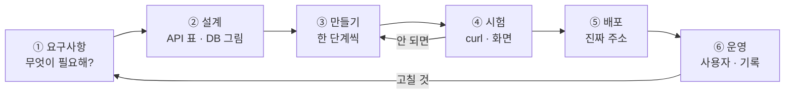

| 단계 | 질문 | 오늘 | 결과물 |
|---|---|---|---|
| ① 요구사항 | 누가 · 무엇을 · 왜? | ✅ | 사용자 이야기 3줄 |
| ② 설계 | 어떤 주소? 어떤 저장 모양? | ✅ | API 표 · DB 구조 그림 |
| ③ 만들기 | 한 번에 하나씩 | ✅ 5단계 | `index.js` |
| ④ 시험 | 되는가? 막아야 할 건 막히는가? | ✅ 단계마다 | 명령 카드 결과 |
| ⑤ 배포 | 친구도 쓸 수 있나? | 👀 설명만 | (다음 시간) |
| ⑥ 운영 | 사용자가 무엇에 막혔나? | 👀 설명만 | (다음 시간) |

> 💬 "코드를 짜는 시간보다 **그리는 시간**이 짧으면 나중에 두 배로 고친다." — 설계는 코드의 정답지다.

### 3.2 요구사항 — 사용자 이야기 (3분)

| # | 나는 … | … 하고 싶다 | 왜냐하면 … |
|---|---|---|---|
| 1 | 학생으로서 | 프로젝트 질문을 보내고 답을 받고 싶다 | 막힌 곳을 빨리 풀려고 |
| 2 | 학생으로서 | 내가 한 질문들을 다시 보고 싶다 | 어떻게 생각이 바뀌었는지 보려고 |
| 3 | 학생으로서 | 내 질문을 친구가 못 봤으면 좋겠다 | 내 생각은 내 것이니까 |

> 활동: 짝과 함께 **4번째 줄**을 하나 더 써 본다. (예: "질문을 지우고 싶다")

### 3.3 API 설계 — REST의 기본 (4분)

**메서드 = 동사, 경로 = 명사**

| 메서드 | 뜻 | 식당으로 | 예 |
|---|---|---|---|
| `GET` | 보기 | 메뉴판 보기 | `GET /questions` 내 질문 목록 |
| `POST` | 새로 만들기 | 주문 넣기 | `POST /questions` 질문 보내기 |
| `PUT` | 통째로 정하기 | 단골 이름표 붙이기 | `PUT /me` 닉네임 정하기 |
| `DELETE` | 지우기 | 주문 취소 | `DELETE /questions/{id}` |

**상태 코드 = 요리와 함께 오는 쪽지**

| 코드 | 뜻 | 오늘 만나는 때 |
|---|---|---|
| `200` OK | 성공 | 목록 보기 |
| `201` Created | 새로 만들어짐 | 질문 저장 |
| `204` No Content | 성공했고 돌려줄 내용 없음 | 지우기 |
| `400` Bad Request | 주문서가 잘못됨 | 빈 질문 |
| `401` Unauthorized | 회원 확인 안 됨 | 토큰 없이 요청 |
| `403` Forbidden | 들어올 수 없음 | DB에 직접 접근 |
| `404` Not Found | 없음 | 친구 질문 열기 |
| `429` Too Many | 너무 많이 | Claude가 바쁠 때 |

**활동지 ① — 오늘의 API 표 채우기** (빈칸은 학생이)

| # | 메서드 | 경로 | 하는 일 | 로그인 필요? | 성공 코드 |
|---|---|---|---|---|---|
| 1 | GET | `/health` | 서버가 살아 있나 | ✕ | 200 |
| 2 | POST | `/guestbook` | 방명록 쓰기 (연습) | ✕ | ___ |
| 3 | PUT | `/me` | 닉네임 정하기 | ___ | 200 |
| 4 | POST | `/questions` | 질문 보내고 Claude 답 받기 | ○ | ___ |
| 5 | GET | `/questions` | ________________ | ○ | 200 |
| 6 | GET | `/questions/{id}` | 질문 하나 보기 | ○ | 200 |
| 7 | ___ | `/questions/{id}` | 질문 지우기 | ○ | 204 |

<details><summary>정답 (교사용)</summary>

2 → 201 · 3 → ○ · 4 → 201 · 5 → 내 질문 목록 보기 · 7 → DELETE

</details>

### 3.4 DB 설계 — 냉장고 칸 나누기 (3분)

Firestore는 **컬렉션(서랍) → 문서(카드) → 칸(필드)** 으로 저장한다. 문서 안에 또 컬렉션을 둘 수 있다.

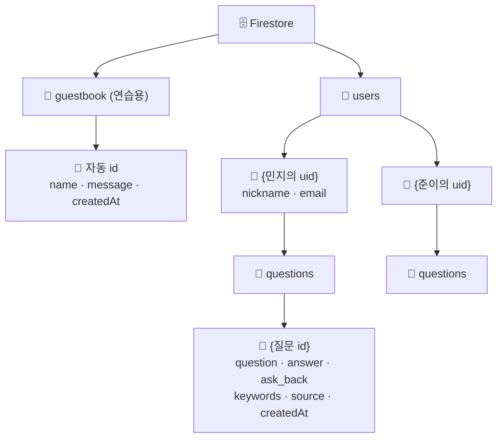

| 경로 | 무엇 | 예시 값 |
|---|---|---|
| `guestbook/{id}` | 누구나 쓰는 방명록 (2단계 연습) | `{ "name": "민지", "message": "안녕!" }` |
| `users/{uid}` | 회원 한 명 | `{ "nickname": "민지", "email": "minji@test.com" }` |
| `users/{uid}/questions/{id}` | 그 회원의 질문 하나 | 아래 JSON |

```json
{
  "question": "화분 흙이 마르면 물을 주는 장치를 만들려면 뭐부터 해야 해?",
  "answer": "먼저 흙이 '마름'을 어떻게 잴지 정해 봐. …",
  "ask_back": "마름을 숫자로 말하면 몇이야?",
  "keywords": ["토양 수분", "기준값"],
  "source": "claude",
  "createdAt": 1795180750045
}
```

> 🔑 **설계 포인트**: 질문을 `users/{uid}/questions` 아래에 둔 순간, "내 질문만 보기"는 **경로만 맞추면** 저절로 된다. 5단계에서 확인한다.

**활동지 ② — 그림 그리기**: 위 트리를 공책에 따라 그리고, 질문 문서에 **칸을 하나 더** 넣는다면 무엇을 넣을지 적는다. (예: `subject` 과목, `liked` 도움 됐나)

---

## 4. 1단계 — 서버 켜기 (15분)

### 4.1 목표

> `GET /health`를 보내면 `{"ok":true}`가 돌아온다. — **서버가 살아 있다**.

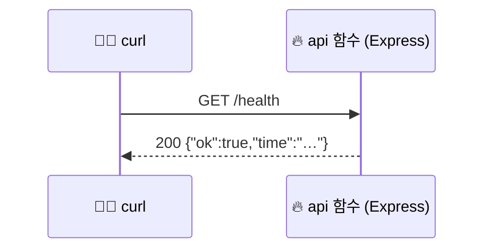

### 4.2 코드 — `functions/index.js`

```js
// ── [1단계] 서버 켜기 ─────────────────────────────────────
const { onRequest } = require("firebase-functions/v2/https");
const { defineSecret } = require("firebase-functions/params");
const express = require("express");

const app = express();
app.use(express.json()); // 들어오는 JSON 주문서를 읽을 수 있게

app.get("/health", (req, res) => {
  res.json({ ok: true, time: new Date().toISOString() });
});

// 맨 아래 — 이 app 전체를 함수 하나 "api" 로 내보낸다
const ANTHROPIC_API_KEY = defineSecret("ANTHROPIC_API_KEY"); // 4단계에서 쓴다
exports.api = onRequest({ region: "asia-northeast3", secrets: [ANTHROPIC_API_KEY] }, app);
```

| 줄 | 뜻 | 식당으로 |
|---|---|---|
| `express()` | 주문 창구들을 모아 둘 가게를 연다 | 가게 열기 |
| `app.use(express.json())` | JSON 주문서를 읽는 법을 배운다 | 주문서 읽는 직원 |
| `app.get("/health", …)` | `GET /health` 창구를 만든다 | "영업 중?" 창구 |
| `res.json({...})` | JSON으로 답한다 (기본 200) | 요리 내보내기 |
| `onRequest(..., app)` | 가게 전체를 Firebase 함수 하나로 | 건물에 입점 |
| `region: "asia-northeast3"` | 서울 데이터센터 | 가까운 곳에 가게 |

> 💡 `ANTHROPIC_API_KEY` 줄은 4단계에서 쓰지만, **함수를 내보내는 줄은 파일 맨 아래 한 번만** 있어야 해서 지금 같이 적는다. 앞으로 코드는 이 두 줄 **위쪽에** 이어 붙인다.

### 4.3 켜고 시험하기

터미널 ① — 에뮬레이터 켜기 (켜 둔 채로 둔다)

```bash
cd askbox
npx firebase emulators:start
```

터미널 ② — 요청 보내기

```bash
API=http://127.0.0.1:5001/demo-askbox/asia-northeast3/api
curl -s $API/health
```

기대 결과

```json
{"ok":true,"time":"2026-11-20T13:18:35.985Z"}
```

**주소를 뜯어 보면**

| 조각 | 뜻 |
|---|---|
| `127.0.0.1:5001` | 내 컴퓨터의 Functions 에뮬레이터 |
| `demo-askbox` | 프로젝트 이름 (`demo-`라 진짜 Firebase와 상관없음) |
| `asia-northeast3` | 지역 (서울) |
| `api` | 함수 이름 (`exports.api`) |
| `/health` | Express 안의 경로 |

### 4.4 확인 · 생각해 보기

| ✓ | 확인 |
|---|---|
| ☐ | `{"ok":true …}`가 보인다 |
| ☐ | 에뮬레이터 화면 `http://127.0.0.1:4000` → **Logs**에 요청 기록이 찍힌다 |
| ☐ | `curl -s $API/hello` 처럼 없는 경로를 보내 본다 → 무엇이 오나? (Express 기본 404) |

> 🧠 **이해 질문**: 코드를 고치고 저장하면 에뮬레이터가 알아서 다시 읽는다. 코드를 바꿀 때마다 무엇을 다시 보내 확인해야 할까?

---

## 5. 2단계 — DB에 저장하기 (15분)

### 5.1 목표

> 방명록에 글을 쓰면 **Firestore에 문서가 생기고**, 목록으로 다시 꺼낼 수 있다.

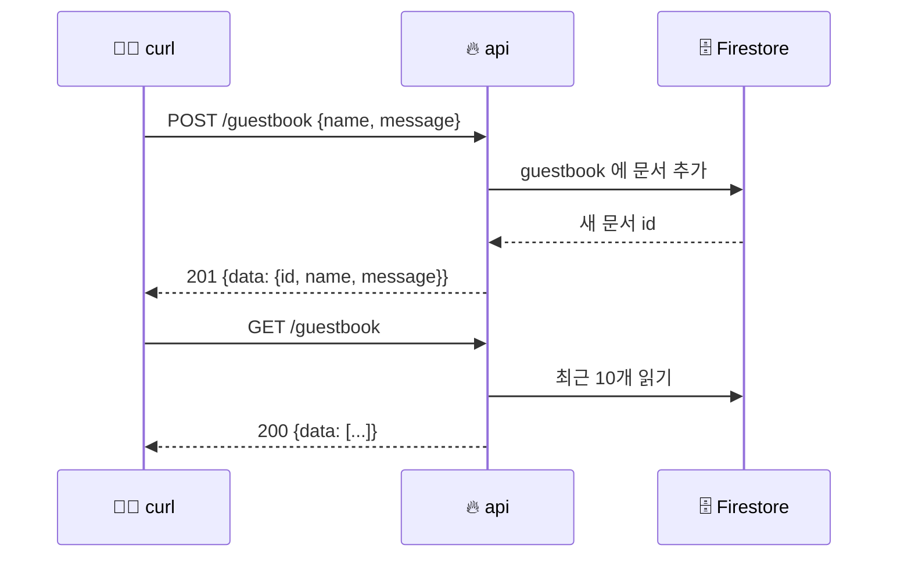

### 5.2 코드 — 1단계 코드 아래, `exports.api` 위에 붙인다

```js
// ── [2단계] DB(Firestore) 연결 ────────────────────────────
const { initializeApp } = require("firebase-admin/app");
const { getFirestore } = require("firebase-admin/firestore");
const { getAuth } = require("firebase-admin/auth"); // 3단계에서 쓴다

initializeApp();         // 에뮬레이터 안에서는 자동으로 에뮬레이터 DB에 붙는다
const db = getFirestore();

// 연습: 누구나 쓰는 방명록
app.post("/guestbook", async (req, res) => {
  const name = String(req.body.name || "").trim();
  const message = String(req.body.message || "").trim();
  if (!name || !message) {
    return res.status(400).json({ error: { code: "empty", message: "이름과 글을 모두 적어 주세요." } });
  }
  const doc = { name, message, createdAt: Date.now() };
  const ref = await db.collection("guestbook").add(doc);
  res.status(201).json({ data: { id: ref.id, ...doc } });
});

app.get("/guestbook", async (req, res) => {
  const snap = await db.collection("guestbook").orderBy("createdAt", "desc").limit(10).get();
  res.json({ data: snap.docs.map((d) => ({ id: d.id, ...d.data() })) });
});
```

| 코드 | 뜻 |
|---|---|
| `async` / `await` | DB는 멀리 있어서 **기다렸다가** 다음 줄로 간다 |
| `db.collection("guestbook").add(doc)` | 서랍 `guestbook`에 카드 한 장 넣기 (id 자동) |
| `res.status(201)` | "새로 만들었어" 쪽지 |
| `res.status(400)` | "주문서가 비었어" 쪽지 — **검사는 서버가 한다** |
| `orderBy(...).limit(10)` | 최신순 10장만 |
| `{ data: ... }` / `{ error: ... }` | 성공과 실패의 **봉투 모양을 정해 둔다** — 받는 쪽이 읽기 쉽다 |

### 5.3 시험

```bash
curl -s -X POST $API/guestbook -H "Content-Type: application/json" \
  -d '{"name":"민지","message":"서버야 안녕!"}'
curl -s $API/guestbook
curl -s -X POST $API/guestbook -H "Content-Type: application/json" -d '{"name":"","message":""}'
```

| 보낸 것 | 기대 결과 |
|---|---|
| 방명록 쓰기 | `201` `{"data":{"id":"…","name":"민지",…}}` |
| 목록 | `{"data":[{"name":"민지",…}]}` |
| 빈 글 | `400` `{"error":{"code":"empty",…}}` |

에뮬레이터 화면 `http://127.0.0.1:4000/firestore` → `guestbook` 서랍에 카드가 생긴 걸 **눈으로** 확인한다.

### 5.4 문제 발견 — 3단계로 가는 이유 (3분 토론)

| 지금 방명록의 문제 | 결과 |
|---|---|
| 이름을 **아무거나** 적을 수 있다 | 내가 "민지"라고 쓰면 민지가 쓴 걸로 보인다 |
| 목록이 **모두에게** 보인다 | 질문함이라면 큰일 |
| 누가 몇 번 썼는지 모른다 | 장난 글을 막을 수 없다 |

> 💬 "서버가 **누가 보냈는지 확실히** 알아야 한다" → 회원 확인(인증)이 필요하다.

---

## 6. 3단계 — 회원 확인하기 (20분)

### 6.1 핵심 그림 — 가입 · 로그인은 Auth가, 확인은 서버가

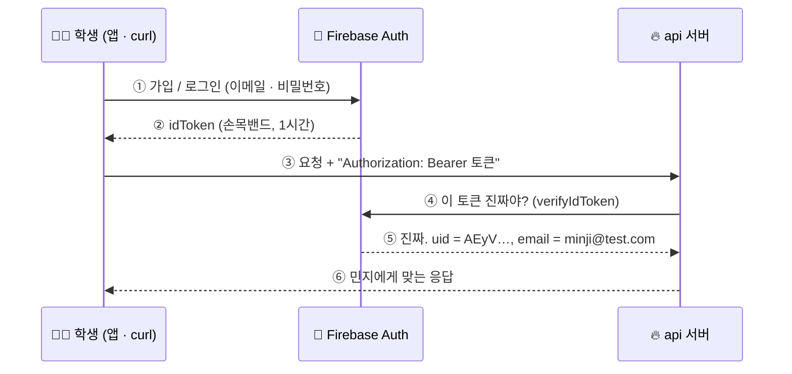

| 누가 | 하는 일 | 하지 않는 일 |
|---|---|---|
| 🔐 Firebase Auth | 가입 · 로그인 · 비밀번호 보관 · 토큰 발급 | 질문 저장 |
| 🔥 우리 서버 | 토큰 검사 → `uid`로 그 사람의 칸만 다루기 | **비밀번호를 받거나 저장하지 않는다** |

> 🎢 **놀이공원 손목밴드**: 입구(Auth)에서 표를 확인하고 밴드를 채워 준다. 놀이기구(서버)는 표를 다시 보지 않고 **밴드만** 본다. 밴드에는 유효 시간이 있다(1시간).

### 6.2 코드 — 문지기(`requireUser`)와 내 정보

```js
// ── [3단계] 회원 확인 (문지기) ─────────────────────────────
// 요청 머리(header)의 "Authorization: Bearer <토큰>" 을 Firebase Auth 에 물어본다.
async function requireUser(req, res, next) {
  const match = /^Bearer (.+)$/.exec(req.get("Authorization") || "");
  if (!match) {
    return res.status(401).json({ error: { code: "no_token", message: "로그인이 필요해요." } });
  }
  try {
    req.user = await getAuth().verifyIdToken(match[1]); // { uid, email, ... }
    next(); // 통과! 다음 일(창구)로
  } catch (e) {
    res.status(401).json({ error: { code: "bad_token", message: "로그인 토큰이 올바르지 않아요." } });
  }
}

// 내 정보 — 닉네임을 정하고, 다시 본다
app.put("/me", requireUser, async (req, res) => {
  const nickname = String(req.body.nickname || "").trim();
  if (!nickname || nickname.length > 20) {
    return res.status(400).json({ error: { code: "bad_nickname", message: "닉네임은 1~20자로 적어 주세요." } });
  }
  await db.doc(`users/${req.user.uid}`).set({ nickname, email: req.user.email, updatedAt: Date.now() }, { merge: true });
  res.json({ data: { uid: req.user.uid, nickname } });
});

app.get("/me", requireUser, async (req, res) => {
  const snap = await db.doc(`users/${req.user.uid}`).get();
  if (!snap.exists) return res.status(404).json({ error: { code: "no_profile", message: "먼저 PUT /me 로 닉네임을 정해 주세요." } });
  res.json({ data: { uid: req.user.uid, ...snap.data() } });
});
```

**미들웨어 = 창구 앞의 문지기**

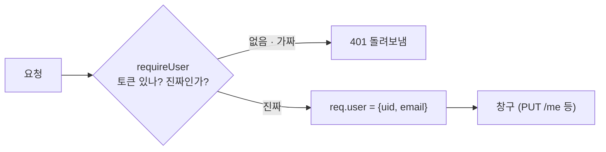

| 코드 | 뜻 |
|---|---|
| `app.put("/me", requireUser, async …)` | `/me` 창구 앞에 문지기를 세운다 — **순서대로** 지나간다 |
| `req.get("Authorization")` | 요청 머리에 붙은 손목밴드 읽기 |
| `verifyIdToken(토큰)` | Auth에게 "진짜야?" — 가짜 · 만료면 오류 |
| `req.user.uid` | 회원마다 다른 **고유 번호** (이메일이 바뀌어도 그대로) |
| `` db.doc(`users/${uid}`) `` | 그 회원의 카드 — **경로에 uid가 들어간다** |
| `set(..., { merge: true })` | 있던 칸은 두고 보낸 칸만 덮는다 |

### 6.3 시험 — 가입하고 손목밴드 받기

> 실제 앱에서는 Firebase 로그인 화면이 이 일을 대신한다. 오늘은 **같은 일을 curl로** 해서 토큰이 어떻게 생기는지 눈으로 본다.

```bash
AUTH=http://127.0.0.1:9099/identitytoolkit.googleapis.com/v1

# 가입 (에뮬레이터에서는 key 값이 아무거나여도 된다)
curl -s -X POST "$AUTH/accounts:signUp?key=practice" -H "Content-Type: application/json" \
  -d '{"email":"minji@test.com","password":"pass1234","returnSecureToken":true}'

# 로그인해서 토큰만 꺼내 TOKEN 에 담기
TOKEN=$(curl -s -X POST "$AUTH/accounts:signInWithPassword?key=practice" -H "Content-Type: application/json" \
  -d '{"email":"minji@test.com","password":"pass1234","returnSecureToken":true}' \
  | node -pe 'JSON.parse(require("fs").readFileSync(0)).idToken')
echo $TOKEN
```

토큰은 `eyJhbGciOi…`로 시작하는 아주 긴 글자다. 에뮬레이터 화면 **Authentication** 탭에 `minji@test.com` 회원이 생긴 것도 확인한다.

이제 문지기를 시험한다.

```bash
curl -s $API/me                                           # ① 토큰 없이
curl -s $API/me -H "Authorization: Bearer $TOKEN"         # ② 닉네임 정하기 전
curl -s -X PUT $API/me -H "Authorization: Bearer $TOKEN" -H "Content-Type: application/json" \
  -d '{"nickname":"민지"}'                                 # ③ 닉네임 정하기
curl -s $API/me -H "Authorization: Bearer $TOKEN"         # ④ 다시 보기
curl -s $API/me -H "Authorization: Bearer 가짜토큰"        # ⑤ 가짜 밴드
```

| # | 기대 결과 | 배운 것 |
|---|---|---|
| ① | `401 no_token` | 문지기는 밴드 없는 사람을 돌려보낸다 |
| ② | `404 no_profile` | 회원(Auth)과 회원 카드(DB)는 **다른 것** |
| ③ | `{"data":{"uid":"…","nickname":"민지"}}` | uid는 Auth가 정해 준 번호 |
| ④ | 닉네임 · 이메일이 보인다 | DB `users/{uid}` 카드 |
| ⑤ | `401 bad_token` | 밴드를 흉내 내도 Auth가 알아챈다 |

### 6.4 생각해 보기

| 질문 | 힌트 |
|---|---|
| 서버 코드 어디에도 비밀번호가 없다. 왜 좋을까? | 서버가 털려도 비밀번호는 안전하다 |
| 토큰이 1시간 뒤 끝나면? | 다시 로그인 (실제 앱은 자동으로 새 토큰을 받는다) |
| 이메일 대신 uid로 카드 이름을 정한 이유는? | 이메일은 바뀔 수 있고, 남에게 보이면 안 되는 정보다 |

---

## ☕ 쉬는 시간 (5분)

> 교사: 이 동안 3단계까지 못 온 학생 자리를 돈다. `완성본/index.js`에서 3단계까지 복사해 붙이게 해도 된다 — **이 수업의 목표는 타자가 아니라 이해**다.

---

## 7. 4단계 — Claude에게 답 받기 (20분)

### 7.1 목표

> 질문을 보내면 Claude가 **정해진 JSON 양식**(답 · 되묻기 · 키워드)으로 답하고, 서버가 그것을 저장한다.

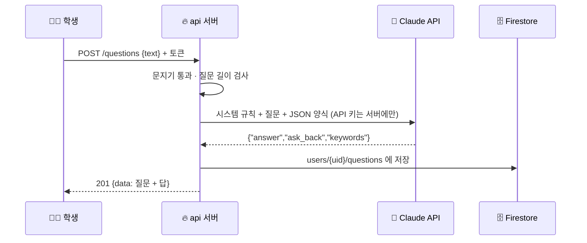

### 7.2 API 키 — 비밀은 서버에만

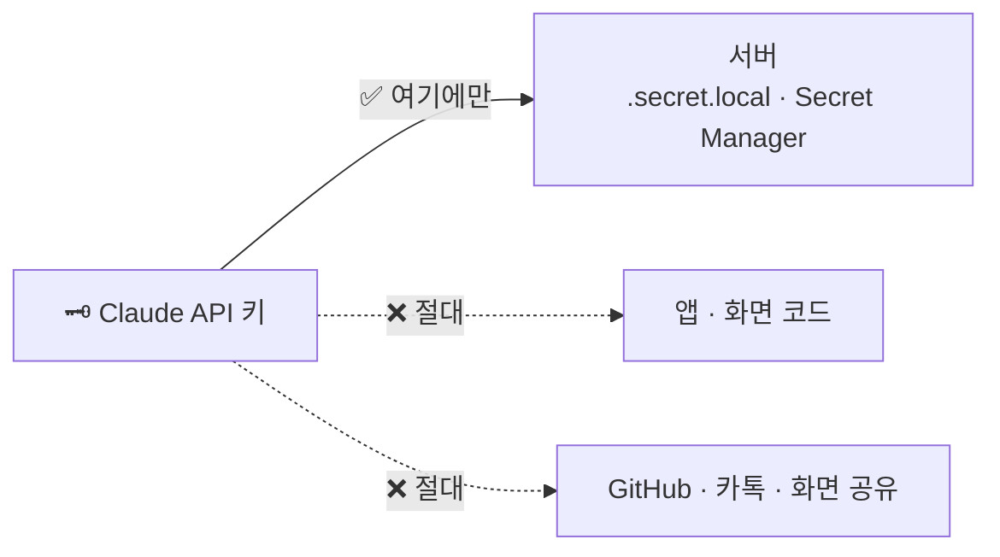

| 어디 | 키를 둬도 되나 | 이유 |
|---|---|---|
| `functions/.secret.local` (에뮬레이터) | ✅ | 내 컴퓨터의 서버만 읽는다. Git에 올리지 않는다 |
| Firebase **Secret Manager** (배포) | ✅ | `firebase functions:secrets:set ANTHROPIC_API_KEY` |
| `index.js` 안에 직접 | ❌ | 코드를 공유하는 순간 키도 공유된다 |
| 앱 · 웹 화면 | ❌ | 누구나 열어 볼 수 있다 |

### 7.3 구조화된 출력 — "빈칸 양식"을 주고 답하게 하기

> 자유롭게 쓴 글은 DB에 넣기 어렵다. **답안지 양식**을 주면, 칸마다 꺼내 저장하고 화면에 나눠 보여 줄 수 있다.

| 칸 이름 | 종류 | 무엇 | 예 |
|---|---|---|---|
| `answer` | 글 | 질문에 대한 답 (5문장 이내) | "먼저 흙이 '마름'을 어떻게 잴지 정해 봐." |
| `ask_back` | 글 | 학생이 스스로 생각하게 하는 **되묻기** 1개 | "마름을 숫자로 말하면 몇이야?" |
| `keywords` | 글 목록 | 핵심 낱말 2~3개 | `["토양 수분", "기준값"]` |

### 7.4 코드

```js
// ── [4단계] Claude 에게 묻기 ───────────────────────────────
const Anthropic = require("@anthropic-ai/sdk");

// Claude 가 꼭 이 모양(JSON)으로만 답하게 한다 — 구조화된 출력
const ANSWER_SCHEMA = {
  type: "object",
  properties: {
    answer: { type: "string", description: "학생 질문에 대한 답. 중학생이 읽을 수 있게 5문장 이내" },
    ask_back: { type: "string", description: "학생이 스스로 생각해 보도록 되묻는 질문 한 개" },
    keywords: { type: "array", items: { type: "string" }, description: "핵심 낱말 2~3개" },
  },
  required: ["answer", "ask_back", "keywords"],
  additionalProperties: false,
};

const SYSTEM = [
  "너는 중학생의 프로젝트를 돕는 코치다.",
  "먼저 질문에 정확하고 쉽게 답한다. 그다음 학생이 스스로 생각하도록 되묻는 질문을 하나 만든다.",
  "개인정보를 묻지 않는다. 위험한 실험 방법은 알려 주지 않고 어른과 함께 하라고 말한다.",
].join("\n");

async function askClaude(question) {
  const apiKey = ANTHROPIC_API_KEY.value();
  if (!apiKey) {
    // 키가 없으면 연습용 답 — 수업이 멈추지 않게
    return {
      source: "practice",
      answer: `(연습 답) "${question}" 에 대한 진짜 답은 선생님 키를 넣으면 나와요.`,
      ask_back: "이 질문으로 무엇을 만들고 싶어?",
      keywords: ["연습"],
    };
  }
  const client = new Anthropic({ apiKey });
  const response = await client.beta.messages.create({
    model: "claude-opus-5-5",
    max_tokens: 4000,
    // 거절되면 Anthropic 이 알맞은 다른 모델로 이어서 답하게 한다
    betas: ["server-side-fallback-2026-07-01"],
    fallbacks: "default",
    system: SYSTEM,
    messages: [{ role: "user", content: question }],
    output_config: {
      effort: "low", // 짧은 답이라 빠르게 · 적게
      format: { type: "json_schema", schema: ANSWER_SCHEMA },
    },
  });
  if (response.stop_reason === "refusal") {
    return { source: "refused", answer: "이 질문에는 답하기 어려워요. 선생님께 물어봐 주세요.", ask_back: "", keywords: [] };
  }
  const text = response.content.filter((b) => b.type === "text").map((b) => b.text).join("");
  const out = JSON.parse(text); // 스키마대로 온 JSON
  return { source: "claude", model: response.model, ...out };
}

app.post("/questions", requireUser, async (req, res) => {
  const question = String(req.body.text || "").trim();
  if (!question || question.length > 500) {
    return res.status(400).json({ error: { code: "bad_question", message: "질문은 1~500자로 적어 주세요." } });
  }
  let reply;
  try {
    reply = await askClaude(question);
  } catch (e) {
    if (e instanceof Anthropic.RateLimitError) {
      return res.status(429).json({ error: { code: "busy", message: "지금 질문이 많아요. 잠시 뒤 다시 해 주세요." } });
    }
    if (e instanceof Anthropic.APIError) {
      return res.status(502).json({ error: { code: "claude_error", message: `Claude 오류 (${e.status})` } });
    }
    throw e;
  }
  // ── [5단계] 내 질문함에 저장 — 경로에 내 uid 가 들어간다 ──
  const doc = { question, ...reply, createdAt: Date.now() };
  const ref = await db.collection(`users/${req.user.uid}/questions`).add(doc);
  res.status(201).json({ data: { id: ref.id, ...doc } });
});
```

**한 요청에 담기는 것**

| 이름 | 값 | 뜻 |
|---|---|---|
| `model` | `claude-opus-5-5` | 답하는 모델 |
| `max_tokens` | `4000` | 답 길이 상한 (토큰 ≈ 글자 조각) |
| `system` | 코치 규칙 3줄 | 모든 질문에 똑같이 적용되는 **역할과 규칙** |
| `messages` | 학생 질문 | 이번 질문 |
| `output_config.effort` | `low` | 얼마나 깊이 생각할지 — 짧은 답이라 낮게 |
| `output_config.format` | `json_schema` + 양식 | **답안지 양식** |
| `betas` · `fallbacks` | 거절 대비 | 안전 기준에 걸리면 Anthropic이 다른 모델로 이어 답한다 |

**실패를 다루는 법 — 서버는 쓰러지지 않는다**

| 상황 | 서버가 돌려주는 것 | 학생 화면에 보일 말 |
|---|---|---|
| 키가 없다 | `201` + `source: "practice"` | 연습 답 |
| Claude가 답을 거절 | `201` + `source: "refused"` | "선생님께 물어봐 주세요" |
| 너무 많은 요청 | `429 busy` | "잠시 뒤 다시" |
| 그 밖의 Claude 오류 | `502 claude_error` | "Claude 오류 (번호)" |
| 빈 질문 · 너무 긴 질문 | `400 bad_question` | "1~500자로" — **Claude를 부르기 전에** 막는다 (돈 아끼기) |

### 7.5 시험

```bash
curl -s -X POST $API/questions -H "Authorization: Bearer $TOKEN" -H "Content-Type: application/json" \
  -d '{"text":"화분 흙이 마르면 물을 주는 장치를 만들려면 뭐부터 해야 해?"}'
```

키가 **없을 때** (방법 ①)

```json
{"data":{"id":"BtQPAzXKWZoOLnN0Fe5k","question":"화분 흙이 마르면 …","source":"practice",
 "answer":"(연습 답) … 진짜 답은 선생님 키를 넣으면 나와요.","ask_back":"이 질문으로 무엇을 만들고 싶어?",
 "keywords":["연습"],"createdAt":1795180716715}}
```

키가 **있을 때** (방법 ②③) — 답 내용은 매번 조금씩 다르다

```json
{"data":{"id":"9YzFunVPwhb9iAcmaXpt","question":"화분 흙이 마르면 …","source":"claude","model":"claude-opus-5-5",
 "answer":"먼저 흙이 '마름'을 어떻게 잴지 정해 봐. …","ask_back":"마름을 숫자로 말하면 몇이야?",
 "keywords":["토양 수분","기준값"],"createdAt":1795180750045}}
```

| ✓ | 확인 |
|---|---|
| ☐ | 응답에 `answer` · `ask_back` · `keywords` 세 칸이 있다 |
| ☐ | 에뮬레이터 화면 Firestore → `users` → (내 uid) → `questions`에 같은 내용이 있다 |
| ☐ | `{"text":""}`를 보내면 `400`이 오고, Claude는 불리지 않는다 |

### 7.6 생각해 보기 — 프롬프트를 바꿔 보자 (빠른 학생)

| 바꿀 곳 | 바꿔 보기 | 무엇이 달라지나 |
|---|---|---|
| `SYSTEM` | "답은 3문장 이내로" | 답 길이 |
| `ANSWER_SCHEMA` | `difficulty` 칸 추가 (`"쉬움"`·`"보통"`·`"어려움"`) — `properties`와 `required` 둘 다에 | 저장되는 칸이 하나 늘어난다 |
| `effort` | `"low"` → `"medium"` | 더 깊이 생각 · 더 느리고 비싸다 |

> ⚠️ 양식(스키마)에 칸을 추가하면 **`required`에도** 넣어야 한다. 양식과 DB 칸이 같이 움직인다는 게 설계의 핵심이다.

---

## 8. 5단계 — 내 질문함과 보안 시험 (10분)

### 8.1 코드 — 내 질문만 보기 · 지우기

```js
// ── [5단계] 내 질문함 ─────────────────────────────────────
app.get("/questions", requireUser, async (req, res) => {
  const snap = await db.collection(`users/${req.user.uid}/questions`).orderBy("createdAt", "desc").limit(20).get();
  res.json({ data: snap.docs.map((d) => ({ id: d.id, ...d.data() })) });
});

app.get("/questions/:id", requireUser, async (req, res) => {
  const snap = await db.doc(`users/${req.user.uid}/questions/${req.params.id}`).get();
  if (!snap.exists) return res.status(404).json({ error: { code: "not_found", message: "그런 질문이 없어요." } });
  res.json({ data: { id: snap.id, ...snap.data() } });
});

app.delete("/questions/:id", requireUser, async (req, res) => {
  const ref = db.doc(`users/${req.user.uid}/questions/${req.params.id}`);
  if (!(await ref.get()).exists) return res.status(404).json({ error: { code: "not_found", message: "그런 질문이 없어요." } });
  await ref.delete();
  res.status(204).end();
});
```

> 🔑 **보안이 어디서 생기나?** `if (질문 주인 === 나)` 같은 검사가 **없다**. 대신 경로가 언제나 `users/{**토큰에서 나온 내 uid**}/…`다. 남의 uid를 넣을 방법이 없으니, 남의 질문은 **애초에 찾을 수 없다**.

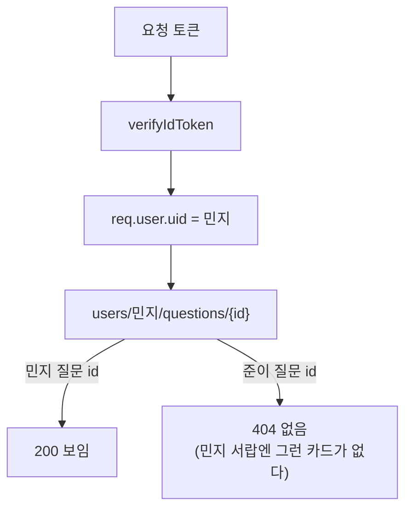

### 8.2 짝 활동 — "친구 질문 훔쳐보기" 시험 (5분)

> 서버를 공격해 보는 사람이 되어, **막혀야 할 것이 막히는지** 시험한다. 이것도 개발의 중요한 단계다.

```bash
# 내 질문 id 하나 꺼내기
QID=$(curl -s $API/questions -H "Authorization: Bearer $TOKEN" | node -pe 'JSON.parse(require("fs").readFileSync(0)).data[0].id')

# 짝(준이) 계정 만들고 → 로그인해서 준이 토큰 받기 (이미 있으면 가입은 EMAIL_EXISTS — 괜찮다)
curl -s -X POST "$AUTH/accounts:signUp?key=practice" -H "Content-Type: application/json" \
  -d '{"email":"jun@test.com","password":"pass1234","returnSecureToken":true}' > /dev/null
OTHER=$(curl -s -X POST "$AUTH/accounts:signInWithPassword?key=practice" -H "Content-Type: application/json" \
  -d '{"email":"jun@test.com","password":"pass1234","returnSecureToken":true}' \
  | node -pe 'JSON.parse(require("fs").readFileSync(0)).idToken')

curl -s -w " [%{http_code}]\n" $API/questions/$QID -H "Authorization: Bearer $OTHER"   # 준이가 민지 질문을
curl -s -w " [%{http_code}]\n" $API/questions/$QID -H "Authorization: Bearer $TOKEN"   # 민지가 민지 질문을
curl -s -w " [%{http_code}]\n" "http://127.0.0.1:8080/v1/projects/demo-askbox/databases/(default)/documents/users"  # DB를 직접
```

| 시도 | 기대 | 왜 막히나 |
|---|---|---|
| 토큰 없이 `GET /questions` | `401` | 문지기 |
| 준이 토큰으로 민지 질문 | `404` | 경로가 `users/준이/…`라 카드가 없다 |
| 민지 토큰으로 민지 질문 | `200` | 내 서랍 |
| 서버를 건너뛰고 DB에 직접 | `403 PERMISSION_DENIED` | `firestore.rules`가 **모든 직접 접근을 잠금** |
| 질문 지우기 `DELETE` | `204` → 다시 열면 `404` | 지워졌다 |

### 8.3 DB 규칙 — 두 겹의 문

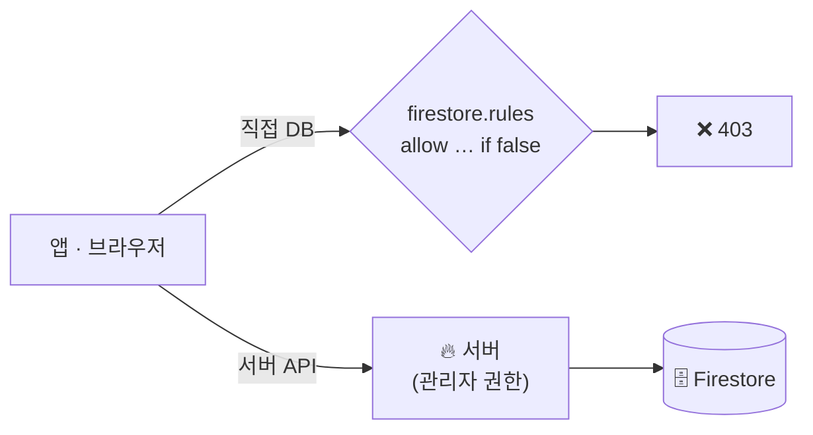

| 문 | 누가 지키나 | 오늘의 설정 |
|---|---|---|
| 1겹: DB 직접 접근 | `firestore.rules` | **전부 잠금** (`if false`) |
| 2겹: 서버 API | 우리 코드 (`requireUser` + uid 경로) | 토큰 있는 회원 · 자기 칸만 |

> 서버(Admin SDK)는 규칙을 건너뛰는 **관리자 열쇠**를 갖고 있다. 그래서 "누가 무엇을"은 **서버 코드가 책임**진다.

---

## 9. 정리 — 오늘 만든 것 (10분)

### 9.1 오늘의 지도

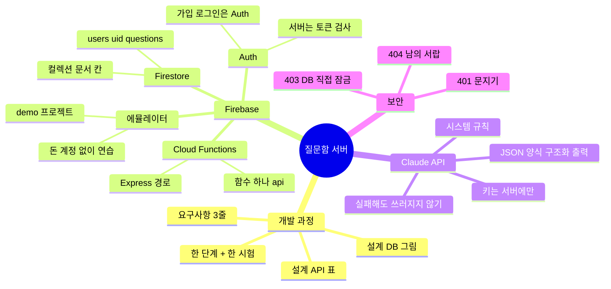

### 9.2 오늘의 API — 완성표

| 메서드 | 경로 | 문지기 | 하는 일 | 성공 | 대표 실패 |
|---|---|---|---|---|---|
| GET | `/health` | — | 살아 있나 | 200 | — |
| POST | `/guestbook` | — | 방명록 쓰기 (연습) | 201 | 400 |
| GET | `/guestbook` | — | 방명록 보기 (연습) | 200 | — |
| PUT | `/me` | 🔐 | 닉네임 정하기 | 200 | 400 · 401 |
| GET | `/me` | 🔐 | 내 정보 | 200 | 401 · 404 |
| POST | `/questions` | 🔐 | 질문 → Claude 답 → 저장 | 201 | 400 · 401 · 429 · 502 |
| GET | `/questions` | 🔐 | 내 질문 목록 | 200 | 401 |
| GET | `/questions/{id}` | 🔐 | 내 질문 하나 | 200 | 401 · 404 |
| DELETE | `/questions/{id}` | 🔐 | 내 질문 지우기 | 204 | 401 · 404 |

### 9.3 다음에 할 일 — 개발 과정의 나머지 반 바퀴

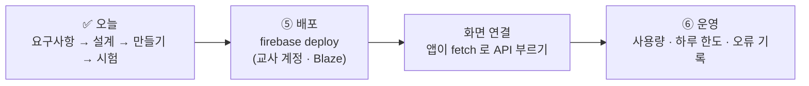

| 다음 단계 | 무엇 | 오늘과 무엇이 다른가 |
|---|---|---|
| 배포 | `firebase deploy --only functions,firestore` | 주소가 `https://asia-northeast3-<프로젝트>.cloudfunctions.net/api` 로 바뀐다. 키는 Secret Manager로 |
| 화면 연결 | 앱이 Firebase 로그인 SDK로 토큰을 받고 `fetch`로 API 호출 | curl 대신 버튼 |
| 운영 | 회원별 하루 질문 한도 · Claude 호출 기록 | 비용과 장난을 막는다 |

### 9.4 회고 — 세 줄 쓰기 (활동지 ③)

| 질문 | 내 답 |
|---|---|
| 오늘 만든 서버를 식당으로 설명하면? | |
| 401과 404는 각각 언제 나왔고, 왜 달랐나? | |
| 질문 문서에 칸을 하나 더 둔다면? (양식 · DB · API 중 어디를 같이 고쳐야 하나) | |

### 9.5 출구 퀴즈 (2분)

| # | 문제 | 정답 |
|---|---|---|
| 1 | 가입 · 로그인 · 비밀번호 보관은 누가? | Firebase Auth |
| 2 | 서버는 회원을 무엇으로 알아보나? | 토큰 (Authorization: Bearer) |
| 3 | Claude API 키를 두면 안 되는 곳 하나 | 앱 · 화면 코드 / GitHub / 메신저 |
| 4 | Claude 답을 JSON 양식으로 받으면 좋은 점 | 칸별로 DB에 저장하고 화면에 나눠 보여 줄 수 있다 |
| 5 | 친구 토큰으로 내 질문을 열면 몇 번? 왜? | 404 — 경로가 친구 uid 서랍이라 카드가 없다 |

---

## 부록 A — 완성 코드

완성 파일은 이 문서 옆 **[askbox_실습꾸러미/완성본/index.js](askbox_실습꾸러미/완성본/index.js)** 에 있다 (약 170줄). 본문 코드 블록을 아래 순서대로 이어 붙인 것과 같고, 두 가지 모두 에뮬레이터에서 부록 B를 처음부터 끝까지 돌려 확인했다.

| 순서 | 본문 | 붙이는 자리 | 줄 수 (대략) |
|---|---|---|---|
| 1 | §4.2 1단계 — `express` · `/health` | 파일 맨 위 | 12 |
| 2 | §5.2 2단계 — Firestore · 방명록 | 1 아래 | 25 |
| 3 | §6.2 3단계 — `requireUser` · `/me` | 2 아래 | 30 |
| 4 | §7.4 4단계 — Claude · `POST /questions` | 3 아래 | 80 |
| 5 | §8.1 5단계 — 내 질문함 · 지우기 | 4 아래 | 20 |
| 끝 | §4.2의 `ANTHROPIC_API_KEY` · `exports.api` 두 줄 | **파일 맨 아래 한 번만** | 2 |

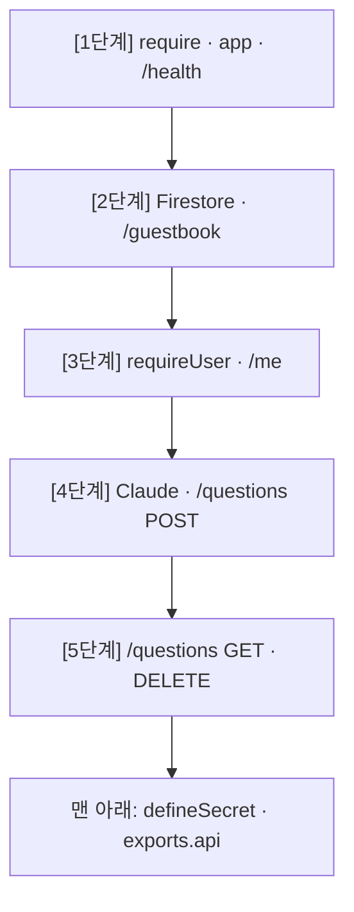

> 📝 완성본에서는 `ANTHROPIC_API_KEY`를 4단계 자리에서 만든다. 본문처럼 맨 아래에서 만들어도 된다 — **변수는 한 번만** 만들면 어디 있든 된다. 두 번 만들면 `Identifier 'ANTHROPIC_API_KEY' has already been declared` 오류가 난다.

### 실습 꾸러미 폴더

| 파일 | 무엇 |
|---|---|
| `firebase.json` · `.firebaserc` · `firestore.rules` | §1.3과 같은 설정 |
| `functions/package.json` | 쓰는 도구 4개 |
| `functions/index.js` | 학생이 채우는 파일 (안내 주석만) |
| `완성본/index.js` | 완성 코드 |
| `.gitignore` | `.secret.local`(키) · `node_modules` 를 Git에서 뺀다 |

---

## 부록 B — 명령 카드

> 터미널 ②에서 위에서부터 차례로. (터미널 ①은 `npx firebase emulators:start`가 켜져 있어야 한다)
> 결과 JSON 바로 뒤에 다음 프롬프트가 붙어 보이는 건 정상이다 (curl은 끝에 줄을 바꾸지 않는다). 두 번째로 돌릴 때 가입 명령이 `EMAIL_EXISTS`를 돌려주는 것도 정상 — 로그인 명령이 토큰을 받는다.

```bash
# 0. 주소 정하기
API=http://127.0.0.1:5001/demo-askbox/asia-northeast3/api
AUTH=http://127.0.0.1:9099/identitytoolkit.googleapis.com/v1

# 1단계
curl -s $API/health

# 2단계
curl -s -X POST $API/guestbook -H "Content-Type: application/json" -d '{"name":"민지","message":"서버야 안녕!"}'
curl -s $API/guestbook

# 3단계
curl -s -X POST "$AUTH/accounts:signUp?key=practice" -H "Content-Type: application/json" \
  -d '{"email":"minji@test.com","password":"pass1234","returnSecureToken":true}'
TOKEN=$(curl -s -X POST "$AUTH/accounts:signInWithPassword?key=practice" -H "Content-Type: application/json" \
  -d '{"email":"minji@test.com","password":"pass1234","returnSecureToken":true}' \
  | node -pe 'JSON.parse(require("fs").readFileSync(0)).idToken')
curl -s $API/me
curl -s -X PUT $API/me -H "Authorization: Bearer $TOKEN" -H "Content-Type: application/json" -d '{"nickname":"민지"}'
curl -s $API/me -H "Authorization: Bearer $TOKEN"

# 4단계
curl -s -X POST $API/questions -H "Authorization: Bearer $TOKEN" -H "Content-Type: application/json" \
  -d '{"text":"화분 흙이 마르면 물을 주는 장치를 만들려면 뭐부터 해야 해?"}'

# 5단계
curl -s $API/questions -H "Authorization: Bearer $TOKEN"
QID=$(curl -s $API/questions -H "Authorization: Bearer $TOKEN" | node -pe 'JSON.parse(require("fs").readFileSync(0)).data[0].id')
curl -s -X POST "$AUTH/accounts:signUp?key=practice" -H "Content-Type: application/json" \
  -d '{"email":"jun@test.com","password":"pass1234","returnSecureToken":true}' > /dev/null
OTHER=$(curl -s -X POST "$AUTH/accounts:signInWithPassword?key=practice" -H "Content-Type: application/json" \
  -d '{"email":"jun@test.com","password":"pass1234","returnSecureToken":true}' \
  | node -pe 'JSON.parse(require("fs").readFileSync(0)).idToken')
curl -s -w " [%{http_code}]\n" $API/questions/$QID -H "Authorization: Bearer $OTHER"
curl -s -w " [%{http_code}]\n" -X DELETE $API/questions/$QID -H "Authorization: Bearer $TOKEN"
curl -s -w " [%{http_code}]\n" "http://127.0.0.1:8080/v1/projects/demo-askbox/databases/(default)/documents/users"
```

| 명령 | 기대 결과 (확인한 값) |
|---|---|
| `/health` | `{"ok":true,"time":"…"}` |
| 방명록 쓰기 · 보기 | `201` · 목록에 "민지" |
| `GET /me` (토큰 없이) | `{"error":{"code":"no_token",…}}` |
| `PUT /me` | `{"data":{"uid":"…","nickname":"민지"}}` |
| `POST /questions` | `201` · `source` `practice` 또는 `claude` · 칸 3개 |
| 준이 토큰 → 민지 질문 | `{"error":{"code":"not_found",…}} [404]` |
| `DELETE` | `[204]` |
| DB 직접 | `PERMISSION_DENIED [403]` |

---

## 부록 C — 막혔을 때

| 증상 | 원인 | 이렇게 |
|---|---|---|
| `command not found: firebase` | CLI가 전역 설치 안 됨 | `npx firebase …` 로 부른다 |
| `Could not spawn java` | Java가 없다 | Java 21 설치 · 터미널 다시 열기 |
| `Port 8080 is not open` / 이미 사용 중 | 다른 프로그램이 포트 사용 | 그 프로그램을 끄거나 `firebase.json` 포트 변경 |
| `curl: (7) Failed to connect` | 에뮬레이터가 꺼짐 · 아직 켜지는 중 | 터미널 ①에 `All emulators ready!` 를 기다린다 |
| `Cannot GET /heath` (404) | 경로 오타 | `/health` 철자 확인 |
| `{"error":{"code":"no_token"…}}` | `-H "Authorization: Bearer $TOKEN"` 빠짐 · `$TOKEN` 빈 값 | `echo $TOKEN` 으로 확인 → 다시 로그인 |
| `bad_token` | 토큰 만료(1시간) · 따옴표 실수 | 로그인 명령을 다시 |
| `EMAIL_EXISTS` | 같은 이메일로 다시 가입 | 로그인 명령(`signInWithPassword`)을 쓴다 |
| `SyntaxError` · 함수가 안 뜸 | `index.js` 괄호 · 따옴표 | 터미널 ① 오류 줄 번호를 본다 |
| `Identifier … already been declared` | 같은 변수를 두 번 만듦 | 부록 A 메모 참고 — 하나 지우기 |
| Windows에서 `-d '{…}'` 오류 | PowerShell · cmd의 따옴표 규칙 | **Git Bash**에서 실행 |
| `502 claude_error (401)` | 키가 틀림 | `.secret.local` 키 확인 (교사) · 에뮬레이터 다시 켜기 |
| `429 busy` | 반 전체가 동시에 질문 | 30초 뒤 다시 · 교사는 사용 한도 확인 |
| 답이 `source: "practice"` | 키가 없음 (정상) | 방법 ①이면 그대로 진행 |

---

## 부록 D — 용어집

| 낱말 | 쉬운 뜻 | 오늘 어디서 |
|---|---|---|
| 프런트엔드 | 사용자가 보는 화면 | 앱 · 브라우저 |
| 백엔드 | 화면 뒤에서 저장 · 확인 · 계산하는 쪽 | 질문함 서버 |
| 서버 | 요청을 받아 응답하는 프로그램 | Cloud Functions `api` |
| API | 서버의 주문 창구 목록 (주소 + 메서드 + 모양) | §9.2 표 |
| REST | 명사 경로 + 동사 메서드로 API를 짜는 약속 | `GET /questions` |
| JSON | `{ "이름": 값 }` 모양의 글 — 컴퓨터끼리 주고받는 주문서 | 요청 · 응답 · DB |
| 상태 코드 | 응답에 붙는 세 자리 쪽지 | 200 · 201 · 401 · 404 |
| 에뮬레이터 | 진짜 서비스를 내 컴퓨터에 흉내 낸 연습장 | `emulators:start` |
| Cloud Functions | 요청이 올 때만 깨어나는 서버 함수 | `exports.api` |
| Express | 경로마다 할 일을 적는 도구 | `app.get(...)` |
| Firestore | Firebase의 문서형 DB | `users/{uid}/questions` |
| 컬렉션 · 문서 · 필드 | 서랍 · 카드 · 카드의 칸 | `questions` · 질문 하나 · `answer` |
| Firebase Auth | 가입 · 로그인 · 토큰 발급 서비스 | `accounts:signUp` |
| 토큰 (ID Token) | 로그인했다는 디지털 손목밴드 (1시간) | `Bearer eyJ…` |
| uid | 회원마다 다른 고유 번호 | `req.user.uid` |
| 미들웨어 | 창구 앞에서 먼저 실행되는 검사 | `requireUser` |
| 인증 / 권한 | 누구인가 / 무엇을 해도 되나 | 401 / 404 · 403 |
| API 키 | 유료 서비스를 쓰는 비밀 열쇠 | Claude 키 |
| 시스템 프롬프트 | AI에게 주는 역할과 규칙 | `SYSTEM` |
| 구조화된 출력 | AI가 정한 JSON 양식으로만 답하게 하는 기능 | `json_schema` |
| 토큰 (AI) | AI가 글을 세는 조각 단위 — 로그인 토큰과 다른 말 | `max_tokens` |
| 배포 | 내 컴퓨터 밖, 모두가 쓰는 주소로 올리기 | `firebase deploy` |

---

## 부록 E — 평가 기준 (교사용)

| 영역 | ⭐ 시작 | ⭐⭐ 할 수 있음 | ⭐⭐⭐ 설명할 수 있음 |
|---|---|---|---|
| 개발 과정 | 단계를 따라 했다 | API 표 · DB 그림을 채웠다 | 자기 기능(칸 하나)을 표 · 그림 · 코드에 **같이** 반영했다 |
| 서버 · REST | `/health`가 돌았다 | 다섯 요청을 보내고 상태 코드를 읽었다 | 메서드와 상태 코드를 골라 쓴 이유를 말한다 |
| 회원 · 보안 | 토큰을 받았다 | 401 · 404 · 403을 직접 만들어 봤다 | "보안은 uid 경로에서 생긴다"를 그림으로 설명한다 |
| AI 연결 | 답을 받았다 (연습 · 진짜) | JSON 칸 3개를 DB에서 찾았다 | 스키마에 칸을 추가하고 저장까지 확인했다 |
| 태도 | 막혔을 때 질문했다 | 부록 C로 스스로 풀었다 | 짝의 막힌 곳을 함께 풀었다 |

---

## 부록 F — 실제 서비스(틴스파크)와 비교

> 오늘 만든 120줄짜리 서버는 실제 서비스 `firebase/functions`와 **뼈대가 같다**. 실제 서비스는 그 위에 운영에 필요한 것을 더 얹었다.

| 주제 | 오늘의 질문함 | 실제 서비스 (이 저장소 `firebase/`) |
|---|---|---|
| 서버 | `exports.api` 하나 · Express | 같음 (`src/index.ts` · `src/app.ts`) · 경로 앞에 `/v1` |
| 언어 | JavaScript 한 파일 | TypeScript 여러 파일 (`routes/` · `coach/` · `llm/`) |
| 회원 | 이메일 · 비밀번호 (에뮬레이터) | Google 로그인 · 만 14세 미만 보호자 동의 · 탈퇴 · 관리자 |
| 문지기 | `requireUser` | 같은 생각 + 정지 회원 · 가입 미완료 계정 막기 |
| DB 경로 | `users/{uid}/questions` | `users/{uid}/projects/{pid}/turns · messages · askbacks · reports` |
| Claude | 한 번 묻고 JSON 3칸 | 답 · 되묻기 다듬기 · 채점 · 10문 리포트 문장 (태스크별 스키마) |
| 실패 대비 | 연습 답 · 429 · 502 | 로컬 답 카드 · 하루 한도 · 호출 기록(`llmCalls`) |
| 시험 | 명령 카드 | `scripts/smoke.mjs` 41개 · `records-smoke.mjs` 자동 시험 |
| 배포 | 다음 시간 | 서울 리전 · Secret Manager · `npm run deploy` |

---

## 부록 G — 더 해 보기 (심화)

| 난이도 | 과제 | 힌트 | 개발 과정에서 연습하는 것 |
|---|---|---|---|
| ⭐ | 질문에 `subject`(과목) 칸 받기 | `req.body.subject` → `doc`에 넣기 | 설계표 → 코드 |
| ⭐ | `GET /questions?keyword=센서` | `snap.docs.filter(...)`로 `keywords` 걸러 내기 | 쿼리 매개변수 |
| ⭐⭐ | 하루 질문 10개 한도 | `users/{uid}/usage/{오늘날짜}` 문서에 숫자 세기 → 넘으면 `429` | 비용 운영 |
| ⭐⭐ | 답이 도움 됐나 👍 | `PATCH /questions/{id}` `{ "liked": true }` | 새 메서드 · 부분 수정 |
| ⭐⭐ | 스키마에 `difficulty` 칸 | `properties` · `required` 둘 다 고치기 | 양식 = DB 칸 |
| ⭐⭐⭐ | 이전 질문 2개를 함께 보내 "이어지는 대화" | `messages`에 `{role:"user"}` · `{role:"assistant"}` 번갈아 | AI 맥락 |
| ⭐⭐⭐ | 간단한 웹 화면 | Firebase JS SDK로 로그인 → `fetch(API, { headers: { Authorization } })` | 프런트 연결 |

---

> **교사 메모**: 이 수업은 "코드를 다 외우기"가 아니라 **"요청이 어디를 지나 무엇이 되는지"를 그림으로 설명하기**가 목표다. 학생이 막히면 `완성본/index.js`를 복사하게 하고, 대신 §6.1 · §7.1 · §8.1의 그림을 **자기 말로** 설명하게 한다.
