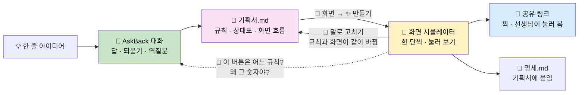
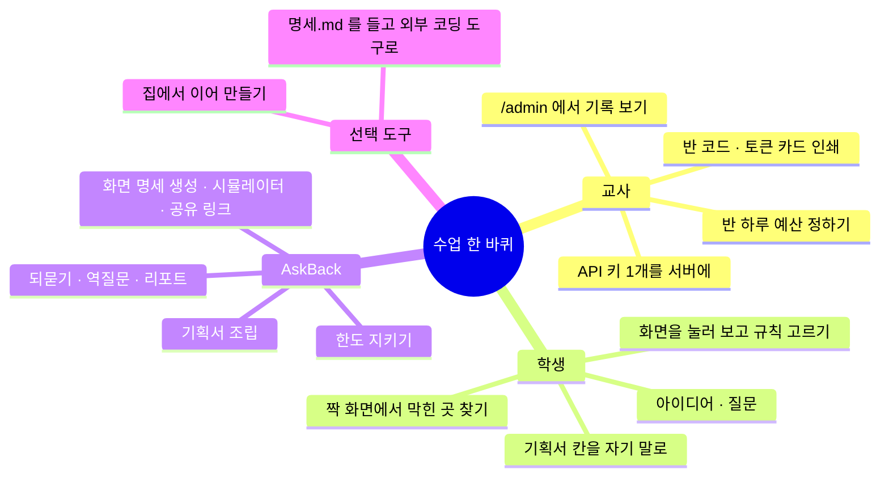
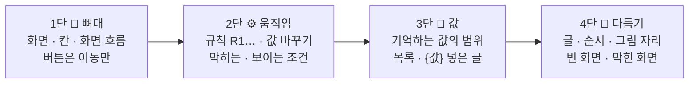
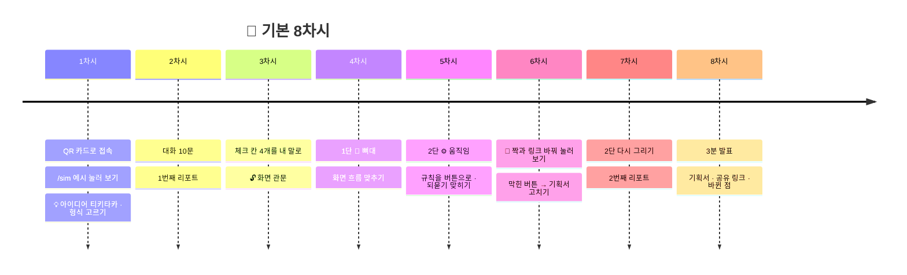

# 🧑‍🏫 바이브 코딩 수업 운영 기획서 v1 — 기획에서 미리보기까지

> **한 문장**: 학생은 결제도, 개인 AI 계정도 없이 **AskBack 하나로** 아이디어 → 기획서.md → **📱 화면 시뮬레이터(눌러 보는 화면 명세)** 까지 간다. AskBack은 코드를 만들어 주지 않는다. 기획과 화면 설계를 한 대화에서 같이 한다.
> 선생님의 Claude API 키 하나가 서버에만 있고, 학생은 닉네임 토큰으로 들어온다.
>
> **위치**: [AskBack 교육과정 v1](AskBack_교육과정_기본용_심화용_v1.md)의 🏫 **기본용** 제작 상세. 기본용 범위는 1~2단 필수 · 3단 선택 · 4단 제외(교육과정 §4.2)
> **다음 단계**: [방학 2달 서비스 완성 과정 기획서 v1](방학_2달_서비스_완성과정_기획서_v1.md) — 이 문서가 1달차, 그 뒤 유료 Claude로 서비스 출시
> **짝 문서**:
> - [📱 화면 시뮬레이터 설계서 v1](AI_역질문_화면_시뮬레이터_설계서_v1.md) — §4~§6의 화면 · 부품 · 명세 · AI 규칙 · 공유의 **원본**
> - [설계서 v4 — 설계를 묻고 기획서를 남긴다](AI_역질문_설계서_v4_설계를_묻고_기획서를_남긴다.md)
> - [서버 API · DB 설계서 v1](AI_역질문_서버_API_DB_설계서_v1.md)
> - [사이트맵 v4](AI_역질문_사이트맵_v4.md)
>
> **기준일**: 2026-11-15 (처음 2026-10-29).
> **바뀐 점**: 예전 계획은 Next.js 코드 생성 · 격리 미리보기 · .zip이었다. 이번에 **화면 명세 + 시뮬레이터 + 공유 링크**로 바꿨다 (§1.2). 시뮬레이터 MVP는 이미 동작한다. 이미 있는 것과 만들 것은 §11에서 나눈다.
>
> **다섯 기둥**
> - ① **학생 0원 · 계정 0개**: 교사 키 1개, 학생은 토큰만, 한도는 서버가 지킨다
> - ② **기획서가 열쇠**: 화면에 들어가는 규칙 · 숫자는 *학생이 정한 것*뿐이다. 정하지 않은 건 AI가 지어내지 않고 되묻는다
> - ③ **한 번에 한 단**: 뼈대 → 움직임 → 값 → 다듬기. 한 번에 앱 전체를 그리지 않는다
> - ④ **눌러 보기 + 나누기**: 폰 모양 화면에서 바로 눌러 보고, 📄 명세.md로 기획서에 붙이고, 🔗 링크로 짝에게 보낸다
> - ⑤ **화면 뒤에도 되묻는다**: 규칙이 붙은 버튼을 처음 누르면 "이 버튼은 기획서의 어느 규칙이야?"라고 묻는다. 동작을 고칠 때는 규칙을 같이 고친다

---

## 1. 왜 필요한가

### 1.1 지금 바이브 코딩 수업이 막히는 곳

| 막히는 곳 | 실제로 생기는 일 | AskBack 안에서 풀면 |
|---|---|---|
| 💳 **유료 결제** | 30명 × 월 구독료. 학교 예산으로 집행하기 어렵다 | 교사 키 하나로 쓴 만큼만 낸다. 반 전체 하루 예산을 정한다 |
| 🔞 **나이 · 계정** | Claude.ai는 만 18세 이상만 쓸 수 있다. 다른 도구도 미성년자는 보호자 동의가 필요하고, 만 14세 미만은 개인정보 동의 절차가 따로 있다 | 학생은 이메일도 비밀번호도 만들지 않는다. 닉네임 토큰뿐이다 |
| 🎲 **제각각인 도구** | 학생마다 다른 도구와 다른 답을 받는다. 교사가 기록을 볼 수 없다 | 같은 규칙과 같은 단계를 쓰고 `/admin`에 기록이 남는다 |
| 🤖 **AI가 다 해 줌** | "앱 만들어 줘" 한 줄이면 끝난다. 학생은 왜 그렇게 돌아가는지 모른다 | 코드는 없다. 학생이 정한 규칙만 화면에 들어가고, 버튼마다 "어느 규칙이야?"를 묻는다 |
| 🧩 **기획과 화면이 끊김** | 기획서를 다른 도구에 붙여 넣는 순간 맥락이 사라진다 | 기획서 → 화면 → 눌러 보다 막힌 곳 → 기획서가 한 대화에서 돈다 |
| 😴 **참여가 없음** | 기획서 쓰기가 혼자 하는 숙제가 된다 | 폰 화면을 딸깍하고, 짝 화면을 링크로 받아 눌러 보고 되묻기에 답한다 |

### 1.2 왜 코드 생성에서 화면 시뮬레이터로 바꿨나

v4의 원칙은 **설계 없이 나온 코드를 막는 것**이다. 예전 계획은 그 선을 지키려고 출처 주석 · 검사기 · 격리 iframe 같은 장치를 여럿 붙였다. 하지만 학생이 받는 것은 여전히 *읽지 못하는 코드*였다. 그래서 결과물을 아예 **명세**로 바꿨다.

| | 예전 계획 (코드 생성) | 지금 (화면 시뮬레이터) |
|---|---|---|
| AI가 내놓는 것 | `page.tsx` 등 파일 최대 5개 | 화면 명세 JSON (화면 · 칸 · 값 · 규칙) |
| 화면을 그리는 쪽 | 생성된 코드가 iframe에서 실행 | 앱의 **고정된 렌더러**가 정해진 부품 6종으로만 그림 |
| 학생이 고칠 때 | 코드를 읽거나 다시 생성 | 칸을 딸깍하거나 말로 한다 |
| 기획서로 돌아가기 | 출처 주석을 따라가야 함 | 📄 명세.md가 기획서 형식(흐름도 · 규칙 · 화면 칸 표)으로 나옴 |
| 안전 장치 | 다른 origin · sandbox · 코드 검사기 | 스키마 검사 하나. 실행되는 코드가 없다 |
| 비용 | 출력이 파일 전체라 길다 | 명세 하나라 짧다 |
| 키가 없는 날 | 제작이 멈춘다 | 🧩 빈 예시 틀 + ✏️ 손으로 고치기로 계속된다 |
| 코드가 필요한 학생 | .zip | 📄 명세.md를 들고 🚀 심화용 · 외부 도구로 (§9) |

> **세 가지 선은 그대로다**: ① 입력은 기획서와 학생의 말뿐이다. ② 버튼마다 기획서 규칙(R1, R2 …) 꼬리표가 붙는다. ③ "멋있게" 같은 꾸미기는 글 · 순서만 바꾸고, 동작을 바꾸려면 규칙을 같이 정해야 한다.

---

## 2. 전체 지도

### 2.1 한 바퀴



### 2.2 누가 무엇을 하나



### 2.3 어디서 쓰나 (사용 공간 지도)

| 공간 | 인원 · 시간 | 쓰는 범위 | 끝에 남는 것 |
|---|---|---|---|
| 🏫 **정보 · 기술 수업** | 한 반 · 주 1~2차시 | 대화 → 기획서 → 화면 1~2단 | 기획서.md + 공유 링크 |
| 🎒 **자유학기 · 동아리** | 한 반 · 8~12차시 | 1~2단 (🌳 확장은 3단까지) | 기획서 + 공유 링크 + 발표 |
| 🔧 **메이커스페이스 · 학원** | 소그룹 · 주말 | 🏫 기본용 1~2단 → 🚀 심화용에서 명세.md로 실제 코드 | 돌아가는 웹 화면 |
| 🏠 **집** | 혼자 | 수업 토큰으로 이어서 (반 한도 안에서) | 다음 수업에 가져올 막힌 버튼 |

---

## 3. 기획 단계 운영 (이미 있는 것 위에)

### 3.1 교사 키 하나, 학생은 토큰만

```
학생 브라우저 (Next.js · 계정 없음)
      │  Authorization: Bearer abk_…
      ▼
AskBack 서버 (Django)  ← ANTHROPIC_API_KEY 는 여기에만
      │  하루 한도 · 분당 한도 · 반 예산 · 기록
      ▼
Claude API (쓴 만큼만)
```

| 설정 | 지금 있는 값 | 수업에서 권장 |
|---|---|---|
| `ASKBACK_DAILY_TURN_LIMIT` | 60 | 수업 날 1인 25턴 정도 (대화 20 + 화면 5) |
| `ASKBACK_RATE_TURNS` | 10/min | 그대로 |
| 키 비움 → 로컬 답 카드 · 🧩 빈 예시 틀 | 있음 | 리허설 · 예산이 없는 날의 **0원 모드** |
| 작업별 모델 `ASKBACK_MODEL_*` | 있음 | 대화와 화면 명세 모두 기본 모델. 화면 명세는 짧은 JSON이라 따로 정하지 않아도 된다 |

> **지금 MVP의 연결**: 시뮬레이터의 AI 호출(`/api/sim`)은 대화의 `/api/turn`처럼 **Next.js 쪽 라우트**에서 바로 Claude를 부른다 (`ASKBACK_MODEL` · `ASKBACK_EFFORT`). 수업용 토큰 · 한도 · 기록을 걸려면 Django 서버로 옮겨야 한다 (§6.1, §11).

### 3.2 화면 만들기가 열리는 조건 (🔓 관문)

관문은 이미 있는 **형식별 체크 칸**(`frontend/src/data/formats.json`, 서버 `PUT /projects/{id}/checks/{key}`)을 읽는다. 체크 칸 4개 가운데 **화면에 꼭 필요한 칸**이 학생의 말로 채워져 있어야 ✨ 기획서로 화면 만들기가 열린다. 기획서 칸 자동 누적이 아직 예시에서만 돌기 때문에(§11), 관문은 기획서 본문이 아니라 체크 칸을 기준으로 삼는다.

| 형식 | 그리는 화면 | 반드시 채울 칸 (`key`) | 있으면 좋은 칸 | 없으면 보이는 말 |
|---|---|---|---|---|
| 💻 서비스 (웹·앱) | 서비스 첫 화면과 흐름 | 핵심 기능 3개 `features` · 화면 흐름 `flow` · 만들 범위 `scope` | 핵심 사용자 `user` | "화면 흐름이 비어 있어. 첫 화면에서 버튼을 누르면 어디로 가?" |
| 🤖 제품 (하드웨어) | 상태를 보여 주는 모니터링 화면 (센서 값은 🎛 슬라이더) | 동작 시나리오 `scenario` · 부품 목록 `parts` | 만드는 순서 `order` | "화면이 보여 줄 '지금 상태'가 몇 가지야? 동작 시나리오가 먼저야" |
| 🎬 캠페인 (AI 영상) | 콘티 4컷을 넘겨 보는 캠페인 화면 | 바꿀 행동 `behavior` · 메시지 `message` · 콘티 4컷 `storyboard` | 배포 채널 `channel` | "이 화면을 본 사람이 딱 한 가지 할 일은 뭐야?" |
| 📄 논문 | 서론–방법–결과–결론 4화면 연구 소개 | 연구 질문 `question` · 목차 `toc` | 확인 방법 `method` | "맨 위에 둘 연구 질문 한 줄부터 정해 볼까?" |
| 🔬 리서치 | 숫자 · 목록으로 보는 조사 결과 화면 | 조사 대상 `target` · 표와 그림 `charts` | 표본 `sample` | "어떤 숫자 하나가 이 조사의 결론을 보여 줘?" |

> 다섯 형식 모두 🏫 기본용에서 **1~2단**을 쓴다. 형식마다 "2단 움직임"의 뜻이 다르다 (§4.1 형식별 표). 🤖 제품의 구조 스케치 `sketch`는 부품 배치라서 화면 관문에는 쓰지 않는다.
> **지금 MVP**: 관문 없이 대화창 **📱 화면** 버튼이 언제나 열린다. 키가 없으면 ✨ 만들기만 꺼지고 🧩 빈 예시 틀은 쓸 수 있다.

---

## 4. 화면 단계 — 한 번에 한 단

> 화면 · 부품 · 되묻기 시트 · 말로 고치기의 자세한 설계는 [화면 시뮬레이터 설계서 v1](AI_역질문_화면_시뮬레이터_설계서_v1.md) §3~§5가 원본이다. 여기서는 **수업에서 단을 어떻게 나누는지**만 적는다.

### 4.1 네 단



| 단 | 기획서에서 읽는 칸 | 명세에 생기는 것 | 통과 기준 (기획서에서 가져옴) | 끝에 붙는 되묻기 |
|---|---|---|---|---|
| 1 🦴 | 화면 흐름을 정하는 칸 (형식별 표) | `screens` · `blocks` · 버튼의 `go` | 🗺 화면 흐름이 기획서의 흐름과 같다 | "첫 화면에서 사용자가 제일 먼저 볼 숫자는 뭐야? 지금 그게 맨 위에 있어?" |
| 2 ⚙️ | 규칙을 정하는 칸 (형식별 표) · 상태표 · 실패 조건 | `rules` · 버튼의 `rule` · `do` · `disabledIf` · 알림의 `showIf` | 규칙 붙은 버튼을 **🙋 내가 설명한 버튼 N / 전체**에서 모두 맞힌다 | "🎛 슬라이더로 경계값을 넘겨 봐. 막혀야 할 때 막혀?" |
| 3 🔌 | 데이터 한 줄의 모양 · 기록 규칙 | `state`의 범위 · `list` · 글 안의 `{값}` | 값이 범위 끝(0 · 최대)에 가도 화면이 말이 된다 | "기록이 1000줄이 되면 이 화면은 무엇을 먼저 보여 줘야 할까?" |
| 4 🎨 | 받는 사람을 정하는 칸 (형식별 표) · 차별점 | 글 · 순서 · 그림 자리 · 빈 상태 알림 | 처음 본 짝이 링크만 받고 10초 안에 첫 버튼을 누른다 | "이 화면을 처음 본 친구가 이해 못 할 곳은 어디야?" |

#### 형식별 — 단마다 읽는 체크 칸과 "움직임"의 뜻

| 형식 | 1단 🦴 화면 흐름 | 2단 ⚙️ 움직임 = 무엇이 동작하나 | 3단 🔌 값 | 4단 🎨 받는 사람 |
|---|---|---|---|---|
| 💻 서비스 | 화면 흐름 `flow` · 핵심 기능 `features` | 핵심 기능의 규칙 · 상태표가 버튼으로 동작 | 기록 값 · 목록 | 핵심 사용자 `user` · 만들 범위 `scope` |
| 🤖 제품 | 동작 시나리오 `scenario` · 부품 목록 `parts` (판단에 쓰는 값 = 숫자 칸) | 시나리오의 상태 전이가 🎛 슬라이더 · 버튼으로 재현됨 | 센서 값 범위 · 기록 목록 | 시나리오 속 사용자 · 차별점 |
| 🎬 캠페인 (AI 영상) | 콘티 4컷 `storyboard` · 메시지 `message` (컷 = 화면) | 컷 넘기기 + **행동 약속 버튼**과 오늘 약속 수 | 약속 수 범위 · 약속 목록 | 배포 채널 `channel` · 바꿀 행동 `behavior` |
| 📄 논문 | 목차 `toc` (서론–방법–결과–결론 = 화면 4개) · 연구 질문 `question` | 조건을 바꾸면 결과 숫자 · 알림이 바뀜 (`method`) | 자료 값 범위 · 결과 목록 | 연구 질문 · 결론 한 줄 |
| 🔬 리서치 | 표와 그림 `charts` · 조사 대상 `target` | 표본 묶음 버튼으로 숫자 · 목록이 바뀜 (`sample`) | 응답 수 범위 · 응답 목록 | 조사 대상 · 결론 한 줄 |

> **왜 네 단인가**: 한 번에 다 그리면 학생은 결과만 본다. 단마다 눌러 보기 → 되묻기 → 규칙 고치기를 거치면 *어느 규칙이 어느 버튼이 됐는지* 보인다. 메모해 둔 "단계별 확장" 원칙과 같은 리듬이다.
> **지금 MVP**: 단 구분 없이 한 번에 그린다 (AI에게 화면 2~5개 · 화면마다 칸 7개 이하로 시킨다). 단 나누기는 §11의 만들 것이다.

### 4.2 예시 — 🌱 스마트 화분 (민준, 중3)

> ⚠️ 예시다. `/sim`의 🌱 스마트 화분 더미 데이터(`frontend/src/data/sim.json`)와 같다.

**기획서에서 읽은 칸**

```md
## 구조 — 화면 3개
- 오늘의 화분 → 급수 중 → 오늘의 화분 / 오늘의 화분 → 물 준 기록
## 알고리즘 — 급수 규칙
- 습도가 30% 아래면 '목말라요' 알림
- 물 한 번에 습도 +30, 100%를 넘지 않는다
- 습도가 80% 이상이면 물 주기를 막는다 (과습 방지)
```

**1단 결과**: 화면 3개와 흐름. 버튼은 화면만 넘긴다.

```
🗺 화면 흐름
🏁 오늘의 화분
 └ 🚿 물 주기 → 급수 중
 └ 📒 기록 보기 → 물 준 기록
급수 중
 └ ✅ 다 줬어 → 오늘의 화분
```

**2단 결과**: 규칙이 버튼의 꼬리표와 조건이 된다.

```json
{ "id": "p5", "type": "button", "text": "🚿 물 주기", "go": "watering", "rule": "R3",
  "disabledIf": { "key": "moisture", "op": ">=", "value": 80 } }
```

화면에는 🎛 **💧 흙 습도 슬라이더**가 생긴다. 민준이는 슬라이더를 85%로 올려 🚿 물 주기가 🔒 막히는 것을, 20%로 내려 "😵 목말라요!"가 뜨는 것을 직접 확인한다.

**되묻기**: 🚿 물 주기를 처음 누르면 "「🚿 물 주기」 — 어느 규칙을 따라?"가 뜬다. 민준이가 R3을 고르면 ✅, 틀리면 🔁.
AI의 🙋: "80%로 정한 이유가 뭐야? 화분 흙마다 같을까?"
→ 민준이가 💬에 "선인장은 60%에서 막아 줘"라고 답한다 → 규칙 R5와 버튼 조건이 **같이** 바뀐다 → 📄 명세.md를 기획서에 다시 붙인다.

### 4.3 고치기 요청을 받는 규칙

💬 **말로 기획 · 화면 같이 고치기**에서 받는 요청을 이렇게 나눈다.

| 학생 요청 | 분류 | AskBack이 하는 일 |
|---|---|---|
| "제목을 더 짧게" · "그림을 맨 위로" | 🎨 다듬기 | 글 · 순서 · 그림 자리만 바로 바꾼다 |
| "습도 20% 아래면 빨간 알림 띄워 줘" | ⚙️ 동작 + 규칙 | 학생이 숫자까지 말했으니 규칙(R5)을 더하고 알림 · 조건을 같이 바꾼다. 🙋 "20%로 정한 이유가 뭐야?" |
| "버튼 누르면 물 주게 해 줘" | ⚙️ 동작, 규칙 없음 | 버튼은 만들되 `rule`은 비워 두고 되묻는다: "그 버튼은 언제 막혀야 해? 몇 %에서?" |
| "로그인 넣어 줘" | 🚫 범위 밖 | 부품 6종에 없다. "로그인이 필요한 이유를 기획서 「누가 쓰나」에 적어 볼까?" |
| "멋있게 만들어 줘" | 🎨 다듬기 | 동작은 바꾸지 않는다. 글 · 순서 · 그림 자리만 |

---

## 5. 눌러 보기 · 나누기

> 자세한 화면은 [화면 시뮬레이터 설계서 v1](AI_역질문_화면_시뮬레이터_설계서_v1.md) §3 · §4 (SIM-0 ~ SIM-sh).

### 5.1 무엇을 보여 주고 어떻게 나누나

| 항목 | 정한 것 | 이유 |
|---|---|---|
| 그리는 범위 | **부품 6종**: 글 · 숫자 · 알림 · 버튼 · 목록 · 그림 자리. 화면 최대 12개 | 닫힌 부품이라 AI가 엉뚱한 것을 만들 수 없다. 실행되는 코드가 없다 |
| 눌러 보기 | 폰 모양 화면 · ▶️ 돌려 보기 · 🎛 상황 바꾸기 슬라이더 · 🧾 방금 일어난 일 | 경계값 시험이 바로 수업 활동이 된다 |
| 고치기 | ✏️ 손으로(칸 더하기 · 고치기 · 지우기) · 💬 말로(규칙과 화면 같이) | 키가 없어도 손으로 진행된다 |
| 기획서로 | 📄 명세.md — 화면 흐름(mermaid) · 규칙 · 기억하는 값 · 화면 칸 표 | 기획서와 같은 모양이라 그대로 붙는다 |
| 나누기 | 🔗 공유 링크 — 명세를 압축해 `#` 뒤에 담는다. 서버 저장 · 로그인 없음 | 짝 활동 · 발표 · 선생님 확인. 받은 쪽에서 고쳐도 원본은 그대로 |
| 버전 | MVP는 마지막 상태만 저장 (프로젝트마다 브라우저에) | 버전 비교는 §11 |

### 5.2 화면 배치

```
┌─ 왼쪽 ───────────────┬─ 가운데 ─────────────────┬─ 오른쪽 ───────────────────┐
│ 📜 기획서의 규칙        │   ┌─────────────────┐    │ 🗺 화면 흐름 — 눌러서 이동    │
│ R1 습도 30% 아래면 알림 │   │   오늘의 화분     │    │ 🏁 오늘의 화분              │
│ R3 80% 이상이면 막기   │   │ 흙 습도      45%  │    │  └ 🚿 물 주기 → 급수 중      │
│                      │   │ [🚿 물 주기 ❓R3] │    │ 🙋 내가 설명한 버튼 1 / 3개   │
│ 🎛 상황 바꾸기         │   └─────────────────┘    │ 🧾 방금 일어난 일            │
│ 💧 흙 습도 ━━●── 45%   │ 💬 말로 기획·화면 같이 고치기 │ ✅ 다 줬어 — 습도 45→75     │
└──────────────────────┴──────────────────────────┴────────────────────────────┘
 머리글: [▶️ 돌려 보기] [✏️ 고치기] [📄 명세.md] [🔗 공유] [✕ 닫기]
```

대화창 헤더의 **📱 화면** 버튼으로 이 화면이 다이얼로그로 열린다. 모바일에서는 폰 + 💬가 맨 위, 나머지 카드가 그 아래로 쌓인다.

### 5.3 안전

| 위험 | 막는 법 |
|---|---|
| 생성물이 AskBack 쿠키 · 토큰에 접근 | **실행되는 코드가 없다**. 명세는 데이터일 뿐이고 정해진 렌더러가 글자로만 그린다 |
| 남이 만든 공유 링크 | 링크 40,000자 · 풀었을 때 300KB 상한 + 스키마 검사. 통과하지 못하면 열지 않는다 |
| 학생 글로 프롬프트 탈취 ("규칙 무시하고…") | 기획서와 요청은 **데이터 블록**(`<plan>` · `<request>`)으로만 넣는다. 출력은 JSON 스키마로 받고, 없는 화면 · 값 · 규칙을 가리키는 연결은 떼어 낸다 |
| 부적절한 내용 | 대화와 같은 관문(잡담 · 유해 필터)을 화면 입력에도 건다 (Django로 옮길 때 — §11) |
| 화면이 너무 커짐 | 화면 12개 · 칸 20개 · 규칙 12개 상한. AI에게는 화면 2~5개 · 칸 7개 이하로 시킨다 |

---

## 6. 서버 · 데이터 설계 (요약)

### 6.1 API

**지금 있는 것 (Next.js 라우트, MVP)**

| 메서드 · 경로 | 하는 일 | 응답 핵심 |
|---|---|---|
| `GET /api/sim` | AI 연결 여부 | `{ live, model }` |
| `POST /api/sim` `{ id, name, plan }` | 기획서로 화면 명세 처음 그리기 | `{ project, note, ask }` |
| `POST /api/sim` `{ …, current, request }` | 말로 고치기 — 규칙과 화면 같이 | `{ project, note, ask }` |

**수업용으로 옮길 것 (Django, §11)**

| 메서드 · 경로 | 하는 일 | 응답 핵심 |
|---|---|---|
| `GET /api/v1/projects/{id}/screens/gate` | 🔓 관문 검사 | `{ open, missing: ["화면 흐름"], ask }` |
| `POST /api/v1/projects/{id}/screens` | 한 단 그리기 · 고치기 `{ step: 1~4, request? }` | `{ versionNo, step, spec, note, ask, usage }` |
| `GET /api/v1/projects/{id}/screens` | 버전 목록 | `[{ versionNo, step, createdAt }]` |
| `GET /api/v1/projects/{id}/screens/{no}` | 한 버전의 명세 | `spec` |
| `POST /api/v1/screens/share` | 짧은 공유 주소 (선택) | `{ code: "ab12" }` |

### 6.2 생성 출력 형식 (LLM 스키마)

```json
{
  "emoji": "🌱", "name": "스마트 화분", "oneLine": "…",
  "rules": [{ "id": "R3", "text": "습도가 80% 이상이면 물 주기를 막는다" }],
  "state": [{ "key": "moisture", "label": "💧 흙 습도", "value": 45, "min": 0, "max": 100, "unit": "%" }],
  "start": "home",
  "screens": [{ "id": "home", "title": "오늘의 화분", "blocks": [
    { "id": "p5", "type": "button", "text": "🚿 물 주기", "go": "watering", "rule": "R3",
      "disabledIf": { "key": "moisture", "op": ">=", "value": 80 },
      "bind": null, "tone": null, "do": [], "showIf": null, "items": [] }
  ]}],
  "note": "화면 3개를 그리고 R3을 물 주기 버튼에 붙였어.",
  "ask": "80%로 정한 이유가 뭐야? 화분 흙마다 같을까?"
}
```

- 모든 칸이 필수이고, 없는 값은 `null` · 빈 배열이다. 앱이 받으면 빈 칸을 지우고 화면 명세로 바꾼다 (설계서 §6.3).
- `note`: 이번에 그린 것 · 바꾼 것. 화면 맨 위 ✨ 띠와 💬 말풍선에 뜬다.
- `ask`: 대화의 🙋 열린 되묻기와 같은 역할. 학생만 정할 수 있는 것 하나를 묻는다. 누르면 입력창에 채워질 뿐 보내지지 않는다.
- 예전의 `assumed`(가정 공개)는 두지 않는다. **가정하지 않고 되묻는다**. 학생이 정하지 않은 규칙은 `rule: null`로 비워 둔다.

### 6.3 DB

| 테이블 | 핵심 칸 |
|---|---|
| `ScreenSpec` | `project` · `version_no`(프로젝트마다 1부터) · `step` · `spec`(JSON) · `note` · `ask` · `plan_snapshot`(그때의 기획서) · `parent`(이전 버전) |
| `ClassRoom` | `code`(예: `2-3반`) · `teacher`(Django User) · `daily_budget_turns` · `screen_limit_per_student` · `starts_at` · `ends_at` |
| `Student` (추가) | `classroom` FK · `number`(번호) |

> MVP는 DB 없이 브라우저에 저장한다 (`askback:sim:p:<프로젝트 id>`).

---

## 7. 비용과 한도

### 7.1 계산하는 법

```
수업 1회 비용 ≈ 학생 수 × (대화 턴 × 대화 1턴 비용 + 화면 횟수 × 화면 1회 비용)
```

- 화면 1회는 명세 JSON 하나라서, 예전 계획(파일 전체)보다 출력이 훨씬 짧다. 그래도 **화면 횟수 상한**을 둔다. 💬 말로 고치기도 1회로 센다.
- 실제 단가는 사용할 모델을 정한 뒤 공식 가격표로 계산해 이 표를 채운다. **이 문서에서는 숫자를 추측하지 않는다.**

| 칸 | 값 (정한 뒤 채움) |
|---|---|
| 대화 1턴 평균 입력 · 출력 토큰 | `/admin` Claude 호출 합계에서 측정 |
| 화면 1회 평균 입력 · 출력 토큰 | 파일럿 1회 후 측정 |
| 반(25명) 수업 1회 비용 | 계산 |

### 7.2 아끼는 장치

| 장치 | 효과 |
|---|---|
| **✏️ 손으로 고치기는 0원** | 글 · 순서 · 칸 더하기는 AI를 부르지 않는다 |
| 고정 지시문을 앞에 두고 **프롬프트 캐시** 사용 | 같은 반의 다음 호출에서 입력 비용이 줄어든다 (이미 적용) |
| 학생 1인 화면 상한 (예: 하루 5회 · 🌿 8차시 과정 전체 12회 — [교육과정 §11.3](AskBack_교육과정_기본용_심화용_v1.md)과 맞춰 정한다) | 반 예산이 예측 가능해진다 |
| 반 하루 예산이 바닥나면 | ✨ 만들기 · 💬만 잠기고, 🧩 빈 틀 · ✏️ 손으로 고치기 · 대화(로컬 답 카드)는 계속된다 |
| 교사 시연용 **예시 명세** | 🌱 스마트 화분 · 🍱 급식 투표는 `/sim`에서 호출 없이 보여 준다 (이미 있음) |
| **공유 링크는 0원** | 짝 활동은 호출 없이 링크로만 돈다 |

---

## 8. 수업 흐름 — 8차시 예시

> 🏫 기본용 8차시는 [교육과정 §4.4](AskBack_교육과정_기본용_심화용_v1.md)와 같다. 1~2단까지 그리고, 남는 차시는 짝 테스트와 다시 그리기에 쓴다. 3단은 🌳 12차시 확장 과정에서 쓴다. 4단은 발표 전 1회만 허용한다. 실제 코드는 🚀 심화용으로 넘어갈 때 명세.md를 들고 간다.



| 과정 | 1단 🦴 | 2단 ⚙️ | 3단 🔌 | 4단 🎨 | 명세.md → 실제 코드 |
|---|---|---|---|---|---|
| 🌱 맛보기 4차시 | ✅ | — | — | — | — |
| 🌿 기본 8차시 | ✅ | ✅ | — | 발표 전 1회 | — |
| 🌳 확장 12차시 | ✅ | ✅ | ✅ | 발표 전 1회 | 심화 관문 통과 시 |
| 🚀 심화용 시작 | — | — | — | ✅ | ✅ (외부 코딩 도구 · 다리 꾸러미) |

**한 차시(45분) 안의 리듬** (5차시 예시)

| 시간 | 학생 | 교사 |
|---|---|---|
| 0~5분 | 지난 되묻기 다시 읽기 | `/sim`의 🌱 스마트 화분을 화면에 띄워 🎛 습도를 85%로 올려 보이기 |
| 5~20분 | 📱 화면 → 2단 그리기 → 🙋 되묻기에 답하며 버튼 눌러 보기 | `/admin`에서 관문에 걸린 학생 확인 |
| 20~35분 | 🙋 AI 되묻기에 💬로 답하기 → 규칙 · 화면 같이 고치기 (최대 2회) | 순회하며 "이 버튼은 R 몇 번이야?" 묻기 |
| 35~45분 | 🔗 링크를 짝에게. 짝이 🤷 한 버튼을 한 줄 적기 | 다음 차시 미션 안내 |

> **짝 활동이 핵심이다**: 내가 만든 버튼을 짝이 "🤷 모르겠어"로 답하면, 그 버튼은 화면에서도 기획서에서도 설명이 안 된 것이다. 점수는 비교하지 않는다. 막힌 버튼만 같이 본다.

---

## 9. 다른 길과 비교 — 왜 AskBack 안에서 만드나

| 길 | 학생 비용 | 학생 계정 | 기획서와 이어짐 | 교사가 볼 수 있음 | 판단 |
|---|---|---|---|---|---|
| **A. AskBack 화면 시뮬레이터 (이 문서)** | 0원 | 없음 | ✅ 그대로 (같은 대화) | ✅ | **주 경로** |
| B. 교사 혼자 Claude Code · Cursor로 시연 | 0원 (교사만 유료) | 없음 | 교사가 명세.md를 붙여 넣음 | ✅ | 실제 코드를 보여 주고 싶을 때 |
| C. 무료 외부 생성 도구 (Google AI Studio, Firebase Studio, v0 등) | 0원 (무료 한도 안에서) | 필요. 나이 약관 확인 필요 | 🟡 명세.md를 붙여 넣으면 이어짐 | ❌ | 만 14세 이상 · 집에서 하는 선택 과제 |
| D. 명세.md + VS Code (+ GitHub Copilot Free 등) | 0원 | 선택 | ✅ 명세가 곧 설계 | ❌ | 동아리 · 메이커스페이스 · 🚀 심화용의 다음 걸음 |

> C와 D의 무료 한도 · 나이 약관 · 학교 계정 허용 여부는 자주 바뀐다. **수업 전에 그 시점의 약관으로 확인한다.**

---

## 10. 수업 전 체크리스트

- [ ] 서버 `.env`에 API 키를 넣고, 콘솔에서 **월 지출 한도**를 설정했다
- [ ] (MVP) `frontend/.env.local`에도 키를 넣어 ✨ 화면 만들기가 켜지는지 확인했다
- [ ] 반 코드를 만들고 토큰 카드(QR)를 인쇄했다
- [ ] 반 하루 예산과 1인 화면 상한을 정했다
- [ ] 키를 비운 상태(0원 모드)로 리허설을 했다 — 🧩 빈 예시 틀 · ✏️ 손으로 고치기 · 🔗 공유가 되는지
- [ ] `/sim` 예시(🌱 스마트 화분 · 🍱 급식 투표)를 시연용으로 열어 두었다
- [ ] 교실 Wi-Fi에서 서버에 접속되는지 확인했다 (교사 노트북 운영 시)
- [ ] 공유 링크가 학교 메신저 · 게시판에서 잘리지 않는지 확인했다 (약 1,250자)
- [ ] 학생 · 보호자 안내문: 닉네임만 쓴다, 실명 · 연락처는 입력하지 않는다

---

## 11. 이미 있는 것 / 만들 것

| 상태 | 항목 |
|---|---|
| ✅ **있음** | 교사 키 서버 보관 · 학생 토큰 발급(`issue_token`) · 하루 · 분당 한도 · 로컬 답 카드(0원 모드) · `/admin` 기록과 Claude 호출 합계 · 형식별 체크 칸 저장(`/checks/{key}`) · 기획서.md 저장(`/plan`) · 10문 리포트 · 작업별 모델 설정 |
| ✅ **있음 (2026-11-15)** | 📱 **화면 시뮬레이터 MVP**: `/sim` 예시 2개 · 대화창 📱 다이얼로그 · ▶️ 돌려 보기 · 🙋 되묻기 · ✏️ 손으로 고치기 · 💬 말로 기획 · 화면 같이 고치기 · 📄 명세.md · 🔗 공유 링크 · 🧩 빈 예시 틀 ([설계서 §10.1](AI_역질문_화면_시뮬레이터_설계서_v1.md)) |
| 🟡 **일부** | 기획서 칸 자동 누적(예시 시나리오에서만 동작) · AI 화면 생성(`/api/sim` — 코드는 있으나 **키를 넣고 실제로 돌려 보지 않음**) |
| ⬜ **만들 것 · 1차** | AI 생성 실제 확인(예시 3개) · `/api/sim`을 Django로 옮겨 토큰 · 한도 · 기록 연결 · 🔓 화면 관문 · 단 나누기(1~2단) · 반(`ClassRoom`) · 일괄 토큰 · QR 카드 · 반 예산 |
| ⬜ **만들 것 · 2차** | 3단 값 · 버전 비교 · 명세 → 기획서 체크 칸 바로 넣기 · 교사용 반 보기(공유 링크 모아 보기) · 짧은 공유 주소 |
| ⬜ **만들 것 · 3차** | 4단 · 부품 더하기(입력칸) · 화면 이미지 내보내기 · 명세.md → 심화용 다리 꾸러미 |

> 차수는 [교육과정 §7 기능 로드맵](AskBack_교육과정_기본용_심화용_v1.md)과 같다. 교육과정 문서의 "제작 · 미리보기 · .zip" 표현은 아직 예전 계획 그대로다 — 다음에 맞춰 고친다.

### 11.1 첫 파일럿의 범위 (가장 작게)

> **한 반 · 💻 서비스 형식만 · 1~2단만 · 공유 링크로 짝 활동.**
> 성공 기준: 25명 중 20명이 ① 2단에서 **규칙 붙은 버튼을 모두 맞히고**(🙋 N / N), ② 짝의 화면에서 막힌 버튼을 한 개 이상 찾고, ③ 되묻기에 답해 기획서 규칙을 한 번 이상 고친다.
