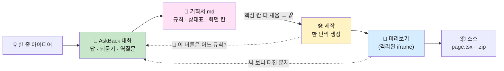
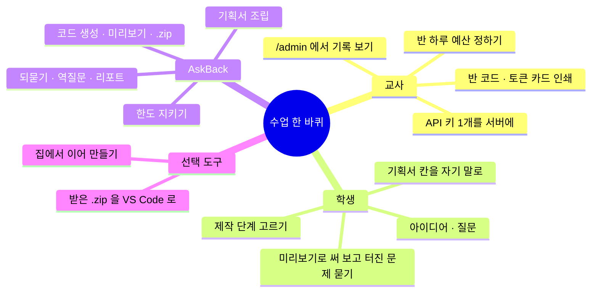
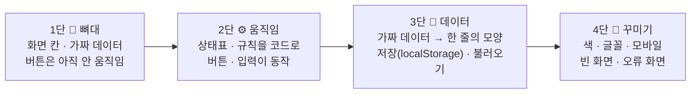
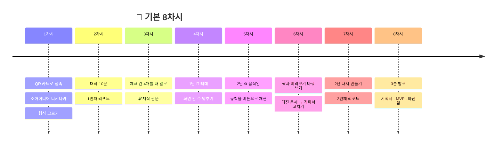

# 🧑‍🏫 바이브 코딩 수업 운영 기획서 v1 — 기획에서 미리보기까지

> **한 문장**: 학생은 결제도, 개인 AI 계정도 없이 **AskBack 하나로** 아이디어 → 기획서.md → **Next.js 페이지 미리보기 · 소스**까지 간다.
> 선생님의 Claude API 키 하나가 서버에만 있고, 학생은 닉네임 토큰으로 들어온다.
>
> **위치**: [AskBack 교육과정 v1](AskBack_교육과정_기본용_심화용_v1.md)의 🏫 **기본용** 제작 상세. 기본용 범위는 1~2단 필수 · 3단 선택 · 4단 제외(교육과정 §4.2)
> **다음 단계**: [방학 2달 서비스 완성 과정 기획서 v1](방학_2달_서비스_완성과정_기획서_v1.md) — 이 문서가 1달차, 그 뒤 유료 Claude로 서비스 출시
> **짝 문서**: [설계서 v4 — 설계를 묻고 기획서를 남긴다](AI_역질문_설계서_v4_설계를_묻고_기획서를_남긴다.md) · [서버 API · DB 설계서 v1](AI_역질문_서버_API_DB_설계서_v1.md) · [사이트맵 v4](AI_역질문_사이트맵_v4.md)
> **기준일**: 2026-10-29. 이 문서의 **제작 단계(§4~§7)는 아직 구현 전**이다. 이미 있는 것과 만들 것은 §11에서 나눈다.
>
> **다섯 기둥**
> - ① **학생 0원 · 계정 0개**: 교사 키 1개, 학생은 토큰만, 한도는 서버가 지킨다
> - ② **기획서가 열쇠**: 기획서 핵심 칸을 채워야 🛠 제작이 열린다. 코드는 *학생이 정한 칸*에서만 나온다
> - ③ **한 번에 한 단**: 뼈대 → 움직임 → 데이터 → 꾸미기. 한 번에 앱 전체를 만들지 않는다
> - ④ **미리보기 + 소스**: 화면 오른쪽에서 바로 돌려 보고, `page.tsx` 복사 또는 Next.js 프로젝트 .zip으로 받는다
> - ⑤ **코드 뒤에도 되묻는다**: 버전마다 "이 버튼은 기획서의 어느 규칙이야?"라고 묻는다. 고칠 때는 기획서를 고친 뒤 다시 만든다

---

## 1. 왜 필요한가

### 1.1 지금 바이브 코딩 수업이 막히는 곳

| 막히는 곳 | 실제로 생기는 일 | AskBack 안에서 풀면 |
|---|---|---|
| 💳 **유료 결제** | 30명 × 월 구독료. 학교 예산으로 집행하기 어렵다 | 교사 키 하나로 쓴 만큼만 낸다. 반 전체 하루 예산을 정한다 |
| 🔞 **나이 · 계정** | Claude.ai는 만 18세 이상만 쓸 수 있다. 다른 도구도 미성년자는 보호자 동의가 필요하고, 만 14세 미만은 개인정보 동의 절차가 따로 있다 | 학생은 이메일도 비밀번호도 만들지 않는다. 닉네임 토큰뿐이다 |
| 🎲 **제각각인 도구** | 학생마다 다른 도구와 다른 답을 받는다. 교사가 기록을 볼 수 없다 | 같은 규칙과 같은 단계를 쓰고 `/admin`에 기록이 남는다 |
| 🤖 **AI가 다 해 줌** | "앱 만들어 줘" 한 줄이면 끝난다. 학생은 왜 그렇게 돌아가는지 모른다 | 기획서 칸 없이는 제작이 열리지 않는다. 버전마다 되묻기가 붙는다 |
| 🧩 **기획과 제작이 끊김** | 기획서를 다른 도구에 붙여 넣는 순간 맥락이 사라진다 | 기획서 → 코드 → 터진 문제 → 기획서가 한 화면에서 돈다 |

### 1.2 "코드보다 설계"와 부딪치지 않나?

v4의 원칙은 **코드를 막는 것**이 아니다. **설계 없이 나온 코드를 막는 것**이다. 그래서 제작 단계에는 세 가지 선을 긋는다.

1. **입력은 기획서뿐**: 제작 프롬프트에는 학생이 쓴 기획서 칸만 들어간다. 자유 입력으로 "멋있게 만들어 줘"라고 해도 코드가 바뀌지 않는다.
2. **코드마다 출처 표시**: 생성된 코드의 주요 블록 위에 `// 📝 기획서 2. 알고리즘 — 급수 규칙` 같은 주석이 붙는다.
3. **고칠 때는 기획서부터**: "버튼 색 바꿔 줘"처럼 꾸미기는 바로 고친다. 하지만 동작을 바꾸려면 *기획서의 어느 칸을 바꿀지* 먼저 되묻는다.

---

## 2. 전체 지도

### 2.1 한 바퀴



### 2.2 누가 무엇을 하나



### 2.3 어디서 쓰나 (사용 공간 지도)

| 공간 | 인원 · 시간 | 쓰는 범위 | 끝에 남는 것 |
|---|---|---|---|
| 🏫 **정보 · 기술 수업** | 한 반 · 주 1~2차시 | 대화 → 기획서 → 제작 1~2단 | 기획서.md + 미리보기 링크 |
| 🎒 **자유학기 · 동아리** | 한 반 · 8~12차시 | 1~2단 (🌳 확장은 3단까지) · .zip은 심화 관문 통과 시 | 기획서 + 미리보기 + 발표 |
| 🔧 **메이커스페이스 · 학원** | 소그룹 · 주말 | 🏫 기본용 1~2단 → 🚀 심화용에서 4단 · .zip · VS Code | 돌아가는 웹 화면 |
| 🏠 **집** | 혼자 | 수업 토큰으로 이어서 (반 한도 안에서) | 다음 수업에 가져올 터진 문제 |

---

## 3. 기획 단계 운영 (이미 있는 것 위에)

### 3.1 교사 키 하나, 학생은 토큰만

```
학생 브라우저 (Next.js · 계정 없음)
      │  Authorization: Bearer abk_…
      ▼
AskBack 서버 (Django)  ← ANTHROPIC_API_KEY 는 여기에만
      │  하루 한도 · 분당 한도 · 반 예산 · 기록
      ▼
Claude API (쓴 만큼만)
```

| 설정 | 지금 있는 값 | 수업에서 권장 |
|---|---|---|
| `ASKBACK_DAILY_TURN_LIMIT` | 60 | 수업 날 1인 25턴 정도 (대화 20 + 제작 5) |
| `ASKBACK_RATE_TURNS` | 10/min | 그대로 |
| 키 비움 → 로컬 답 카드 | 있음 | 리허설 · 예산이 없는 날의 **0원 모드** |
| 작업별 모델 `ASKBACK_MODEL_*` | 있음 | 대화는 기본 모델, 제작은 **코드를 잘 쓰는 모델 하나로 고정**한다. 단가를 확인한 뒤 정한다 |

### 3.2 제작이 열리는 조건 (🔓 관문)

관문은 이미 있는 **형식별 체크 칸**(`frontend/src/data/formats.json`, 서버 `PUT /projects/{id}/checks/{key}`)을 읽는다. 체크 칸 4개 가운데 **제작에 꼭 필요한 칸**이 학생의 말로 채워져 있어야 한다. 기획서 칸 자동 누적이 아직 예시에서만 돌기 때문에(§11), 관문은 기획서 본문이 아니라 체크 칸을 기준으로 삼는다.

| 형식 | 만드는 페이지 | 반드시 채울 칸 (`key`) | 있으면 좋은 칸 | 없으면 보이는 말 |
|---|---|---|---|---|
| 💻 서비스 (웹·앱) | 서비스 첫 화면 | 핵심 기능 3개 `features` · 화면 흐름 `flow` · 만들 범위 `scope` | 핵심 사용자 `user` | "화면 흐름이 비어 있어. 첫 화면에서 버튼을 누르면 어디로 가?" |
| 🤖 제품 (하드웨어) | 상태를 보여 주는 모니터링 화면 (센서 값은 가짜 데이터) | 동작 시나리오 `scenario` · 부품 목록 `parts` | 만드는 순서 `order` | "웹 화면이 보여 줄 '지금 상태'가 몇 가지야? 동작 시나리오가 먼저야" |
| 🎬 캠페인 (AI 영상) | 콘티 4컷을 넘겨 보는 캠페인 페이지 | 바꿀 행동 `behavior` · 메시지 `message` · 콘티 4컷 `storyboard` | 배포 채널 `channel` | "이 페이지를 본 사람이 딱 한 가지 할 일은 뭐야?" |
| 📄 논문 | 서론–방법–결과–결론 4칸 연구 소개 페이지 | 연구 질문 `question` · 목차 `toc` | 확인 방법 `method` | "페이지 맨 위에 둘 연구 질문 한 줄부터 정해 볼까?" |
| 🔬 리서치 | 표와 그림으로 보는 조사 결과 페이지 | 조사 대상 `target` · 표와 그림 `charts` | 표본 `sample` | "어떤 표 하나가 이 조사의 결론을 보여 줘?" |

> 다섯 형식 모두 🏫 기본용에서 **1~2단**을 쓴다. 형식마다 "2단 움직임"의 뜻이 다르다 (§4.1 형식별 표). 🤖 제품의 구조 스케치 `sketch`는 부품 배치라서 웹 화면 관문에는 쓰지 않는다.

---

## 4. 제작 단계 — 한 번에 한 단

### 4.1 네 단



| 단 | 기획서에서 읽는 칸 | 만드는 것 | 통과 기준 (기획서에서 가져옴) | 끝에 붙는 되묻기 |
|---|---|---|---|---|
| 1 🦴 | 화면 칸을 정하는 칸 (형식별 표) | `page.tsx` 하나와 칸별 컴포넌트, 가짜 데이터 3개 | 화면 칸 수가 기획서와 같다 | "첫 화면에서 사용자가 제일 먼저 볼 숫자는 뭐야? 지금 그게 맨 위에 있어?" |
| 2 ⚙️ | 규칙을 정하는 칸 (형식별 표) · 상태표 · 실패 조건 | 상태 전이 함수, 버튼 · 입력 처리 | 상태표의 모든 줄을 버튼으로 재현할 수 있다 | "실패 조건(센서 0)을 화면에서 어떻게 흉내 내 볼 수 있을까?" |
| 3 🔌 | 데이터 한 줄의 모양 · 기록 규칙 | 타입 정의, 저장 · 불러오기, 샘플 데이터 | 새로고침해도 기록이 남는다 | "기록이 1000줄이 되면 이 화면은 무엇을 먼저 버려야 할까?" |
| 4 🎨 | 받는 사람을 정하는 칸 (형식별 표) · 차별점 | 반응형, 빈 상태, 오류 상태 | 휴대폰 폭(375px)에서 가로 스크롤이 없다 | "이 페이지를 처음 본 친구가 10초 안에 이해 못 할 곳은 어디야?" |

#### 형식별 — 단마다 읽는 체크 칸과 "움직임"의 뜻

| 형식 | 1단 🦴 화면 칸 | 2단 ⚙️ 움직임 = 무엇이 동작하나 | 3단 🔌 데이터 | 4단 🎨 받는 사람 |
|---|---|---|---|---|
| 💻 서비스 | 화면 흐름 `flow` · 핵심 기능 `features` | 핵심 기능의 규칙 · 상태표가 버튼으로 동작 | 기록 한 줄 저장 | 핵심 사용자 `user` · 만들 범위 `scope` |
| 🤖 제품 | 동작 시나리오 `scenario` · 부품 목록 `parts` (판단에 쓰는 값 = 화면 칸) | 시나리오의 상태 전이가 슬라이더 · 버튼으로 재현됨 | 센서 값 기록 한 줄 | 시나리오 속 사용자 · 차별점 |
| 🎬 캠페인 (AI 영상) | 콘티 4컷 `storyboard` · 메시지 `message` | 컷 넘기기 + **행동 약속 버튼**과 오늘 약속 수 (가짜 값) | 약속 기록 저장 | 배포 채널 `channel` · 바꿀 행동 `behavior` |
| 📄 논문 | 목차 `toc` (서론–방법–결과–결론) · 연구 질문 `question` | 자료를 넣으면 결과 표 · 그래프가 다시 계산됨 (`method` · `data`) | 자료 행 저장 | 연구 질문 · 결론 한 줄 |
| 🔬 리서치 | 표와 그림 `charts` · 조사 대상 `target` | 표 ↔ 그림 전환 · 표본 묶음별 걸러 보기 (`methods` · `sample`) | 응답 행 저장 | 조사 대상 · 결론 한 줄 |

> **왜 네 단인가**: 한 번에 다 만들면 학생은 결과만 본다. 단마다 미리보기 → 써 보기 → 되묻기를 거치면 *어느 규칙이 어느 코드가 됐는지* 보인다. 메모해 둔 "단계별 확장" 원칙과 같은 리듬이다.

### 4.2 예시 — 🌱 스마트 화분 (민준, 중3)

**기획서에서 읽은 칸 (1단 입력)**

```md
## 구조 — 화면 3칸
- 지금 / 오늘 그래프 / 마지막 급수
- 한 줄의 모양 — 시각 · 흙 값 · 화분 상태 · 오늘 급수 횟수 · 물통 · 온습도
```

**1단 결과 (요약)**

```tsx
// 📝 기획서 「구조 — 화면 3칸」
export default function Page() {
  return (
    <main className="grid gap-4 p-4 md:grid-cols-3">
      <NowCard reading={FAKE[0]} />        {/* 칸 1 · 지금 */}
      <TodayChart readings={FAKE} />       {/* 칸 2 · 오늘 그래프 */}
      <LastWatering readings={FAKE} />     {/* 칸 3 · 마지막 급수 */}
    </main>
  );
}
```

**2단 결과 (요약)**: 상태표가 그대로 함수가 된다.

```tsx
// 📝 기획서 「알고리즘 — 급수 규칙」 상태표
type PotState = "대기" | "급수" | "휴식";
function next(state: PotState, soil: number, secs: number): PotState {
  if (state === "대기" && soil < DRY) return "급수";   // DRY = 민준이 정한 '마른 값' 기준 (재 온 값: 마른 320 · 젖은 610)
  if (state === "급수" && (soil > 550 || secs >= 5)) return "휴식";   // 실패 조건 안전망 (민준이 역질문에서 찾음)
  if (state === "휴식" && secs >= 600) return "대기";
  return state;
}
```

화면에는 "흙 값 슬라이더 + 상태 표시"가 생긴다. 민준이는 슬라이더를 0으로 내려 *센서 선이 빠진 상황*을 직접 재현해 본다.

**되묻기**: "슬라이더를 0에 두면 '급수 → 휴식 → 대기 → 급수'가 10분마다 반복돼. 이게 기획서가 원한 안전망이야, 아니면 알림이 하나 더 필요해?"
→ 민준이의 답이 기획서 「알림 규칙」의 📵 줄을 고친다 → 다음 단에서 반영된다.

### 4.3 고치기 요청을 받는 규칙

| 학생 요청 | 분류 | AskBack이 하는 일 |
|---|---|---|
| "배경을 초록색으로" | 🎨 꾸미기 | 바로 고친 버전을 만든다 (제작 1회로 센다) |
| "버튼 누르면 물 주게 해 줘" | ⚙️ 동작 | "그 버튼은 상태표의 어느 줄이야? 대기에서도 눌러지면 휴식 규칙은?" → 기획서 수정 → 다시 생성 |
| "로그인 넣어 줘" | 🚫 범위 밖 | "로그인이 필요한 이유를 기획서 「누가 쓰나」에 적어 볼까?" 수업 범위(1인용 · 서버 없음)를 알려 준다 |
| "이거 왜 안 돼?" + 오류 문구 | 🐞 디버그 | 미리보기 콘솔 오류를 함께 보내 원인 한 줄과 고친 버전. 되묻기: "다음에 같은 오류를 너라면 어디부터 볼래?" |

---

## 5. 미리보기와 소스 제공

### 5.1 무엇을 만들고 어떻게 보여 주나

| 항목 | 정한 것 | 이유 |
|---|---|---|
| 만드는 범위 | **클라이언트 화면만**: React + TypeScript + Tailwind, 파일 최대 5개 | 서버 · DB · 로그인을 빼면 미리보기가 브라우저 안에서 끝난다 |
| 미리보기 | 브라우저 번들러(예: Sandpack, 또는 esbuild-wasm 직접)로 **격리된 iframe**에서 실행 | 학생 PC에 Node.js 설치가 필요 없다. 빌드 서버 비용도 0원이다 |
| 소스 · 복사 | 파일 탭 + 줄 번호 + 📝 기획서 출처 주석 + 복사 버튼 | 읽으면서 배우게 한다 |
| 소스 · 받기 | **Next.js 프로젝트 .zip**: 고정 템플릿(`package.json` · `app/layout.tsx` · Tailwind 설정) + 생성 파일 + `README.md`(실행법) + `기획서.md` | 집이나 메이커스페이스에서 `npm run dev` 한 줄로 이어 간다 |
| 버전 | 단마다 v1, v2…. 이전 버전 미리보기와 바뀐 줄을 보여 준다 | 리포트처럼 "프로젝트 · N번째 빌드"로 센다 |

> 미리보기는 React 템플릿으로 돌리고, .zip은 Next.js 템플릿에 같은 파일을 넣는다. 생성 코드는 `"use client"` 화면 컴포넌트만 쓰므로 두 곳에서 똑같이 돈다. Sandpack의 Next.js 템플릿을 그대로 쓸 수 있는지는 구현할 때 확인한다.

### 5.2 화면 배치

```
┌─ 왼쪽: 프로젝트 · 기획서 ─┬─ 가운데: 대화 ───────────┬─ 오른쪽: 🛠 제작 ─────────────┐
│ 🌱 스마트 화분           │ 💬 2단 ⚙️ 움직임을 만들었어 │ [👀 미리보기] [📄 소스] [⬇ .zip] │
│ 📝 기획서               │ 상태표 3줄 → next() 함수   │ ┌──────────────────────────┐ │
│  ✅ 화면 3칸            │                           │ │  지금: 💧 급수 (흙 380)    │ │
│  ✅ 급수 규칙           │ 🙋 슬라이더를 0에 두면…    │ │  [흙 값 ───●──── ]        │ │
│  ⬜ 알림 규칙  ← 되묻기  │                           │ └──────────────────────────┘ │
│ 🛠 빌드 v1 · v2         │ [답하기…]                 │  v1 ◀ v2  · 바뀐 줄 14        │
└────────────────────────┴───────────────────────────┴──────────────────────────────┘
```

모바일에서는 오른쪽 칸이 **🛠 탭**으로 접힌다.

### 5.3 안전

| 위험 | 막는 법 |
|---|---|
| 생성 코드가 AskBack 쿠키 · 토큰에 접근 | 미리보기는 **다른 origin + `sandbox="allow-scripts"`** iframe에서만 돈다. `allow-same-origin`을 주지 않는다 |
| 생성 코드가 외부로 요청 | 생성 규칙에서 `fetch` · 외부 URL · 외부 스크립트를 금지하고, 생성 후 검사기로 한 번 더 걸러 낸다 |
| 학생 글로 프롬프트 탈취 ("규칙 무시하고…") | 기획서 칸은 **데이터 블록**으로만 넣는다. 출력은 JSON 스키마(파일 목록)로 받고, 형식이 틀리면 버린다 |
| 부적절한 내용 | 대화와 같은 관문(잡담 · 유해 필터)을 제작 입력에도 건다 |
| 코드가 너무 커짐 | 파일 5개 · 합계 600줄 상한. 넘으면 "기능을 다음 단으로 미루자"로 되묻는다 |

---

## 6. 서버 · 데이터 설계 (요약)

### 6.1 API

| 메서드 · 경로 | 하는 일 | 응답 핵심 |
|---|---|---|
| `GET /api/v1/projects/{id}/builds/gate` | 🔓 관문 검사 | `{ open, missing: ["화면 칸"], ask }` |
| `POST /api/v1/projects/{id}/builds` | 한 단 생성 `{ step: 1~4, request?, consoleError? }` | `{ buildNo, step, files[], notes[], askback, usage }` |
| `GET /api/v1/projects/{id}/builds` | 버전 목록 | `[{ buildNo, step, createdAt, changedLines }]` |
| `GET /api/v1/projects/{id}/builds/{no}` | 한 버전의 파일 | `files[]` |
| `GET /api/v1/projects/{id}/builds/{no}/zip` | Next.js .zip | 템플릿 + 파일 + README + 기획서.md |

### 6.2 생성 출력 형식 (LLM 스키마)

```json
{
  "files": [
    { "path": "app/page.tsx", "content": "…" },
    { "path": "components/NowCard.tsx", "content": "…" }
  ],
  "notes": [
    { "plan": "알고리즘 — 급수 규칙", "where": "app/page.tsx: next()", "said": "상태표 3줄을 함수 하나로" }
  ],
  "assumed": ["흙 값 범위를 0~1023으로 가정"],
  "askback": "슬라이더를 0에 두면 10분마다 급수가 반복돼. 이게 기획서가 원한 안전망이야?"
}
```

- `assumed`: v4의 "가정 공개"와 같다. 학생이 *🫵 네가 정할 것*으로 기획서에 옮긴다.
- `askback`: 대화의 🙋 열린 되묻기와 같은 자리에 뜬다.

### 6.3 DB

| 테이블 | 핵심 칸 |
|---|---|
| `Build` | `project` · `build_no`(프로젝트마다 1부터) · `step` · `files`(JSON) · `notes` · `assumed` · `askback` · `plan_snapshot`(그때의 기획서) · `parent`(이전 버전) |
| `ClassRoom` | `code`(예: `2-3반`) · `teacher`(Django User) · `daily_budget_turns` · `build_limit_per_student` · `starts_at` · `ends_at` |
| `Student` (추가) | `classroom` FK · `number`(번호) |

---

## 7. 비용과 한도

### 7.1 계산하는 법

```
수업 1회 비용 ≈ 학생 수 × (대화 턴 × 대화 1턴 비용 + 제작 횟수 × 제작 1회 비용)
```

- 제작 1회는 대화 1턴보다 출력이 훨씬 길다(파일 전체). 그래서 **제작 횟수 상한**이 비용의 핵심이다.
- 실제 단가는 사용할 모델을 정한 뒤 공식 가격표로 계산해 이 표를 채운다. **이 문서에서는 숫자를 추측하지 않는다.**

| 칸 | 값 (정한 뒤 채움) |
|---|---|
| 대화 1턴 평균 입력 · 출력 토큰 | `/admin` Claude 호출 합계에서 측정 |
| 제작 1회 평균 입력 · 출력 토큰 | 파일럿 1회 후 측정 |
| 반(25명) 수업 1회 비용 | 계산 |

### 7.2 아끼는 장치

| 장치 | 효과 |
|---|---|
| **바뀐 파일만 다시 생성** (2단부터) | 출력 토큰이 줄어든다 |
| 고정 지시문 · 템플릿 · 기획서를 앞에 두고 **프롬프트 캐시** 사용 | 같은 학생의 다음 단에서 입력 비용이 줄어든다 |
| 학생 1인 제작 상한 (예: 하루 3회 · 🌿 8차시 과정 전체 7회 — [교육과정 §11.3](AskBack_교육과정_기본용_심화용_v1.md)) | 반 예산이 예측 가능해진다 |
| 반 하루 예산이 바닥나면 | 제작만 잠기고 대화는 로컬 답 카드로 계속된다 |
| 교사 시연용 **예시 빌드 미리 저장** | 스마트 화분 · 콩이 일지 같은 예시는 호출 없이 보여 준다 |

---

## 8. 수업 흐름 — 8차시 예시

> 🏫 기본용 8차시는 [교육과정 §4.4](AskBack_교육과정_기본용_심화용_v1.md)와 같다. 1~2단까지 만들고, 남는 차시는 짝 테스트와 다시 만들기에 쓴다. 3단은 🌳 12차시 확장 과정에서 쓴다. 4단은 발표 전 1회만 허용하고, 본격적인 4단과 .zip은 🚀 심화용으로 넘어갈 때 쓴다.



| 과정 | 1단 🦴 | 2단 ⚙️ | 3단 🔌 | 4단 🎨 | .zip |
|---|---|---|---|---|---|
| 🌱 맛보기 4차시 | ✅ | — | — | — | — |
| 🌿 기본 8차시 | ✅ | ✅ | — | 발표 전 1회 | — |
| 🌳 확장 12차시 | ✅ | ✅ | ✅ | 발표 전 1회 | 심화 관문 통과 시 |
| 🚀 심화용 시작 | — | — | — | ✅ | ✅ (다리 꾸러미) |

**한 차시(45분) 안의 리듬** (4차시 예시)

| 시간 | 학생 | 교사 |
|---|---|---|
| 0~5분 | 지난 되묻기 다시 읽기 | 예시 빌드(스마트 화분 v1)를 화면에 띄우기 |
| 5~20분 | 1단 생성 → 미리보기 → 화면 칸 수 확인 | `/admin`에서 관문에 걸린 학생 확인 |
| 20~35분 | 되묻기에 답하기 → 기획서 수정 → 다시 생성 (최대 1회) | 순회하며 "이 칸은 기획서 어디야?" 묻기 |
| 35~45분 | 짝에게 미리보기 보여 주기, 터진 문제 한 줄 적기 | 다음 차시 미션 안내 |

---

## 9. 다른 길과 비교 — 왜 AskBack 안에서 만드나

| 길 | 학생 비용 | 학생 계정 | 기획서와 이어짐 | 교사가 볼 수 있음 | 판단 |
|---|---|---|---|---|---|
| **A. AskBack 제작 (이 문서)** | 0원 | 없음 | ✅ 그대로 | ✅ | **주 경로** |
| B. 교사 혼자 Claude Code · Cursor로 시연 | 0원 (교사만 유료) | 없음 | 교사가 붙여 넣음 | ✅ | A를 만드는 동안의 임시 경로 |
| C. 무료 외부 생성 도구 (Google AI Studio, Firebase Studio, v0 등) | 0원 (무료 한도 안에서) | 필요. 나이 약관 확인 필요 | ❌ 끊김 | ❌ | 만 14세 이상 · 집에서 하는 선택 과제 |
| D. 받은 .zip + VS Code (+ GitHub Copilot Free 등) | 0원 | 선택 | ✅ .zip 안에 기획서 | ❌ | 동아리 · 메이커스페이스의 다음 걸음 |

> C와 D의 무료 한도 · 나이 약관 · 학교 계정 허용 여부는 자주 바뀐다. **수업 전에 그 시점의 약관으로 확인한다.**

---

## 10. 수업 전 체크리스트

- [ ] 서버 `.env`에 API 키를 넣고, 콘솔에서 **월 지출 한도**를 설정했다
- [ ] 반 코드를 만들고 토큰 카드(QR)를 인쇄했다
- [ ] 반 하루 예산과 1인 제작 상한을 정했다
- [ ] 키를 비운 상태(0원 모드)로 리허설을 한 번 했다
- [ ] 예시 빌드(스마트 화분 1~4단)를 미리 저장했다
- [ ] 교실 Wi-Fi에서 서버에 접속되는지 확인했다 (교사 노트북 운영 시)
- [ ] 학생 · 보호자 안내문: 닉네임만 쓴다, 실명 · 연락처는 입력하지 않는다

---

## 11. 이미 있는 것 / 만들 것

| 상태 | 항목 |
|---|---|
| ✅ **있음** | 교사 키 서버 보관 · 학생 토큰 발급(`issue_token`) · 하루 · 분당 한도 · 로컬 답 카드(0원 모드) · `/admin` 기록과 Claude 호출 합계 · 형식별 체크 칸 저장(`/checks/{key}`, 관문이 읽는 곳) · 기획서.md 저장(`/plan`) · 10문 리포트 · 작업별 모델 설정(`ASKBACK_MODEL_ANSWER` 등. 제작용 `_BUILD`는 추가해야 함) |
| 🟡 **일부** | 기획서 칸 자동 누적(예시 시나리오에서만 동작) |
| ⬜ **만들 것 · 1차** | 🔓 제작 관문 · 1~2단 생성(`/builds`) · 격리 미리보기 · 소스 탭 · 복사 · 반(`ClassRoom`) · 일괄 토큰 · QR 카드 · 반 예산 |
| ⬜ **만들 것 · 2차** | 3단 데이터 · 버전 비교 · 고치기 요청 분류(§4.3) · 콘솔 오류 디버그 · 교사용 반 보기 |
| ⬜ **만들 것 · 3차** | .zip 내보내기(Next.js 템플릿 · 다리 꾸러미) · 4단 |

> 차수는 [교육과정 §7 기능 로드맵](AskBack_교육과정_기본용_심화용_v1.md)과 같다.

### 11.1 첫 파일럿의 범위 (가장 작게)

> **한 반 · 💻 서비스 형식만 · 1~2단만 · .zip 없이 복사만.**
> 성공 기준: 25명 중 20명이 2단 미리보기에서 **상태표의 모든 줄을 버튼으로 재현**하고, 되묻기에 답해 기획서를 한 번 이상 고친다.
