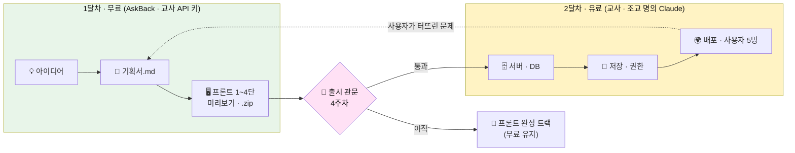
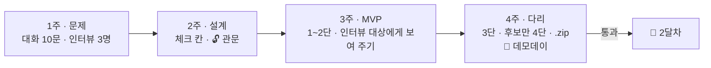

# 🚀 방학 2달 서비스 완성 과정 기획서 v1 — 한 달은 무료로 설계, 한 달은 유료로 출시

> **한 문장**: 1달차에는 AskBack(무료)으로 **기획서 + 프론트 페이지**까지 만든다. 그중 관문을 넘은 학생만 팀을 이뤄 2달차에 **유료 Claude**로 서버 · DB · 배포를 붙여 **실제 사용자가 쓰는 서비스**로 낸다.
>
> **위치**: [AskBack 교육과정 v1](AskBack_교육과정_기본용_심화용_v1.md)의 ⚡ **방학 집중형**(🏫 기본용 1달 + 🚀 심화용 1달). 출시 관문은 교육과정 §5.2 🚦 심화 관문과 맞춘다
> **짝 문서**: [바이브 코딩 수업 운영 기획서 v1 — 기획에서 미리보기까지](바이브코딩_수업_운영_기획서_v1_기획에서_미리보기까지.md)(1달차의 바탕) · [설계서 v4](AI_역질문_설계서_v4_설계를_묻고_기획서를_남긴다.md) · [서버 API · DB 설계서 v1](AI_역질문_서버_API_DB_설계서_v1.md)
> **기준일**: 2026-10-29. 요금 · 약관 · 무료 한도는 **구매하기 전에 그 시점의 공식 문서로 확인**한다. 이 문서는 숫자를 추측하지 않고 칸만 둔다.
>
> **다섯 기둥**
> - ① **무료로 거르고, 유료는 좁게**: 유료 비용은 기획서와 프론트가 검증된 팀에만 쓴다
> - ② **학생 계정은 끝까지 0개**: 유료 Claude도 **교사 · 기관 명의**로 산다. 미성년 학생은 개인 Claude 계정을 만들 수 없다
> - ③ **"서비스"의 뜻을 먼저 정한다**: 공개 주소 · 실제 사용자 5명 · 저장되는 데이터 · 1주 운영 기록
> - ④ **AskBack은 2달차에도 코치**: 기획서 v2(서버 칸)를 되묻고, Claude Code가 읽을 작업 문서를 만들어 준다
> - ⑤ **1달차 결과물을 버리지 않는다**: 1달차 Next.js .zip이 그대로 2달차의 출발 저장소가 된다

---

## 0. 결론 — 이 구성이 좋은가?

**좋다. 다만 한 가지를 바꿔야 한다.**

| 처음 생각 | 문제 | 바꾼 것 |
|---|---|---|
| 2달차에 Claude 유료를 구매해서 학생이 쓴다 | Claude.ai(Pro · Max 등 개인 요금제)는 **만 18세 이상**만 가입할 수 있다. 중고등학생은 개인 계정을 만들 수 없다 | 유료는 **교사 · 조교(성인) 명의**로 사고, 학생은 **팀 단위로 지시 · 검토**한다. 장기적으로는 AskBack 서버가 API 키로 코딩을 대신 돌린다 (§5) |
| 2달 뒤 모두가 서비스를 낸다 | 기획이 약한 팀에 유료 시간을 쓰면 비용만 들고 결과가 나오지 않는다 | 4주차 **출시 관문**을 넘은 학생만 팀을 이뤄 2달차 유료 트랙, 나머지는 프론트 완성 트랙 (§3) |
| 서비스 = 돌아가는 웹 | "돌아간다"는 기준이 사람마다 다르다 | **완성 기준 7가지**를 처음부터 공개한다 (§6) |

### 0.1 왜 "한 달 무료 → 한 달 유료" 순서인가



| 순서를 바꾸면 | 생기는 일 |
|---|---|
| 처음부터 유료 Claude Code | 1주차부터 "앱 만들어 줘"로 시작한다. 기획서 없이 코드만 쌓이고, 3주차에 방향을 바꾸면서 다 버린다 |
| 끝까지 무료 AskBack만 | 화면은 나오지만 서버 · DB · 배포가 없어서 **실제 사용자가 쓸 수 없다**. 목표인 "서비스"에 닿지 못한다 |
| **무료 → 관문 → 유료** | 유료 비용이 검증된 팀에만 들어간다. 2달차 1일차에 이미 화면 · 규칙 · 데이터 모양이 정해져 있다 |

---

## 1. 대상과 규모

| 항목 | 권장 | 이유 |
|---|---|---|
| 학생 | 중3~고2 · 반 24명 | 1달차는 개인, 2달차는 팀 |
| 팀 | 2달차에 **3명 1팀**, 최대 6팀 | 유료 좌석과 교사 손이 감당하는 수 |
| 일정 | 주 4일 × 하루 3시간 × 8주 ≈ 96시간 | 방학 집중 과정 |
| 운영진 | 교사 1 + **조교(성인) 1명당 2~3팀** | 2달차 유료 Claude를 실제로 운전하는 사람 |
| 형식 | 1달차는 다섯 형식 자유, **2달차는 💻 서비스 중심**. 🤖 제품은 하드웨어를 봐 줄 운영진이 있을 때만 | 서버 · DB · 배포가 붙는 형식. 하드웨어는 고장 대응 시간이 따로 든다 |

---

## 2. 1달차 — 기획 + 프론트 (무료)

1달차는 [교육과정 §4.4](AskBack_교육과정_기본용_심화용_v1.md)의 🌳 **확장 12차시**를 4주에 펼친 것이다. 사용자 인터뷰와 3단(데이터)이 들어 있다. 방학 과정은 바로 🚀 심화용으로 이어지므로, 4주차에 **4단(꾸미기)과 .zip(다리 꾸러미)** 까지 간다. 제작 단의 상세는 [수업 운영 기획서 v1](바이브코딩_수업_운영_기획서_v1_기획에서_미리보기까지.md) §4를 따른다.



| 주 | 목표 | AskBack에서 | AskBack 밖에서 | 주말 산출물 |
|---|---|---|---|---|
| 1주 | 문제 찾기 | 💡 아이디어 티키타카 · 대화 10문 · 1번째 리포트 | **진짜 사용자 3명 인터뷰** ("요즘 이걸 어떻게 해결하고 있어?") | 문제 한 줄 · 인터뷰 메모 |
| 2주 | 설계 | 체크 칸 4개 · 역질문 · 2번째 리포트 · 🔓 제작 관문 | 종이로 화면 흐름 그리기 | 기획서.md v1 |
| 3주 | 프론트 1~2단 | 🦴 뼈대 → ⚙️ 움직임 · 되묻기로 기획서 고치기 | 인터뷰했던 사람에게 미리보기 보여 주기 | 미리보기 v2 이상 |
| 4주 | 프론트 3단 + 관문 | 🔌 데이터 · **출시 트랙 후보만** 🎨 4단 · .zip | **데모데이** · 🚦 출시 관문 심사 | 기획서 · 미리보기 · 발표 3분 (후보는 + .zip) |

### 2.1 1달차에 꼭 남겨야 하는 것 — 📦 다리 꾸러미

[교육과정 §5.1 다리 꾸러미](AskBack_교육과정_기본용_심화용_v1.md)와 같다. 방학 과정에서 특히 중요한 세 가지는 아래와 같다.

| 꾸러미 | 담긴 것 | 2달차에서 |
|---|---|---|
| 📝 기획서.md | 체크 칸 4개 · 상태표 · 규칙 · 🫵 내가 정한 것 · 버린 대안 | 기획서 v2(서버 칸)의 출발점 · `CLAUDE.md`의 원본 |
| 🖥 프론트 .zip | 가짜 데이터로 모든 화면이 돌아가는 Next.js 프로젝트 | 저장소의 첫 커밋 |
| 🔌 데이터 한 줄의 모양 | 3단에서 정한 타입 | 그대로 DB 표가 된다 |

> 예 — 📚 **우리 반 문제집 공유** (가상 팀)
> - 문제 한 줄: "반 친구들이 같은 문제집을 따로 사고, 다 푼 책은 버린다"
> - 데이터 한 줄: `책 이름 · 과목 · 상태(새것/필기 조금/많음) · 빌려줄 사람 닉네임 · 빌린 사람 · 반납일`
> - 1달차 끝: 목록 · 등록 · 빌리기 버튼이 *가짜 데이터*로 돈다. 새로고침하면 localStorage에만 남는다
> - 2달차에 붙일 것: 반 친구끼리 같은 목록 보기(서버 · DB) · 누가 빌렸는지(권한) · 반납일 알림

---

## 3. 🚦 출시 관문 (4주차 데모데이)

> **출시 관문** = 교육과정의 🚦 **심화 관문**(필수 4개)에 방학 과정 추가 2개를 더한 것이다. 관문은 **개인이 받고**, 통과한 학생끼리 3명 1팀을 짠다.

### 3.1 기준 — 필수 4개 + 방학 과정 추가 2개

필수 4개는 [교육과정 §5.2 🚦 심화 관문](AskBack_교육과정_기본용_심화용_v1.md)과 같다. 방학 과정은 1달을 통째로 쓰므로 2개를 더 본다.

| # | 구분 | 기준 | 확인 방법 |
|---|---|---|---|
| 1 | 필수 | 프론트가 **2단(움직임) 이상**이다 | 미리보기 · 빌드 기록 |
| 2 | 필수 | 역질문에 🟢를 **3개 이상** 받았다 | 리포트 |
| 3 | 필수 | "다른 사람과 데이터를 **나눠야** 하는 이유"를 한 줄로 말한다 | 발표. 혼자 쓰는 앱이면 서버가 필요 없다 |
| 4 | 필수 | 2달차에 **하지 않을 것** 3가지를 적었다 | 기획서 「만들 범위 `scope`」 |
| 5 | 방학 추가 | 프론트가 3단(데이터)까지 갔다 | 미리보기 · 빌드 기록 |
| 6 | 방학 추가 | 인터뷰한 사용자 1명 이상이 미리보기를 써 봤다 | 짧은 영상이나 메모 |

> **필수 4개를 모두** 넘고, 방학 추가 2개 중 **1개 이상**이면 🚀 출시 트랙이다.

### 3.2 관문 뒤 두 트랙

| 트랙 | 누구 | 2달차에 하는 일 | 비용 |
|---|---|---|---|
| 🚀 **출시 트랙** | 관문을 통과한 학생 → 3명 1팀으로 묶음 | 서버 · DB · 배포 · 실제 사용자 | 유료 Claude + 호스팅 |
| 🎨 **프론트 완성 트랙** | 아직인 학생 | AskBack으로 기획서 v2 · 프론트 고도화 · 출시 팀의 **사용자 · 테스터** 역할 | 무료 유지 |

> 프론트 완성 트랙은 탈락이 아니다. 출시 팀의 첫 사용자가 되어 **버그 리포트를 쓰는 역할**을 맡는다. 출시 팀은 진짜 사용자를 얻고, 이 트랙은 "사용자의 눈"을 배운다.

---

## 4. 2달차 — 서비스로 (유료)

### 4.1 주차별

| 주 | 목표 | AskBack에서 (코치) | 유료 Claude에서 (제작) | 주말 산출물 |
|---|---|---|---|---|
| 5주 | 서버 설계 · 연결 | **기획서 v2 · 서버 칸** 되묻기 (§7) → 작업 문서 내보내기 | 1달차 .zip을 저장소로 · DB 표 · API 2개 · 프론트의 가짜 데이터를 API로 바꾸기 | 로컬에서 진짜 데이터로 도는 화면 |
| 6주 | 핵심 기능 · 권한 | "누가 무엇을 지울 수 있어?" 역질문 | 로그인(필요할 때만) · 권한 규칙 · 오류 화면 | 기능 3개 완성 |
| 7주 | 배포 · 베타 | "첫 사용자가 처음 10분에 막힐 곳은?" | 배포 · 환경 변수 · 간단한 사용 기록 | **공개 주소** · 사용자 5명 |
| 8주 | 고치기 · 운영 · 발표 | 사용자가 터뜨린 문제 → 기획서 고치기 · 마지막 리포트 | 버그 수정 · README | 데모데이 · 1주 운영 기록 |

### 4.2 하루(3시간)의 리듬 — 출시 트랙

| 시간 | 팀 | 조교 (유료 Claude 운전) |
|---|---|---|
| 0:00~0:30 | 어제 사용자 피드백 읽기 → AskBack에 "오늘 고칠 것 1개"를 묻고 기획서 고치기 | 어제 커밋 확인 |
| 0:30~2:00 | **작업 카드 1장**을 팀이 쓰고 조교와 함께 Claude Code로 실행. 학생이 키보드 앞에 앉아 지시하고, 결과는 셋이 함께 읽는다 | 위험한 명령 · 비밀 키 · 배포 승인만 직접 한다 |
| 2:00~2:40 | 직접 써 보기 · 짝 팀과 바꿔서 테스트 | 다른 팀 순회 |
| 2:40~3:00 | 커밋 메시지 쓰기 · 내일 작업 카드 초안 | 오늘 쓴 사용량 기록 |

> **"학생이 키보드 앞, 계정은 조교 명의"**: 계정 주인과 승인 책임은 성인에게 두고, 무엇을 만들지 정하고 지시하는 일은 학생이 한다.

---

## 5. 유료 Claude를 어떻게 살까

### 5.1 세 가지 길

| 길 | 어떻게 | 학생 계정 | 장점 | 단점 | 판단 |
|---|---|---|---|---|---|
| **A. 조교 · 교사 명의 구독 + Claude Code** | 조교 1명당 유료 좌석 1개, 2~3팀을 맡는다. 팀 작업은 각 팀 저장소에서 | 없음 | **이번 방학에 바로 가능**하다. 실제 업계 도구를 쓴다 | 조교 시간이 병목. 좌석 수만큼 팀 수가 정해진다 | ✅ **이번 방학 주 경로** |
| B. AskBack 서버가 API 키로 코딩 에이전트 실행 | 학생이 AskBack에서 작업 카드를 내면, 서버가 격리된 작업 공간에서 Claude로 코드를 고치고 미리보기 · 커밋 | 없음 | 학생이 직접 돌린다. 기록 · 한도 · 비용을 반 단위로 통제한다 | 개발량이 크다. 격리 실행 · 보안 설계가 필요하다 | 🔜 다음 방학 목표 |
| C. 학생 개인 구독 | 학생이 직접 Pro를 산다 | 필요 | 간단하다 | **만 18세 미만은 불가**. 대학생 · 성인반만 해당한다 | 성인반에만 |

### 5.2 구매 전에 확인할 것

- [ ] 그 시점 요금제별 가격과 **Claude Code 사용량 한도**. 하루 3시간 × 2~3팀이 한 좌석에서 버티는지 1주차에 측정한다
- [ ] 팀 · 기관 요금제의 **최소 좌석 수**, 월 단위로 끊을 수 있는지
- [ ] 미성년자가 **화면을 보며 지시**하는 방식이 약관상 문제없는지 기관 담당자와 확인
- [ ] API 키(학생 서비스 안의 AI 기능용)는 **구독과 따로 과금**된다는 점

### 5.3 비용

계산식 · 횟수 · 재는 법은 [교육과정 §11](AskBack_교육과정_기본용_심화용_v1.md)을 따른다. 방학 과정의 값은 아래와 같다.

| 항목 | 방학 과정의 값 | 계산 근거 |
|---|---|---|
| 1달차 AskBack API (교사 키) | 학생 24명 × 🌳 확장 12차시 횟수 | 교육과정 §11.3 (1명: 질문 35 · 역질문 17 · 제작 9) |
| 1달차 4단 · .zip | 출시 트랙 후보만 · 1명 제작 +2회 | 4단 꾸미기 1회 + 다시 1회 |
| 2달차 유료 좌석 (조교 명의) | 2~3석 × 1개월 | 조교 1명당 1석 |
| 학생 서비스 안의 AI 기능 API | 쓰는 팀만 · 팀별 월 상한 | 교육과정 §11.5 |
| 호스팅 · DB · 도메인 | 6팀 · 무료 한도로 시작 | 교육과정 §11.5 |
| **학생 1인당** | ( ) | 위 합계 ÷ 24 |

---

## 6. "서비스"의 완성 기준 (Definition of Done)

| # | 기준 | 왜 |
|---|---|---|
| 1 | **공개 주소**로 접속된다 (휴대폰에서) | "내 컴퓨터에서만 돼요"는 서비스가 아니다 |
| 2 | **실제 사용자 5명 이상**이 쓴 기록이 있다 | 팀원 · 선생님 · 프론트 완성 트랙 친구는 2명까지만 센다 |
| 3 | 데이터가 **서버에 저장**되고 다른 사람에게 보인다 | 서버가 필요한 이유 (관문 3번)를 증명한다 |
| 4 | 잘못된 입력 · 서버 오류에 **오류 화면**이 뜬다 | 첫 사용자는 반드시 이상하게 누른다 |
| 5 | **개인정보 최소화**: 실명 · 전화번호 · 주소를 받지 않는다 | 만 14세 미만 사용자의 정보는 법정대리인 동의가 필요하다. 처음부터 받지 않는 설계가 가장 쉽다 |
| 6 | **1주 운영 기록**: 사용자 수 · 터진 문제 · 고친 것 | 출시 후에 무엇을 배웠는지가 발표의 중심이다 |
| 7 | README + 기획서 v2가 저장소에 있다 | 다른 사람이 이어받을 수 있어야 끝난 것이다 |

---

## 7. 2달차의 AskBack — 기획서 v2 · 서버 칸

1달차 체크 칸 위에 **서버 칸 4개**를 더한다. 이 칸에서 Claude Code용 작업 문서가 나온다.

| 서버 칸 | 학생이 정할 것 | 역질문 예시 (📚 문제집 공유) |
|---|---|---|
| 🗄 **데이터 표** | 표 이름 · 칸 · 누가 만드나 | "책이 '빌려줌' 상태일 때 주인이 지우면 빌린 사람 화면에는 뭐가 보여야 해?" |
| 🔌 **API 목록** | 주소 · 누가 부르나 · 무엇을 돌려주나 | "목록 API가 반 전체 책을 다 주면, 다른 반 친구도 볼 수 있어?" |
| 🔐 **권한 규칙** | 누가 무엇을 보고 · 만들고 · 지우나 | "반납 버튼은 빌린 사람만? 주인도? 둘 다 누르면?" |
| 🚨 **운영 규칙** | 서버가 죽으면 · 이상한 글이 올라오면 · 반납일이 지나면 | "반납일을 3일 넘긴 사람에게 알림을 몇 번 보낼 거야? 누가 끄지?" |

### 7.1 기획서 → Claude Code 작업 문서

AskBack이 기획서 v2에서 두 파일을 만든다. 팀은 이 파일을 저장소에 넣고 Claude Code를 시작한다.

```
📦 우리반문제집/
├─ CLAUDE.md          ← AskBack이 생성: 목적 · 규칙 · 하지 않을 것 · 데이터 표 · 권한 규칙
├─ 기획서.md           ← 학생이 쓴 원본 (v2)
├─ tasks/
│  ├─ 05-1_DB표.md     ← 작업 카드: 할 일 1개 · 통과 기준 · 기획서 출처
│  ├─ 05-2_목록API.md
│  └─ …
└─ app/ …             ← 1달차 .zip 그대로
```

**작업 카드 한 장의 모양**

```md
# 05-2 목록 API
- 📝 출처: 기획서 v2 「API 목록」 1번 · 「권한 규칙」 2번
- 할 일: GET /api/books — 우리 반 책만, 최신순
- 통과 기준: 다른 반 코드로 부르면 빈 목록 / 책 0권이면 빈 목록과 안내 문구
- 하지 않을 것: 검색 · 페이지 나누기 (8주차 이후)
- 🙋 끝나면 AskBack에 물을 것: "책이 100권이 되면 이 API는 무엇부터 느려질까?"
```

> 작업 카드가 "할 일 1개 + 통과 기준 + 출처"로 되어 있으면 Claude Code가 범위를 넘지 않는다. 학생은 통과 기준으로 결과를 **스스로 검사**한다. 1달차의 "한 번에 한 단"이 2달차에는 "한 번에 카드 한 장"이 된다.

---

## 8. 기술 구성 — 1달차를 그대로 이어서

| 층 | 1달차 | 2달차 | 고른 이유 |
|---|---|---|---|
| 화면 | Next.js · React · Tailwind (가짜 데이터) | 같은 코드 + API 호출 | 버리는 코드가 없다 |
| 서버 | 없음 | Next.js Route Handlers (`app/api/…`) | 저장소 하나, 언어 하나 |
| DB | localStorage | 호스팅 DB의 무료 한도 (예: Postgres 계열) | 3단의 "데이터 한 줄"이 그대로 표가 된다 |
| 로그인 | 없음 | **필요한 팀만**. 반 코드 + 닉네임으로 시작 | 개인정보를 받지 않는다 (§6-5) |
| 배포 | 미리보기 | 무료 호스팅. **계정은 교사 · 기관 명의** | 학생 계정 0개 원칙. 무료 요금제의 비상업 조건을 확인한다 |
| AI 기능 (선택) | 없음 | 서버 환경 변수의 API 키 + 팀별 월 한도 | 키가 화면 코드에 들어가지 않게 한다 |

---

## 9. 위험과 대응

| 위험 | 신호 | 대응 |
|---|---|---|
| 조교 한 명에게 팀이 몰림 | 대기 줄이 생긴다 | 작업 카드를 전날 미리 받는다. 카드 없이 온 팀은 AskBack에서 카드부터 쓴다 |
| 유료 사용량 한도 초과 | 오후에 응답이 멈춘다 | 1주차(5주)에 팀당 하루 사용량을 측정해서 좌석을 늘리거나 시간을 나눈다 |
| Claude Code가 범위를 넘어 큰 변경 | 바뀐 파일이 많다 | 카드마다 커밋. 통과 기준을 못 넘으면 되돌린다. 조교가 승인한 뒤에만 합친다 |
| 비밀 키가 저장소에 올라감 | `.env`가 커밋됨 | 처음부터 `.gitignore`에 넣고, 키는 조교만 호스팅 설정에 넣는다 |
| 사용자를 못 구함 | 7주차에 사용자 0명 | 프론트 완성 트랙 친구 2명 + 1주차 인터뷰 대상 3명을 처음부터 "베타 사용자"로 약속 받아 둔다 |
| 서비스 내용이 부적절 | 남을 평가하거나 개인정보를 모으는 기능 | 관문 심사에서 기획서 「만들 범위」를 교사가 확인한다 |

---

## 10. AskBack에서 만들 것 — 방학 일정에 맞춘 마감

순서와 상태는 [교육과정 §7 기능 로드맵](AskBack_교육과정_기본용_심화용_v1.md)을 따른다. 방학 과정은 아래 **마감일**이 추가로 붙는다.

| 로드맵 차수 | 항목 | 방학 과정의 마감 | 왜 그때 |
|---|---|---|---|
| 1차 | 반 코드 · 일괄 토큰 · 반 예산 | 1달차 1주 전 | 24명이 첫날 접속한다 |
| 1차 | 🔓 제작 관문 | 1달차 2주 전 | 2주차에 관문을 연다 |
| 1차 | 1~2단 · 미리보기 | 1달차 3주 전 | 3주차가 1~2단 |
| 2차 | 3단 데이터 · 버전 비교 | 1달차 4주 전 | 4주차가 3~4단 |
| 3차 | 📦 다리 꾸러미 .zip | 1달차 4주 전 | 2달차의 출발 저장소 |
| 3차 | 🗄 서버 칸 · `CLAUDE.md` · 작업 카드 내보내기 | 2달차 5주 전 | 5주차 첫날 쓴다. 코드가 아니라 *문서 생성*이라 비용이 작다 |
| 4차 | 서버가 코딩 에이전트 실행 (§5.1 길 B) | 다음 방학 | 격리 실행 · 보안 설계 문서를 따로 쓴다 |

### 10.1 이번 방학 성공 기준

| 기준 | 목표 |
|---|---|
| 🚀 출시 트랙 | 6팀 중 **4팀**이 §6 완성 기준 7개를 모두 넘는다 |
| 💰 비용 | 학생 1인당 비용이 시작 전에 정한 상한 안에 든다. 상한은 §5.3 표를 [교육과정 §11.4](AskBack_교육과정_기본용_심화용_v1.md) 방법으로 채운 뒤 정한다 |
| 🎨 프론트 완성 트랙 | 학생 전원이 출시 팀에 버그 리포트를 **3개 이상** 낸다 |
