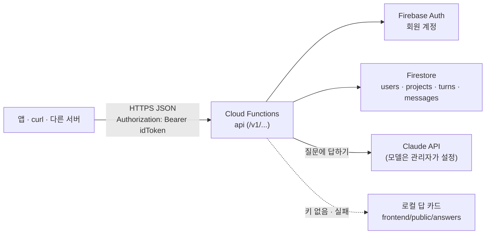
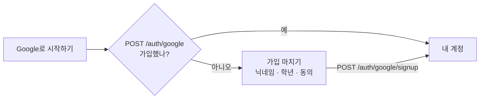
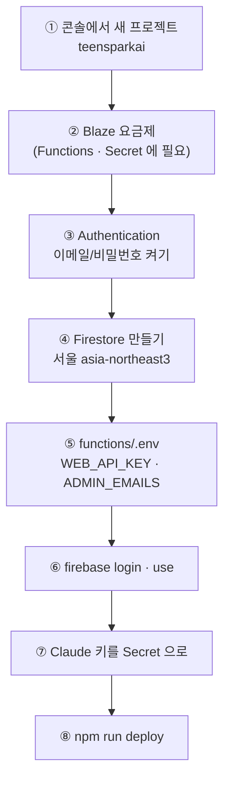

# 틴스파크AI 백엔드: Firebase REST API

Django 없이 **Google Firebase만으로** 돌아가는 서버입니다.

| 필요한 것 | 이 서버에서 맡는 곳 |
|---|---|
| 회원가입 · 로그인 · 토큰 | **Firebase Authentication** (이메일 + 비밀번호) |
| 회원 · 프로젝트 · 대화 · 사용량 저장 | **Cloud Firestore** |
| REST API · Claude 호출 | **Cloud Functions** (`api` 함수 하나, Express) |
| Claude API 키 | **Secret Manager** (`ANTHROPIC_API_KEY`) |



- 코치 규칙(`prompts.json`), 분석기(`analyzer.ts`), 출력 스키마(`schemas.ts`), 답 카드는 **프런트 파일을 그대로 번들에 넣습니다**. 고칠 곳은 `frontend/src` 한 곳뿐입니다.
- 브라우저는 Firestore에 직접 접근하지 못합니다(`firestore.rules`가 전부 막음). 읽기와 쓰기는 모두 이 API를 거칩니다.

---

## 1. 내 컴퓨터에서 바로 돌려 보기 (에뮬레이터)

Firebase 프로젝트나 결제 없이 Auth · Firestore · Functions를 로컬에서 그대로 띄웁니다. Java 21과 Node 22가 필요합니다.

```bash
cd firebase
npm install && npm --prefix functions install
cp functions/.env.example functions/.env.local          # ADMIN_EMAILS=admin@teenspark.test 처럼 채우기
cp functions/.secret.local.example functions/.secret.local   # Claude 키를 넣으면 진짜 Claude 가 답한다
npm run emulators
```

| 주소 | 내용 |
|---|---|
| `http://127.0.0.1:5001/demo-teenspark/asia-northeast3/api/v1` | REST API |
| `http://127.0.0.1:4000` | 에뮬레이터 UI (가입한 회원 · Firestore 문서 보기) |

다른 터미널에서 전체 흐름을 한 번에 시험합니다. 가입부터 질문, 관리자, 정지, 탈퇴까지 41개 항목입니다.

```bash
cd firebase && npm run smoke
```

> 콘솔(console.firebase.google.com)에는 에뮬레이터 프로젝트(`demo-teenspark`)가 보이지 않습니다. 진짜 프로젝트에 올리는 방법은 [4. 배포](#4-firebase-콘솔에-올리기-teensparkai)를 보세요.

---

## 2. API 한눈에

- 모든 경로 앞에 `/v1`이 붙습니다.
- 성공 응답은 `{ "data": … }`, 실패 응답은 `{ "error": { "code", "message", "details" } }`입니다.
- 🔒 표시는 `Authorization: Bearer <idToken>`이 필요한 경로이고, 👑 표시는 관리자 전용입니다.

### 회원가입 · 로그인

| 메서드 | 경로 | 하는 일 |
|---|---|---|
| POST | `/auth/signup` | 가입하고 곧바로 로그인 토큰 받기 |
| POST | `/auth/login` | 이메일 + 비밀번호로 토큰 받기 |
| POST | `/auth/refresh` | `refreshToken`으로 새 `idToken` 받기 (idToken은 1시간짜리) |
| POST 🔒 | `/auth/logout` | 모든 기기에서 로그아웃 (토큰 무효화) |
| POST | `/auth/password-reset` | 비밀번호 재설정 메일 보내기 |

가입할 때 받는 값:

| 칸 | 규칙 |
|---|---|
| `email` · `password` | 비밀번호는 8자 이상이고 영문과 숫자를 섞어야 합니다 |
| `nickname` · `grade` · `interests[]` | 코치가 답할 때 맥락으로 씁니다 |
| `under14` | 만 14세 미만이면 `true`로 보내고, 이때는 `guardianConsent: true`가 있어야 합니다 (개인정보 보호법 · 법정대리인 동의) |
| `agreeTerms` · `agreePrivacy` | 둘 다 `true`여야 가입됩니다 |

### Google 로그인 (프런트 `/account` 화면이 쓰는 길)

브라우저가 Firebase JS SDK로 Google 로그인(`signInWithPopup`)을 하고, 받은 ID 토큰을 `Authorization: Bearer`로 보냅니다. 비밀번호는 만들지 않습니다.

| 메서드 | 경로 | 하는 일 |
|---|---|---|
| POST 🔑 | `/auth/google` | 가입했으면 `{ registered: true, user }`, 처음이면 `{ registered: false, profile }` (→ 가입 화면) |
| POST 🔑 | `/auth/google/signup` | `nickname` · `grade` · `interests[]` · `under14` · `guardianConsent` · `agreeTerms` · `agreePrivacy`를 받아 회원 문서를 만든다 |

🔑 = Google로 로그인한 Firebase ID 토큰. 가입을 마치지 않은 Google 계정으로 다른 🔒 경로를 부르면 `403 signup_required`가 옵니다(동의 없이 회원 문서가 생기지 않게). Google 회원의 탈퇴(`DELETE /me`)는 비밀번호 대신 **5분 안에 다시 로그인했는지**로 확인합니다.



### 내 정보 🔒

| 메서드 | 경로 | 하는 일 |
|---|---|---|
| GET · PATCH | `/me` | 내 정보 보기 · 닉네임/학년/관심사 고치기 |
| POST | `/me/password` | 비밀번호 바꾸기 (`currentPassword` · `newPassword`). 다른 기기는 로그아웃됩니다 |
| GET | `/me/usage` | 오늘 질문 수 · 하루 한도 · 지난 7일 |
| DELETE | `/me` | 탈퇴 (`password`를 한 번 더 받음). 프로젝트와 대화도 전부 지웁니다 |

### 질문하기 🔒

| 메서드 | 경로 | 하는 일 |
|---|---|---|
| **POST** | **`/ask`** | **바로 묻기.** 처음 부르면 "빠른 질문" 프로젝트를 만들어 씁니다 (`projectId`를 보내면 그 프로젝트에서 묻습니다) |
| GET · POST | `/projects` | 프로젝트 목록 · 만들기 (`name` · `desc` · `emoji` · `format`) |
| GET · PATCH · DELETE | `/projects/{id}` | 조회 · 고치기 · 지우기 |
| **POST** | **`/projects/{id}/turns`** | **질문 하나.** 분석기 → 하루 한도 → Claude → 저장 (`text`, 사진 `images[]` 최대 3장) |
| GET | `/projects/{id}/turns` | 질문 기록 (열림 O1~O5 · 6요소 · 국면 포함) |
| GET | `/projects/{id}/messages?before=` | 대화 기록 (오래된 것은 `nextBefore`로 이어 읽기) |

`POST …/turns` 응답의 `outcome` 값은 셋 중 하나입니다.

| outcome | 뜻 | 함께 오는 것 |
|---|---|---|
| `answered` | 답했음 | `turn`(분석) · `answer`(md · 가정 · 학생이 정할 것 · 역할) · `source`(`claude`/`local`) · `model` · `usage` |
| `gated` | 잡담 · 사용법 · 같은 질문이라 Claude를 부르지 않음 | `coachMessage` |
| `emotional` | 마음이 힘든 신호. 1388 안내 | `coachMessage` |

`source: "local"`이면 `fallbackReason`에 Claude를 쓰지 못한 이유(`no_key` · `billing` · `timeout` · `refusal` …)가 담깁니다.

### 즉답 (스트리밍) 🔒

답이 다 만들어질 때까지 기다리지 않고, **글자가 생기는 대로** 받습니다. 요청 본문은 위와 같고, 응답은 Server-Sent Events(`text/event-stream`)입니다.

| 메서드 | 경로 |
|---|---|
| POST | `/ask/stream` |
| POST | `/projects/{id}/turns/stream` |

| 이벤트 | 언제 | data |
|---|---|---|
| `analysis` | 관문을 지나 답을 만들기 시작 (1초 안) | `{ analysis, model }` |
| `delta` | 답 글자가 생길 때마다 | `{ text }`: 이어 붙이면 전체 답(md) |
| `done` | 저장까지 끝남 | `POST …/turns`와 같은 결과 + `timing`. **화면은 이걸로 확정** |
| `error` | 시작한 뒤 실패 | `{ code, message }` |

잡담 · 같은 질문처럼 관문에 걸리면 `analysis`와 `delta` 없이 `done`만 옵니다. 입력 오류 · 404 · 하루 한도처럼 시작 전에 실패하면 보통의 JSON 오류로 옵니다.

실측 (2026-11-20, `claude-sonnet-5` · effort `low`):

| | 예전 (`/ask`, effort medium) | 즉답 (`/ask/stream`, effort low) |
|---|---|---|
| 첫 글자가 보이기까지 | 31초 (다 끝나야 보임) | **약 6초** |
| 답이 끝나기까지 | 31초 | 약 20초 |

```bash
API=https://asia-northeast3-teensparkai.cloudfunctions.net/api/v1 node scripts/stream-demo.mjs
```

브라우저에서는 `fetch`로 받아 읽습니다(`EventSource`는 POST를 못 보내요).

```js
const res = await fetch(`${API}/ask/stream`, { method: "POST", headers: { "Content-Type": "application/json", Authorization: `Bearer ${idToken}` }, body: JSON.stringify({ text }) });
const reader = res.body.pipeThrough(new TextDecoderStream()).getReader();
let buf = "";
for (;;) {
  const { value, done } = await reader.read();
  if (done) break;
  buf += value;
  for (let i; (i = buf.indexOf("\n\n")) >= 0; buf = buf.slice(i + 2)) {
    const block = buf.slice(0, i);
    const event = /^event: (.+)$/m.exec(block)?.[1];
    const data = JSON.parse(/^data: (.+)$/m.exec(block)?.[1] ?? "null");
    if (event === "delta") answerEl.textContent += data.text;
    if (event === "done") render(data); // 저장된 최종 결과
  }
}
```

### 관리자 👑

| 메서드 | 경로 | 하는 일 |
|---|---|---|
| GET | `/admin/users?email=&role=&status=&cursor=` | 회원 목록 · 검색 |
| GET | `/admin/users/{uid}` | 회원 상세 · 동의 기록 · 7일 사용량 |
| PATCH | `/admin/users/{uid}` | `role`(student/teacher/admin) · `status`(active/suspended) · `dailyLimit` · 닉네임 · 학년 |
| DELETE | `/admin/users/{uid}` | 회원과 데이터 삭제 |
| GET | `/admin/stats` | 회원 수 · 오늘 질문 수 · 토큰 |
| GET | `/admin/llm-calls?uid=` | Claude 호출 기록 (모델 · 토큰 · 캐시 · 걸린 시간 · 실패 이유) |

정지(`suspended`)하면 그 회원은 바로 로그아웃되고 다시 로그인할 수도 없습니다.

---

## 3. Claude 모델 설정 👑

설정은 Firestore `config/llm` 문서 한 개에 들어 있습니다. API로 바꾸면 **다시 배포하지 않아도 15초 안에** 반영됩니다.

| 메서드 | 경로 | 하는 일 |
|---|---|---|
| GET | `/admin/settings/llm` | 지금 설정 + API 키가 들어 있는지 |
| PATCH | `/admin/settings/llm` | 보낸 칸만 바꾸기 |
| POST | `/admin/settings/llm/test` | 저장하지 않고 한 번 답해 보기 (`text`, `override`) |
| POST | `/admin/settings/llm/reset` | 기본값으로 되돌리기 |
| GET | `/admin/models` | 쓸 수 있는 모델 목록 (키가 있으면 Anthropic Models API에서 최신 목록) |

| 칸 | 기본값 | 뜻 |
|---|---|---|
| `tasks.answer.model` | `claude-opus-5-5` (`ASKBACK_MODEL`, 지금 배포는 `claude-sonnet-5`) | 답하는 모델 (`claude-sonnet-5-5`, `claude-haiku-5-5`, `claude-fable-5-2` …) |
| `tasks.answer.effort` | `medium` (`ASKBACK_EFFORT`, 지금 배포는 `low`) | `low` · `medium` · `high` · `xhigh` · `max`. 높을수록 깊게 생각하고 느리고 비쌉니다 |
| `tasks.answer.maxTokens` | `16000` | 답 길이 상한 |
| `tasks.answer.timeoutMs` | `60000` | 이 시간 안에 답이 없으면 로컬 답 카드로 답합니다 |
| `enabled` | `true` | `false`면 Claude를 부르지 않습니다 |
| `fallbackToLocal` | `true` | Claude가 실패하면 로컬 답 카드로 답합니다. `false`면 503을 돌려줍니다 |
| `refusalFallback` | `true` | Claude가 답을 거절하면 Anthropic 서버가 다른 모델로 이어서 답합니다 (지원 모델만) |
| `dailyTurnLimit` | `60` | 회원 한 명의 하루 질문 수 (회원별 `dailyLimit`이 있으면 그쪽이 우선) |
| `historyMessages` | `12` | Claude에게 함께 보내는 이전 대화 수 |

예시: 모델을 Sonnet으로 바꾸고 effort를 낮추기

```bash
curl -s -X PATCH $API/admin/settings/llm -H "Authorization: Bearer $ADMIN" -H "Content-Type: application/json" \
  -d '{"tasks":{"answer":{"model":"claude-sonnet-5-5","effort":"low"}}}'
```

**관리자 만들기:** `ADMIN_EMAILS`에 적은 이메일로 가입하면 자동으로 관리자가 됩니다. 이미 가입한 사람은 다른 관리자가 `PATCH /admin/users/{uid}`에 `{"role":"admin"}`을 보내거나, Firestore 콘솔에서 `users/{uid}.role`을 `admin`으로 바꾸면 됩니다.

---

## 4. Firebase 콘솔에 올리기 (teensparkai)



| 단계 | 할 일 |
|---|---|
| ① | [console.firebase.google.com](https://console.firebase.google.com) → **새 Firebase 프로젝트 만들기** → 이름 `teensparkai`. 프로젝트 ID(예: `teensparkai-1a2b3`)를 적어 둡니다 |
| ② | 왼쪽 아래 **업그레이드 → Blaze**. Cloud Functions와 Secret Manager를 쓰려면 필요합니다 (사용한 만큼만 과금, 무료 할당량 있음) |
| ③ | **Authentication → 시작하기 → 로그인 방법 → 이메일/비밀번호** 사용 설정 |
| ④ | **Firestore Database → 데이터베이스 만들기** → 위치 `asia-northeast3 (서울)` · 프로덕션 모드 |
| ⑤ | **프로젝트 설정 → 일반 → 웹 API 키**를 복사해서 `functions/.env`에 적습니다 (`cp functions/.env.example functions/.env`). `ADMIN_EMAILS`에는 본인 이메일을 적습니다 |
| ⑥ | `cd firebase && npx firebase login` 후 `npx firebase use --add` 로 ①의 프로젝트를 고르고 별칭은 `default` |
| ⑦ | `npx firebase functions:secrets:set ANTHROPIC_API_KEY` → Claude API 키 붙여 넣기 |
| ⑧ | `npm run deploy` (함수 · Firestore 규칙 · 인덱스를 함께 올립니다) |

배포가 끝나면 API 주소는 다음과 같습니다.

```
https://asia-northeast3-<프로젝트ID>.cloudfunctions.net/api/v1/health
```

**지금 배포된 주소 (2026-11-20):** `https://asia-northeast3-teensparkai.cloudfunctions.net/api/v1`

Claude 키 자리에는 아직 `NOT_SET`이 들어 있습니다. 이 값이면 서버는 "키 없음"으로 보고 로컬 답 카드로 답해요(`/v1/health`의 `apiKeyConfigured: false`). 진짜 키로 바꾸려면 키를 넣고 다시 배포합니다.

```bash
npx firebase functions:secrets:set ANTHROPIC_API_KEY
npm run deploy
```

---

### 웹에서 부르기: Next rewrite (CORS 없음)

프런트(`teensparkai.com`, Vercel)는 API를 직접 부르지 않고 **같은 주소의 `/api/v1/...`**를 부릅니다. `frontend/next.config.ts`의 rewrite가 이 요청을 Cloud Functions로 넘기므로, 브라우저 입장에서는 같은 출처라 CORS 설정이 필요 없습니다.

| 브라우저가 부르는 주소 | 실제로 가는 곳 |
|---|---|
| `https://www.teensparkai.com/api/v1/auth/google` | `https://asia-northeast3-teensparkai.cloudfunctions.net/api/v1/auth/google` |

### Google 로그인 켜기 (콘솔에서 한 번)

| 단계 | 할 일 |
|---|---|
| ① | **Authentication → 로그인 방법 → 새 제공업체 추가 → Google** → 사용 설정, 지원 이메일 고르기 → 저장 |
| ② | **Authentication → 설정 → 승인된 도메인 → 도메인 추가**: `teensparkai.com`, `www.teensparkai.com` (미리보기 주소에서도 시험하려면 그 `*.vercel.app` 주소도) |
| ③ | `npm run deploy`: `/auth/google` 경로가 들어간 함수를 올린다 |

### 로컬에서 Google 가입까지 시험하기

```bash
cd firebase && npm run emulators        # 터미널 1
```

```bash
TEENSPARK_API=http://127.0.0.1:5001/demo-teenspark/asia-northeast3/api NEXT_PUBLIC_FIREBASE_EMULATOR=1 npm --prefix frontend run dev   # 터미널 2
```

`/account`에서 "Google로 시작하기"를 누르면 에뮬레이터의 가짜 Google 계정 창이 뜹니다(진짜 Google 계정 필요 없음).

---

## 5. curl로 써 보기

```bash
API=http://127.0.0.1:5001/demo-teenspark/asia-northeast3/api/v1   # 배포 후에는 위 주소

# 가입 → 토큰
TOKEN=$(curl -s -X POST $API/auth/signup -H "Content-Type: application/json" -d '{
  "email":"seoyeon@example.com","password":"teenspark123","nickname":"서연","grade":"중2",
  "interests":["스마트팜"],"under14":false,"agreeTerms":true,"agreePrivacy":true
}' | python3 -c "import json,sys;print(json.load(sys.stdin)['data']['tokens']['idToken'])")

# 질문하기
curl -s -X POST $API/ask -H "Authorization: Bearer $TOKEN" -H "Content-Type: application/json" \
  -d '{"text":"흙이 마르면 물을 주는 화분을 만들고 싶은데, 물을 너무 많이 주지 않으려면 어떤 방식이 좋을까?"}'
```

---

## 6. Firestore 구조

| 경로 | 내용 |
|---|---|
| `users/{uid}` | 이메일 · 닉네임 · 학년 · 관심사 · `role` · `status` · `dailyLimit` · 동의 시각 · 통계 |
| `users/{uid}/usage/{2026-11-20}` | 그날 질문 수 · 입력/출력 토큰 (한국 시간 자정에 새로 셈) |
| `users/{uid}/projects/{pid}` | 프로젝트 (프런트 `Project`와 같은 모양 + `turnCount`) |
| `…/projects/{pid}/turns/{tid}` | 질문 + 분석(열림 · 6요소 · 국면 · 개념) · 역할 · 모델 |
| `…/projects/{pid}/messages/{mid}` | 대화 (프런트 `Message`와 같은 모양: user · answer · coach) |
| `config/llm` | Claude 모델 설정 |
| `llmCalls/{id}` | Claude 호출 기록 |

## 7. 폴더

```
firebase/
├─ firebase.json · .firebaserc         에뮬레이터 · 배포 설정 (배포: teensparkai, 에뮬레이터: demo-teenspark)
├─ firestore.rules · firestore.indexes.json
├─ scripts/smoke.mjs                   전체 흐름 시험 (41개 항목)
└─ functions/
   ├─ build.mjs                         esbuild 로 lib/index.js 하나로 묶고 답 카드 복사
   └─ src/
      ├─ index.ts                       api 함수 (서울 리전 · Secret)
      ├─ app.ts                         Express · CORS · /v1 라우터 · /health
      ├─ routes/  auth · me · admin     회원가입 · 내 정보 · 회원 관리 · 모델 설정
      ├─ coach/   projects · turn       프로젝트 · 질문 하나가 지나가는 길
      ├─ llm/     claude · local · settings
      └─ lib/     firebase · http · identity · users
```

예전 `server/`(Django)는 이 서버와 상관없이 그대로 남아 있습니다. 이제 쓰지 않는다면 지워도 됩니다.
